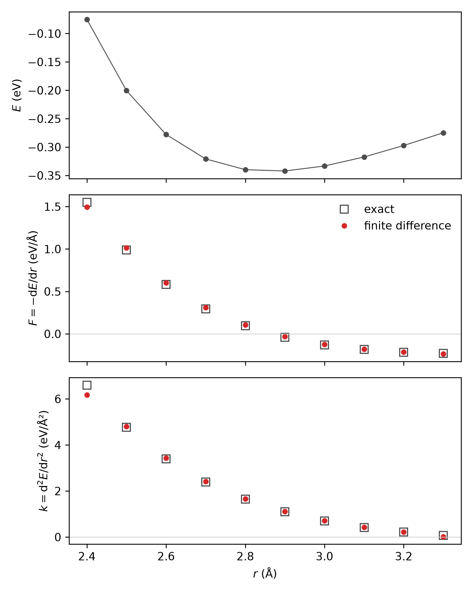
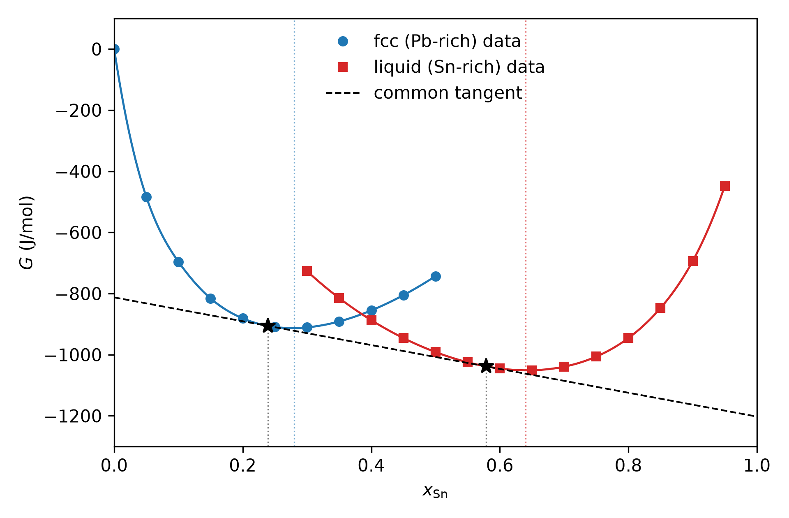

## Completed reference notebooks

- [Q2 · Force and stiffness of a Cu–Cu bond](https://tiangroup-uofa.github.io/mate374-cmpt-methods-mate/completed-notebooks/8f7c2e91/a4_q2_force_stiffness_completed.html)
- [Q4 · Common tangent for Pb–Sn solder at 500 K](https://tiangroup-uofa.github.io/mate374-cmpt-methods-mate/completed-notebooks/8f7c2e91/a4_q4_common_tangent_completed.html)

## Problem 1 · Short answers — 20 marks

### 1.1 A force that is always zero

The likely cause is loss of the increment when it is added to the stored `float64` position. For example, at \(x_0=3.2\) Å, the spacing between adjacent representable numbers is approximately \(4.44\times10^{-16}\) Å. Adding \(10^{-16}\) Å rounds back to the same stored position:

\[
\operatorname{fl}(x_0+\Delta x)=x_0.
\]

The program evaluates the energy at the same position twice, giving an energy difference of exactly zero and hence a computed force of zero. A larger step is needed, followed by a check that the calculated derivative is stable over a useful range of step sizes.

The spacing depends on the magnitude of \(x_0\), which the question does not specify. Rounding the two energies to the same value can also produce zero even if the stored positions differ. The essential issue is finite floating-point resolution.

### 1.2 Order of accuracy

**The claim is false.** Define the signed error as the finite-difference estimate minus the exact derivative. Taylor expansion gives

\[
\begin{aligned}
D_{\mathrm f}(h)-f'(x)
  &=\frac h2 f''(x)+\frac{h^2}{6}f'''(x)+O(h^3),\\
D_{\mathrm c}(h)-f'(x)
  &=\frac{h^2}{6}f'''(x)+O(h^4).
\end{aligned}
\]

The derivatives multiplying the powers of \(h\) matter. For \(f(x)=x^3\), the exact derivative is \(3x^2\), and the errors are exactly

\[
D_{\mathrm f}(h)-3x^2=3xh+h^2,\qquad
D_{\mathrm c}(h)-3x^2=h^2.
\]

| \(x\) | Exact \(f'(x)\) | Forward estimate, \(h=0.001\) | Forward error | Central estimate, \(h=0.01\) | Central error |
|--:|--:|--:|--:|--:|--:|
| 0 | 0 | 0.000001 | 0.000001 | 0.000100 | 0.000100 |
| 1 | 3 | 3.003001 | 0.003001 | 3.000100 | 0.000100 |

At \(x=0\), the central estimate has 100 times the error of the forward estimate. At \(x=1\), the central estimate is more accurate. Order describes how truncation error scales as \(h\) decreases for a given method and function. It does not by itself rank these two calculations at different step sizes.

## Problem 2 · Force and stiffness of a Cu–Cu bond — 25 marks

### 2.1 A derivative function

For equally spaced arrays with at least four points, the completed function is:

```python
import numpy as np

def first_second_derivative(x, y):
    h = x[1] - x[0]
    yd = np.empty(len(y))
    ydd = np.empty(len(y))

    yd[1:-1] = (y[2:] - y[:-2]) / (2 * h)
    yd[0] = (-3 * y[0] + 4 * y[1] - y[2]) / (2 * h)
    yd[-1] = (3 * y[-1] - 4 * y[-2] + y[-3]) / (2 * h)

    ydd[1:-1] = (y[2:] - 2 * y[1:-1] + y[:-2]) / h**2
    ydd[0] = (2 * y[0] - 5 * y[1] + 4 * y[2] - y[3]) / h**2
    ydd[-1] = (2 * y[-1] - 5 * y[-2] + 4 * y[-3] - y[-4]) / h**2
    return yd, ydd
```

The notebook check uses \(y=x^3\) at \(x=0,1,\ldots,5\). The second derivative must be \(6x\), giving \((0,6,12,18,24,30)\), including both end points. All three second-derivative formulas are exact for cubic polynomials.

### 2.2 Force and stiffness

Apply the function to the printed energy data with \(h=0.1\) Å:

```python
dE, k_fd = first_second_derivative(r_data, E_data)
F_fd = -dE
F_error = F_fd - F_exact
k_error = k_fd - k_exact
```

The signed errors below are **finite difference minus the supplied exact value**. Force columns are in eV/Å, and stiffness columns are in eV/Ų. Five decimal places are retained for force so that rounding does not obscure the value at 2.80 Å.

| \(r\) (Å) | \(F_{\mathrm{FD}}\) | Exact \(F\) | \(F\) error | \(k_{\mathrm{FD}}\) | Exact \(k\) | \(k\) error |
|--:|--:|--:|--:|--:|--:|--:|
| 2.40 | 1.49410 | 1.55100 | −0.05690 | 6.178 | 6.600 | −0.422 |
| 2.50 | 1.01370 | 0.98730 | +0.02640 | 4.804 | 4.765 | +0.039 |
| 2.60 | 0.60200 | 0.58240 | +0.01960 | 3.430 | 3.400 | +0.030 |
| 2.70 | 0.30990 | 0.29540 | +0.01450 | 2.412 | 2.390 | +0.022 |
| 2.80 | 0.10625 | 0.09560 | +0.01065 | 1.661 | 1.645 | +0.016 |
| 2.90 | −0.03240 | −0.04020 | +0.00780 | 1.112 | 1.100 | +0.012 |
| 3.00 | −0.12370 | −0.12930 | +0.00560 | 0.714 | 0.704 | +0.010 |
| 3.10 | −0.18070 | −0.18470 | +0.00400 | 0.426 | 0.419 | +0.007 |
| 3.20 | −0.21310 | −0.21590 | +0.00280 | 0.222 | 0.217 | +0.005 |
| 3.30 | −0.23530 | −0.23020 | −0.00510 | 0.018 | 0.077 | −0.059 |

For example, at 2.50 Å the interior formulas give

\[
\begin{aligned}
F_{\mathrm{FD}}
  &=-\frac{-0.27790-(-0.07516)}{0.2}
    =1.01370\ \mathrm{eV}/\text{Å},\\
k_{\mathrm{FD}}
  &=\frac{-0.07516-2(-0.20055)-0.27790}{0.1^2}
    =4.804\ \mathrm{eV}/\text{Å}^2.
\end{aligned}
\]

{width=70%}

Both **largest absolute errors occur at 2.40 Å**:

- Force: \(1.49410-1.55100=-0.05690\) eV/Å.
- Stiffness: \(6.178-6.600=-0.422\) eV/Ų.

The second-largest absolute force error is at 2.50 Å, whereas the second-largest absolute stiffness error is at 3.30 Å. The stiffness error at 3.30 Å is also large relative to its small exact value: \(0.059/0.077\approx77\%\).

### 2.3 A bracket for the equilibrium separation

The neighbouring finite-difference forces are

\[
F_{\mathrm{FD}}(2.80)=+0.10625,\qquad
F_{\mathrm{FD}}(2.90)=-0.03240\quad\mathrm{eV}/\text{Å}.
\]

Their opposite signs give the bracket

\[
\boxed{a=2.80\ \text{Å},\qquad b=2.90\ \text{Å}.}
\]

To refine the root, first provide a continuous force function between the tabulated points, for example by interpolating the finite-difference forces. Bisection can then evaluate this function at the midpoint and retain the half-interval whose end values have opposite signs. A bracketed solver such as `scipy.optimize.brentq` can use the same interval.

Alternatively, fit or interpolate the energy and solve for a zero of its negative derivative, after checking that this force function also changes sign across the bracket. The refined root depends on that interpolation or fit. The force changes from repulsive to attractive as \(r\) increases, consistent with a local energy minimum.

### 2.4 Improving the derivatives

The largest absolute mismatches are at the first point, on the steep repulsive side. Higher derivatives are large there, increasing the truncation error. The one-sided end formulas also have larger leading error coefficients than the interior formulas. The effect is especially visible for stiffness at both ends.

Reasoned proposals include:

- Obtain energies at smaller spacings to reduce truncation error, while keeping the energy precision sufficient for differentiation.
- Obtain extra points outside the current interval so that central formulas can be used at its ends.
- Use higher-order finite differences with enough neighbouring points.
- Fit a smooth physical model or interpolate the energy with a spline, then differentiate it. Assess the fit and the treatment of the end points.
- Use Richardson extrapolation if energies on compatible finer grids are available.

Printed energy rounding is also amplified by differentiation, particularly by division by \(h^2\) in the stiffness. A smaller step alone will eventually amplify rounding or numerical noise. This part is open-ended: a method with a sound explanation is acceptable.

## Problem 3 · Finite differences on an uneven grid — 20 marks

### 3.1 Taylor series

With all derivatives evaluated at \(x\),

\[
\begin{aligned}
f(x+h)
 &=f(x)+hf'(x)+\frac{h^2}{2}f''(x)
   +\frac{h^3}{6}f'''(x)+O(h^4),\\
f(x-2h)
 &=f(x)-2hf'(x)+2h^2f''(x)
   -\frac{4h^3}{3}f'''(x)+O(h^4).
\end{aligned}
\]

### 3.2 A three-point formula for this grid

Multiply the first expansion by 4 and subtract the second. The second-derivative terms cancel:

\[
4f(x+h)-f(x-2h)
 =3f(x)+6hf'(x)+2h^3f'''(x)+O(h^4).
\]

Subtract \(3f(x)\) and divide by \(6h\). Writing the resulting estimate as \(D_hf(x)\),

\[
D_hf(x)
 =\frac{4f(x+h)-3f(x)-f(x-2h)}{6h}
 =f'(x)+\frac{h^2}{3}f'''(x)+O(h^3).
\]

Thus the formula is **second order**. With error defined as estimate minus exact derivative, the leading term is \(+\tfrac{h^2}{3}f'''(x)\). Equivalently, solving for the exact derivative gives

\[
\boxed{
f'(x)=\frac{4f(x+h)-3f(x)-f(x-2h)}{6h}
       -\frac{h^2}{3}f'''(x)+O(h^3).
}
\]

The negative sign in this last equation is the correction added to the estimate. Either sign convention is acceptable when it is stated consistently.

### 3.3 Any spacing

**Equal spacing:** substitute \(h_l=h_r=h\):

\[
\begin{aligned}
D f(x)
 &=\frac{-h^2f(x-h)+(h^2-h^2)f(x)+h^2f(x+h)}
         {h^2(2h)}\\
 &=\frac{f(x+h)-f(x-h)}{2h}.
\end{aligned}
\]

This is the central difference. The supplied leading error becomes
\(\tfrac{h^2}{6}f'''(x)\), using the estimate-minus-exact convention.

**Left spacing twice the right spacing:** substitute \(h_l=2h\), \(h_r=h\):

\[
\begin{aligned}
D f(x)
 &=\frac{-h^2f(x-2h)+(h^2-4h^2)f(x)+4h^2f(x+h)}
         {(2h)h(3h)}\\
 &=\frac{4f(x+h)-3f(x)-f(x-2h)}{6h}.
\end{aligned}
\]

This is the result from 3.2. Its leading error is
\(\tfrac{(2h)h}{6}f'''(x)=\tfrac{h^2}{3}f'''(x)\), in agreement with the expansion above.

## Problem 4 · Phase separation in Pb–Sn solder — 35 marks

### 4.1 Interpolation

Use the composition and Gibbs-energy arrays supplied in the notebook:

```python
from scipy.interpolate import CubicSpline

G_fcc = CubicSpline(x_fcc, G_fcc_data)
G_liq = CubicSpline(x_liq, G_liq_data)
```

These calls use SciPy's default not-a-knot end conditions. The notebook's interpolation checks give

\[
G_{\mathrm{fcc}}(0.125)=-763.06087,\qquad
G_{\mathrm{liq}}(0.625)=-1049.97556\quad\mathrm{J/mol}.
\]

Each spline reproduces its supplied data at the tabulated compositions.

### 4.2 Slopes

A central difference with \(h=10^{-5}\) gives:

```python
h = 1e-5

def slope_fcc(x):
    return (G_fcc(x + h) - G_fcc(x - h)) / (2 * h)

def slope_liq(x):
    return (G_liq(x + h) - G_liq(x - h)) / (2 * h)
```

The requested slopes are

\[
\boxed{
G'_{\mathrm{fcc}}(0.2)=-882.24614\ \mathrm{J/mol},
\qquad
G'_{\mathrm{liq}}(0.6)=-266.74931\ \mathrm{J/mol}.
}
\]

Composition is dimensionless, so these slopes have units of J/mol. Direct differentiation of the cubic splines gives \(-882.246134\) and \(-266.749315\) J/mol, respectively, confirming the central-difference values. Other small step sizes giving consistent slopes are acceptable.

### 4.3 The common tangent

The two residuals compare the energy difference between the tangent points with the rise predicted by each phase's slope:

```python
from scipy.optimize import root

def tangent_residuals(p):
    alpha, beta = p
    gap = G_liq(beta) - G_fcc(alpha)
    r1 = gap - slope_fcc(alpha) * (beta - alpha)
    r2 = gap - slope_liq(beta) * (beta - alpha)
    return [r1, r2]

def solve_alpha_beta(alpha_guess, beta_guess):
    result = root(tangent_residuals, [alpha_guess, beta_guess])
    if not result.success:
        raise RuntimeError(result.message)
    alpha, beta = result.x
    return alpha, beta

alpha, beta = solve_alpha_beta(0.28, 0.64)
```

Starting near the two minima gives

\[
\boxed{\alpha=0.2394,\qquad\beta=0.5786.}
\]

These are tin mole fractions: the coexisting phases are approximately **23.94 mol% Sn in the fcc solid** and **57.86 mol% Sn in the liquid**.

| Initial \((\alpha,\beta)\) | Calculated \(\alpha\) | Calculated \(\beta\) |
|:--|--:|--:|
| (0.28, 0.64) | 0.23942075 | 0.57857214 |
| (0.25, 0.60) | 0.23942075 | 0.57857214 |
| (0.20, 0.70) | 0.23942075 | 0.57857214 |

Using the unrounded solution,

\[
\begin{aligned}
G_{\mathrm{fcc}}(\alpha)&\approx-905.90484\ \mathrm{J/mol},\\
G_{\mathrm{liq}}(\beta)&\approx-1038.15077\ \mathrm{J/mol},\\
G'_{\mathrm{fcc}}(\alpha)
 &\approx G'_{\mathrm{liq}}(\beta)
 \approx\frac{G_{\mathrm{liq}}(\beta)-G_{\mathrm{fcc}}(\alpha)}
               {\beta-\alpha}
 \approx-389.93185\ \mathrm{J/mol}.
\end{aligned}
\]

The common line is therefore approximately

\[
G_{\mathrm{tangent}}(x)=-812.54707-389.93185x
\quad\mathrm{J/mol}.
\]

{width=90%}

The line touches both splines and lies below them throughout their tabulated composition ranges. Between \(\alpha\) and \(\beta\), a mixture of these two phases has a lower molar Gibbs energy than either homogeneous phase at the overall composition.

A numerical check should use the unrounded compositions: both handout residuals are below \(10^{-5}\) J/mol for the three starts above. Solving independently with the analytical spline derivatives changes either composition by less than \(10^{-8}\). Check that the points are distinct, lie inside their respective data ranges, and give equal slopes. Because the residual equations were multiplied by \(\beta-\alpha\), a crossing with \(\alpha=\beta\) can also make both residuals vanish without defining a common tangent between two distinct phases.
