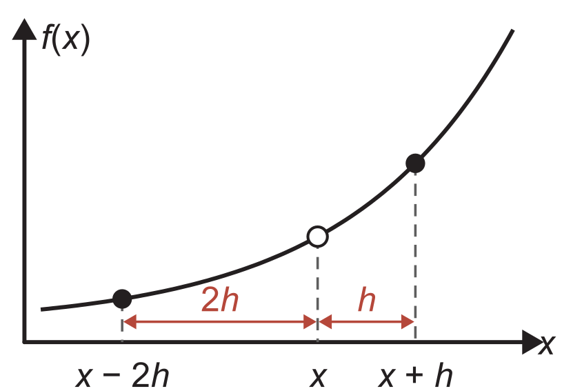
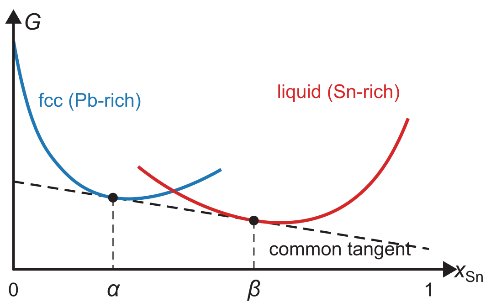

**Due:** Monday, November 16, 2026, at 11:59 am (after the reading week) via Canvas

::: {.content-visible when-format="html"}
[Download the PDF handout](index.pdf)
:::

Submit **one PDF answering all four problems**, including your code for Q2 and Q4, the requested figures, and short explanations. You may use [https://marimo.app](https://marimo.app) or your local Python environment for short calculations, and our provided notebooks for Q2 and Q4.

## Problem 1 · Short answers — 20 marks

Keep your answers concise. If you use AI to help with these questions, clearly state which model you used.

1. **A force that is always zero** (Lectures [3](https://tiangroup-uofa.github.io/mate374-cmpt-methods-mate/units/01/L03/index.html) and [18](https://tiangroup-uofa.github.io/mate374-cmpt-methods-mate/units/04/L18/index.html)). To calculate the force $F=-\partial E/\partial x$ between two atoms, a student writes a program that evaluates the energy $E$ at a position $x_0$ and at $x_0+\Delta x$, with positions stored in ångström as `float64`. With $\Delta x=10^{-16}$ Å, every force the program calculates is exactly zero, yet the student cannot find a bug in the code. What went wrong?

```{=latex}
\vspace{1em}
```

2. **Order of accuracy** ([Lecture 17](https://tiangroup-uofa.github.io/mate374-cmpt-methods-mate/units/04/L17/index.html)). In Lecture 17, we learned that the central difference for $f'(x)$ has a truncation error of $O(h^2)$, while the forward difference has $O(h)$. A student concludes that a central difference with $h=0.01$ is **always** more accurate than a forward difference with $h=0.001$, because $(0.01)^2=0.0001<0.001$. Is this true? **Hint:** Consider the exact form of each truncation error, and try $f(x)=x^3$ at $x=0$ and at $x=1$.

```{=latex}
\newpage
```

## Problem 2 · Force and stiffness of a Cu–Cu bond — 25 marks

In Unit 4, the force between two atoms is the negative derivative of their energy, $F=-\mathrm dE/\mathrm dr$, and the bond stiffness is the second derivative, $k=\mathrm d^2E/\mathrm dr^2$. Suppose an accurate quantum chemistry package gives the energy $E$ between two copper atoms at the separations $r$ in the table below, together with the exact force and stiffness at these separations.

| $r$ (Å) | $E$ (eV) | exact $F$ (eV/Å) | exact $k$ (eV/Ų) |
|---:|---:|---:|---:|
| 2.40 | −0.07516 | 1.5510 | 6.600 |
| 2.50 | −0.20055 | 0.9873 | 4.765 |
| 2.60 | −0.27790 | 0.5824 | 3.400 |
| 2.70 | −0.32095 | 0.2954 | 2.390 |
| 2.80 | −0.33988 | 0.0956 | 1.645 |
| 2.90 | −0.34220 | −0.0402 | 1.100 |
| 3.00 | −0.33340 | −0.1293 | 0.704 |
| 3.10 | −0.31746 | −0.1847 | 0.419 |
| 3.20 | −0.29726 | −0.2159 | 0.217 |
| 3.30 | −0.27484 | −0.2302 | 0.077 |

How close do finite differences of the energies alone come to the exact force and stiffness? The [Q2 notebook](https://tiangroup-uofa.github.io/mate374-cmpt-methods-mate/wasm-local/a4_q2_force_stiffness.html) contains this table.

### 2.1 A derivative function

For this question, we use the following finite-difference formulas, which all have a truncation error of $O(h^2)$. Here $y_0,\ldots,y_{n-1}$ are the data values with equal spacing $h$.

```{=latex}
\renewcommand{\arraystretch}{2.4}
```

| Point | First derivative | Second derivative |
|---|:-:|:-:|
| first point, $i=0$ | $\dfrac{-3y_0+4y_1-y_2}{2h}$ | $\dfrac{2y_0-5y_1+4y_2-y_3}{h^2}$ |
| interior points | $\dfrac{y_{i+1}-y_{i-1}}{2h}$ | $\dfrac{y_{i-1}-2y_i+y_{i+1}}{h^2}$ |
| last point, $i=n-1$ | $\dfrac{3y_{n-1}-4y_{n-2}+y_{n-3}}{2h}$ | $\dfrac{2y_{n-1}-5y_{n-2}+4y_{n-3}-y_{n-4}}{h^2}$ |

```{=latex}
\renewcommand{\arraystretch}{1}
```

The notebook's function `first_second_derivative(x, y)` already calculates the first derivative `yd` at every point. Your goal is to complete the second derivative `ydd` in the same way. A similar example is shown in [Lecture 18](https://tiangroup-uofa.github.io/mate374-cmpt-methods-mate/units/04/L18/index.html#derivatives-of-sampled-data-in-a-numpy-array). Include your code. The notebook checks your function automatically.

### 2.2 Force and stiffness

Use your function to calculate $F$ and $k$ at each separation. Report the notebook's table of your $F$ and $k$ with their errors from the exact values, together with the stacked plots of $E$, $F$, and $k$. At which separations do your $F$ and $k$ differ most from the exact values?

### 2.3 A bracket for the equilibrium separation

The most stable separation of the bond is where the force vanishes, $F=0$. In Unit 2, we found such roots by first bracketing them. From your finite-difference forces, report the two neighbouring separations $a$ and $b$ that bracket the root. Explain how you would use this bracket to start finding the root.

### 2.4 Improving the derivatives

Where are the mismatches between your finite-difference values and the exact $F$ and $k$ largest? Which methods can you think of to make these derivatives more accurate? This part is open-ended.

:::: {.content-visible when-format="html"}
::: {.quarto-wasm-local notebook="a4_q2_force_stiffness.edit.py" view="edit" title="A4 Q2 · Force and stiffness of a Cu–Cu bond from tabulated energies" height="1100" loading="lazy" fullscreen="true"}
The [Q2 notebook](https://tiangroup-uofa.github.io/mate374-cmpt-methods-mate/wasm-local/a4_q2_force_stiffness.html) holds the energy table, checks your second derivative, and compares your $F$ and $k$ with the exact values.
:::
::::

```{=latex}
\newpage
```

## Problem 3 · Finite differences on an uneven grid — 20 marks

The finite-difference formulas from Lecture 17 assume evenly spaced points. Data are often sampled more densely where a function changes quickly, so the neighbours of a point can sit at different distances. Consider a point $x$ whose left neighbour is $2h$ away and whose right neighbour is $h$ away. We want to derive an expression for the first derivative at $x$.

{width=32% fig-align="center" fig-alt="A rising curve sampled at x minus 2h, x, and x plus h. Red arrows mark the spacing 2h on the left and h on the right."}

### 3.1 Taylor series

Expand $f(x+h)$ and $f(x-2h)$ in Taylor series about $x$, up to the term containing $f'''(x)$.

### 3.2 A three-point formula for this grid

Combine your two expansions to eliminate $f''(x)$, and show that

$$
f'(x)\approx\frac{4f(x+h)-3f(x)-f(x-2h)}{6h}.
$$

State the leading truncation-error term and the order of the formula.

### 3.3 Any spacing

The same procedure works for any left spacing $h_l$ and right spacing $h_r$. It gives

$$
f'(x)\approx\frac{-h_r^2\,f(x-h_l)+\left(h_r^2-h_l^2\right)f(x)+h_l^2\,f(x+h_r)}{h_l\,h_r\,(h_l+h_r)},
$$

with leading truncation error $\tfrac{h_l h_r}{6}f'''(x)$. Show that this general formula reduces to our familiar forms:

- if $h_l=h_r=h$, it becomes the central difference;
- if $h_l=2h$ and $h_r=h$, it becomes the formula from 3.2.

```{=latex}
\newpage
```

## Problem 4 · Phase separation in Pb–Sn solder — 35 marks

Phase separation in A–B alloys is a common phenomenon in materials science. When an alloy has two possible phases, one A-rich and one B-rich, each phase has its own Gibbs free energy curve $G(x_{\mathrm B})$, where $x_{\mathrm B}$ is the mole fraction of B. When phase separation happens, there are two compositions, $\alpha$ and $\beta$, such that any alloy with $\alpha<x_{\mathrm B}<\beta$ does not mix and separates into the two phases. Numerically, $\alpha$ and $\beta$ are found from the **common tangent**: a straight line that is tangent to both $G$ curves.

We take the Pb–Sn alloy used in solders as an example. At 500 K, it has two phases: a Pb-rich fcc solid and a Sn-rich liquid. Our goal is a program that constructs the common tangent and reports the compositions of the two phases, that is, the values of $\alpha$ and $\beta$. The [Q4 notebook](https://tiangroup-uofa.github.io/mate374-cmpt-methods-mate/wasm-local/a4_q4_common_tangent.html) lists the Gibbs energies of both phases from the [NIST solder database](https://www.metallurgy.nist.gov/phase/solder/pbsn.html) against the mole fraction of tin, $x_{\mathrm{Sn}}$. The figure shows the intended result.

{width=60% fig-align="center" fig-alt="Blue fcc curve with a minimum near x equals 0.28 and red liquid curve with a minimum near 0.64. A dashed line touches the blue curve at alpha and the red curve at beta, with dashed guides down to the composition axis."}

### 4.1 Interpolation

Build an interpolation of the data for each phase with `scipy.interpolate.CubicSpline`, giving the functions `G_fcc(x)` and `G_liq(x)`. Include your code.

### 4.2 Slopes

Build the two slope functions `slope_fcc(x)` and `slope_liq(x)`, which return $\mathrm dG/\mathrm dx_{\mathrm{Sn}}$ from a central difference with a small step $h$ on your splines. The function `central(f, x, h)` from [Lecture 18](https://tiangroup-uofa.github.io/mate374-cmpt-methods-mate/units/04/L18/index.html#derivatives-of-a-python-function-at-a-point) can be used directly. Report the slopes $G'_{\mathrm{fcc}}(0.2)$ and $G'_{\mathrm{liq}}(0.6)$. You should get values close to $-882$ J/mol and $-267$ J/mol.

### 4.3 The common tangent

Solving the common-tangent problem requires a system of two equations for the two unknowns $\alpha$ and $\beta$. The straight line joining the points $(\alpha, G_{\mathrm{fcc}}(\alpha))$ and $(\beta, G_{\mathrm{liq}}(\beta))$ has the slope

$$
\frac{G_{\mathrm{liq}}(\beta)-G_{\mathrm{fcc}}(\alpha)}{\beta-\alpha}.
$$

For a common tangent, this slope must equal the slope of the fcc curve at $\alpha$ and the slope of the liquid curve at $\beta$. Multiplying by $\beta-\alpha$ gives the two equations to solve:

$$
\begin{aligned}
r_1(\alpha,\beta)&=G_{\mathrm{liq}}(\beta)-G_{\mathrm{fcc}}(\alpha)-G'_{\mathrm{fcc}}(\alpha)\,(\beta-\alpha)=0,\\
r_2(\alpha,\beta)&=G_{\mathrm{liq}}(\beta)-G_{\mathrm{fcc}}(\alpha)-G'_{\mathrm{liq}}(\beta)\,(\beta-\alpha)=0.
\end{aligned}
$$

A root-finding program such as `scipy.optimize.root` from [Lecture 14](https://tiangroup-uofa.github.io/mate374-cmpt-methods-mate/units/03/L14/index.html) needs both residuals as one function of the vector of unknowns. Write it step by step:

1. Define `tangent_residuals(p)`, where `p = [alpha, beta]`, and unpack the two unknowns with `alpha, beta = p`.
2. Calculate `r1` from `G_fcc`, `G_liq`, and `slope_fcc`.
3. Calculate `r2` from `G_fcc`, `G_liq`, and `slope_liq`.
4. Return both residuals as `[r1, r2]`.

Then complete `solve_alpha_beta(alpha_guess, beta_guess)`, which calls `root(tangent_residuals, [alpha_guess, beta_guess])` and returns `alpha, beta` from `result.x`. In the notebook, two sliders above the figure set the initial guesses for $\alpha$ and $\beta$. Start close to the minima of the two curves. Report $\alpha$ and $\beta$ to four decimal places, together with your code and the notebook figure.

:::: {.content-visible when-format="html"}
::: {.quarto-wasm-local notebook="a4_q4_common_tangent.edit.py" view="edit" title="A4 Q4 · Common tangent for Pb–Sn solder at 500 K" height="1100" loading="lazy" fullscreen="true"}
The [Q4 notebook](https://tiangroup-uofa.github.io/mate374-cmpt-methods-mate/wasm-local/a4_q4_common_tangent.html) lists the Gibbs energy data and guides the interpolation, slope, and root-finding steps, with a figure of both curves and the common tangent.
:::
::::
