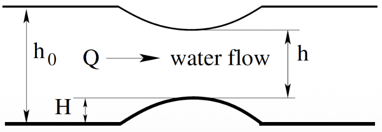

[Mock examination](midterm-mock.qmd) · [Sample solutions (PDF)](midterm-mock-solutions.pdf) · [Coding workspaces](midterm-workspaces.qmd)

## Exam information

|  | Details |
|---|---|
| **Date and time** | Friday, October 30, 2026 · 12:00–12:50 pm |
| **Location** | Same classroom as the lecture |
| **Course weight** | 20%, as listed in the [syllabus](../syllabus/index.qmd#assessment) |
| **Format** | Open book, with answers written on the answer sheet |

You may use Canvas materials, the course website, course notes, notebooks, assignment solutions, and official Python/API documentation. **Generative AI and communication with other people are not permitted during the exam.**

### What to bring

- A personal electronic device, preferably a laptop.
- A pen or pencil.
- A calculator, if you wish.
- Any printed materials you wish to consult, including your own formula sheet.

### What will be graded

**Only the answers written on the answer sheet will be graded.** Include your method, calculations, results, units, and any assumptions needed to understand your answer. A final answer without supporting steps or explanation may lose marks.

If you use code, upload it through Canvas. If you cannot upload it, write the key code on the answer sheet. Uploaded code is retained for record keeping, and **code quality is not graded**. Your answer sheet must contain the reasoning and results even when you upload code.

### Permitted solution methods

Follow any method specified in the question, such as “solve manually by Gaussian elimination.” Otherwise, choose a suitable approach:

1. **Pen and paper:** show the equations and solution steps.
2. **Calculator-assisted calculation:** record the algorithm's steps and intermediate values. You may use Python as a calculator.
3. **Python code:** identify the numerical method and the functions used, whether from NumPy, SciPy, or your own implementation.


### Formula sheets, searches, and interpretation

- There will be **no official formula sheet**.
- You may **bring your own formula sheet**.
- You can find formulas using the **course website's search tool**.
- **Search engines are permitted** for finding code documentation or debugging information.
- **Generative AI is forbidden**, including when searching or debugging. Do not use Gemini, ChatGPT, or coding agents to solve questions or write code.

If a question is unclear, **state your assumptions or interpretation on the answer sheet and proceed on that basis**. Do not ask anyone, including the instructor, for clarification of exam questions during the exam.

Asking for help if you cannot access the coding environment during the exam!

## Exam questions

The exam has **three questions**.

| Question | Focus | Points |
|---|---|---:|
| **Q1** | Two theoretical questions. Answer concisely. | **20** |
| **Q2** | A numerical problem involving root finding, minimization, interpolation, or fitting. | **40** |
| **Q3** | A numerical matrix problem. | **40** |

For Q2 and Q3, you may choose any suitable method unless the question specifies one. Any required iteration count, tolerance, or reporting precision will be stated in the question.

## Topics covered

The exam covers the **first three units**.

| Unit | Topics | Preparation page |
|---|---|---|
| [Unit 1 · Numerical thinking](../units/01/index.qmd) | Introduction to numerical methods, errors, and number representation. | [Summary and preparation](../units/01/summary.qmd) |
| [Unit 2 · Working with functions](../units/02/index.qmd) | Root finding, minimization, interpolation, and fitting. | [Summary and preparation](../units/02/summary.qmd) |
| [Unit 3 · Systems of equations](../units/03/index.qmd) | Linear and nonlinear systems, matrix operations, multidimensional optimization, and eigenvalues. | [Summary and preparation](../units/03/summary.qmd) |

[Assignment 1](../assignments/A1/index.qmd), [Assignment 2](../assignments/A2/index.qmd), and [Assignment 3](../assignments/A3/index.qmd) provide further practice. **Assignment solutions are permitted during the exam.**

## Example short-answer questions

We will discuss a brief Wooclap questionnaire during class, followed by examples from the 2025 midterm. Prepare a concise written explanation or a labelled sketch for each question.

### **Question 1: Reducing truncation error**

How can we reduce truncation error? Give one approach and identify a numerical calculation where it applies.

::: {.callout-note collapse="true"}
## **Example answer and rubric: Truncation error**

**Example answer:** Truncation error arises when a numerical approximation retains only a finite number of terms or uses a finite step size. For example, retaining more terms in a Taylor expansion can reduce the truncation error.

**Accepted approaches:** Any of the following is acceptable when paired with a suitable example:

- **Include more terms:** increase $n$ in the $\pi$ estimation or retain higher-order terms in a Taylor expansion.
- **Use a finer step size:** reduce the step size in numerical integration or differentiation.
- **Use a faster-converging approximation:** choose a model or numerical method that reaches the desired accuracy with fewer terms or steps.

**Grading note:** You do **not** need to discuss competition with round-off error for this question.
:::

### **Question 2: Fixed-point convergence**

For fixed-point iteration $x_{n+1}=g(x_n)$, state a sufficient condition for local convergence to a fixed point $x_s$, where $x_s=g(x_s)$. Assume $g$ is continuously differentiable near $x_s$ and the starting point is sufficiently close.

::: {.callout-note collapse="true"}
## **Example answer and rubric: Fixed-point convergence**

**Example answer:** A sufficient condition for local convergence is

$$
|g'(x_s)|<1.
$$

Under the stated assumptions, this makes $g$ a contraction in a sufficiently small neighbourhood of the fixed point, so nearby iterates approach $x_s$.

**Accepted graphical answer:** A cobweb sketch is also acceptable if it shows the correct shape of $g(x)$ relative to $y=x$ and successive iterates approaching their intersection.
:::

## Example long-form questions

The following questions are adapted from past exams. Each example includes a sample solution and code. We will discuss the solutions using live demonstrations and whiteboard calculations.

For each problem, work through the following questions:

- **What are the known quantities and unknowns?**
- **What are the governing equations?**
- **Which numerical topic does the problem involve?**
- **Which method would I choose, and why?**
- **How can I check the result against the equations or data?**
- **What are the potential caveats or limitations?**

### Example 1: Root finding for open-channel flow

Water flows through a rectangular channel of width $b$ over a small bump of height $H$. Bernoulli's equation gives

$$
\frac{Q^2}{2gb^2h_0^2}+h_0
=
\frac{Q^2}{2gb^2h^2}+h+H,
$$

where $h_0$ is the upstream water depth and $h$ is the depth measured from the top of the bump to the water surface.

{#fig-channel-flow width=75% fig-alt="Side view of water flowing to the right over a bump. h0 is measured from the upstream bed to the water surface, H from the upstream bed to the bump crest, and h from the crest to the water surface."}

| Quantity | Volume flow rate, $Q$ | Gravitational acceleration, $g$ | Channel width, $b$ | Upstream depth, $h_0$ | Bump height, $H$ |
|---|---|---|---|---|---|
| Value | $1.2\ \mathrm{m^3\,s^{-1}}$ | $9.81\ \mathrm{m\,s^{-2}}$ | $1.8\ \mathrm{m}$ | $0.6\ \mathrm{m}$ | $0.075\ \mathrm{m}$ |

Find the root for $h$ in the interval $[0.1,\,0.4]\ \mathrm{m}$ using any suitable root-finding method. This interval specifies which root to seek.

- **By hand or calculator:** show three iterations, including your starting value or bracket and the values needed for each update. Report the resulting estimate to four decimal places.
- **With Python:** solve to an absolute tolerance in $h$ of $10^{-6}\ \mathrm{m}$ or smaller, then report $h$ to four decimal places. Record your starting value or bracket and check the residual in Bernoulli's equation.

Keep extra digits during calculations. For the three-iteration route, four decimal places specify how to display the estimate, not a guarantee of four-decimal-place accuracy.

::: {.callout-note collapse="true"}
## **Example 1: Sample solution and Python code**

**1. Governing equation and unknown**

The unknown is the water depth $h$. With the other quantities fixed, write Bernoulli's equation as a residual:

$$
F(h)=\frac{Q^2}{2gb^2h_0^2}+h_0
-\frac{Q^2}{2gb^2h^2}-h-H=0.
$$

**2. Numerical method**

This is a nonlinear root-finding problem. Use **bisection** on the specified interval $[0.1,0.4]\ \mathrm{m}$. The residual is continuous on this interval and changes sign between its endpoints.

**3. Sample Python code**

The code below uses SciPy's bisection solver with its default tolerances, which are tighter than the requested $10^{-6}\ \mathrm{m}$.

```python
import scipy as sp

Q = 1.2
g = 9.81
b = 1.8
h0 = 0.6
H = 0.075

def residual(h):
    lhs = Q**2 / (2 * g * b**2 * h0**2) + h0
    rhs = Q**2 / (2 * g * b**2 * h**2) + h + H
    return lhs - rhs

solution = sp.optimize.root_scalar(
    residual, bracket=[0.1, 0.4], method="bisect"
)

print(solution)
print("Residual (m):", residual(solution.root))
```

**4. Result and residual check**

The solver reports convergence after **38 iterations**, giving

$$
h=0.2647552633901796\ \mathrm{m}
\quad\Rightarrow\quad
\boxed{h=0.2648\ \mathrm{m}}.
$$

At the unrounded root, $F(h)\approx3.95\times10^{-13}\ \mathrm{m}$, so the two sides of Bernoulli's equation agree to the solver's numerical accuracy.

**5. Physical interpretation**

The specified bracket selects the shallower, supercritical root. The equation also has a subcritical root near $0.4958\ \mathrm{m}$, which is consistent with the smooth flow over the bump shown in the sketch. Selecting the physically appropriate branch requires considering the upstream flow conditions as well as solving the equation.
:::

### Example 2: Newton–Raphson for a pressure–volume relation

Nitrogen at $T=300\ \mathrm{K}$ is stored in a vessel. For this exercise, use the supplied pressure–volume model

$$
P=\frac{0.5T}{V+0.1}-\frac{5}{V^2},
$$

with $P$ in atmospheres and $V$ in litres. The constants carry the units needed for these inputs: $0.5\ \mathrm{atm\,L\,K^{-1}}$, $0.1\ \mathrm{L}$, and $5\ \mathrm{atm\,L^2}$.

Find the volume at $P=50\ \mathrm{atm}$ using **Newton–Raphson**, starting from $V_0=1\ \mathrm{L}$.

- **By hand or calculator:** write the residual equation and its derivative, then show three updates to obtain $V_1$, $V_2$, and $V_3$. Report $V_3$ to four decimal places.
- **With Python:** use Newton–Raphson with the derivative. Continue until both $|V_{n+1}-V_n|<10^{-6}\ \mathrm{L}$ and the absolute pressure residual is below $10^{-6}\ \mathrm{atm}$. Report the converged volume to four decimal places.

Keep extra digits during the updates. Check that the returned volume is positive and that the model is defined at every iterate.

::: {.callout-note collapse="true"}
## **Example 2: Sample solution and Python code**

**1. Governing equation and unknown**

The unknown is the volume $V$. Substitute $T=300\ \mathrm{K}$ and $P=50\ \mathrm{atm}$ into the supplied model and form the pressure residual:

$$
F(V)=\frac{150}{V+0.1}-\frac{5}{V^2}-50=0.
$$

**2. Numerical method**

Use **Newton–Raphson**, as required. Differentiate the residual:

$$
F'(V)=-\frac{150}{(V+0.1)^2}+\frac{10}{V^3}.
$$

Starting from $V_0=1\ \mathrm{L}$, calculate successive volumes using

$$
V_{n+1}=V_n-\frac{F(V_n)}{F'(V_n)}.
$$

**3. Three updates by hand or calculator**

The values below are displayed to four decimal places. Keep extra digits when calculating each update.

| Step $n$ | 0 | 1 | 2 | 3 |
|---|---:|---:|---:|---:|
| $V_n$ (L) | 1.0000 | 1.7139 | 2.4247 | 2.7997 |
| $F(V_n)$ (atm) | 81.3636 | 30.9916 | 8.5624 | 1.0909 |
| $F'(V_n)$ (atm/L) | -113.9669 | -43.6021 | -22.8311 | -17.3835 |

For example, the first update is

$$
V_1=1-\frac{81.363636\ldots}{-113.966942\ldots}
=1.713923\ldots\ \mathrm{L}.
$$

After three updates, **$V_3=2.7997\ \mathrm{L}$**. The remaining pressure residual is about $1.09\ \mathrm{atm}$, so further updates are needed for the converged Python result.

**4. Sample Python code**

```python
import scipy as sp

T = 300.0
P = 50.0

def F(V):
    return 0.5 * T / (V + 0.1) - 5 / V**2 - P

def F_prime(V):
    return -0.5 * T / (V + 0.1)**2 + 10 / V**3

solution = sp.optimize.root_scalar(
    F, x0=1.0, fprime=F_prime, method="newton"
)

print(solution)
print("Residual (atm):", F(solution.root))
```

**5. Converged result and checks**

With SciPy's default tolerances, the solver converges after **7 iterations**:

$$
V=2.8638628691278303\ \mathrm{L}
\quad\Rightarrow\quad
\boxed{V=2.8639\ \mathrm{L}}.
$$

The default step tolerance is tighter than $10^{-6}\ \mathrm{L}$, and the residual evaluated at the unrounded root is **$0.0\ \mathrm{atm}$** in this floating-point calculation. All iterates remain positive and avoid the model's singularities at $V=0$ and $V=-0.1$.
:::

### Example 3: Interpolation or polynomial fitting

The electrical power generated by a wind turbine was measured at five wind speeds:

| Wind speed (mph) | 12 | 20 | 28 | 36 | 44 |
|---|---|---|---|---|---|
| Electrical power (W) | 320 | 490 | 540 | 500 | 480 |

Estimate the power at a wind speed of **30 mph** using either an interpolation method or a polynomial least-squares fit.

State the method, including the polynomial degree if relevant, and which data points you use. Show enough working or function inputs to reproduce your estimate. Explain one limitation of the estimate and whether your chosen curve must pass through the measurements.

::: {.callout-note collapse="true"}
## **Example 3: Worked solution**

**1. Unknown and governing relation**

The unknown is the power $P$ at $v=30\ \mathrm{mph}$. We have five measured pairs $(v,P)$ rather than a governing equation. Power rises and then falls, so a single straight line through the full dataset would miss the curvature.

**2. Which method or model?**

- **Interpolation:** use linear interpolation, a cubic spline, or PCHIP. PCHIP uses piecewise cubic curves that preserve the rising or falling trend between neighbouring measurements.
- **Polynomial fitting:** choose a model such as $P(v)=a_0+a_1v+a_2v^2$ and fit its coefficients to all five points by least squares.

**3. Hand solution: Linear interpolation**

Use the two neighbouring points $(28,540)$ and $(36,500)$. Equal slopes along the straight line give

$$
\frac{P(30)-540}{30-28}=\frac{500-540}{36-28}.
$$

Therefore,

$$
P(30)=540+\frac{30-28}{36-28}(500-540)
=\boxed{530\ \mathrm{W}}.
$$

This assumes a linear variation in power between 28 and 36 mph.

**4. Python solution: Interpolation or polynomial fitting**

```python
import numpy as np
import scipy as sp

v = np.array([12, 20, 28, 36, 44])
P = np.array([320, 490, 540, 500, 480])

interp = sp.interpolate.PchipInterpolator(v, P)
interp(30.0)

pow_fit = np.polynomial.Polynomial.fit(v, P, deg=2)
pow_fit(30.0), np.sum((pow_fit(v) - P)**2)
```

PCHIP gives **$P(30)=535.0\ \mathrm{W}$**. Replacing PchipInterpolator with CubicSpline, using its default boundary conditions, gives **$535.2344\ \mathrm{W}$**.

The quadratic fit is

$$
P(v)=6.392857+33.5v-0.52455357v^2,
$$

giving **$P(30)=539.2946\ \mathrm{W}$**. Changing the polynomial degree gives:

| Polynomial degree | 2 | 3 | 4 |
|---|---:|---:|---:|
| $P(30)$ (W) | 539.2946 | 529.5603 | 535.5078 |
| Sum of squared residuals ($\mathrm{W^2}$) | 2051.4286 | 91.4286 | $\approx0$ |

**5. Interpretation**

The interpolants pass through the measurements. The quadratic and cubic least-squares fits need not. A degree-4 polynomial has five coefficients and can pass through all five points, but its nearly zero fitting error does not establish accuracy between them. It may also follow measurement noise. State which method you used because the estimates depend on the assumed curve.
:::

### Example 4: Fitting a growth-rate model

An experiment measured bacterial growth rate $k$ at three oxygen concentrations $c$:

| Oxygen concentration, $c$ | 0.5 | 1.5 | 2.5 |
|---|---|---|---|
| Growth rate, $k$ | 1.085 | 3.572 | 4.400 |

Use the model

$$
k(c)=\frac{k_{\max}c^2}{c_s+c^2},
$$

where $k_{\max}$ and $c_s$ are positive parameters. Use the numerical scales in the table. The parameter $k_{\max}$ has the same units as $k$, and $c_s$ has the units of $c^2$.

Determine $k_{\max}$ and $c_s$ using either of these approaches:

- **By hand or calculator:** rearrange the model into a straight-line relation, perform linear least-squares fitting on the transformed data, and recover the original parameters.
- **With Python:** use `scipy.optimize.curve_fit` or `scipy.optimize.minimize` to minimize the sum of squared differences between the predicted and measured growth rates. State your starting parameter values and how you keep the parameters positive.

State which residuals your fit minimizes. The two approaches minimize errors on different scales and can give different parameter estimates. Retain at least four decimal places during hand calculations, and report the fitted parameters and predicted growth rates at the three measured concentrations.


::: {.callout-note collapse="true"}
## **Example 4: Worked solution**

**1. Unknowns and governing model**

The concentrations $c$ and growth rates $k$ are known. The unknown parameters are **$k_{\max}$ and $c_s$** in

$$
k(c)=\frac{k_{\max}c^2}{c_s+c^2}.
$$

**2. Which method?**

This is a **curve-fitting problem**. We can transform the model into a straight line for a hand calculation, or fit the original model directly using **curve_fit** or **minimize**.

**3. Hand solution: Transform to a straight line**

Taking reciprocals gives

$$
\frac{1}{k}=\frac{c_s+c^2}{k_{\max}c^2}
=\frac{1}{k_{\max}}+\frac{c_s}{k_{\max}}\frac{1}{c^2}.
$$

Set $X=1/c^2$ and $Y=1/k$. Then $Y=a+bX$, where

$$
a=\frac{1}{k_{\max}},\qquad b=\frac{c_s}{k_{\max}}.
$$

| $c$ | 0.5 | 1.5 | 2.5 |
|---|---:|---:|---:|
| $X=1/c^2$ | 4.000000 | 0.444444 | 0.160000 |
| $Y=1/k$ | 0.921659 | 0.279955 | 0.227273 |

For the three points, define $S_X=X_1+X_2+X_3$, $S_Y=Y_1+Y_2+Y_3$, $S_{XX}=X_1^2+X_2^2+X_3^2$, and $S_{XY}=X_1Y_1+X_2Y_2+X_3Y_3$. Using unrounded data,

$$
S_X=4.604444\ldots,\quad S_Y=1.428887\ldots,\quad
S_{XX}=16.223131\ldots,\quad S_{XY}=3.847424\ldots.
$$

The least-squares slope and intercept are

$$
b=\frac{3S_{XY}-S_XS_Y}{3S_{XX}-S_X^2}
=0.18068132\ldots,\qquad
a=\frac{S_Y-bS_X}{3}=0.19898328\ldots.
$$

Recover the parameters:

$$
\boxed{k_{\max}=\frac{1}{a}=5.025548,\qquad
c_s=\frac{b}{a}=0.908023.}
$$

**4. Python solution: Fit the original model**

Use **curve_fit** with starting values $(k_{\max},c_s)=(5,1)$. Nonnegative bounds restrict the search, and the fitted values are strictly positive.

```python
import numpy as np
import scipy as sp

c = np.array([0.5, 1.5, 2.5])
k = np.array([1.085, 3.572, 4.400])

def model(c, kmax, cs):
    return kmax * c**2 / (cs + c**2)

params, cov = sp.optimize.curve_fit(
    model, c, k, p0=[5, 1], bounds=(0, np.inf)
)

params
model(c, *params)
```

The direct fit gives

$$
\boxed{k_{\max}=5.041045,\qquad c_s=0.918408.}
$$

**5. Predicted growth rates**

| $c$ | 0.5 | 1.5 | 2.5 |
|---|---:|---:|---:|
| Measured $k$ | 1.085000 | 3.572000 | 4.400000 |
| Transformed linear fit | 1.084942 | 3.580558 | 4.388038 |
| Direct fit | 1.078614 | 3.579827 | 4.395192 |

The hand calculation minimizes squared residuals in **$1/k$**, while the direct fit minimizes squared residuals in **$k$**. These different objectives explain the different parameter estimates. The units of $k_{\max}$ are those of $k$, and the units of $c_s$ are those of $c^2$.
:::

### Example 5: A linear system for circuit currents

Four loop currents $i_1$, $i_2$, $i_3$, and $i_4$ in a resistor network satisfy

$$
\begin{pmatrix}
r_1+r_2+r_4 & -r_2 & 0 & -r_4\\
-r_2 & r_2+r_3+r_5 & -r_5 & 0\\
0 & -r_5 & r_5+r_6+r_7 & -r_6\\
-r_4 & 0 & -r_6 & r_4+r_8+r_6
\end{pmatrix}
\begin{pmatrix}i_1\\i_2\\i_3\\i_4\end{pmatrix}
=
\begin{pmatrix}V_1\\0\\-V_2\\0\end{pmatrix}.
$$

Use $V_1=15\ \mathrm{V}$, $V_2=45\ \mathrm{V}$, and the following resistances:

| Resistance | $r_1$ | $r_2$ | $r_3$ | $r_4$ | $r_5$ | $r_6$ | $r_7$ | $r_8$ |
|---|---|---|---|---|---|---|---|---|
| Value ($\Omega$) | 5 | 10 | 4 | 6 | 7 | 9 | 17 | 65 |

Determine the four currents using any suitable method. Write the numerical matrix and right-hand-side vector, identify your solution method, and report the currents in amperes. Verify your result by substituting it into the system. A negative current indicates flow opposite to the reference direction used in the equations.


::: {.callout-note collapse="true"}
## **Example 5: Worked solution**

**1. Unknowns and governing equations**

The unknowns are the four currents **$i_1,i_2,i_3,i_4$**. Substitute the resistances and voltages into the supplied equations:

$$
\underbrace{\begin{pmatrix}
21&-10&0&-6\\
-10&21&-7&0\\
0&-7&33&-9\\
-6&0&-9&80
\end{pmatrix}}_{\mathbf A}
\underbrace{\begin{pmatrix}i_1\\i_2\\i_3\\i_4\end{pmatrix}}_{\mathbf i}
=
\underbrace{\begin{pmatrix}15\\0\\-45\\0\end{pmatrix}}_{\mathbf b}.
$$

**2. Which method?**

This is a **linear system**, $\mathbf A\mathbf i=\mathbf b$. Gaussian elimination or LU decomposition can solve it. Here, use NumPy's **linalg.solve**, an LU-based direct solver.

**3. Python solution**

```python
import numpy as np

A = np.array([
    [21, -10, 0, -6],
    [-10, 21, -7, 0],
    [0, -7, 33, -9],
    [-6, 0, -9, 80]
], dtype=float)
b = np.array([15, 0, -45, 0], dtype=float)

i = np.linalg.solve(A, b)
i
A @ i - b
```

**4. Result and substitution check**

$$
\boxed{\mathbf i=
\begin{pmatrix}
0.584889\\
-0.200960\\
-1.438434\\
-0.117957
\end{pmatrix}\ \mathrm{A}.}
$$

Using the unrounded currents, every component of $\mathbf A\mathbf i-\mathbf b$ is below $10^{-14}\ \mathrm{V}$ in magnitude. The negative values of $i_2,i_3,i_4$ indicate flow opposite to their reference directions.
:::

### Example 6: A nonlinear system

Solve the coupled equations

$$
\begin{aligned}
f_1(x,y)&=x^2+2x+2y^2-25=0,\\
f_2(x,y)&=2x^3-y^2+4y-20=0.
\end{aligned}
$$

Use the starting point $(x_0,y_0)=(1,1)$. You may use a library solver or your own implementation of a suitable nonlinear-system method.

State the method and starting point, report the computed solution, and evaluate both residuals at the unrounded solution. Require $|f_1|<10^{-6}$ and $|f_2|<10^{-6}$ before rounding the reported coordinates to four decimal places.

For discussion: how might a different starting point affect the result? What would you examine if the solver reported failure or returned a point with a large residual?

::: {.callout-note collapse="true"}
## **Example 6: Worked solution**

**1. Unknowns and governing equations**

The unknowns are **$x$ and $y$**, which must satisfy both equations simultaneously:

$$
\begin{aligned}
f_1(x,y)&=x^2+2x+2y^2-25=0,\\
f_2(x,y)&=2x^3-y^2+4y-20=0.
\end{aligned}
$$

**2. Which method?**

This is a **nonlinear system**. Use SciPy's **root** solver with the starting point $(1,1)$. Its hybrid method combines Newton-type steps with controls on the step size. The function supplied to the solver returns both residuals.

**3. Python solution**

```python
import scipy as sp

def F(values):
    x, y = values
    return [
        x**2 + 2*x + 2*y**2 - 25,
        2*x**3 - y**2 + 4*y - 20
    ]

solution = sp.optimize.root(F, [1, 1], method="hybr")
solution
F(solution.x)
```

**4. Result and residual check**

The solver reports convergence to

$$
\boxed{x=2.0331,\qquad y=2.8983.}
$$

At the unrounded solution,

$$
f_1\approx1.07\times10^{-11},\qquad
f_2\approx1.02\times10^{-11},
$$

so both residuals satisfy the $10^{-6}$ requirement.

A different starting point may lead to another root or fail to converge. If residuals remain large, check the equations entered, the starting point, and the relative scales of the variables before interpreting the returned values.
:::
