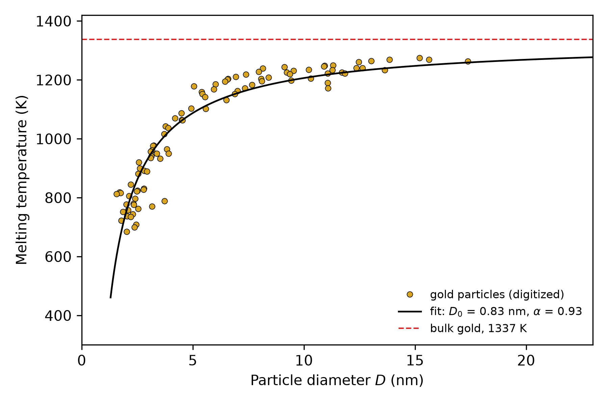
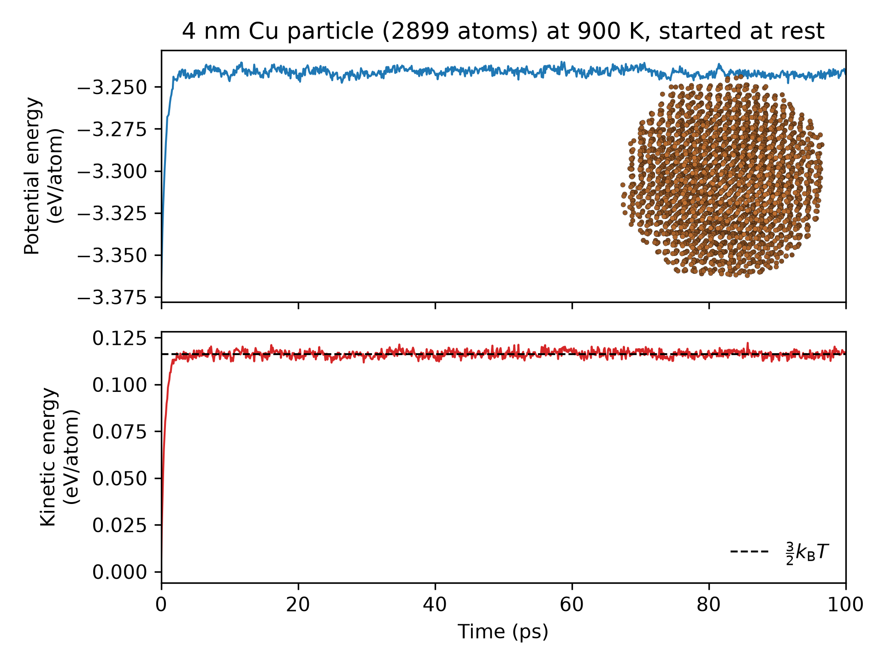
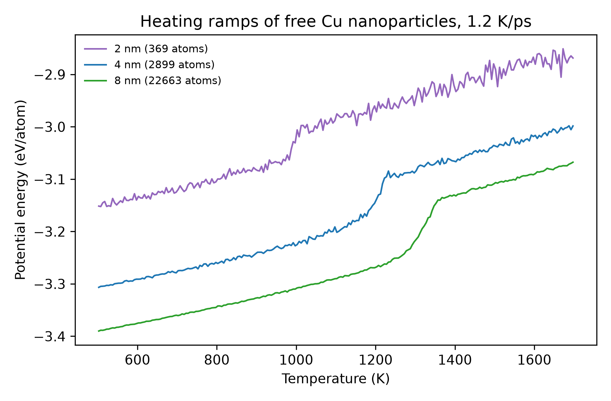
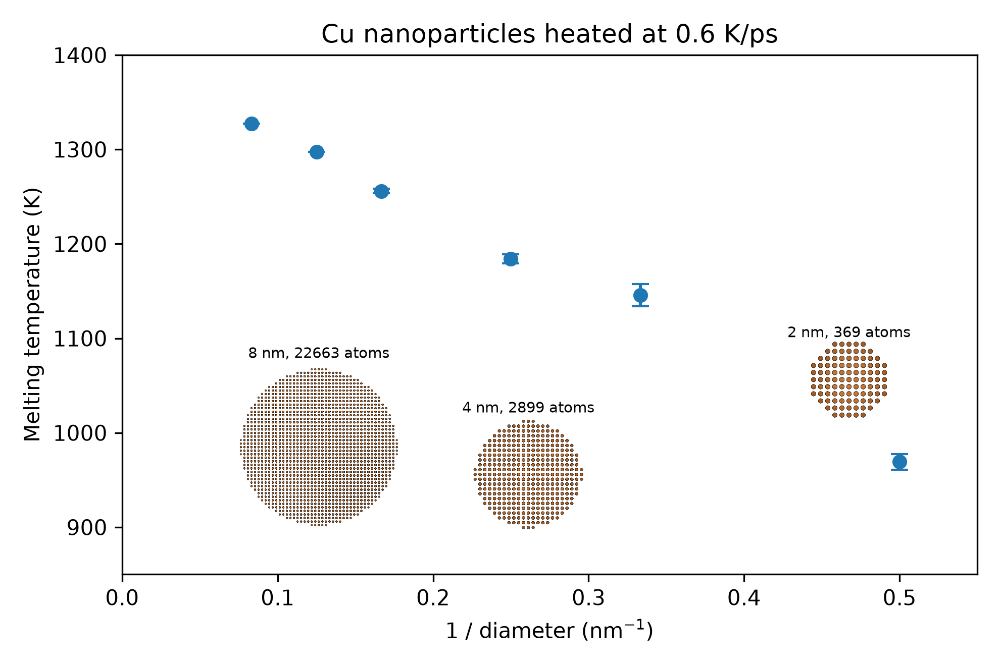

## Instructions

- **Groups:** groups of five, formed by the instructor. The instructor will email the group list to each student later in the week of November 2.
- **Same project for all groups:** every group works on the project described on this page.
- **Weight:** 20% of the course grade.
- **Due:** **Monday, December 7, 2026** (last day of classes), one final report per group via Canvas.

## How the project works

- **Content:** the project combines a real materials simulation task, parameter regression, and numerical code.
- **Goal:** interpret the melting behaviour of a real metal at the atomic scale, and compare the results of different methods.
- **Code:** the instructor provides all example code as marimo notebooks. The links will be posted on this page later in the week of November 2.
  - The notebooks run on a remote GPU instance (molab) from your own laptop. No local installation is required.
  - The molecular dynamics (MD) engine is [OpenMM](https://openmm.org), a fast MD code that runs on the GPU.
- **Run time:** the full set of simulations for one project takes less than a few hours of computing time. This does not include writing the report.

## Final report

- **Format:** use the format of an American Chemical Society (ACS) journal article.
  - [ACS author guidelines](https://researcher-resources.acs.org/publish/author_guidelines)
  - [ACS templates on Overleaf](https://www.overleaf.com/gallery/tagged/acs) (LaTeX). ACS also provides Word templates through its author guidelines.
- **Style:** concise and scientific.
- **Sections:**
  - **Title** of the project.
  - **Scope:** the question you answer and the systems you simulate.
  - **Methods:** the model, simulation settings, and analysis procedure.
  - **Results and discussion,** with figures and tables. Explain what each figure shows and what it means for the material.
  - **References:** list every source you use to support a claim.

## The problem

The melting behaviour of metals, and of small metal particles in particular, is of great importance in materials science. Metal nanoparticles are used, for example:

- in conductive inks for printed electronics, which are sintered at low temperature;
- as catalysts, where the particle shape and surface change near melting;
- in solders and brazing pastes made from nanopowders.

A nanoparticle melts at a lower temperature than the bulk metal. Atoms at the surface have fewer neighbours than atoms inside, so they are less strongly bound, and in a small particle a large fraction of the atoms sit at the surface. For the Cu particles in this project:

| Diameter (nm) | 2 | 3 | 4 | 6 | 8 | 12 |
|---|---:|---:|---:|---:|---:|---:|
| Number of atoms | 369 | 1205 | 2899 | 9597 | 22663 | 76429 |
| Surface atoms (fewer than 12 neighbours) | 55% | 41% | 31% | 22% | 17% | 11% |

: Size of the fcc Cu particles used on this page. {#tbl-sizes}

Buffat and Borel measured this **melting temperature depression** for gold particles with electron diffraction [@buffat1976gold]. Particles 2–3 nm in diameter melted several hundred kelvin below the bulk melting point of gold (1337 K), and the depression grew steadily as the particles became smaller.

{width=60%}

To first order, the depression follows a power law in the particle diameter $D$:

$$
\boxed{T_\mathrm{m}(D) = T_\mathrm{m,bulk}\left[1-\left(\frac{D_0}{D}\right)^{\alpha}\right]}
$$

- $T_\mathrm{m,bulk}$ is the melting point of the bulk metal.
- $D_0$ is a length of the order of a nanometre. For the gold data above, a fit gives $D_0 \approx 0.83$ nm and $\alpha \approx 0.93$.
- With $\alpha = 1$, this is the Gibbs–Thomson form, $T_\mathrm{m}(D) = T_\mathrm{m,bulk} - C/D$. It follows from the surface-to-volume ratio of a sphere, $\pi D^2 / (\pi D^3/6) = 6/D$: the extra surface energy per atom scales as $1/D$.
- The number of atoms is $N \propto D^3$, so $1/D \propto N^{-1/3}$.

In this project, you simulate the melting of free copper (Cu) nanoparticles of different sizes with molecular dynamics, and you compare the result with the power law and with the bulk melting point of Cu.

## Background: molecular dynamics of a Cu particle

### The interatomic potential

The atoms interact through the embedded-atom method (EAM) potential for Cu by Mishin and co-workers [@mishin2001cu]. The total energy is

$$
E = \sum_{i<j} \phi(r_{ij}) + \sum_i F(\rho_i), \qquad \rho_i = \sum_{j\neq i} f(r_{ij}),
$$

- $r_{ij}$ is the distance between atoms $i$ and $j$. Only neighbours closer than the cutoff, 5.5 Å, contribute.
- $\phi(r)$ is a pair energy: repulsive at short distance, weakly attractive near the nearest-neighbour distance (2.56 Å in fcc Cu).
- $\rho_i$ is the electron density at atom $i$ from its neighbours, and $F(\rho)$ is the energy to embed atom $i$ in that density.
- $F$ is not linear in $\rho$. Each extra neighbour lowers the energy by less than the one before, so a surface atom, with fewer neighbours, loses less than a proportional share of its bonding energy. This is why EAM describes metal surfaces and melting much better than a pair potential.

The functions $\phi$, $f$, and $F$ are stored as tables. Mishin and co-workers fitted them to experimental properties of Cu and to first-principles calculations.

### Molecular dynamics

Molecular dynamics (MD) solves Newton's equations of motion for every atom,

$$
m\,\frac{\mathrm d^2 \mathbf r_i}{\mathrm dt^2} = \mathbf F_i = -\frac{\partial E}{\partial \mathbf r_i},
$$

in small time steps $\Delta t$ (2 fs in our notebooks).

- **Forces** are the negative derivatives of the energy with respect to the atom positions (Lectures [17](../units/04/L17/index.qmd) and [18](../units/04/L18/index.qmd)). OpenMM computes them analytically.
- **Integration:** each step updates velocities and positions from the forces, similar to the time-stepping methods in this course.
- **Temperature** is measured from the kinetic energy, $E_\mathrm{kin} = \sum_i \tfrac12 m v_i^2 = \tfrac32 N k_\mathrm B T$.
- **Thermostat:** a Langevin thermostat adds a small friction force and random kicks to every atom. Together they keep the average temperature at the set value $T$. To heat or cool a particle, the notebook changes the thermostat temperature step by step.
- **Free particle:** there is no periodic box. The particle sits in vacuum, so its whole surface is free, as in the experiment.
- **Time scale:** MD covers picoseconds to nanoseconds. A heating ramp from 500 K to 1700 K at 1 K/ps takes 1.2 ns of simulated time. Experiments heat a sample over seconds, so our heating rates are about $10^{12}$ times faster.

### Connections to this course

- **Derivatives and forces:** finite differences check the forces computed by OpenMM.
- **Fitting:** the size dependence and the onset and end temperatures come from linear least-squares fits ([L08](../units/02/L08/index.qmd), [L09](../units/02/L09/index.qmd)).
- **Energy minimization:** the starting crystal structure and its lattice constant ([L15](../units/03/L15/index.qmd)).
- **Bonus:** fitting a potential is a large linear regression problem ([L09](../units/02/L09/index.qmd), [L12](../units/03/L12/index.qmd)).

### Computing and team work

- One heating ramp of a 2–8 nm particle takes about 1–5 min on the molab GPU, depending on the size and the heating rate. Particles larger than 8 nm take much longer; check the time of a short run first.
- Save every result to a file in the notebook. Remote sessions can stop without warning.
- A suggested division of work in a team of five:
  - one member for Part 1 and the checks;
  - two members for the heating ramps (Part 2), split by particle size or heating rate;
  - one member for the cooling runs (Part 3);
  - one member for the fits and the comparison with literature (Part 4).
- Every member must understand every part. The final report is one document, written together.

## Tasks

### Part 1 · Set up and check the simulation

- Use the provided notebook to run individual MD simulations of a free Cu nanoparticle at a fixed temperature.
- Record the potential energy and the kinetic energy against time, for up to 100 ps.
- Show that both energies become stable (fluctuate about a constant mean) after an initial period. Report how long this takes.
- Check that the mean kinetic energy agrees with the target temperature, $\langle E_\mathrm{kin}\rangle/N = \tfrac{3}{2}k_\mathrm{B}T$.
- Repeat at a temperature close to melting (for example 1100 K for a 4 nm particle). Do the energies still settle? How large are the fluctuations?

Why this matters: a measured property is only meaningful after the system reaches a steady state. The thermostat brings the kinetic energy to its target in a few picoseconds. The potential energy follows as the atoms move away from their perfect-crystal positions. The size of the fluctuations also sets how accurately you can read a melting temperature from a single run.

{width=70%}

### Part 2 · Melting by a heating ramp

- Heat a nanoparticle by increasing the thermostat temperature at a constant rate (the **heating rate**, in K/ps).
- Plot the potential energy per atom against temperature. Melting appears as a region where the energy rises steeply (the latent heat).
- Record the temperature at the **onset** and at the **end** of the melting region.
- Repeat for:
  - different particle sizes (numbers of atoms);
  - different heating rates.
- Report how the onset and end temperatures change with size and with heating rate.

How to read a heating ramp:

- **Solid branch:** at low temperature, the energy rises linearly, because each atom vibrates more strongly about its lattice site.
- **Melting region:** the energy rises steeply, because the particle absorbs the latent heat of melting. For bulk Cu the latent heat is about 0.14 eV per atom.
- **Liquid branch:** above the melting region, the energy again rises linearly, with a slightly different slope.
- **Onset and end:** fit straight lines to the solid and liquid branches. The melted fraction is
  $$
  f(T) = \frac{E(T) - E_\mathrm{solid}(T)}{E_\mathrm{liquid}(T) - E_\mathrm{solid}(T)}.
  $$
  For example, take the onset at $f = 0.1$ and the end at $f = 0.9$. State the definition that you use.
- **Heating rate:** melting needs time. The liquid starts at the surface and moves inwards, while the temperature keeps rising. A faster ramp therefore reads a higher melting temperature. Compare the rates to see how large this effect is.

{width=70%}

### Part 3 · Cooling

- Take a particle that is fully melted and cool it at the same rate that you used for heating.
- Record the temperature where the liquid freezes (the solidification point).
- Compare the solidification point with the melting region from Part 2. You will find that the particle freezes at a much lower temperature than it melts.
- Use the literature to identify this phenomenon and explain its origin.

Hint: on heating, the surface of the particle starts the liquid. On cooling, the liquid has no crystal to start from. Think about what must form inside the liquid before it can freeze, and why that is difficult just below the melting point.

{width=100%}

### Part 4 · Size dependence and bulk melting temperature

A slow heating rate gives an estimate of the melting temperature of a nanoparticle, even though the estimate is not exact.

- Choose a slow heating rate. Measure the melting temperature of particles of at least four different sizes.
- Repeat each simulation two to three times with different random seeds, and report the mean and spread.
- Fit your results to $T_\mathrm{m}(D) = T_\mathrm{m,bulk} - C/D$.
- Answer these questions:
  - How good is the linear fit in $1/D$?
  - What does the fit give for the melting temperature of bulk copper?
  - How does your value compare with the experimental melting point of Cu (1357.77 K)? What causes the difference? Consider both the heating rate and the potential.
  - Compare your fitted $\alpha$ or $C$ with the gold data of Buffat and Borel.

Two numbers help with the comparison:

- The equilibrium melting point of this EAM potential, from a simulation of a solid and a liquid in contact, is about 1325 K. This is the value your extrapolation should approach if the heating rate had no effect.
- At the heating rates in these notebooks, larger particles lag further behind the thermostat, so a ramp at one rate overestimates the melting point of large particles more than that of small ones. Check whether your bulk value moves when you halve the heating rate.

{width=70%}

## Bonus · Fit your own EAM-type potential

The EAM potential describes the melting of Cu well. But how does one make such a potential? In this optional part, you fit an EAM-type potential to reference data from density functional theory (DFT), with the linear regression methods from this course.

- **Model:** use the same form of the energy as above, with each function written as a sum of simple terms:
  - pair energy $\phi(r) = \sum_k a_k (t_k - r)^3$ for $r < t_k$ (cubic pieces with fixed knots $t_k$);
  - embedding energy $F(\rho) = c_1\rho^{1/2} + c_2\rho^{3/2} + c_3\rho^2$;
  - density function $f(r)$ fixed in advance.
- **Linear regression:** the energy and forces are linear in the coefficients $a_k$ and $c_m$. Fitting the model to energies and forces is a linear least-squares problem.
- **Data:** a separate notebook from the instructor shows:
  - how long one DFT calculation of a small Cu cell takes;
  - a provided set of about 100 to 200 reference structures (solid, liquid, and strained cells) with energies and forces.
- **Task:**
  - Fit the coefficients. Report the energy and force errors on structures that you did not use in the fit.
  - Check the lattice constant of fcc Cu from your potential.
  - Put your potential back into the simulation notebook and repeat part of Part 2 or Part 4. Compare the melting temperatures with those of the Mishin EAM potential.
- **Marks:** up to 10% extra on the project mark (the project mark cannot exceed 100%):
  - 4%: a working fit, with errors reported on held-out structures;
  - 2%: the lattice constant compared with the DFT value and with experiment;
  - 4%: melting temperatures from your potential, compared with the Mishin EAM and discussed.

## References
