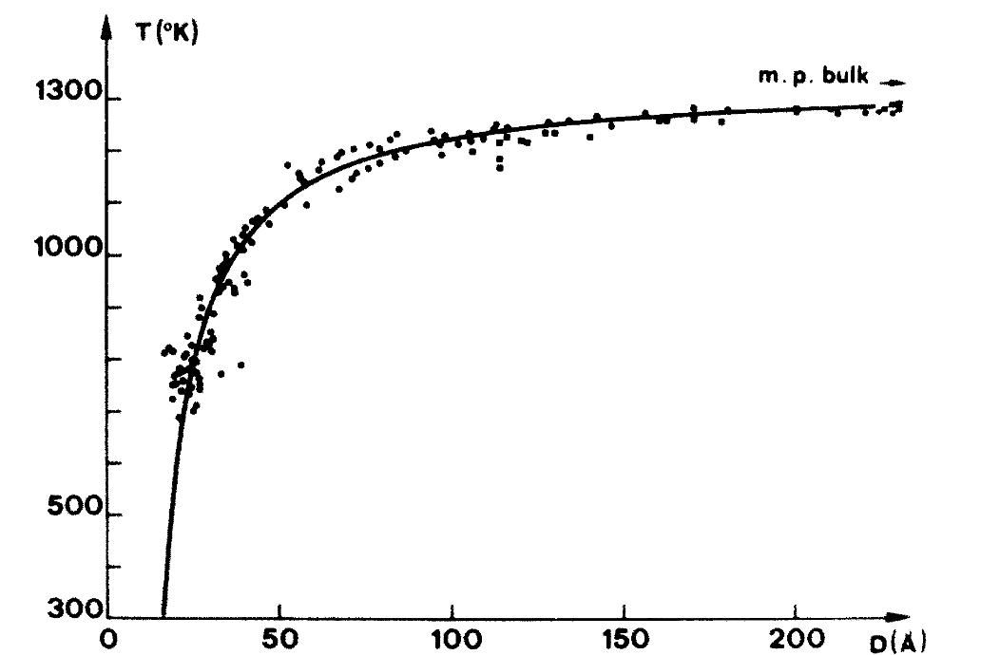

## Instructions

- **Groups:** groups of five, formed by the instructor. The instructor will email the group list to each student later in the week of November 2.
- **Same project for all groups:** every group works on the project described on this page.
- **Weight:** 20% of the course grade.
- **Due:** **Monday, December 7, 2026** (last day of classes), one final report per group via Canvas.

## How the project works

- **Content:** the project combines a real materials simulation task, parameter regression, and numerical code.
- **Goal:** interpret the melting behaviour of a real metal at the atomic scale, and compare the results of different methods.
- **Code:** the instructor provides all example code as marimo notebooks. The links will be posted on this page later in the week of November 2.
  - The notebooks run on a remote GPU instance (molab) from your own laptop. No local installation is required.
  - The molecular dynamics (MD) engine is [OpenMM](https://openmm.org), a fast MD code that runs on the GPU.
- **Run time:** the full set of simulations for one project takes less than a few hours of computing time. This does not include writing the report.

## Final report

- **Format:** use the format of an American Chemical Society (ACS) journal article.
  - [ACS author guidelines](https://researcher-resources.acs.org/publish/author_guidelines)
  - [ACS templates on Overleaf](https://www.overleaf.com/gallery/tagged/acs) (LaTeX). ACS also provides Word templates through its author guidelines.
- **Style:** concise and scientific.
- **Sections:**
  - **Title** of the project.
  - **Scope:** the question you answer and the systems you simulate.
  - **Methods:** the model, simulation settings, and analysis procedure.
  - **Results and discussion,** with figures and tables. Explain what each figure shows and what it means for the material.
  - **References:** list every source you use to support a claim.

## The problem

The melting behaviour of metals, and of small metal particles in particular, is of great importance in materials science. A nanoparticle melts at a lower temperature than the bulk metal because a large fraction of its atoms sit at the surface, where they have fewer neighbours and are less strongly bound. This affects, for example, sintering, catalysis, and printed electronics.

Buffat and Borel measured this **melting temperature depression** for gold particles with electron diffraction [@buffat1976gold]. Gold particles 2–3 nm in diameter melted several hundred kelvin below the bulk melting point of gold (1337 K), and the depression grew steadily as the particles became smaller.

{width=55%}

To first order, the depression follows a power law in the particle diameter $D$:

$$
T_\mathrm{m}(D) = T_\mathrm{m,bulk}\left[1-\left(\frac{D_0}{D}\right)^{\alpha}\right], \qquad \alpha \approx 1,
$$

where $D_0$ is a length of the order of a nanometre. With $\alpha = 1$, this is the Gibbs–Thomson form, $T_\mathrm{m}(D) = T_\mathrm{m,bulk} - C/D$. The number of atoms is $N \propto D^3$, so $1/D \propto N^{-1/3}$.

In this project, you simulate the melting of free copper (Cu) nanoparticles of different sizes with MD. The atoms interact through the embedded-atom method (EAM) potential for Cu by Mishin and co-workers [@mishin2001cu]. The total energy is

$$
E = \sum_{i<j} \phi(r_{ij}) + \sum_i F(\rho_i), \qquad \rho_i = \sum_{j\neq i} f(r_{ij}),
$$

where $\phi$ is a pair energy, $\rho_i$ is the electron density at atom $i$ from its neighbours, and $F$ is the energy to embed atom $i$ in that density.

### Part 1 · Set up and check the simulation

- Use the provided notebook to run individual MD simulations of a free Cu nanoparticle at a fixed temperature.
- Record the potential energy and the kinetic energy against time, for up to 100 ps.
- Show that both energies become stable (fluctuate about a constant mean) after an initial period. Report how long this takes.
- Check that the mean kinetic energy agrees with the target temperature, $\langle E_\mathrm{kin}\rangle/N = \tfrac{3}{2}k_\mathrm{B}T$.

{width=70%}

### Part 2 · Melting by a heating ramp

- Heat a nanoparticle by increasing the thermostat temperature at a constant rate (the **heating rate**, in K/ps).
- Plot the potential energy per atom against temperature. Melting appears as a region where the energy rises steeply (the latent heat).
- Record the temperature at the **onset** and at the **end** of the melting region.
- Repeat for:
  - different particle sizes (numbers of atoms);
  - different heating rates.
- Report how the onset and end temperatures change with size and with heating rate.

{width=70%}

### Part 3 · Cooling

- Take a particle that is fully melted and cool it at the same rate that you used for heating.
- Record the temperature where the liquid freezes (the solidification point).
- Compare the solidification point with the melting region from Part 2. You will find that the particle freezes at a much lower temperature than it melts.
- Use the literature to identify this phenomenon and explain its origin.

{width=100%}

### Part 4 · Size dependence and bulk melting temperature

A slow heating rate gives an estimate of the melting temperature of a nanoparticle, even though the estimate is not exact.

- Choose a slow heating rate. Measure the melting temperature of particles of at least four different sizes.
- Repeat each simulation two to three times with different random seeds, and report the mean and spread.
- Fit your results to $T_\mathrm{m}(D) = T_\mathrm{m,bulk} - C/D$.
- Answer these questions:
  - How good is the linear fit in $1/D$?
  - What does the fit give for the melting temperature of bulk copper?
  - How does your value compare with the experimental melting point of Cu (1357.77 K)? What causes the difference? Consider both the heating rate and the potential.

{width=70%}

## Bonus · Fit your own EAM-type potential

The EAM potential describes the melting of Cu well. But how does one make such a potential? In this optional part, you fit an EAM-type potential to reference data from density functional theory (DFT), with the linear regression methods from this course.

- **Model:** use the same form of the energy as above, with each function written as a sum of simple terms:
  - pair energy $\phi(r) = \sum_k a_k (t_k - r)^3$ for $r < t_k$ (cubic pieces with fixed knots $t_k$);
  - embedding energy $F(\rho) = c_1\rho^{1/2} + c_2\rho^{3/2} + c_3\rho^2$;
  - density function $f(r)$ fixed in advance.
- **Linear regression:** the energy and forces are linear in the coefficients $a_k$ and $c_m$. Fitting the model to energies and forces is a linear least-squares problem.
- **Data:** a separate notebook from the instructor shows:
  - how long one DFT calculation of a small Cu cell takes;
  - a provided set of about 100 to 200 reference structures (solid, liquid, and strained cells) with energies and forces.
- **Task:**
  - Fit the coefficients. Report the energy and force errors on structures that you did not use in the fit.
  - Check the lattice constant of fcc Cu from your potential.
  - Put your potential back into the simulation notebook and repeat part of Part 2 or Part 4. Compare the melting temperatures with those of the Mishin EAM potential.
- **Marks:** up to 10% extra on the project mark (the project mark cannot exceed 100%):
  - 4%: a working fit, with errors reported on held-out structures;
  - 2%: the lattice constant compared with the DFT value and with experiment;
  - 4%: melting temperatures from your potential, compared with the Mishin EAM and discussed.

## References
