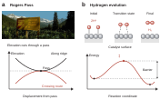
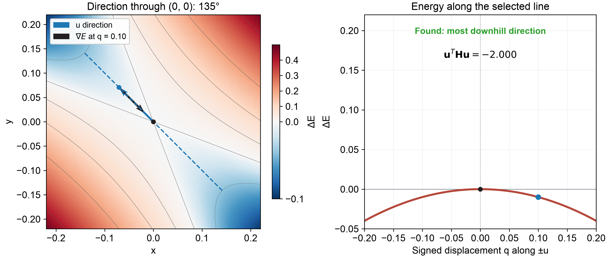
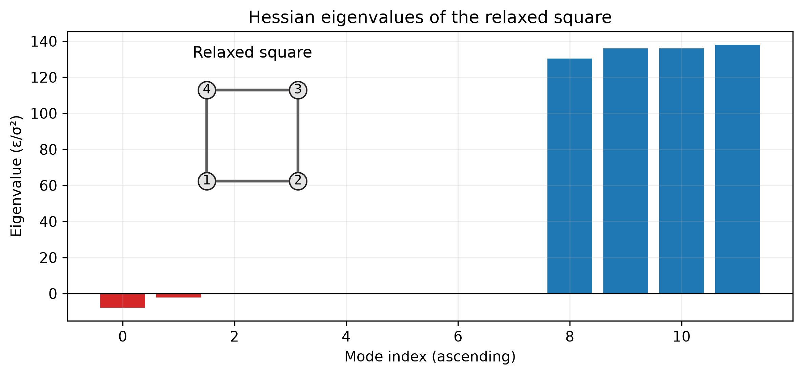
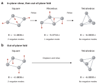
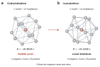
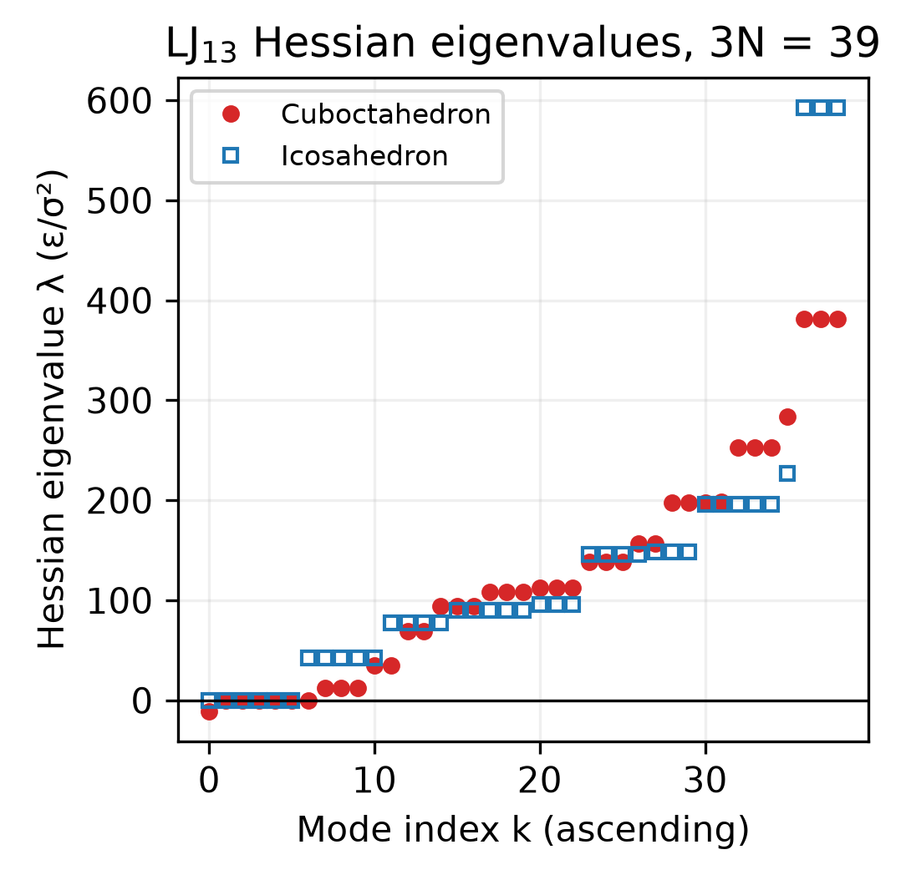

::: {.callout-note}
## Central question

**How can eigenvalues of the Hessian tell us whether a stationary atomic structure is a minimum, even when it has too many coordinates to visualize?**
:::

## Learning outcomes

By the end of this lecture, you should be able to:

1. **Explain** why the eigenvectors of a Hessian are the directions in which the energy curves without coupling, and why each eigenvalue is the curvature along its eigenvector.
2. **Solve** the eigenvalue problem $\mathbf H\mathbf v=\lambda\mathbf v$ for a $2\times2$ matrix by hand, and for larger matrices with `np.linalg.eigh`.
3. **Classify** a relaxed atomic structure from the signs of its Hessian eigenvalues, accounting for rigid translations and rotations.
4. **Lower** the energy of a structure stuck on a saddle point by following the eigenvector of a negative eigenvalue and relaxing again.

## Recap: minimization in higher dimensions

In [L14](../L14/index.qmd) and [L15](../L15/index.qmd), we turned the search for a stable structure into a system of equations. At force balance, every first derivative of the energy $E(\mathbf x)$ with respect to a free atomic coordinate vanishes. These derivatives are the components of the gradient:

$$
\nabla E(\mathbf x)=\begin{bmatrix}\partial E/\partial x_1\\ \partial E/\partial x_2\\ \vdots\\ \partial E/\partial x_n\end{bmatrix}=\mathbf 0 .
$$

Newton's method solves these nonlinear equations one linear system at a time:

$$
\boxed{\mathbf H\,\Delta\mathbf x=-\nabla E.}
$$

This is the force-balance step $\mathbf J_F\Delta\mathbf x=-\mathbf F$ rewritten with $\mathbf F=-\nabla E$ and $\mathbf J_F=-\mathbf H$. All derivatives are evaluated at the current coordinates, and $\Delta\mathbf x$ is the proposed change in those coordinates.

::: {.callout-tip collapse="true"}
## Recap: the Jacobian and Hessian matrices

The **Jacobian** contains the first partial derivatives of a vector field. For $\mathbf F=(F_1,\ldots,F_n)^{\mathsf T}$, each row describes how one force component changes as the coordinates vary:

$$
\mathbf J_F=
\begin{bmatrix}
\dfrac{\partial F_1}{\partial x_1} & \cdots & \dfrac{\partial F_1}{\partial x_n}\\
\vdots & \ddots & \vdots\\
\dfrac{\partial F_n}{\partial x_1} & \cdots & \dfrac{\partial F_n}{\partial x_n}
\end{bmatrix}.
$$

The **Hessian** contains the second partial derivatives of a scalar field, here the energy:

$$
\mathbf H=
\begin{bmatrix}
\dfrac{\partial^2 E}{\partial x_1^2} & \cdots & \dfrac{\partial^2 E}{\partial x_1\,\partial x_n}\\
\vdots & \ddots & \vdots\\
\dfrac{\partial^2 E}{\partial x_n\,\partial x_1} & \cdots & \dfrac{\partial^2 E}{\partial x_n^2}
\end{bmatrix}.
$$

Thus $\mathbf H$ is the Jacobian of $\nabla E$. Since force is the negative energy gradient, $\mathbf J_F=-\mathbf H$. For a smooth energy with continuous second derivatives, $\mathbf H$ is symmetric.
:::

### Saddle points: from mountain passes to catalysts

By the end of L15, we had seen two ways in which the search for a minimum can go wrong:

1. **A poor starting guess.** Newton steps can overshoot, run away along a flat energy tail, or stop without converging.
2. **A stationary point that is not a minimum.** In the compressed-spring model, the moving atom lies between two fixed atoms. At the midpoint, the forces cancel, even though a vertical displacement lowers the energy. A stopping test based only on the gradient can accept this saddle point.

The second outcome is easy to miss because the force residual can be essentially zero. Yet saddle points also describe physically important routes between stable states. Think of crossing a mountain ridge through a **mountain pass**, such as Rogers Pass in British Columbia (@fig-pass-catalyst). In an idealized smooth landscape, the pass is a high point along the route from one valley to the other, but a low point along the ridge. From the pass, walking toward either valley takes you downhill, while walking along the ridge takes you uphill. A route through the pass avoids climbing to a nearby summit.

The same geometry appears on an atomic energy surface. For example, one step in the **hydrogen evolution reaction (HER)** is the combination of two hydrogen atoms adsorbed on a catalyst into an $\mathrm H_2$ molecule. As the atoms approach each other and detach from the surface, the system passes through a **transition state**: a saddle point with a downhill direction toward the reactants and another toward the products along the same reaction path. Small displacements perpendicular to that path raise the energy. The transition state is the barrier configuration, whereas a reaction intermediate occupies a local minimum.

{#fig-pass-catalyst width="100%" fig-alt="Left: Rogers Pass with schematic elevation cuts along the ridge and crossing route. Right: hydrogen atoms combine on a catalyst surface and cross a transition-state energy barrier."}

Photo: [Michael Rogers, Wikimedia Commons](https://commons.wikimedia.org/wiki/File:Rogers_pass.jpg), [CC BY-SA 3.0](https://creativecommons.org/licenses/by-sa/3.0/). Elevation and energy profiles are schematic. The symbol $*$ denotes an adsorption site.

The energy difference between the initial and final states describes their relative energetic stability. The barrier between them helps determine how quickly the reaction can occur. A catalyst provides a reaction pathway with a lower activation barrier while leaving the overall reaction free-energy change unchanged. At finite temperature, reaction rates depend on the activation **free energy**, which includes entropic contributions as well as energy.

Saddle points therefore connect the stability question to reaction kinetics. To decide whether a force-balanced structure is a minimum or a transition-state candidate, we need the energy curvature along possible atomic displacements. The Hessian contains this information. We will first read it for the moving atom connected by two springs, then extend the reasoning to structures with many coordinates.

## What the Hessian tells us about a two-coordinate atom

Return to the atom that moves freely in $x$ and $y$. Its Hessian collects the four second derivatives of the energy:

$$
\mathbf H=\begin{bmatrix}H_{11}&H_{12}\\H_{21}&H_{22}\end{bmatrix}
=\begin{bmatrix}
\dfrac{\partial^2E}{\partial x^2} & \dfrac{\partial^2E}{\partial x\,\partial y}\\[2ex]
\dfrac{\partial^2E}{\partial y\,\partial x} & \dfrac{\partial^2E}{\partial y^2}
\end{bmatrix}.
$$

The two kinds of entry describe different features of the energy surface:

- **Diagonal entries.** $H_{11}=\partial^2E/\partial x^2$ and $H_{22}=\partial^2E/\partial y^2$ are the curvatures of the energy along the $x$- and $y$-axes. Each is the second derivative we would obtain by cutting the surface along one axis and treating the cut as a function of one variable, as in [L07](../../02/L07/index.qmd).
- **Off-diagonal entries.** $H_{12}=\partial^2E/\partial x\,\partial y$ couples the two coordinates. Reading it as $\partial(\partial E/\partial x)/\partial y$, it measures how the slope along $x$, and therefore the force $F_x=-\partial E/\partial x$, changes when the atom moves in $y$. For a smooth energy the order of differentiation does not matter, so $H_{21}=H_{12}$: a move in $x$ changes $F_y$ by the same amount.

When the off-diagonal entries are zero, the matrix can be read at a glance. The Hessian

$$
\mathbf H=\begin{bmatrix}4&0\\0&2\end{bmatrix}
$$

describes an energy that bends more sharply along $x$ than along $y$. In the local-stiffness picture of L15, the atom sits in a spring of constant 4 for motion along $x$ and a spring of constant 2 for motion along $y$, so it is held twice as stiffly in $x$.

::: {.quarto-wasm-local notebook="l16_diagonal_hessian.edit.py" view="app" title="Energy surfaces with a diagonal Hessian: a minimum and a saddle" height="640" loading="lazy" fullscreen="true"}
The notebook draws two energy surfaces with a stationary point at the origin. The minimum $E=2x^2+y^2$ has $\mathbf H=\begin{bmatrix}4&0\\0&2\end{bmatrix}$, and its cuts along both axes are upward parabolas. The saddle $E=2x^2-y^2$ has $\mathbf H=\begin{bmatrix}4&0\\0&-2\end{bmatrix}$. Its cut along $x$ curves upward and its cut along $y$ curves downward. In both cases, each diagonal entry is the curvature of one cut.
:::

### Energy change near a stationary point

The Taylor expansion (which we will revisit in Unit 4) connects these entries to the stability of a structure. For a small displacement $\Delta\mathbf x$ from a point $\mathbf x$,

$$
E(\mathbf x+\Delta\mathbf x)\approx E(\mathbf x)+\nabla E^{\mathsf T}\Delta\mathbf x+\tfrac12\,\Delta\mathbf x^{\mathsf T}\mathbf H\,\Delta\mathbf x .
$$

At a stationary point, $\nabla E=\mathbf 0$ removes the middle term, and the energy change is

$$
\Delta E=E(\mathbf x+\Delta\mathbf x)-E(\mathbf x)\approx\tfrac12\,\Delta\mathbf x^{\mathsf T}\mathbf H\,\Delta\mathbf x .
$$

For two coordinates, $\Delta\mathbf x=(\Delta x,\Delta y)^{\mathsf T}$. Multiplying out the matrix product and using $H_{21}=H_{12}$ gives

$$
\begin{aligned}
\Delta E &\approx \tfrac12\left(H_{11}\Delta x^2+H_{12}\Delta x\,\Delta y+H_{21}\Delta y\,\Delta x+H_{22}\Delta y^2\right)\\
&= \tfrac12\left(H_{11}\Delta x^2+2H_{12}\Delta x\,\Delta y+H_{22}\Delta y^2\right).
\end{aligned}
$$

With a diagonal Hessian, the cross term vanishes and $\Delta E\approx\tfrac12\left(H_{11}\Delta x^2+H_{22}\Delta y^2\right)$. The signs of the two diagonal entries then decide what kind of stationary point we have:

- **Case 1, a local minimum:** $H_{11}>0$ and $H_{22}>0$, as in $\begin{bmatrix}4&0\\0&2\end{bmatrix}$. Both terms are positive for any nonzero displacement, so every small move raises the energy, which is the definition of a local minimum from L15.
- **Case 2, a saddle point:** $H_{11}$ and $H_{22}$ have opposite signs, as in $\begin{bmatrix}4&0\\0&-2\end{bmatrix}$. A move along $x$ alone raises the energy, but a move along $y$ alone lowers it by $\tfrac12|H_{22}|\,\Delta y^2$. Like the hiker on the pass, the atom sits at the top of one path and the bottom of another.

The compressed springs of L15 are an example of case 2. With the fixed atoms at $(\pm a,0)$ and natural length $l_0=1.2a$, the Hessian at the origin is $k\begin{bmatrix}2&0\\0&-0.4\end{bmatrix}$. The positive entry is the restoring response along the springs, and the negative entry is the energy decrease across them.

## Rotate the geometry, keeping the axes fixed

What if we keep the same spring system ($l_0=1.2a$), but rotate it $45^\circ$ counterclockwise? **Where will the stationary points be, and how can we tell whether they are minima or saddle points?**

{#fig-spring-rotated width="90%" fig-alt="Panel a: two fixed atoms on a line 45 degrees above the x-axis, joined by compressed red springs to a middle atom at the origin. A blue arrow along the springs is labelled E rises, a blue arrow perpendicular to them is labelled E falls, and fixed x and y axes are drawn at the left. Panel b: the middle atom at the upper-left minimum with both grey springs at their natural length, the saddle point at the origin, and a dashed mirror minimum at the lower right."}

From the physical model, we know that the stationary points rotate by $45^\circ$ as well (@fig-spring-rotated). The two minima move with the geometry, and $(0,0)$ remains a stationary point.

- **No change in the numerical task.** With suitable starting guesses, `scipy.optimize.minimize` finds the rotated minima, while `scipy.optimize.root` applied to $\nabla E=\mathbf 0$ finds stationary points, including the saddle. We use the same solvers with the rotated energy and gradient.
- **Cannot tell from the diagonal entries alone.** At the origin, the Hessian is now

  $$
  \mathbf H=k\begin{bmatrix}0.8 & 1.2\\1.2 & 0.8\end{bmatrix}.
  $$

  Both diagonal entries are positive, so moving along either coordinate axis raises the energy. Yet the origin remains a saddle point. How can we read the downhill direction from the full Hessian?

The downhill direction hides in the off-diagonal entries. With $H_{12}=1.2k$, a move in $x$ changes the force in $y$, and a move in $y$ changes the force in $x$. In the energy change, the cross term $2H_{12}\Delta x\,\Delta y$ is negative whenever $\Delta x$ and $\Delta y$ have opposite signs, so a combined displacement can lower the energy even though neither coordinate can do so alone.

::: {.callout-tip collapse="true"}
## Derivation of the spring Hessian and its rotation

For one spring, let $\mathbf d$ point from its fixed end to the moving atom, let $r=|\mathbf d|$, and let $\hat{\mathbf n}=\mathbf d/r$. Differentiating $\tfrac12 k(r-l_0)^2$ gives gradient $k(r-l_0)\hat{\mathbf n}$ and Hessian

$$
\mathbf H_{\mathrm{spring}}=k\left[\hat{\mathbf n}\hat{\mathbf n}^{\mathsf T}
+\left(1-\frac{l_0}{r}\right)(\mathbf I-\hat{\mathbf n}\hat{\mathbf n}^{\mathsf T})\right].
$$

At the origin both springs have length $a$. Their directions are opposite, so they give the same outer product $\hat{\mathbf n}\hat{\mathbf n}^{\mathsf T}$. For an angle $\theta$ to the $x$-axis, add their contributions using $\hat{\mathbf n}=(\cos\theta,\sin\theta)^{\mathsf T}$:

$$
\mathbf H=2k\begin{bmatrix}
1-(l_0/a)\sin^2\theta & (l_0/a)\sin\theta\cos\theta\\
(l_0/a)\sin\theta\cos\theta & 1-(l_0/a)\cos^2\theta
\end{bmatrix}.
$$

Setting $\theta=0$ gives the diagonal matrix. At $45^\circ$, $\sin^2\theta=\cos^2\theta=1/2$, giving the matrix with entries $0.8k$ and $1.2k$.
:::

::: {.callout-tip collapse="true"}
## Rotating the coordinates back

One fix seems obvious. We rotated the atoms by $45^\circ$, so we could measure displacements along axes rotated by the same angle. Let $q_\parallel$ be the displacement along the springs, in the direction $\hat{\mathbf n}=(1,1)/\sqrt2$, and $q_\perp$ the displacement across them, in the direction $\hat{\mathbf n}_\perp=(-1,1)/\sqrt2$. A displacement in the laboratory coordinates is then

$$
\Delta\mathbf x=q_\parallel\hat{\mathbf n}+q_\perp\hat{\mathbf n}_\perp=\mathbf R\mathbf q,
\qquad
\mathbf R=\frac1{\sqrt2}\begin{bmatrix}1&-1\\1&1\end{bmatrix},
\qquad
\mathbf q=\begin{bmatrix}q_\parallel\\ q_\perp\end{bmatrix},
$$

where the columns of the rotation matrix $\mathbf R$ are the two new directions. Substituting into the energy change gives $\Delta E\approx\tfrac12\,\mathbf q^{\mathsf T}\left(\mathbf R^{\mathsf T}\mathbf H\mathbf R\right)\mathbf q$, with

$$
\mathbf R^{\mathsf T}\mathbf H\mathbf R
=\frac k2\begin{bmatrix}1&1\\-1&1\end{bmatrix}
\begin{bmatrix}0.8&1.2\\1.2&0.8\end{bmatrix}
\begin{bmatrix}1&-1\\1&1\end{bmatrix}
=k\begin{bmatrix}2&0\\0&-0.4\end{bmatrix}.
$$

The diagonal Hessian has returned, and we can again read case 2 from it: the energy rises along the springs and falls across them. The rotation worked because we built the system ourselves and knew the angle. For the 13-atom cluster at the end of this lecture, the Hessian is $39\times39$, and nothing tells us in advance which combinations of the 39 coordinates remove the coupling. We need a method that finds these directions from the matrix itself, and that method is the eigenvalue problem.

:::

## The eigenvalue problem

### Curvature along any direction

Let's set the spring stiffness to $k=5$ in the previous example so that the Hessian is easier to write:

$$
\mathbf H=\begin{bmatrix}4&6\\6&4\end{bmatrix}.
$$

Starting at the stationary point $\mathbf x^*=(0,0)$, take a displacement $\delta\mathbf x=q\mathbf u$, where $\mathbf u$ is a unit vector in any direction and $q$ is the signed distance along it. We use $q$ for the displacement amplitude because $k$ already denotes the spring stiffness. **From our physical intuition, which direction should we choose to lower the energy most for the same displacement distance?**

Write $\mathbf u=(\cos\theta,\sin\theta)^{\mathsf T}$. Substituting $\delta\mathbf x=q\mathbf u$ into the quadratic energy change gives

$$
\Delta E\approx \frac12 q^2\,\mathbf u^{\mathsf T}\mathbf H\mathbf u.
$$

For a fixed distance $|q|$, the quantity $\mathbf u^{\mathsf T}\mathbf H\mathbf u$ determines how much the energy rises or falls. It is the **curvature along $\mathbf u$**. In the demo, rotate $\mathbf u$ in $5^\circ$ steps and compare the energy along the line through $\pm\mathbf u$. The surface is the local quadratic model $\Delta E=2x^2+6xy+2y^2$.

::: {.quarto-wasm-local notebook="l16_direction_scan.edit.py" view="app" title="Rotate a displacement direction through the saddle-point energy surface" height="760" loading="lazy" fullscreen="true"}
{width="100%"}

At $0^\circ$, $\mathbf u=(1,0)^{\mathsf T}$ and the curvature is $4$, so $\Delta E=2q^2$. At $135^\circ$, $\mathbf u=(-1,1)^{\mathsf T}/\sqrt2$ and the curvature is $-2$, so $\Delta E=-q^2$. Both signs of $q$ lower the energy. The gradient at the displaced point $q=0.10$ points back toward the saddle, so the force points away from it.
:::

Imagine climbing through this energy landscape from the saddle point. For the same displacement distance, we find two lines along which the energy rises or falls most:

- **$45^\circ$ or $225^\circ$: the largest energy rise.** The curvature is $\mathbf u^{\mathsf T}\mathbf H\mathbf u=10$, giving $\Delta E=5q^2$. At a point displaced along $\mathbf u$, the **gradient aligns with $\mathbf u$**.
- **$135^\circ$ or $315^\circ$: the largest energy decrease.** The curvature is $\mathbf u^{\mathsf T}\mathbf H\mathbf u=-2$, giving $\Delta E=-q^2$. At a point displaced along $\mathbf u$, the **gradient points opposite to $\mathbf u$**.

Intuitively, we have found a geometric way to solve the problem by identifying these special directions. In linear algebra, finding the directions and their associated curvatures is an **eigenvalue–eigenvector problem**. The German word *eigen* means “own”: these are directions intrinsic to the matrix.

### Eigenvectors and eigenvalues

We can generalize the search for special directions by finding nonzero vectors $\mathbf u$ that satisfy

$$
\boxed{\mathbf H\mathbf u=\lambda\mathbf u.}
$$

If this holds, moving from the stationary point by $\delta\mathbf x=q\mathbf u$ produces an approximate force

$$
\mathbf F\approx-\mathbf H\delta\mathbf x=-\lambda q\mathbf u,
$$

along the same line as the displacement.

- An **eigenvector** $\mathbf u$ is a nonzero vector that becomes a scalar multiple of itself when multiplied by $\mathbf H$.
- The **eigenvalue** $\lambda$ is the corresponding multiplier. For this Hessian, it gives the curvature along the unit eigenvector: positive for a restoring force and negative for a force that drives the atom farther from the stationary point.

::: {.callout-tip}
## How many eigenvalues and eigenvectors?

An $n\times n$ real symmetric matrix has $n$ real eigenvalues, counting repeated values, and we can choose $n$ mutually perpendicular unit eigenvectors. These provide $n$ independent directions.

The matrix fixes its eigenvalues, but the eigenvectors have a scaling freedom: if $\mathbf u$ is an eigenvector, any nonzero multiple $c\mathbf u$ is also an eigenvector with the same eigenvalue. When an eigenvalue repeats, the choice of directions within its eigenspace is also nonunique.
:::

### The general matrix problem

The same definition applies to any square matrix $\mathbf A$:

$$
\mathbf A\mathbf u=\lambda\mathbf u
\quad\Longleftrightarrow\quad
(\mathbf A-\lambda\mathbf I)\mathbf u=\mathbf 0.
$$

This resembles the homogeneous systems of L12. An invertible matrix would give only $\mathbf u=\mathbf 0$, which contains no direction and is excluded from the definition. We therefore look for values of $\lambda$ that make $\mathbf A-\lambda\mathbf I$ singular:

$$
\boxed{\det(\mathbf A-\lambda\mathbf I)=0.}
$$

For a general $2\times2$ matrix this expands to

$$
\det\begin{bmatrix}a-\lambda&b\\c&d-\lambda\end{bmatrix}
=(a-\lambda)(d-\lambda)-bc
=\lambda^2-(a+d)\lambda+(ad-bc)=0.
$$

We have a quadratic equation $\lambda^2+A\lambda+B=0$, with coefficients $A=-(a+d)$ and $B=ad-bc$. The quadratic formula gives

$$
\lambda_{1,2}=\frac{-A\pm\sqrt{A^2-4B}}{2}
=\frac{a+d\pm\sqrt{(a+d)^2-4(ad-bc)}}{2}.
$$

### Worked example: the rotated spring Hessian

Continue with $\mathbf H=\begin{bmatrix}4&6\\6&4\end{bmatrix}$.

**Step 1: solve for the eigenvalues.** The determinant equation is

$$
\begin{aligned}
\det(\mathbf H-\lambda\mathbf I)
&=\det\begin{bmatrix}4-\lambda&6\\6&4-\lambda\end{bmatrix}\\
&=(4-\lambda)^2-36
=\lambda^2-8\lambda-20=0.
\end{aligned}
$$

Here $A=-8$ and $B=-20$, so

$$
\lambda_{1,2}=\frac{8\pm\sqrt{64+80}}{2}
=\frac{8\pm12}{2},
\qquad
\boxed{\lambda_1=-2,\quad\lambda_2=10.}
$$

**Step 2: solve for the corresponding eigenvectors.** Substitute each eigenvalue into $(\mathbf H-\lambda\mathbf I)\mathbf u=\mathbf 0$:

$$
\begin{aligned}
\lambda_1=-2:\quad&
\begin{bmatrix}6&6\\6&6\end{bmatrix}
\begin{bmatrix}u_x\\u_y\end{bmatrix}
=\begin{bmatrix}0\\0\end{bmatrix}
&&\Longrightarrow\quad u_y=-u_x,\\[1ex]
\lambda_2=10:\quad&
\begin{bmatrix}-6&6\\6&-6\end{bmatrix}
\begin{bmatrix}u_x\\u_y\end{bmatrix}
=\begin{bmatrix}0\\0\end{bmatrix}
&&\Longrightarrow\quad u_y=u_x.
\end{aligned}
$$

Each matrix has rank 1: its two rows give the same equation. We cannot use `np.linalg.solve`, which requires an invertible coefficient matrix. Instead, we obtain two families of nonzero solutions,

$$
\mathbf u_1=c_1\begin{bmatrix}-1\\1\end{bmatrix},
\qquad
\mathbf u_2=c_2\begin{bmatrix}1\\1\end{bmatrix},
\qquad c_1,c_2\ne0.
$$

Choosing unit length gives $\mathbf u_1=(-1,1)^{\mathsf T}/\sqrt2$ and $\mathbf u_2=(1,1)^{\mathsf T}/\sqrt2$. The first points across the springs, where the energy falls, and the second points along them, where the energy rises. These are the same directions we found by rotating the slider.

### Use eigenvalues and eigenvectors to tell saddle points from minima

For an $n\times n$ symmetric Hessian $\mathbf H$, we can calculate $n$ mutually perpendicular unit eigenvectors $\mathbf u_1,\ldots,\mathbf u_n$. They work as new axes for the energy landscape. Any displacement can be written as

$$
\delta\mathbf x=q_1\mathbf u_1+q_2\mathbf u_2+\cdots+q_n\mathbf u_n,
$$

where $q_i$ is the displacement along axis $\mathbf u_i$. Near the stationary point, the energy change is

$$
\Delta E\approx\tfrac12\,\delta\mathbf x^{\mathsf T}\mathbf H\,\delta\mathbf x
=\tfrac12\left(\lambda_1q_1^2+\lambda_2q_2^2+\cdots+\lambda_nq_n^2\right).
$$

Each eigenvalue tells us whether the energy rises or falls along its eigenvector. Since every $q_i^2$ is nonnegative, we can classify the stationary point from the signs:

| Eigenvalues of $\mathbf H$ | Energy near the point | Stationary point |
|---|---|---|
| All positive | Rises in every direction | Local minimum |
| Some positive, some negative | Rises in some directions and falls in others | Saddle point |
| All negative | Falls in every direction | Local maximum |

{#fig-compressed-spring fig-alt="Two contour plots of the middle-atom energy. Left, fixed atoms on the x-axis, minima above and below the origin, a red arrow pointing up and a blue arrow pointing right. Right, the same landscape rotated by 45 degrees, with fixed atoms on the diagonal, minima on the other diagonal, and the arrows rotated with them." width="90%"}

### Computing eigenvalues in practice

For a $2\times2$ matrix, $\det(\mathbf H-\lambda\mathbf I)=0$ is a quadratic equation that we can solve by hand. For the $3N\times3N$ Hessian of a cluster, we use a library routine.

- **General square matrix: `np.linalg.eig(A)`.** It returns the eigenvalues and the corresponding eigenvectors as columns. The results can be complex and are not sorted. In our real symmetric example the imaginary parts vanish, so we can use `values.real` and `vectors.real`. For a general matrix, check the imaginary parts before taking only the real part.
- **Real symmetric matrix: `np.linalg.eigh(H)`.** This routine returns real eigenvalues in ascending order and mutually perpendicular unit eigenvectors as columns. It is the natural choice for a Hessian.

::: {.quarto-wasm-local notebook="l16_eig_syntax.edit.py" view="edit" title="Compute eigenvalues and eigenvectors with NumPy eig and eigh" height="640" loading="lazy" fullscreen="true"}
For $\mathbf H=\begin{bmatrix}4&6\\6&4\end{bmatrix}$, both routines give eigenvalues $-2$ and $10$. The columns of the returned eigenvector array give the corresponding directions. The `eigh` result puts $-2$ first, with an eigenvector proportional to $(-1,1)^{\mathsf T}$, followed by $10$, with an eigenvector proportional to $(1,1)^{\mathsf T}$. Either sign of each vector is valid.
:::

## (Reading material): how to implement the saddle-point solver

::: {.quarto-wasm-local notebook="l16_saddle_eigen.edit.py" view="edit" title="Hessian, eigenvectors, and a Cholesky test for the compressed spring" height="1000" loading="lazy" fullscreen="true"}
The notebook builds the $2\times2$ Hessian of the compressed spring system by central differences, compares it with the analytical matrix, and diagonalizes it with `np.linalg.eigh`. At $\theta=45^\circ$, $l_0=1.2a$, and $k=5.0$, it gives $\mathbf H=\begin{bmatrix}4&6\\6&4\end{bmatrix}$ with eigenvalues $-2$ and $10$, and eigenvectors perpendicular and parallel to the spring axis. Energy profiles along the $x$- and $y$-axes rise in both directions, while the profile along the first eigenvector falls. Cholesky factorization fails at the origin and succeeds at the minimum.
:::

## Advanced topic: from one atom to a cluster

For a cluster of $N$ atoms, the Hessian is $3N\times3N$, and the same rule applies with one adjustment. If we translate the whole cluster or rotate it rigidly, no distance between atoms changes, and neither does the energy. At a stationary configuration, an isolated nonlinear cluster therefore has three translational and three rotational zero modes, giving six zero eigenvalues. (A linear molecule has only two distinct rotations, and therefore five.) In the spring system, the fixed atoms removed these motions, which is why every eigenvalue there was nonzero.

A relaxed cluster is a local minimum when, apart from the six zero eigenvalues, all $3N-6$ remaining eigenvalues are positive. In floating-point arithmetic the "zero" eigenvalues come out as small numbers such as $10^{-6}$, so in practice we use a tolerance appropriate to the stiffness scale and derivative accuracy. Additional zero modes can represent internal flexibility. Their stability needs higher-order information or direct energy tests.

### Four-atom LJ clusters: are they really minima?

In Assignment 1, the tetrahedron was the lowest of three four-atom argon shapes. What happens if we hand a perfect square to a minimizer? Using LJ reduced units, with energies in $\varepsilon$ and lengths in $\sigma$, the minimizer correctly meets its gradient-based stopping criterion at $E=-4.480620\,\varepsilon$, with a gradient below $10^{-8}$. The structure is still a flat square. By symmetry, every force lies in the plane of the square, so nothing pushes any atom out of it, and the minimizer only adjusts the side length.

The $12\times12$ Hessian tells a different story:

{#fig-square-eigenvalues fig-alt="Inset: four numbered atoms forming a square. Bar chart of twelve eigenvalues in ascending order: two negative bars near minus 7.9 and minus 2.2, six bars at zero, and four positive bars between 130 and 138." width="70%"}

**Two eigenvalues are negative!** Their values are $\lambda_1=-7.86$ and $\lambda_2=-2.22\,\varepsilon/\sigma^2$. The square is therefore a saddle point with two independent downhill directions. Their eigenvectors show what they are:

- **Mode 1** keeps the atoms in the plane and shears the square into a rhombus.
- **Mode 2** moves the atoms perpendicular to the plane: two opposite corners rise while the other two sink, folding the square.

Displacing the atoms a short distance along an eigenvector and relaxing again follows that downhill path:

| Path | Energies along the path ($\varepsilon$) | Structures |
|---|---|---|
| Follow mode 1 | $-4.4806\ \rightarrow\ -5.0734\ \rightarrow\ -6.0000$ | Square → flat rhombus (a saddle with one negative eigenvalue) → tetrahedron |
| Follow mode 2 | $-4.4806\ \rightarrow\ -6.0000$ | Square → tetrahedron |

{#fig-lj4-mode-paths width="100%" fig-alt="Path a: the square at minus 4.4806 epsilon shears into a flat rhombus at minus 5.0734 epsilon, then folds out of plane into a tetrahedron at minus 6 epsilon. Path b: opposite corners of the square move up and down, reaching a tetrahedron directly. Red arrows show each atom's displacement along the selected eigenvector."}

Both paths end at the tetrahedron, with all six pair distances equal to $2^{1/6}\sigma$ and a Hessian with six zero and six positive eigenvalues. On the first path, the flat rhombus is another saddle, so we repeat the eigenvalue test after every relaxation.

:::: {.callout-tip collapse="true"}
## Code: follow the two negative modes of the four-atom square

::: {.quarto-wasm-local notebook="l16_cluster_check.edit.py" view="edit" title="Checking a relaxed four-atom cluster with Hessian eigenvalues" height="1000" loading="lazy" fullscreen="true"}
The notebook relaxes a perfect four-atom square to $-4.480620\,\varepsilon$. Its $12\times12$ finite-difference Hessian has two negative, six zero, and four positive eigenvalues. Following the in-plane mode passes through a flat rhombus at $-5.073421\,\varepsilon$, which still has one negative eigenvalue, and reaches the tetrahedron at $-6\,\varepsilon$. Following the out-of-plane mode reaches the tetrahedron directly.
:::

::::

### Thirteen argon atoms: when appearances deceive

One more example comes from the 13-atom Lennard-Jones cluster. We can construct two highly symmetric arrangements, each with a central atom and 12 neighbours:

- **Cuboctahedron:** take one atom and its 12 nearest neighbours from the usual face-centred cubic (fcc) lattice. The outer shell has square and triangular faces.
- **Icosahedron:** arrange the 12 neighbours in a shell with 20 triangular faces. This is the structure found by relaxation in L15.

Both look orderly, but do both sit at energy minima? By symmetry, every force in the perfect cuboctahedron points along a line through the central atom, so a minimizer only changes the size of the cluster. It stops at $E=-40.884494\,\varepsilon$ with a tiny gradient. Its $39\times39$ Hessian has

- **one negative eigenvalue**, $\lambda_1=-10.99\,\varepsilon/\sigma^2$;
- six zero eigenvalues, from rigid translation and rotation;
- 32 positive eigenvalues.

The cuboctahedron is therefore a saddle point. Displacing the atoms along the negative mode by $0.1\sigma$ in total and relaxing again gives the **icosahedron**, with $E=-44.326801\,\varepsilon$. Its Hessian has six zero and 33 positive eigenvalues, so it is a minimum.

{#fig-lj13-structures width="100%" fig-alt="A cuboctahedron at minus 40.8845 epsilon with one negative mode transforms into an icosahedron at minus 44.3268 epsilon with no negative modes. Both clusters show a red central atom and twelve grey neighbours. Dashed spokes connect the centre to the shell."}

{#fig-lj13-eigenvalues width="65%" fig-alt="The 39 sorted Hessian eigenvalues for both clusters. The cuboctahedron has one negative eigenvalue, six zero eigenvalues, and 32 positive eigenvalues. The icosahedron has six zero eigenvalues and 33 positive eigenvalues."}

The positive eigenvalues carry more information than their signs. Each one measures the stiffness of the structure along its eigenvector. For small displacements from a minimum, Newton's second law reads $m\,\ddot{\delta\mathbf x}=-\mathbf H\,\delta\mathbf x$, and along each eigenvector the atoms oscillate on their own, like a single mass on a spring of stiffness $\lambda_k$, with angular frequency

$$
\omega_k=\sqrt{\frac{\lambda_k}{m}} .
$$

For the argon icosahedron, the 33 vibrations lie between 16 and 60 cm⁻¹, in the far infrared. The eigenvectors are the **normal modes** of the cluster, the patterns in which its atoms vibrate together.

## Wrapping up Unit 3

Unit 3 began with atoms joined by harmonic springs, whose equilibrium displacements solved one linear system, $\mathbf K\mathbf u=\mathbf f$ (L11–L13). With a full pair potential, the force balance became a system of nonlinear equations, which Newton's method solves one linear system at a time, using the Jacobian ([L14](../L14/index.qmd)). Asking for a stable structure turned the problem into energy minimization, where the Jacobian of the gradient is the Hessian and optimization methods use energy information to guide their steps ([L15](../L15/index.qmd)). The eigenvalues of that Hessian tell us whether the result is a minimum. A structure relaxation in a research code chains the same operations:

$$
\text{structure}
\;\rightarrow\; E,\ \nabla E
\;\rightarrow\; \text{minimizer}
\;\rightarrow\; \mathbf H\mathbf v=\lambda\mathbf v
\;\rightarrow\; \text{minimum, or a downhill mode to follow}.
$$

## Next

Unit 4 begins with **numerical differentiation and integration** in [L17](../../04/L17/index.qmd). We will calculate derivatives from sampled values and approximate integrals from discrete data, examining how the spacing of the data and the choice of method affect accuracy.
