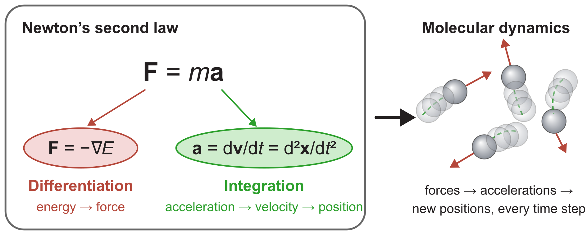
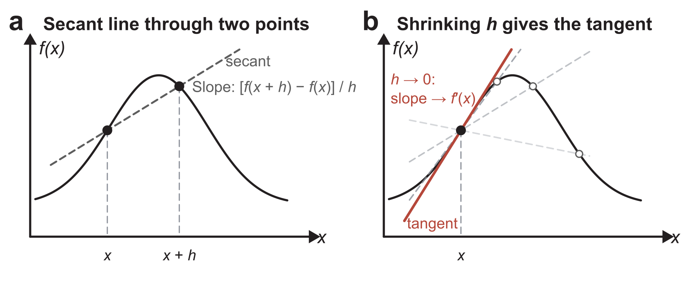
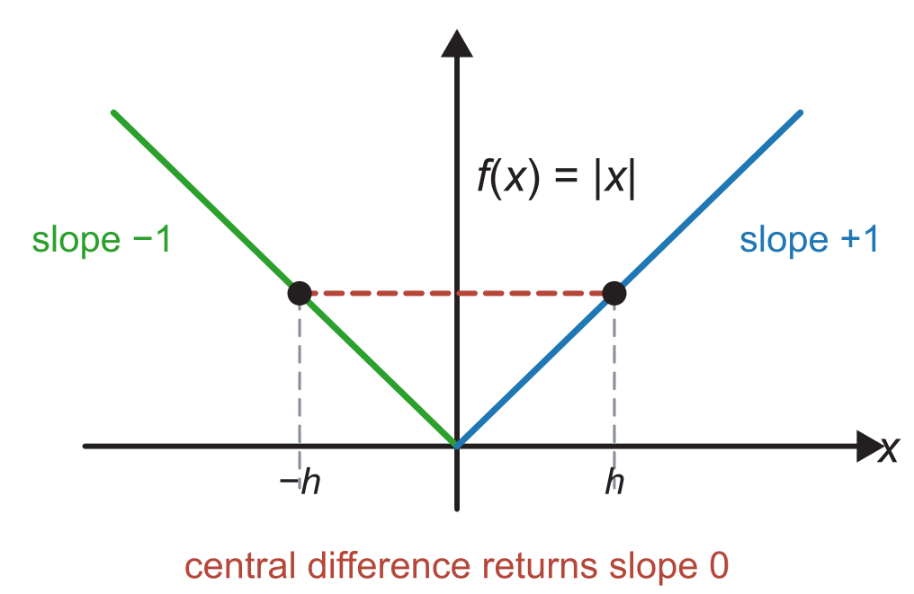
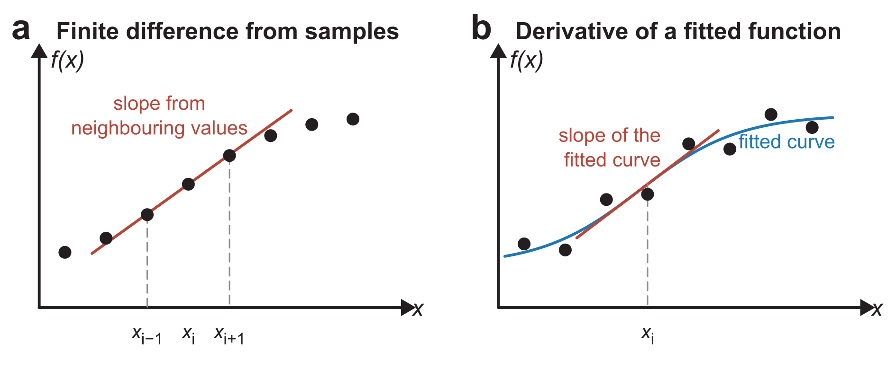
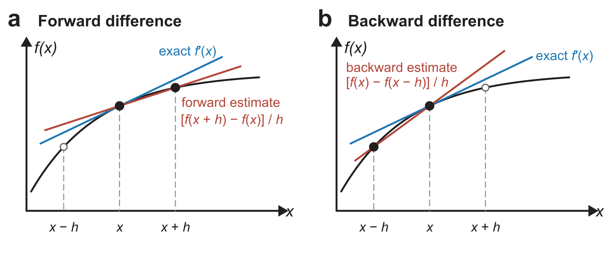
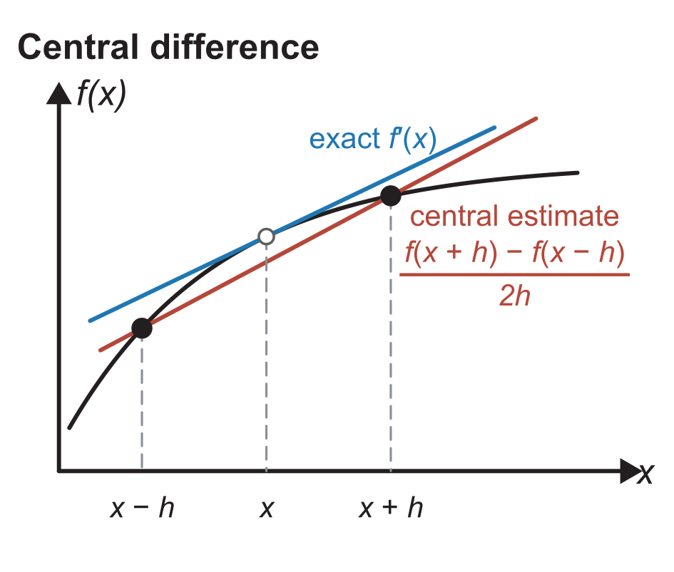
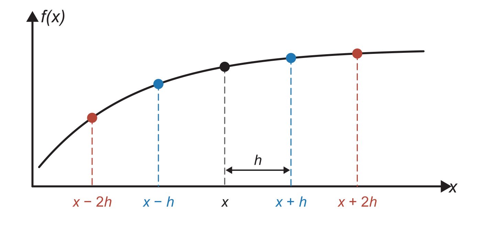
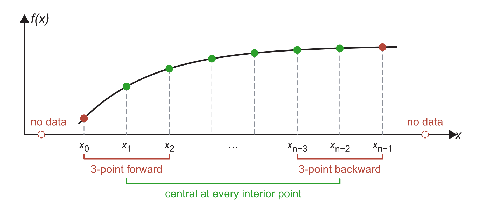
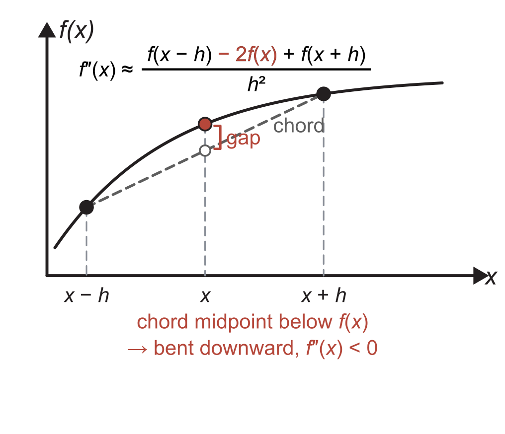

::: {.callout-note}
## Central question

**A computer knows a function only through its values at chosen points. How can it calculate a derivative, such as the force $F=-\mathrm dE/\mathrm dx$, and how accurate is the result?**
:::

## Learning outcomes

By the end of this lecture, you should be able to:

1. **Explain** the derivative as the limiting slope of a secant line, and recognize a point where a function has no derivative.
2. **Derive** the forward, backward, and central difference formulas from Taylor series and state the order of their truncation errors.
3. **Construct** three-point one-sided formulas that keep $O(h^2)$ accuracy at the ends of a data set.
4. **Apply** tabulated $O(h^2)$ formulas to calculate higher derivatives.
5. **Implement** a finite-difference stencil on a NumPy array with a loop and with array slicing, and calculate derivatives with `np.gradient` and `scipy.differentiate.derivative`.

## Unit 4: how do atoms move?

Unit 3 found where atoms sit when the forces on them balance. Unit 4 asks how they move in time. A simulation of atomic motion follows Newton's second law for every atom:

$$
\mathbf F=m\mathbf a .
$$

Both sides of this equation contain derivatives. The force comes from the energy model, as in L11 and L14: $\mathbf F=-\nabla E$, so **differentiating** the energy with respect to the atomic coordinates gives the force on each atom. The acceleration is a time derivative, $\mathbf a=\mathrm d\mathbf v/\mathrm dt=\mathrm d^2\mathbf x/\mathrm dt^2$. To find where the atoms go, we have to reverse this relation and **integrate**. The velocity accumulates the acceleration, and the position accumulates the velocity:

$$
\mathbf v(t)=\mathbf v_0+\int_0^t \mathbf a\,\mathrm dt', \qquad \mathbf x(t)=\mathbf x_0+\int_0^t \mathbf v\,\mathrm dt' .
$$

{#fig-newton-md width="100%" fig-alt="Left: F equals m a, with the force linked to the negative gradient of the energy (differentiation, red) and the acceleration linked to the first time derivative of velocity and second time derivative of position (integration, green). Right: four atoms with red force arrows and dashed green recent paths, labelled molecular dynamics."}

Repeating these two operations at every time step is the core of **molecular dynamics (MD)**, one of the most widely used methods in materials simulation. MD trajectories are used to study:

- diffusion of atoms in solids and liquids,
- melting and solidification,
- crack growth,
- the mechanical response of nanostructures.

Knowing how to differentiate and integrate on a computer already takes us a long way towards such simulations. The next few lectures build these two tools, and the unit ends by combining them to move an atomic system.

## What is a derivative?

Let us return to calculus. For a function of one variable, $f(x)$, the derivative is written $f'(x)$ ("f prime") or $\mathrm df/\mathrm dx$, where $\mathrm d/\mathrm dx$ is an operator acting on $f$. It is defined as a limit:

$$
f'(x)=\frac{\mathrm d f}{\mathrm d x}=\lim_{h\to 0}\frac{f(x+h)-f(x)}{h}.
$$

Here $h$ is a small step in $x$. The fraction is the slope of the **secant line** through the points $(x, f(x))$ and $(x+h, f(x+h))$. As $h$ shrinks, the second point slides along the curve towards the first, and the secant approaches the **tangent line** at $x$ (@fig-secant-tangent). The derivative is the slope of that tangent. We used the same picture in [L06](../../02/L06/index.qmd), where bringing the two secant points together turned the secant method into Newton–Raphson.

{#fig-secant-tangent width="100%" fig-alt="Panel a: a bell-shaped curve with a dashed secant line through two points at x and x plus h. Panel b: several faint secant lines through the point at x and nearer points, converging to a red tangent line at x."}

Differentiating again gives **higher-order derivatives**. The second derivative, $f''(x)=\mathrm d^2f/\mathrm dx^2$, measures how fast the slope itself changes, which is how strongly the curve bends. We write $f'''(x)$ for the third derivative and $f^{(n)}(x)$ for the $n$th. The first two orders appear throughout materials modelling:

- **First derivative:**
  - of the energy with respect to position, the force, $F=-\mathrm dE/\mathrm dx$ (L11, L14);
  - of position with respect to time, the velocity, $v=\mathrm dx/\mathrm dt$.
- **Second derivative:**
  - of the energy with respect to position, the bond stiffness, $k=\mathrm d^2E/\mathrm dx^2$, which we met as a spring constant in L11 and as the Hessian in L15–L16;
  - of position with respect to time, the acceleration, $a=\mathrm d^2x/\mathrm dt^2$.

::: {.callout-caution}
## Not every function has a derivative

The limit in the definition must give the same value whether $h$ approaches zero from the positive or the negative side. Only then is $f$ **differentiable** at $x$, and continuity alone does not guarantee it. The absolute value $f(x)=|x|$ is continuous at $x=0$, but its slope is $-1$ from the left and $+1$ from the right, so $f'(0)$ does not exist.

{#fig-abs-x width="55%" fig-alt="V-shaped graph of the absolute value of x, green on the left with slope minus one and blue on the right with slope plus one. A red dashed horizontal line joins the points at minus h and h."}

A numerical formula still returns a number at such a point. The central difference introduced below gives $\big(|h|-|-h|\big)/(2h)=0$ for every $h$, a plausible-looking slope where no derivative exists. Finite-difference formulas assume that the function is smooth near $x$, and every error estimate in this lecture depends on that assumption.

**This is a main reason why fitting and optimization usually minimize the squared error $r^2$ instead of the absolute error $|r|$: the squared error has a derivative everywhere, including at $r=0$.**
:::

## How do we calculate a derivative?

Which route we can take depends on what we know about the function:

1. **Analytical derivative.** If we have a formula, such as the Lennard–Jones pair energy, we differentiate it by hand and code the result. This is how we obtained $V'(r)$ and $V''(r)$ in L14.
2. **Finite difference.** If we only have values of $f$ at discrete points, from measurements or from a program we cannot differentiate by hand, we keep the fraction from the definition but stop at a small, finite $h$. The slope then comes from neighbouring values (@fig-derivative-routes a).
3. **Fit, then differentiate.** We can fit or interpolate a function to the discrete data, as in L08–L09, and differentiate that function analytically. This brings us back to route 1 (@fig-derivative-routes b).

{#fig-derivative-routes width="100%" fig-alt="Panel a: evenly spaced black sample points with a red line through the neighbours of x sub i. Panel b: scattered samples with a blue fitted curve and a red tangent to the curve at x sub i."}

This lecture develops route 2, the **finite-difference** method. L18 compares it with route 3 for data that contain noise.

## Finite differences from secant lines

Suppose we can evaluate $f$ at $x$ and at neighbouring points a distance $h$ away. There are three natural secant lines near $x$. The **forward difference** uses $x$ and the point ahead, $x+h$. The **backward difference** uses $x$ and the point behind, $x-h$ (@fig-forward-backward):

$$
f'(x)\approx\frac{f(x+h)-f(x)}{h}\quad\text{(forward)},\qquad
f'(x)\approx\frac{f(x)-f(x-h)}{h}\quad\text{(backward)}.
$$

{#fig-forward-backward width="100%" fig-alt="Two panels with the same rising, flattening curve and points at x minus h, x, and x plus h. In panel a the red forward secant through x and x plus h is shallower than the blue tangent. In panel b the red backward secant through x minus h and x is steeper."}

The **central difference** skips $f(x)$ and joins the neighbours on both sides:

$$
f'(x)\approx\frac{f(x+h)-f(x-h)}{2h}\quad\text{(central)}.
$$

Its secant line in @fig-central does not pass through $(x, f(x))$, yet it is nearly parallel to the tangent there.

{#fig-central width="55%" fig-alt="A rising, flattening curve with a red secant through the points at x minus h and x plus h, nearly parallel to the blue tangent at x."}

### A worked comparison

- **Function:** $f(x)=x^3$.
- **Exact derivative:** $f'(x)=3x^2$, so $f'(3)=27$.
- **Question:** with $h=1$, what do the three formulas give at $x=3$? They use the points $x=2, 3, 4$, where $f$ takes the values 8, 27, and 64.

| Formula | Calculation | Result | Error | Relative error |
|---|---|:-:|:-:|:-:|
| Forward | $(64-27)/1$ | 37 | $+10$ | 37% |
| Backward | $(27-8)/1$ | 19 | $-8$ | 30% |
| Central | $(64-8)/2$ | 28 | $+1$ | 3.7% |

The central estimate is about ten times closer to the exact value, from the same three function values. It is also the average of the other two, $(37+19)/2=28$, so the forward and backward errors of opposite sign largely cancel. Move the `h` slider in the notebook below and compare how quickly each error shrinks.

::: {.quarto-wasm-local notebook="l17_fd_formulas.edit.py" view="edit" title="Forward, backward, and central differences of x³ at x = 3" height="620" loading="lazy" fullscreen="true"}
For $f(x)=x^3$ at $x=3$ with $h=1$, the forward, backward, and central differences give 37, 19, and 28, against the exact value 27. With $h=0.5$ the errors become $+4.75$, $-4.25$, and $+0.25$. Halving $h$ roughly halves the one-sided errors and divides the central error by four.
:::

The central difference is better both geometrically, since its secant is nearly parallel to the tangent (@fig-central), and numerically. To see why, and to predict by how much, we need Taylor series.

## Taylor series: where the error comes from

A smooth function can be expanded in powers of the step around $x$. We will need the values at the evenly spaced points of @fig-stencil.

{#fig-stencil width="75%" fig-alt="A smooth curve with five marked points at x minus 2h, x minus h, x, x plus h, and x plus 2h. The spacing h is marked between x and x plus h."}

$$
\begin{aligned}
f(x+h) &= f(x) + h f'(x) + \frac{h^2}{2!}f''(x) + \frac{h^3}{3!}f'''(x) + \frac{h^4}{4!}f^{(4)}(x)+\cdots\\
f(x-h) &= f(x) - h f'(x) + \frac{h^2}{2!}f''(x) - \frac{h^3}{3!}f'''(x) + \frac{h^4}{4!}f^{(4)}(x)-\cdots\\
f(x+2h) &= f(x) + 2h f'(x) + \frac{(2h)^2}{2!}f''(x) + \frac{(2h)^3}{3!}f'''(x) + \cdots\\
f(x-2h) &= f(x) - 2h f'(x) + \frac{(2h)^2}{2!}f''(x) - \frac{(2h)^3}{3!}f'''(x) + \cdots
\end{aligned}
$$

All derivatives are evaluated at the centre point $x$. A step backwards is the same series with $h$ replaced by $-h$, so the odd powers change sign. Because $h$ is small, each term is much smaller than the one before it, and the first term a formula leaves out controls its error.

### Forward and backward differences: $O(h)$

Subtract $f(x)$ from the first expansion and divide by $h$:

$$
\frac{f(x+h)-f(x)}{h}=f'(x)+\underbrace{\frac{h}{2}f''(x)+\frac{h^2}{6}f'''(x)+\cdots}_{\text{truncation error}}
= f'(x)+O(h).
$$

The terms that the formula drops form its **truncation error**, because we have truncated the Taylor series. For small $h$ the first of them dominates, so the error is proportional to $h$. The notation $O(h)$, read "order $h$", records this proportionality: halving $h$ halves the error. The backward difference has the same order, with the opposite sign on the leading term:

$$
\frac{f(x)-f(x-h)}{h}=f'(x)-\frac{h}{2}f''(x)+\frac{h^2}{6}f'''(x)-\cdots= f'(x)+O(h).
$$

### Central difference: $O(h^2)$

Subtract the second expansion from the first. The $f(x)$ and $f''(x)$ terms cancel:

$$
f(x+h)-f(x-h)=2hf'(x)+\frac{2h^3}{3!}f'''(x)+\cdots=2hf'(x)+\frac{h^3}{3}f'''(x)+\cdots
$$

Dividing by $2h$ gives

$$
\frac{f(x+h)-f(x-h)}{2h}=f'(x)+\frac{h^2}{6}f'''(x)+\cdots= f'(x)+O(h^2).
$$

The symmetric points cancel every even power of $h$ in the numerator, so the leading error is proportional to $h^2$, and halving $h$ divides it by four.

For $f(x)=x^3$ the series stop after the cubic term, because $f''(3)=18$, $f'''=6$, and all higher derivatives are zero. The error terms therefore reproduce the worked example exactly. The forward error is $\tfrac12(18)+\tfrac16(6)=10$, the backward error is $-9+1=-8$, and the central error is $\tfrac16(6)=1$.

### Summary: truncation errors of first-derivative formulas

$$
\boxed{
\begin{aligned}
\text{forward:}&\quad \frac{f(x+h)-f(x)}{h}=f'(x)+O(h)\\[4pt]
\text{backward:}&\quad \frac{f(x)-f(x-h)}{h}=f'(x)+O(h)\\[4pt]
\text{central:}&\quad \frac{f(x+h)-f(x-h)}{2h}=f'(x)+O(h^2)
\end{aligned}}
$$

For smooth data at the same spacing, the central difference generally gives a smaller truncation error. When function values require new calculations, we must also compare evaluation cost and numerical precision, as we will in L18.

::: {.callout-important}
## Choose at least $O(h^2)$ whenever possible

On a table of values, an $O(h^2)$ formula needs no extra data: the central difference uses the same neighbouring values as the forward and backward differences. Treat the $O(h)$ formulas as a fallback, and keep $O(h^2)$ accuracy even at the ends of the data, as the next section shows.
:::

## Keeping $O(h^2)$ accuracy at the ends of the data

If central differences are better, why not use them everywhere? On a set of samples $x_0, x_1, \ldots, x_{n-1}$, every interior point has a neighbour on both sides. The first point has no left neighbour and the last point has no right one (@fig-endpoints). Two-point forward and backward differences at the ends would bring back $O(h)$ errors, and the derivative of the whole data set would be only as accurate as its worst points.

{#fig-endpoints width="100%" fig-alt="Eight samples on a curve, labelled x sub 0 to x sub n minus 1. Hollow markers beyond each end are labelled no data. Brackets below mark three-point forward at the left end, three-point backward at the right end, and central at every interior point."}

The remedy is to use one more point on the side where data exist. At the left end, write the expansions for the two points ahead:

$$
\begin{aligned}
E_1:\quad f(x+h) &= f(x) + h f'(x) + \frac{h^2}{2}f''(x) + \frac{h^3}{6}f'''(x)+\cdots\\
E_2:\quad f(x+2h) &= f(x) + 2h f'(x) + 2h^2 f''(x) + \frac{4h^3}{3}f'''(x)+\cdots
\end{aligned}
$$

The $f''(x)$ term made the two-point formula $O(h)$, so we combine the equations to eliminate it. Its coefficient in $E_2$ is four times that in $E_1$, so we form $E_2-4E_1$:

$$
f(x+2h)-4f(x+h) = -3f(x) - 2hf'(x) + \frac{2h^3}{3}f'''(x)+\cdots
$$

Solving for $f'(x)$ gives the **three-point forward difference**:

$$
\frac{-3f(x)+4f(x+h)-f(x+2h)}{2h}=f'(x)-\frac{h^2}{3}f'''(x)+\cdots=f'(x)+O(h^2).
$$

Replacing $h$ by $-h$ gives the **three-point backward difference** for the right end:

$$
\frac{3f(x)-4f(x-h)+f(x-2h)}{2h}=f'(x)-\frac{h^2}{3}f'''(x)+\cdots=f'(x)+O(h^2).
$$

For $x^3$ at $x=3$ with $h=1$, the three-point forward formula gives $(-81+256-125)/2=25$. Its error, $-2=-\tfrac13(6)$, is the predicted value. The error constant $1/3$ is twice the central value of $1/6$, but both errors shrink as $h^2$.

::: {.callout-tip}
## Match the truncation order

Pair central differences in the interior with three-point one-sided differences at the ends, so that every point has an $O(h^2)$ error. If $O(h)$ formulas are mixed in, the least accurate points control the result.
:::

## Higher derivatives

### The central second difference

Adding the expansions of $f(x+h)$ and $f(x-h)$, instead of subtracting them, cancels the odd powers and keeps $f''(x)$:

$$
f(x+h)+f(x-h)=2f(x)+h^2f''(x)+\frac{h^4}{12}f^{(4)}(x)+\cdots
$$

Rearranging gives the **central second difference**, with a leading error of $\frac{h^2}{12}f^{(4)}(x)$:

$$
\boxed{f''(x)=\frac{f(x-h)-2f(x)+f(x+h)}{h^2}+O(h^2)}
$$

The numerator equals $2\big[\tfrac12\big(f(x-h)+f(x+h)\big)-f(x)\big]$, twice the height of the chord midpoint measured from $f(x)$. How to read it (@fig-second-derivative):

- **Curve bends downward:** $f(x)$ lies above the chord midpoint, so the numerator is negative and $f''(x)<0$.
- **Curve bends upward:** $f(x)$ lies below the chord midpoint, so $f''(x)>0$.
- **Straight line:** $f(x)$ lies on the chord, so $f''(x)=0$.

For a bonded atom near equilibrium, three energy evaluations give the bond stiffness $k=E''(x)$ in this way. The finite-difference Hessians in L16 were built in the same way, one coordinate at a time.

{#fig-second-derivative width="55%" fig-alt="A concave curve with points at x minus h, x, and x plus h. A dashed chord joins the outer points. Its midpoint, a hollow marker, lies below the curve at x, and a red bracket marks the gap."}

With $x^3$ at $x=3$ and $h=1$, $(8-2\cdot27+64)/1^2=18=f''(3)$. The result is exact because $f^{(4)}=0$.

### A table of $O(h^2)$ formulas

The same elimination produces formulas for any derivative. We write the expansions at the points we can use, then choose coefficients that cancel every unwanted term below the target accuracy. Textbooks collect the results in tables [@kiusalaas2013, ch. 5]. For practical work, a finite-difference formula should be at least $O(h^2)$, so the tables below list only $O(h^2)$ formulas. To use a row:

- multiply each function value by the coefficient in its column,
- add the products,
- divide by the denominator.

| Derivative | Denominator | $f(x-2h)$ | $f(x-h)$ | $f(x)$ | $f(x+h)$ | $f(x+2h)$ |
|:-:|:-:|:-:|:-:|:-:|:-:|:-:|
| $f'(x)$ | $2h$ | | $-1$ | $0$ | $1$ | |
| $f''(x)$ | $h^2$ | | $1$ | $-2$ | $1$ | |
| $f'''(x)$ | $2h^3$ | $-1$ | $2$ | $0$ | $-2$ | $1$ |
| $f^{(4)}(x)$ | $h^4$ | $1$ | $-4$ | $6$ | $-4$ | $1$ |

: Central differences, $O(h^2)$ {#tbl-central .fd-table}

| Derivative | Denominator | $f(x)$ | $f(x+h)$ | $f(x+2h)$ | $f(x+3h)$ | $f(x+4h)$ | $f(x+5h)$ |
|:-:|:-:|:-:|:-:|:-:|:-:|:-:|:-:|
| $f'(x)$ | $2h$ | $-3$ | $4$ | $-1$ | | | |
| $f''(x)$ | $h^2$ | $2$ | $-5$ | $4$ | $-1$ | | |
| $f'''(x)$ | $2h^3$ | $-5$ | $18$ | $-24$ | $14$ | $-3$ | |
| $f^{(4)}(x)$ | $h^4$ | $3$ | $-14$ | $26$ | $-24$ | $11$ | $-2$ |

: Forward differences, $O(h^2)$ {#tbl-forward .fd-table}

| Derivative | Denominator | $f(x-5h)$ | $f(x-4h)$ | $f(x-3h)$ | $f(x-2h)$ | $f(x-h)$ | $f(x)$ |
|:-:|:-:|:-:|:-:|:-:|:-:|:-:|:-:|
| $f'(x)$ | $2h$ | | | | $1$ | $-4$ | $3$ |
| $f''(x)$ | $h^2$ | | | $-1$ | $4$ | $-5$ | $2$ |
| $f'''(x)$ | $2h^3$ | | $3$ | $-14$ | $24$ | $-18$ | $5$ |
| $f^{(4)}(x)$ | $h^4$ | $-2$ | $11$ | $-24$ | $26$ | $-14$ | $3$ |

: Backward differences, $O(h^2)$ {#tbl-backward .fd-table}

The $f''(x)$ row of @tbl-forward, for example, reads

$$
f''(x)\approx\frac{2f(x)-5f(x+h)+4f(x+2h)-f(x+3h)}{h^2}.
$$

Suppose we have only the samples $f(2)=8$, $f(3)=27$, $f(4)=64$, and $f(5)=125$ of $x^3$, with $h=1$, and we need $f''$ at the first point, $x=2$. The central formula would need $f(1)$, which is not in the data, so we use the forward row:

$$
f''(2)\approx\frac{2(8)-5(27)+4(64)-125}{1^2}=12,
$$

which equals the exact value $6\cdot2=12$. Two quick checks help when copying a formula:

- **The coefficients in each row add up to zero**, because a constant function has zero derivatives.
- **The backward table is the forward table read from right to left**, with the signs reversed for the odd derivatives.

## Using the finite-difference formulas in Python

In NumPy [@harris2020numpy], the samples $x_0,\ldots,x_{n-1}$ are stored in an array `x` with indices `0` to `n-1`, and their function values in a second array `fx`. A stencil is applied the same way at every interior index `i`, and the end indices `0` and `n-1` take the three-point formulas. There are two ways to write this:

1. **Loop.** Visit the interior indices one at a time, `for i in range(1, n - 1)`, and evaluate `(fx[i + 1] - fx[i - 1]) / (2 * h)`. The code follows the formula symbol by symbol.
2. **Array slicing.** Evaluate the stencil for all interior points in one line, replacing the interior entries of the result in place:

   ```python
   dfx[1:-1] = (fx[2:] - fx[:-2]) / (2 * h)
   ```

   How to read the slices:

   - `fx[2:]` holds $f(x_{i+1})$ for $i=1,\ldots,n-2$, the right neighbours;
   - `fx[:-2]` holds $f(x_{i-1})$ for the same $i$, the left neighbours;
   - `dfx[1:-1]` is the interior of the result, where the central values belong.

Both versions give the same numbers. The sliced version hands the whole calculation to NumPy's compiled code, which is much faster for long arrays, as we saw in L04. The same pattern gives the second difference, `(fx[2:] - 2 * fx[1:-1] + fx[:-2]) / h**2`.

::: {.quarto-wasm-local notebook="l17_fd_stencil.edit.py" view="edit" title="Central and three-point differences on a NumPy array, written as a loop and with array slicing" height="980" loading="lazy" fullscreen="true"}
For $f(x)=x^3$ sampled at $x=0,1,\ldots,5$ with $h=1$, the loop and the sliced version both return $-2, 4, 13, 28, 49, 73$, against the exact $0, 3, 12, 27, 48, 75$. Every interior error is $+1=h^2f'''/6$ and both end errors are $-2=-h^2f'''/3$. The sliced second difference at the interior points gives $6, 12, 18, 24$, equal to the exact $6x$.
:::

## Using stock functions in NumPy and SciPy

NumPy and SciPy already provide these calculations:

- **`np.diff(fx)`** returns the $n-1$ differences `fx[i+1] - fx[i]`. It does not divide by the spacing. After division by `h`, it gives the $O(h)$ forward difference at each $x_i$, with no value at the last point.
- **`np.gradient(fx, h, edge_order=2)`** does what our stencil code does. It uses central differences in the interior and three-point one-sided differences at both ends, so every value is $O(h^2)$ and the output has the same length as the input.
  - For unevenly spaced samples, pass the coordinates in place of the spacing, `np.gradient(fx, x, edge_order=2)`.
  - The default, `edge_order=1`, uses two-point differences at the ends.
- **`scipy.differentiate.derivative(f, x)`**, available from SciPy 1.15 [@virtanen2020scipy], works on a Python function, so it can choose where to evaluate `f`.
  - It evaluates `f` on a central stencil around `x`, using an eighth-order formula by default (`order=8`).
  - It shrinks the step over several iterations and stops when successive estimates agree.
  - The result holds the derivative `res.df`, an error estimate `res.error`, and the number of function calls `res.nfev`.
  - Because it needs a callable function, it cannot be applied to a fixed table of measured values.

::: {.quarto-wasm-local notebook="l17_fd_library.edit.py" view="edit" title="np.diff, np.gradient, and scipy.differentiate.derivative" height="640" loading="lazy" fullscreen="true"}
For $f(x)=x^3$ sampled at $x=0,1,\ldots,5$, `np.gradient(fx, 1.0, edge_order=2)` returns $-2, 4, 13, 28, 49, 73$, the same values as our stencil code. `np.diff(fx)` returns only five values, $1, 7, 19, 37, 61$. For a callable function, `derivative(np.sin, 1.0)` matches $\cos 1$ to about $5\times10^{-15}$, reports an error estimate of $1.4\times10^{-12}$, and uses 11 function calls.
:::

## What to keep

- A finite difference replaces the limit in the derivative with a small, finite step $h$ and uses function values at neighbouring points.
- Taylor series give the truncation error of each formula. Forward and backward differences are $O(h)$, while the central first and second differences are $O(h^2)$.
- Three-point one-sided formulas keep $O(h^2)$ accuracy at the ends of a data set.
- A stencil can be applied to an array with a loop or, much faster, with array slicing such as `fx[2:] - fx[:-2]`.
- Coefficient tables give higher derivatives with the same order of accuracy. Each row sums to zero.
- `np.gradient(..., edge_order=2)` applies the same $O(h^2)$ stencils to sampled arrays, while `scipy.differentiate.derivative` needs a callable function and chooses its own evaluation points.

## Check your understanding

1. Explain, using the Taylor series, why the forward difference underestimates the slope of a curve that bends downward.
2. Halving $h$ reduces the error of a derivative estimate from $4\times10^{-3}$ to $1\times10^{-3}$. Which kind of formula was probably used?
3. A data set has 50 evenly spaced points. Which formula does `np.gradient(fx, h, edge_order=2)` apply at indices 0, 1, 25, and 49?
4. Use the central table to estimate $f'''(3)$ for $f(x)=x^3$ with $h=1$. Why is the result exact?

## Next

The truncation errors suggest that we should simply make $h$ smaller. Try it with the central difference of $x^3$ at $x=3$. With $h=10^{-5}$ the error is about $2\times10^{-10}$, but with $h=10^{-13}$ the result is 26.965, an error of 0.035. Should we chase $h$ as small as possible? In L18 we will find out what goes wrong, and compare finite differences with differentiating a fitted function.
