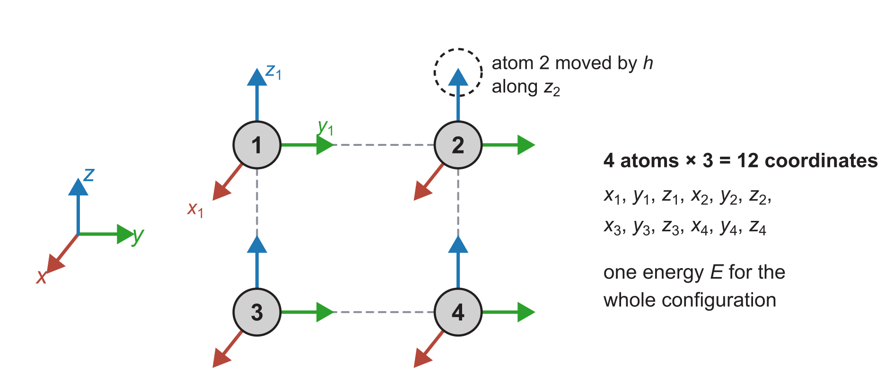

::: {.callout-note}
## Central question

**What cautions should we take when we calculate derivatives numerically?**
:::

## Learning outcomes

By the end of this lecture, you should be able to:

1. **Implement** first- and second-derivative functions for a Python function and for a sampled NumPy array with $O(h^2)$ accuracy at every point, and check them against `scipy.differentiate.derivative` and `np.gradient`.
2. **Explain** the total error of a finite difference as the sum of truncation and round-off contributions, and choose a reasonable step size.
3. **Compare** derivatives calculated directly from noisy data with derivatives of a fitted function.
4. **Count** the energy evaluations needed for the gradient and Hessian of $N$ atoms, and explain how a large total energy can hide a small force (reading material).

## The $O(h^2)$ formulas from L17

L17 derived finite-difference formulas from Taylor series. For the first derivative, we compared two formulas that each use two function values:

- **Forward difference:** $\dfrac{f(x+h)-f(x)}{h}$, with an $O(h)$ error.
- **Central difference:** $\dfrac{f(x+h)-f(x-h)}{2h}$, with an $O(h^2)$ error.

From the same amount of data, the central difference gives the more accurate slope, so it is our default for the first derivative. For the second derivative, the central second difference is also $O(h^2)$. These are the two formulas we use throughout this lecture:

$$
\boxed{
\begin{aligned}
f'(x)&=\frac{f(x+h)-f(x-h)}{2h}+O(h^2)\\[4pt]
f''(x)&=\frac{f(x+h)-2f(x)+f(x-h)}{h^2}+O(h^2)
\end{aligned}}
$$

At the first and last points of a data set, one neighbour is missing, and the three-point one-sided formulas from L17 keep the same $O(h^2)$ accuracy.

## Finite differences as Python functions

A finite-difference formula can receive two kinds of input. When the function is available as Python code, we can evaluate it wherever the stencil needs a value. When we have only a table of values, from a measurement or an earlier calculation, the stencil can use only the points in the table. The two cases lead to two kinds of Python function, and each has a library routine that performs the same calculation.

### Derivatives of a Python function at a point

Given a function `f`, a point `x`, and a step `h`, each formula becomes one line:

```python
def central(f, x, h):
    return (f(x + h) - f(x - h)) / (2 * h)

def central_second(f, x, h):
    return (f(x + h) - 2 * f(x) + f(x - h)) / h**2
```

These functions are written for a single point `x`. They also accept a NumPy array of points, provided that `f` returns an array of values when it receives an array. Functions built from NumPy operations, such as `np.sin(x)` or `x**3`, do this. A function that uses `math.sin` or an `if` test on `x` works only for single numbers.

SciPy performs this calculation with an automatic choice of step:

- **`scipy.differentiate.derivative(f, x)`** differentiates a Python function at the point `x` [@virtanen2020scipy].
  - It chooses its own evaluation points and refines the step until successive estimates agree.
  - It returns the derivative `res.df`, an error estimate `res.error`, and the number of function calls `res.nfev`.
  - It computes first derivatives only. Its `order` argument sets the accuracy order of the stencil, not the order of the derivative.
  - A second derivative takes more work. We can nest two calls, `derivative(lambda x: derivative(f, x).df, x)`, or use `scipy.differentiate.hessian`, which expects a function of a vector and returns a matrix of second derivatives. For a function of one variable, `central_second` is the more direct choice.

### Derivatives of sampled data in a NumPy array

Measured or tabulated data give no function to call, only values at fixed points. The neighbours $f(x\pm h)$ are then the adjacent entries of an array, and the first and last entries have a neighbour on one side only. In L17 we applied the central stencil to an array, first with a loop and then with array slicing, and handled the end points separately. Collecting the interior and end-point formulas into functions gives a tool we can reuse on any evenly spaced data. Suppose an array `f` holds $n$ function values with spacing `h`, so `f` is now a table of numbers rather than a Python function. We want an array `fp` of the same length that holds $f'$ at every sample.

We label the samples by their index: $f_i$ is the entry `f[i]`, the value $f(x_i)$ at $x_i=x_0+ih$, for $i=0,1,\dots,n-1$.

- **Interior points**, $i=1,\dots,n-2$, have a neighbour on each side and use the central formulas.
- **The first point**, $i=0$, has neighbours only to its right and uses a forward formula.
- **The last point**, $i=n-1$, has neighbours only to its left and uses a backward formula.

To keep the $O(h^2)$ accuracy of the central formulas, each one-sided formula uses one more point than its central counterpart (L17).

**First derivative**, two points in the interior and three at each end:

$$
\begin{aligned}
\text{interior, } i=1,\dots,n-2:&\quad f'_i=\frac{f_{i+1}-f_{i-1}}{2h}\\[6pt]
\text{first point, } i=0:&\quad f'_0=\frac{-3f_0+4f_1-f_2}{2h}\\[6pt]
\text{last point, } i=n-1:&\quad f'_{n-1}=\frac{3f_{n-1}-4f_{n-2}+f_{n-3}}{2h}
\end{aligned}
$$

**Second derivative**, three points in the interior and four at each end:

$$
\begin{aligned}
\text{interior, } i=1,\dots,n-2:&\quad f''_i=\frac{f_{i+1}-2f_i+f_{i-1}}{h^2}\\[6pt]
\text{first point, } i=0:&\quad f''_0=\frac{2f_0-5f_1+4f_2-f_3}{h^2}\\[6pt]
\text{last point, } i=n-1:&\quad f''_{n-1}=\frac{2f_{n-1}-5f_{n-2}+4f_{n-3}-f_{n-4}}{h^2}
\end{aligned}
$$

All six formulas have an $O(h^2)$ error. In NumPy, negative indices count back from the end of the array, and a slice collects the same neighbour for every interior point at once (@fig-array-stencil):

- $f_0,\ f_1,\ f_2,\ f_3$ ↔ `f[0]`, `f[1]`, `f[2]`, `f[3]`
- $f_{n-1},\ f_{n-2},\ f_{n-3},\ f_{n-4}$ ↔ `f[-1]`, `f[-2]`, `f[-3]`, `f[-4]`
- $f_{i-1},\ f_i,\ f_{i+1}$ for all interior $i$ ↔ `f[:-2]`, `f[1:-1]`, `f[2:]`

![Central differences on a NumPy array. Each interior entry of `fp` combines the entries of `f` on either side, for example `fp[1]` from `f[0]` and `f[2]` (blue). The slices `f[2:]` and `f[:-2]` line up the right and left neighbours of every interior point, so one line fills `fp[1:-1]` (green). The two end entries (red) need the three-point one-sided formulas.](../../../assets/L18-array-stencil.png){#fig-array-stencil width="100%" fig-alt="Two rows of array cells labelled f and fp, indexed 0 to n minus 1. Blue arrows from f[0] and f[2] point to fp[1]. Brackets above f mark the slices f[:-2], from index 0 to n minus 3, and f[2:], from index 2 to n minus 1. The interior cells of fp are green and labelled fp[1:-1] = (f[2:] - f[:-2]) / (2*h). The end cells are red and labelled 3-point forward and 3-point backward."}

A complete function has three steps:

1. **Create the output array.** `np.empty_like(f)` allocates an array with the same shape and type as `f` without setting its entries, so every entry must be filled afterwards. `np.zeros_like(f)` starts from zeros, which makes a forgotten entry easier to spot.
2. **Fill the interior.** One sliced line applies the central difference at indices $1$ to $n-2$. A loop over `range(1, len(f) - 1)` gives the same numbers, more slowly.
3. **Fill the two ends.** Index $0$ takes a one-sided forward formula, and index $n-1$ takes a one-sided backward formula.

Each line of the two functions below is one of the six formulas above, written with these indices and slices:

```python
import numpy as np

def first_der(f, h):
    fp = np.empty_like(f)
    fp[1:-1] = (f[2:] - f[:-2]) / (2 * h)                         # central, interior
    fp[0] = (-3 * f[0] + 4 * f[1] - f[2]) / (2 * h)               # three-point forward
    fp[-1] = (3 * f[-1] - 4 * f[-2] + f[-3]) / (2 * h)            # three-point backward
    return fp

def second_der(f, h):
    fpp = np.empty_like(f)
    fpp[1:-1] = (f[2:] - 2 * f[1:-1] + f[:-2]) / h**2             # central, interior
    fpp[0] = (2 * f[0] - 5 * f[1] + 4 * f[2] - f[3]) / h**2       # four-point forward
    fpp[-1] = (2 * f[-1] - 5 * f[-2] + 4 * f[-3] - f[-4]) / h**2  # four-point backward
    return fpp
```

For first derivatives of an array, NumPy already provides this function:

- **`np.gradient(f, h, edge_order=2)`** performs the calculation in `first_der`, with central differences in the interior and three-point one-sided differences at both ends [@harris2020numpy].
  - `edge_order=2` keeps the ends at $O(h^2)$. The default, `edge_order=1`, uses two-point $O(h)$ formulas there.
  - Applying `np.gradient` twice gives a second derivative, but its interior stencil reaches out to $x\pm2h$, so its error is four times that of `second_der`.

### A Lennard–Jones pair from a table of energies (after-class practice material)

To apply these functions to a materials example, return to the Lennard–Jones (LJ) pair energy from L14. In reduced units, with the separation $r$ in $\sigma$ and the energy in $\varepsilon$,

$$
V(r)=4\left(r^{-12}-r^{-6}\right).
$$

- **Given:** $V$ tabulated at evenly spaced separations from $r=1.0$ to $r=2.0$.
- **Exact answers:** the force $F=-V'(r)=24\left(2r^{-13}-r^{-7}\right)$ and the bond stiffness $V''(r)=24\left(26r^{-14}-7r^{-8}\right)$, both derived in L14.
- **Question:** how close are `-first_der(V, h)` and `second_der(V, h)` to the exact curves, and how do their errors change with the number of samples?

::: {.quarto-wasm-local notebook="l18_fd_functions.edit.py" view="app" title="Force and stiffness of a Lennard–Jones pair from first_der, second_der, np.gradient, and scipy.differentiate" height="600" loading="lazy" fullscreen="true"}
With 21 samples ($h=0.05\,\sigma$), `-first_der` and `-np.gradient(..., edge_order=2)` return identical forces. Their largest error, $3.5\,\varepsilon/\sigma$, occurs at $r=1.0$, on the steep repulsive wall where the force is about $24\,\varepsilon/\sigma$. With 41 and 81 samples, this error falls to 1.15 and $0.33\,\varepsilon/\sigma$, approaching the factor of four per halving expected for $O(h^2)$. The largest stiffness error falls from 122 to 44 to $14\,\varepsilon/\sigma^2$. Applied to the function itself, `scipy.differentiate.derivative` gives $F(1.2)=-2.211693342226\,\varepsilon/\sigma$, against the exact $-2.211693342223$, using 17 function calls.
:::

The errors are largest where the energy curve bends most sharply. The leading error of the central difference is $\tfrac{h^2}{6}V'''$, and $V'''$ is very large on the repulsive wall. The largest error appears at $r=1.0$, where the three-point one-sided formula has an error constant twice as large, $\tfrac{h^2}{3}V'''$. A uniform table therefore needs enough samples to resolve its steepest region.

### The central difference of $x^3$ in a computer

Before trusting finite-difference code, we should test it on a function whose derivative we know exactly.

- **Function:** $f(x)=x^3$.
- **Exact derivative:** $f'(3)=27$.
- **Question:** how large is the error of `central(f, 3.0, h)` for a given $h$?

For a cubic, the central difference has an exact closed form:

$$
\frac{(3+h)^3-(3-h)^3}{2h}=27+h^2 .
$$

The error is exactly $h^2$, the $\tfrac{h^2}{6}f'''$ term with $f'''=6$.

::: {.callout-note collapse="true"}
## Expanding $(3\pm h)^3$ to obtain $27+h^2$

Expanding both cubes,

$$
\begin{aligned}
(3+h)^3&=3^3+3\cdot3^2h+3\cdot3h^2+h^3=27+27h+9h^2+h^3,\\
(3-h)^3&=3^3-3\cdot3^2h+3\cdot3h^2-h^3=27-27h+9h^2-h^3.
\end{aligned}
$$

The even powers cancel in the difference:

$$
\frac{(3+h)^3-(3-h)^3}{2h}=\frac{54h+2h^3}{2h}=27+h^2 .
$$
:::

The prediction for a few steps is:

- $h=0.1$: error $0.01$,
- $h=0.01$: error $10^{-4}$,
- $h=10^{-13}$: error $10^{-26}$, far too small to notice.

What does Python return? Choose $h$ in the notebook below.

::: {.quarto-wasm-local notebook="l18_x3_test.edit.py" view="app" title="Central difference of x³ at x = 3 for a chosen h" height="300" loading="lazy" fullscreen="true"}
For $h=0.1$, $0.01$, and $10^{-3}$, the central difference gives errors of $10^{-2}$, $10^{-4}$, and $10^{-6}$, as predicted. For $h=10^{-5}$ the error is $2.2\times10^{-10}$, about twice the prediction. For $h=10^{-8}$ the error is $-7.5\times10^{-8}$, and for $h=10^{-13}$ the result is 26.965097, an error of $-0.035$ where $10^{-26}$ was predicted. With $h=10^{-15}$ the result is 24.87.
:::

The first rows agree with the Taylor series, but the smallest steps give errors larger than the prediction by many orders of magnitude. The formula is correct, so the extra error comes from how the computer stores and subtracts numbers.

## Problem 1: round-off error

### Subtracting nearly equal numbers

Like the polygon estimate of $\pi$ in Unit 1, numerical differentiation is a competition between truncation error and round-off error. L03 showed that the default `float64` precision is of order $10^{-16}$, so any number stored in the computer can differ from the exact number by a relative amount of up to the machine epsilon, $\epsilon\approx2.2\times10^{-16}$. When we subtract two numbers that agree almost to this precision and divide their difference by a small spacing $h$, the result can carry a **huge** error.

::: {.callout-note collapse="true"}
## Numerical analysis of the $x^3$ test: why $h=10^{-13}$ gives an error of 0.035

A finite difference performs exactly this subtraction and then divides the result by a small number. For $h=10^{-13}$, the values $(3+h)^3$ and $(3-h)^3$ are both close to 27 and differ by only $5.4\times10^{-12}$. Each is stored with an absolute error of order $10^{-15}$, and the step $h$ itself is stored only approximately once it is added to 3. Dividing errors of order $10^{-15}$ by $2h=2\times10^{-13}$ produces a derivative error of order $10^{-2}$, which is what we observed. If $h$ falls below the spacing between stored numbers near $x$, about $4.4\times10^{-16}$ at $x=3$, then `x + h` is stored as `x` and every difference in the numerator is exactly zero. @burden2016numerical [§4.1] give the same error analysis for the three-point formulas.
:::

### Total error: truncation plus round-off

The total error of a finite difference is the sum of two parts: the **truncation error**, from cutting off the Taylor series, and the **round-off error**, from storing and subtracting numbers with finite precision. For the central difference,

$$
E_{\text{central}}(h)=\left|f'_{\text{central}}(h)-f'_{\text{true}}\right|\approx Ah^2+\frac{B}{h}.
$$

- **$A$** is the coefficient of the **truncation error**, which comes from the Taylor series. For the central difference, $A\approx|f'''(x)|/6$. Decreasing $h$ reduces this term.
- **$B$** is the coefficient of the **round-off error**. It depends on the precision $\epsilon$, on the size of the function values being subtracted, and on the operations used to evaluate $f$. Decreasing $h$ increases this term.

A forward difference has the same round-off term but a truncation term $Ah$, with $A\approx|f''(x)|/2$. On a log–log plot against $1/h$, the two errors trace the shapes in @fig-error-vs-step, the same shape we saw in L03.

{#fig-error-vs-step width="90%" fig-alt="Log-log schematic of absolute error against 1/h from 1 to 10 to the 16. The blue forward curve falls with slope minus 1 to a minimum near h of 10 to the minus 8. The red central curve falls with slope minus 2 to a lower minimum near h of 10 to the minus 5. Beyond each minimum, both curves continue as one purple round-off branch proportional to 1/h. The left region is labelled truncation dominates and the right region round-off dominates."}

How to read @fig-error-vs-step:

- **Left part, large $h$:** truncation dominates. The errors fall along straight lines with slopes $-1$ (forward) and $-2$ (central), the orders found in L17.
- **Right part, small $h$:** round-off dominates. Both errors rise together along the purple $B/h$ branch, because both formulas subtract two nearly equal values and divide by a small step.
- **Minimum:** the best achievable accuracy, where the two contributions are about equal.

### Theoretical optimal spacing

Setting the derivative of $Ah^2+B/h$ to zero gives the location of the central-difference minimum:

$$
2Ah-\frac{B}{h^2}=0 \quad\Longrightarrow\quad h_{\text{opt}}=\left(\frac{B}{2A}\right)^{1/3}.
$$

When $x$, $f$, and the derivatives of $f$ are all of order one, $A$ is of order one and $B$ is of order $\epsilon$. The same calculation for the forward difference gives $h_{\text{opt}}=(B/A)^{1/2}$.

### Summary: finite-difference error in a computer

$$
\boxed{
\begin{aligned}
\text{forward:}&\quad E(h)\approx Ah+\frac{B}{h}, &\quad h_{\text{opt}}&\sim\epsilon^{1/2}\approx10^{-8}\\[4pt]
\text{central:}&\quad E(h)\approx Ah^2+\frac{B}{h}, &\quad h_{\text{opt}}&\sim\epsilon^{1/3}\approx10^{-5}
\end{aligned}}
$$

The optimal step $h_{\text{opt}}$ is a theoretical estimate that serves as a ballpark first trial. Its meaning depends on the units. In ångströms, $h=10^{-5}$ is a sensible displacement for an atomic coordinate of about 1 Å. In metres, the same coordinate is about $10^{-10}$, and a step of $10^{-5}$ m would move the atom by ten micrometres. Always run a rough scaling test over a few decades of $h$ before **abruptly using a very small spacing** or **a very dense grid**.

### Testing the model with $\sin x$

Is the V-shaped error real? We can check it with a function whose derivative we know everywhere.

- **Function:** $f(x)=\sin x$, with exact derivative $\cos x$.
- **Points:** $x=0.5$, $1.0$, or $2.0$, chosen from a dropdown.
- **Steps:** 161 values of $h$ from $1$ down to $10^{-16}$.
- **Question:** do the forward and central errors follow the shapes in @fig-error-vs-step, and where are their minima?

The notebook compares `central` from the start of the lecture with the forward difference, written in the same form:

```python
def forward(f, x, h):
    return (f(x + h) - f(x)) / h

def central(f, x, h):
    return (f(x + h) - f(x - h)) / (2 * h)
```

Passing the array of 161 steps as `h` returns 161 estimates from each function in one call.

::: {.quarto-wasm-local notebook="l18_roundoff.edit.py" view="app" title="Forward and central errors of d(sin x)/dx over sixteen decades of h, with the truncation-plus-round-off model" height="760" loading="lazy" fullscreen="true"}
At $x=1$ in `float64`, the forward error falls from $4.3\times10^{-2}$ at $h=0.1$ to $1.4\times10^{-8}$ at $h=10^{-8}$, then rises to $4.3\times10^{-5}$ at $h=10^{-12}$. The central error falls from $9.0\times10^{-4}$ at $h=0.1$ to $1.1\times10^{-11}$ at $h=10^{-5}$, then rises to $1.2\times10^{-5}$ at $h=10^{-12}$. Both measured curves follow the slopes of the dotted model lines $Ah+B/h$ and $Ah^2+B/h$, which bound the round-off scatter from above. In `float32` ($\epsilon\approx1.2\times10^{-7}$), the central minimum moves to about $h=10^{-2}$ with an error near $10^{-5}$. For $h\le10^{-8}$, `x + h` equals `x` and both formulas return zero.
:::

The measured errors follow the model. The irregular scatter on the right-hand side is the round-off itself, since the rounding errors of the two function values can add or partly cancel at each step.

::: {.callout-caution}
## A smaller step can give a less accurate derivative

Below the optimal step, every further reduction of $h$ makes the derivative worse. A very small step such as $h=10^{-12}$ looks careful, yet it gives a central difference with an error about a million times larger than $h=10^{-5}$.

**For a smooth function of order-one size, use a moderate step such as $h\approx10^{-4}$ to $10^{-5}$ for central differences, or let `scipy.differentiate.derivative` choose the step when the function is available as Python code.**
:::

## Problem 2: derivatives of noisy data

### Where noisy derivatives appear

Many quantities in materials engineering are derivatives of measured data:

- **heat capacity** from enthalpies measured at several temperatures, $C_p=\mathrm dH/\mathrm dT$,
- **thermal expansion coefficient** from a dilatometer length record, $\alpha=\dfrac{1}{L}\dfrac{\mathrm dL}{\mathrm dT}$,
- **velocity** from a recorded atomic or particle trajectory, $v=\mathrm dx/\mathrm dt$,
- **force** from energies of a calculation that is converged only to a set tolerance.

Every measured value carries some random error. Should we apply a central or forward difference directly to such data?

### Why noise grows when we differentiate

Write each measured value as the exact value plus a random error $\xi_i$:

$$
\tilde y_i=f(x_i)+\xi_i .
$$

The central difference of the measured values then splits into two parts:

$$
\frac{\tilde y_{i+1}-\tilde y_{i-1}}{2h}
=\underbrace{\frac{f(x_{i+1})-f(x_{i-1})}{2h}}_{\text{central difference of }f}
+\underbrace{\frac{\xi_{i+1}-\xi_{i-1}}{2h}}_{\text{noise in the derivative}} .
$$

The noise term has the same form as round-off, an error divided by $h$, but its size is set by the measurement instead of by $\epsilon$. @fig-noise-secant shows the geometry. The same vertical errors $\pm\delta$ tilt the secant much more when the two points are close together.

{#fig-noise-secant width="100%" fig-alt="Two panels with the same rising grey curve. Black measured points scatter around it, seven widely spaced points in panel a and about twenty closely spaced points in panel b. Hollow points on the curve at x minus h and x plus h have grey error bars of plus or minus delta. Filled red measured points sit at the bottom of the left error bar and the top of the right one. In panel a, with a wide spacing 2h, the red secant through them is only slightly steeper than the blue dashed exact slope. In panel b, with a narrow spacing, the red secant is much steeper."}

Suppose the noise in different points is independent and has a typical size, the standard deviation $\sigma$. The difference of two such errors has a typical size $\sqrt2\,\sigma$ [@taylor1997error, ch. 3]. The noise in a central-difference derivative is then

$$
\sigma_{f'}=\frac{\sqrt2\,\sigma}{2h}=\frac{\sigma}{\sqrt2\,h}.
$$

Measuring at **more closely spaced** points reduces $h$ and **increases** this noise. A higher-resolution data set therefore gives a worse derivative from neighbouring differences.

### Noisy samples of $x^3$

- **Data:** $y_i=x_i^3+\xi_i$ at 21 evenly spaced points from $x=1$ to $x=3$, so $h=0.1$. The errors $\xi_i$ are drawn from a normal distribution with mean 0 and standard deviation $\sigma=0.1$, written $\mathcal N(0,\sigma)$.
- **Exact derivative:** $3x^2$, between 3 and 27 over this range.
- **Questions:**
  - What percentage error does the noise introduce into the data?
  - What percentage error appears in the forward and central derivatives?

We ran this experiment in Python to find out, using the notebook at the end of this problem. Each percentage error is measured over the whole data set, as the root-mean-square error divided by the root-mean-square exact value:

- data error: 0.9%,
- derivative from the forward difference: 10.1%,
- derivative from the central difference: 9.4%.

**The derivative error is about ten times the data error.** With no noise, the central error would be only 0.08%, so nearly all of the 9.4% comes from the noise. Doubling the number of points to 41 ($h=0.05$) raises the central error to 14%.

### Fitting or interpolating?

Instead of differentiating neighbouring values, we can first represent the data by a smooth function and then differentiate that function analytically, which is route 3 from L17. L08 and L09 gave two such representations, and they treat the noise very differently:

- **Fitting reduces the noise-induced error.** A least-squares fit (L09) chooses a few coefficients to describe the trend of all the data. For these data, a cubic is the natural model:
  $$
  \hat f(x)=c_0+c_1x+c_2x^2+c_3x^3,\qquad \hat f'(x)=c_1+2c_2x+3c_3x^2 .
  $$
  All 21 points determine the four coefficients, so the random errors partly average out. The derivative error drops to **1.0%**, about the same as the data error.
- **Interpolation does not help.** A cubic spline (L08) passes exactly through every data point, including every noisy fluctuation, so its derivative inherits the noise. The derivative error is 11.8%, no better than the central difference.

In NumPy, `p = Polynomial.fit(x, y, 3)` performs the fit and `p.deriv()` returns the derivative polynomial, which can be evaluated at any $x$ [@harris2020numpy]. Between the two extremes, a **smoothing spline** allows the curve to miss each point by a small residual, and a smoothing parameter balances closeness to the data against smoothness of the curve. SciPy's [smoothing-spline tutorial](https://docs.scipy.org/doc/scipy/tutorial/interpolate/smoothing_splines.html) shows how to construct one [@virtanen2020scipy].

::: {.quarto-wasm-local notebook="l18_noisy_derivative.edit.py" view="app" title="Derivatives of noisy x³ data: central difference, cubic spline, and cubic fit" height="820" loading="lazy" fullscreen="true"}
With 21 points on $[1,3]$ and noise $\sigma=0.1$, the data error is 0.93%. The central-difference, cubic-spline, and cubic-fit derivatives have errors of 9.4%, 11.8%, and 0.98%. With 81 points and $\sigma=0.2$, the data error is 1.6%, while the central and spline errors grow to 47% and 75%. The cubic-fit error stays at 1.0% as more points contribute to the four coefficients. At the largest noise, $\sigma=1.0$ with 21 points, the data error is 9.3% and the central-difference error reaches 94%. With $\sigma=0$, the fit and spline are exact, and the central difference keeps only its truncation error of 0.08%.
:::

The fit succeeds here because the cubic form matches the function that generated the data. A quadratic fitted to the same data would give a smooth derivative with a systematic error. For real measurements, choose a form motivated by the physics, such as a quadratic energy near a bond minimum, and check the residuals for systematic patterns, as in L09.

Two practical rules follow from Problem 2:

- **Differentiation amplifies noise** by a factor of about $1/h$, so closer spacing makes a finite-difference derivative of noisy data worse.
- **Compare derivatives of the raw data with derivatives of a fitted or smoothed function.** When the two agree, the result is reliable. When they disagree, either the noise or the choice of model needs attention.

## Problem 3 (reading material): how many energy evaluations does a gradient need?

The last two problems arise when the function is the energy of many atoms. They explain why simulation codes calculate forces from analytical derivatives, and why an energy calculation needs tight convergence before its finite differences can be trusted.

### Twelve directions for four atoms

Consider the four-atom square from L16 (@fig-four-atoms). Each atom has three Cartesian coordinates, so the configuration is described by 12 numbers:

$$
\mathbf q=(x_1,y_1,z_1,\;x_2,y_2,z_2,\;x_3,y_3,z_3,\;x_4,y_4,z_4).
$$

{#fig-four-atoms width="90%" fig-alt="Four grey atoms numbered 1 to 4 at the corners of a square joined by dashed lines. Each atom has a red arrow pointing obliquely down-left for x, a green arrow to the right for y, and a blue arrow upwards for z. A dashed circle above atom 2 shows it moved by h along z2. Text at the right lists the 12 coordinates and notes one energy E for the whole configuration."}

The energy model returns one number $E(\mathbf q)$ for the whole configuration. To lower it in a relaxation, we need to know how the energy changes along each of the 12 directions. These are the 12 components of the gradient, and the forces are their negatives:

$$
\mathbf F_1=-\left(\frac{\partial E}{\partial x_1},\ \frac{\partial E}{\partial y_1},\ \frac{\partial E}{\partial z_1}\right),\quad\ldots,\quad
\mathbf F_4=-\left(\frac{\partial E}{\partial x_4},\ \frac{\partial E}{\partial y_4},\ \frac{\partial E}{\partial z_4}\right).
$$

Each partial derivative is an ordinary one-variable derivative along one direction. We displace a single coordinate by $h$ and keep the other 11 fixed. Write $\mathbf e_j$ for the vector with 1 in position $j$ and 0 elsewhere, so that $\mathbf q+h\mathbf e_j$ moves only coordinate $j$. Labelling the components of $\mathbf q$ as $q_1,\ldots,q_{12}$, the two finite-difference gradients are

$$
\begin{aligned}
\text{forward:}&\quad \frac{\partial E}{\partial q_j}\approx\frac{E(\mathbf q+h\mathbf e_j)-E(\mathbf q)}{h},\\[4pt]
\text{central:}&\quad \frac{\partial E}{\partial q_j}\approx\frac{E(\mathbf q+h\mathbf e_j)-E(\mathbf q-h\mathbf e_j)}{2h}.
\end{aligned}
$$

Counting the energy evaluations for one gradient:

- **Forward:** the base energy $E(\mathbf q)$ is shared by all 12 components, so one gradient costs $12+1=13$ energy evaluations.
- **Central:** each component needs two displaced configurations, so one gradient costs $2\times12=24$ energy evaluations.

For $N$ atoms there are $d=3N$ coordinates, and the counts become $3N+1$ for the forward gradient and $6N$ for the central gradient. A 100-atom cluster needs 301 or 600 energy evaluations for a single gradient. A relaxation needs a new gradient at every step, and molecular dynamics needs new forces at every time step. If one energy calculation takes a minute, a single central-difference gradient for 100 atoms takes ten hours.

The comparison in L17 assumed that the function values were already available in a table. When each value requires a new energy calculation, the forward gradient costs half as much as the central one, at lower accuracy. The choice then depends on the force accuracy needed and on the computing time available.

### The cost of a Hessian

L15 and L16 used the Hessian, the matrix of second derivatives,

$$
H_{ij}=\frac{\partial^2E}{\partial q_i\,\partial q_j},
$$

which has $d^2=144$ entries for four atoms. @fig-hessian-stencil shows the configurations needed for its two kinds of entries.

{#fig-hessian-stencil width="90%" fig-alt="Two panels, each a three by three grid of faint points around the origin in the q_i, q_j plane. Panel a highlights three red points on the q_i axis at minus h, 0, and h, with weights 1, minus 2, and 1 and the note divided by h squared. Panel b highlights four blue corner points with weights plus 1 at (h, h) and (minus h, minus h), and minus 1 at (h, minus h) and (minus h, h), with the note divided by 4 h squared. The centre point is hollow."}

- **Diagonal entries** use the central second difference along one coordinate:
  $$
  H_{ii}\approx\frac{E(\mathbf q+h\mathbf e_i)-2E(\mathbf q)+E(\mathbf q-h\mathbf e_i)}{h^2}.
  $$
  All $d$ of them share the base energy, so they need $2d+1$ energy evaluations.
- **Mixed entries** describe how moving along $q_j$ changes the force along $q_i$. Taking a central difference in each direction gives the four corners of @fig-hessian-stencil b:
  $$
  H_{ij}\approx\frac{E(\mathbf q+h\mathbf e_i+h\mathbf e_j)-E(\mathbf q+h\mathbf e_i-h\mathbf e_j)-E(\mathbf q-h\mathbf e_i+h\mathbf e_j)+E(\mathbf q-h\mathbf e_i-h\mathbf e_j)}{4h^2}.
  $$
  Since $H_{ij}=H_{ji}$, only the $d(d-1)/2$ distinct pairs are needed, at four energies each.

The full Hessian from energies therefore costs

$$
1+2d+4\cdot\frac{d(d-1)}{2}=2d^2+1
$$

energy evaluations. That is 289 for four atoms and 180,001 for 100 atoms.

If a routine already returns the complete gradient, a central difference of the gradient vector gives a whole column of the Hessian at once:

$$
H_{ij}\approx\frac{g_i(\mathbf q+h\mathbf e_j)-g_i(\mathbf q-h\mathbf e_j)}{2h},
$$

where $g_i=\partial E/\partial q_i$. This needs only $2d$ gradient evaluations. The finite-displacement method for phonons, the vibrations of a crystal, works in this way, displacing atoms one at a time and recording the changes in the forces.

| Quantity | Evaluations for $d=3N$ coordinates | 4 atoms | 100 atoms |
|---|:-:|:-:|:-:|
| Forward gradient from energies | $d+1$ energies | 13 | 301 |
| Central gradient from energies | $2d$ energies | 24 | 600 |
| Full Hessian from energies | $2d^2+1$ energies | 289 | 180,001 |
| Full Hessian from gradients | $2d$ gradients | 24 | 600 |

: Evaluation counts for finite-difference derivatives of an $N$-atom energy {#tbl-counts}

These counts measure how many evaluations are needed. The cost of each evaluation also grows with the number of atoms. Independent displaced configurations can run in parallel, which shortens the waiting time without reducing the total work.

### Analytical forces in atomistic codes

For a pair potential such as LJ, the force on atom $i$ is a sum over its neighbours $j$,

$$
\mathbf F_i=-\sum_{j\ne i}V'(r_{ij})\,\frac{\mathbf r_i-\mathbf r_j}{r_{ij}},
$$

where $r_{ij}$ is the distance between atoms $i$ and $j$. It uses the same pair distances as the energy, so all $3N$ force components cost about as much as one energy evaluation, compared with $6N$ energies for a central-difference gradient. Electronic-structure codes also calculate forces directly from the converged electronic solution, at a cost comparable to that of the energy itself. Finite differences of the energy then serve as an independent check of a force implementation, applied to a few components.

The notebook below relaxes an LJ cluster with SciPy's BFGS minimizer from L15, supplying the gradient in three ways: the analytical formula above, a forward difference, and a central difference. A counter records every energy evaluation.

::: {.quarto-wasm-local notebook="l18_relaxation_cost.edit.py" view="app" title="Count the energy evaluations in an LJ cluster relaxation with analytical, forward, and central gradients" height="340" loading="lazy" fullscreen="true"}
For $N=4$ atoms starting from a slightly distorted square, all three runs reach the tetrahedron with $E=-6\,\varepsilon$ in about 40 BFGS steps and 66 gradient evaluations. The analytical run uses 66 energy evaluations, the forward run 910, and the central run 1650, so each central gradient costs 24 energies. For $N=27$ atoms ($d=81$), the totals are 149, 12,450, and 24,776 energy evaluations.
:::

## Problem 4 (reading material): small forces from large total energies

### The size of a total energy

Total energies from electronic-structure calculations include the large binding energies of the core electrons. For a single iron atom in an all-electron calculation, the total energy is about $-3.4\times10^4$ eV, so a cell of 3000 iron atoms has a total energy near $-10^8$ eV. Near a relaxed structure, a displacement of $10^{-5}$ Å can change this total by as little as $10^{-9}$ eV, as the example below shows.

The spacing between stored `float64` numbers grows with their magnitude. Near 1 it is $2.2\times10^{-16}$, but near $10^8$ it is $1.49\times10^{-8}$, which you can check with `np.spacing(1e8)`. Whether a small energy change survives storage therefore depends on the size of the total it is added to.

### A harmonic force that disappears

- **Energy model:** $E(q)=-10^8\ \text{eV}+\tfrac12kq^2$ with $k=1$ eV/Ų.
- **Configuration:** $q=10^{-4}$ Å, where the true force is $F=-kq=-10^{-4}$ eV/Å.
- **Question:** what does a central difference with $h=10^{-5}$ Å return?

The exact energies at $q\pm h$ lie $6.05\times10^{-9}$ and $4.05\times10^{-9}$ eV above $-10^8$ eV, and they differ by

$$
E(q+h)-E(q-h)=2hkq=2\times10^{-9}\ \text{eV}.
$$

This difference is smaller than the spacing between stored numbers (@fig-float-spacing). Both energies lie closer to $-10^8$ than to the next stored value, so both are stored as exactly $-10^8$ eV. The central difference returns a force of exactly zero, and a relaxation would report convergence while the atom is still displaced from equilibrium.

{#fig-float-spacing width="100%" fig-alt="A number line with ticks at stored float64 values minus 1.49e-8, minus 10 to the 8 eV, plus 1.49e-8, and plus 2.98e-8 relative to minus 10 to the 8. A green band around minus 10 to the 8 marks values stored as minus 10 to the 8. The exact energies E(q minus h) in blue and E(q plus h) in red both lie inside the band, slightly above minus 10 to the 8."}

Subtracting the constant after the energies have been stored cannot restore the lost digits, because the information was lost when each total was rounded. The same reasoning connects a force tolerance to the accuracy of the energies. If each energy has an absolute error $\eta$, the force error is of order $\eta/h$. To resolve forces to a tolerance $\tau_F$, the energies must be accurate to well below $h\tau_F$. For a typical relaxation criterion of $\tau_F=0.01$ eV/Å and a displacement of $h=0.01$ Å, this means energies accurate to much better than $10^{-4}$ eV.

### Energy convergence versus force convergence

Near a harmonic minimum, the energy above the minimum and the force are related by

$$
\Delta E=\tfrac12kq^2,\qquad |F|=k|q|\quad\Longrightarrow\quad \Delta E=\frac{F^2}{2k}.
$$

For $k=1$ eV/Ų, a force of $10^{-4}$ eV/Å corresponds to only $5\times10^{-9}$ eV above the minimum. An energy history can therefore look flat long before the forces are small. In an electronic-structure calculation, each energy also carries the error of its iterative electronic solution. With a tolerance of $10^{-4}$ eV and $h=0.01$ Å, the finite-difference force error is of order $10^{-2}$ eV/Å, as large as the relaxation criterion itself.

### Convergence criteria for atomistic relaxations

The examples in this problem lead to three practical conclusions:

- **Energy precision is critical in atomistic simulations.** A finite-difference force cannot resolve more than $\eta/h$, where $\eta$ is the absolute accuracy of each energy. The precision of the total energies, set by floating-point storage and by the tolerance of the electronic solution, therefore limits every force and every relaxation built on them.
- **Force criteria do not need to go below $10^{-3}$ eV/Å.** With $\Delta E=F^2/2k$ and $k\approx1$ eV/Ų, a residual force of $10^{-3}$ eV/Å leaves the structure only $5\times10^{-7}$ eV above the minimum. Resolving a force of $10^{-4}$ eV/Å with $h=0.01$ Å would require energies accurate to $10^{-6}$ eV. For example, the documentation of packages such as the Vienna Ab initio Simulation Package (VASP) lists $10^{-2}$ eV/Å as a common target and $10^{-3}$ eV/Å before phonon calculations [@vaspwikiimaginaryphonon].
- **A relaxation can be regarded as converged** when both conditions hold:
  - the total energy changes by less than $10^{-5}$ eV between successive relaxation steps,
  - the force on every atom is below $10^{-2}$ eV/Å, or below $10^{-3}$ eV/Å when the relaxed structure is used for a phonon calculation.

::: {.callout-caution}
## A zero force can mean lost resolution

A finite-difference force of exactly zero, or a force that stops decreasing at the same value whatever tolerance you request, can mean that the energy differences fell below the resolution of the stored totals or of the energy calculation.

**Test a suspicious force by repeating it with a larger $h$ and comparing it with an analytical force or a calculation with a tighter energy tolerance.**
:::

## Check your understanding

1. A central-difference derivative improves by a factor of four each time $h$ is halved, then begins to change erratically as $h$ continues to decrease. Which error dominates in each region, and which $h$ would you choose?
2. Using the model $Ah^2+B/h$, explain why the optimal step of a central difference is larger than that of a forward difference.
3. Energies measured at a spacing of $h=0.01$ Å have independent errors with a standard deviation of $2\times10^{-4}$ eV. Estimate the noise in a central-difference force. What happens if you halve the spacing?
4. Why does the derivative of an interpolating cubic spline remain noisy, while the derivative of a cubic least-squares fit does not? When would the fit give a misleading derivative?
5. For 20 atoms, how many energy evaluations do a forward gradient, a central gradient, and a full Hessian from energies require? How many gradient evaluations does the Hessian need if analytical gradients are available?

## Next

Differentiation extracts a small change from nearby values, which makes it sensitive to round-off and noise. Integration does the reverse. It accumulates many values over an interval, and random errors in those values tend to average out. Next, in L19, we construct the trapezoidal and Simpson rules for numerical integration and examine how their truncation errors depend on the step size.
