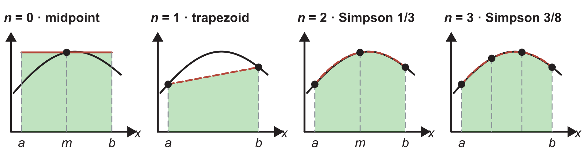
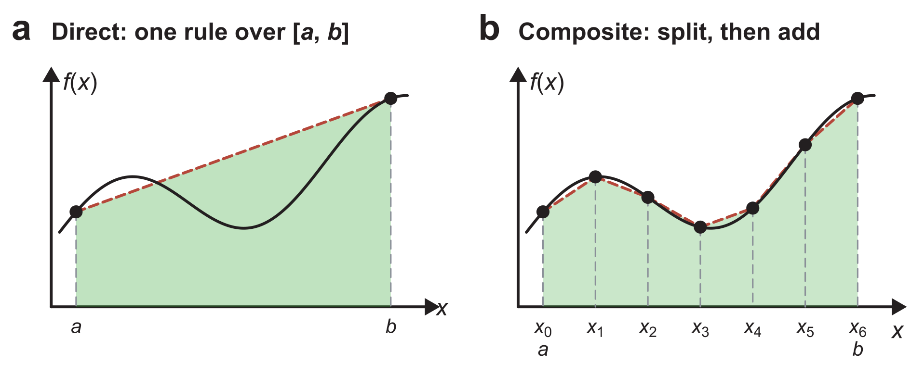
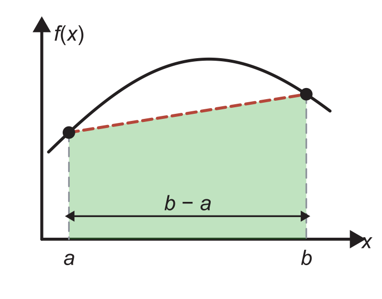
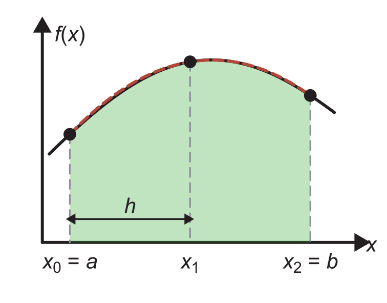
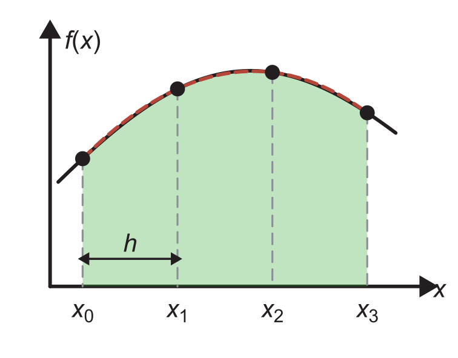

::: {.callout-note}
## Central question

**A measurement or a simulation gives a rate or a profile only at discrete points. How can a computer add these values up into a total, such as a distance, a mass, or an energy?**
:::

## Learning outcomes

By the end of this lecture, you should be able to:

1. **Identify** integrals in materials problems, and distinguish a function that can be evaluated anywhere from discrete data.
2. **Explain** a Newton–Cotes formula as the exact integral of an interpolating polynomial, applied directly or as a composite rule.
3. **Apply** the composite midpoint, trapezoidal, Simpson's 1/3, and Simpson's 3/8 rules, and state the points and spacing that each one requires.
4. **Choose** a NumPy or SciPy routine for an integral, from `np.trapezoid` for discrete data to `scipy.integrate.quad` for a callable function.

## The other half of Newton's second law

L17 opened Unit 4 with Newton's second law, $\mathbf F=m\mathbf a$, and found two operations inside it. L17 and L18 developed the first one, differentiation, which turns an energy into a force. This lecture turns to the other end, integration. If we know the velocity of an atom at every moment from $t=0$, we can add up the small displacements $v\,\mathrm dt$ over time, and the total gives the position:

$$
x(t)=x_0+\int_0^t v(t')\,\mathrm dt' .
$$

The same accumulation turns the acceleration into the velocity. In an MD simulation, the velocity is not known in advance, because the force that changes it depends on where the atoms are at that moment. This coupled problem is an ordinary differential equation (ODE), which we solve from L21 onwards. Here, the quantity to integrate has already been measured or calculated, and the task is to add it up correctly.

In general, integration evaluates

$$
I=\int_a^b f(x)\,\mathrm dx .
$$

- $f(x)$ is the **integrand**, the quantity being accumulated.
- $a$ and $b$ are the **limits** of integration.
- $I$ is the area between the curve $y=f(x)$ and the $x$-axis. Area below the axis counts as negative.

In this lecture, we deal with functions of one variable only.

## Integrals in materials engineering

Integrals in materials problems usually do one of two jobs (@fig-integration-examples).

**Accumulating a rate over time.** A process that evolves in time is often measured as a rate, and the total change is the time integral of that rate:

- the position of an atom in MD, from its velocity (a),
- the mass of steel lost to corrosion, from a measured corrosion rate (b),
- the mass of a carbon particle consumed during combustion, from its oxidation rate,
- the heat released by a phase transformation, from the peak in a differential scanning calorimetry (DSC) record of heat flow against time. The fraction transformed at time $t$ is the area of the peak up to $t$ divided by its total area.

**Totals and averages over space or along a path.** A quantity distributed over a cross-section, or collected along a loading path, is added up over that variable:

- the mass flow rate of a fluid in a tube, $\dot m=2\pi\int_0^R\rho\,u(r)\,r\,\mathrm dr$, which adds the flow through thin rings of radius $r$. Dividing $\dot m$ by $\rho\pi R^2$ gives the average velocity (c).
- the energy per unit volume needed to break a steel bar, its **toughness** $U_T=\int\sigma\,\mathrm d\varepsilon$, which is the area under the stress–strain curve up to fracture (d),
- the electrical energy stored per unit area of an electrode in the double layer of an electrolyte, $\int\tfrac12\epsilon_0\epsilon_r E(z)^2\,\mathrm dz$, where $E(z)$ is the electric field at a distance $z$ from the electrode.

![Four integrals in materials engineering. (a) An MD snapshot of solid argon accompanies a velocity curve, whose signed area gives displacement. (b) Rusty steel illustrates mass loss, found by integrating a corrosion rate. (c) Flow through a tube is added ring by ring over its cross-section. (d) A fractured steel specimen accompanies a stress–strain curve, whose area gives toughness. [Images: (a) still from @rowley2015solidargon, CC BY-SA 4.0; (b) @sagisavas2024rustysteel, CC0; (d) @trociny2015steelsample, CC0. Figure CC BY-SA 4.0.]{style="font-size:0.75em"}](../../../assets/L19-integration-examples.png){#fig-integration-examples width="100%" fig-alt="Four panels with physical images and integral schematics. a: solid argon atoms above an oscillating velocity curve with positive and negative shaded areas. b: a photograph of rusty steel plates above a sampled corrosion-rate curve. c: a tube with a parabolic velocity profile and arrows along the tube, beside its circular cross-section divided into concentric rings, with one ring of width dr highlighted and its radius r marked. d: a photograph of a fractured steel tensile specimen above a stress-strain curve shaded to fracture."}

The data for these integrals arrive at different time or spatial steps:

- **Frequent readings:** a thermocouple can record a temperature many times per second.
- **Long-term tests:** a corrosion test may weigh its coupons only once a week over several months.
- **Simulation steps:** the interval depends on the step size of the calculation and on how often results are saved. An MD code calculates the velocities at every time step but often saves them only every hundred steps.

An integration method has to work with the spacing that the data come with.

## A function or a table?

As with derivatives in L17, the route depends on what we know about the integrand. Compare these two problem statements.

::: {.columns}
::: {.column width="48%"}
### Type I: a callable function

Given
$$
f(x)=x+x^3,
$$
evaluate
$$
I=\int_0^2 f(x)\,\mathrm dx.
$$

We can calculate $f(x)$ at any point, chosen whenever it is needed. In engineering, such a function may be

- an analytical model, such as the Lennard–Jones pair energy from L14,
- a simulation that returns one value for each input, such as the energy of a structure relaxed at a given strain,
- the numerical derivative of another function, calculated as in L17–L18.
:::
::: {.column width="4%"}
:::
::: {.column width="48%"}
### Type II: discrete data

The following values were recorded at five points. Estimate the integral from $x=0$ to $x=2$.

| $x_i$ | 0 | 0.5 | 1.0 | 1.5 | 2.0 |
|---|:-:|:-:|:-:|:-:|:-:|
| $y_i$ | 0 | 0.625 | 2.000 | 4.875 | 10.000 |

Only these five values are available, and we cannot ask for a value between them. In engineering, such tables come from

- measurements, such as a DSC heat-flow record or a tensile test,
- simulation output saved at intervals, such as MD velocities saved every hundred steps.
:::
:::

In this lecture, we mostly focus on discrete data, which is the usual situation for measurements and saved simulation output.

## Numerical integration on discrete data: Newton–Cotes formulas

Interpolation in L08 gave a polynomial that passes through a set of data points, and a polynomial is easy to integrate exactly. Between the data points, we can therefore replace the integrand by an interpolating polynomial $P_n(x)$ of degree $n$ and integrate the polynomial instead:

$$
I=\int_a^b f(x)\,\mathrm dx\;\approx\;\int_a^b P_n(x)\,\mathrm dx .
$$

When the $n+1$ points of the polynomial are evenly spaced, the integral of $P_n$ becomes a weighted sum of the function values,

$$
I\approx w_0f(x_0)+w_1f(x_1)+\cdots+w_nf(x_n),
$$

with weights $w_i$ that depend only on the spacing. Each degree $n$ gives one formula. Together they are called the **Newton–Cotes formulas**, after Isaac Newton and Roger Cotes, who worked them out around 1700. @fig-newton-cotes draws the four used in practice on the same curve, and @tbl-newton-cotes lists their formulas in the same order.

{#fig-newton-cotes width="100%" fig-alt="Four panels side by side with the same curve from a to b, which rises to a broad maximum and falls slightly. n equals 0, midpoint: a horizontal red line through the curve at the midpoint m, with the green rectangle under it. n equals 1, trapezoid: a dashed red chord from the point at a to the point at b, lying below the curve. n equals 2, Simpson 1/3: a dashed red parabola through a, m, and b that almost coincides with the curve. n equals 3, Simpson 3/8: a dashed red cubic through four evenly spaced points that coincides with the curve."}

| Degree $n$ | 0 | 1 | 2 | 3 |
|---|:-:|:-:|:-:|:-:|
| **Rule** | rectangle (midpoint) | trapezoidal | Simpson's 1/3 | Simpson's 3/8 |
| **Points** | 1 | 2 | 3 | 4 |
| **Panel integral** | $(b-a)\,f\!\left(\dfrac{a+b}{2}\right)$ | $\dfrac{b-a}{2}\big[f(a)+f(b)\big]$ | $\dfrac h3\big[f_0+4f_1+f_2\big]$ | $\dfrac{3h}{8}\big[f_0+3f_1+3f_2+f_3\big]$ |

: Newton–Cotes formulas on one panel from $a$ to $b$, in the order of @fig-newton-cotes. The midpoint is $m=(a+b)/2$, $f_i$ is the value at the $i$th point of the panel, and $h$ is the spacing between these points. {#tbl-newton-cotes .fd-table}

The constant and the straight line miss the bend of the curve. The parabola and the cubic follow the curvature and lie almost on top of it.

### Direct and composite rules

A Newton–Cotes formula can be applied to an interval $[a,b]$ in two ways (@fig-direct-composite):

- **Direct:** one polynomial rule covers the whole interval from $a$ to $b$ (a). A low-degree polynomial can miss the bends of the curve. Increasing the degree can follow more detail, but L08 showed that high-degree interpolation through evenly spaced points can oscillate.
- **Composite:** the interval is split into $N$ subintervals at the points $a=x_0<x_1<\cdots<x_N=b$. A low-degree formula is applied on each subinterval, and the results are added (b). Accuracy improves by making the subintervals narrower, while the degree stays low.

{#fig-direct-composite width="100%" fig-alt="Two panels with the same wavy rising curve. In panel a a single dashed red chord from the point at a to the point at b passes far from a hump and a dip of the curve, with one green trapezoid underneath. In panel b seven points labelled x0 to x6, with x0 equal to a and x6 equal to b, are joined by dashed red straight segments that stay close to the curve, with six pale-green trapezoids underneath."}

From now on we use composite rules. For evenly spaced points, every subinterval has the width $h=(b-a)/N$, and the points are $x_i=a+ih$. For unevenly spaced points, each subinterval has its own width, $h_i=x_{i+1}-x_i$. As in L17, $h$ always denotes a spacing.

## Rectangle and midpoint rules (degree 0)

The simplest Newton–Cotes formula, $n=0$, replaces $f$ on $[a,b]$ by a constant. Taking that constant from one of the end points gives the area of a rectangle:

$$
\boxed{I\approx f(a)\,(b-a)\qquad\text{or}\qquad I\approx f(b)\,(b-a)}
$$

How to read @fig-rectangle-midpoint, for a curve that rises:

- **Left end (a):** the rectangle lies below the curve and misses the blue area, so the integral is underestimated.
- **Right end (b):** the rectangle lies above the curve and includes the red area, so the integral is overestimated.
- **Midpoint (c):** the rectangle crosses the curve at $m$. The extra area on the left partly cancels the missed area on the right.

{#fig-rectangle-midpoint width="100%" fig-alt="Three panels with the same rising, flattening curve between a and b. Panel a: a green rectangle at the height of f of a, with a large blue region between the rectangle top and the curve labelled missed. Panel b: a rectangle at the height of f of b, with a large red region above the curve labelled extra. Panel c: a rectangle at the height of f of m crossing the curve at m, with a small red region on the left labelled extra and a small blue region on the right labelled missed."}

Taking the height at the midpoint $m=(a+b)/2$ gives the **midpoint rule**:

$$
\boxed{I\approx f\!\left(\frac{a+b}{2}\right)(b-a)}
$$

The estimate is still the area of a rectangle. Its height is chosen where the errors on the two sides of the midpoint largely cancel, which makes it much more accurate than either end-point rectangle. L20 shows by how much.

### Composite midpoint rule

Splitting $[a,b]$ into $N$ subintervals of equal width $h$ and applying the midpoint rule to each gives

$$
I\approx h\,f\!\left(\frac{x_0+x_1}{2}\right)+h\,f\!\left(\frac{x_1+x_2}{2}\right)+\cdots+h\,f\!\left(\frac{x_{N-1}+x_N}{2}\right),
$$

or, written with a sum symbol,

$$
\boxed{I\approx h\sum_{i=0}^{N-1}f\!\left(\frac{x_i+x_{i+1}}{2}\right)}
$$

The sum symbol $\sum_{i=0}^{N-1}$ is shorthand for the $N$ terms written out above, one for each subinterval, with $i$ running from 0 to $N-1$.

The composite midpoint rule has a practical catch for discrete data (@fig-composite-midpoint-trapezoid a). It needs $f$ at the centre of every subinterval, and if the data were recorded at $x_0, x_1, \ldots, x_N$, the values at the centres were never measured. For a function we can evaluate anywhere this is no problem. For data, we need a rule that uses only the points we have.

## The trapezoidal rule (degree 1)

::: {.columns}
::: {.column width="58%"}
The trapezoidal rule, $n=1$, replaces $f$ by the straight line through $(a, f(a))$ and $(b, f(b))$ (@fig-trapezoid-panel). In Newton's form from L08, this line is

$$
P_1(x)=f(a)+\frac{f(b)-f(a)}{b-a}\,(x-a).
$$
:::
::: {.column width="4%"}
:::
::: {.column width="38%"}
{#fig-trapezoid-panel width="100%" fig-alt="A curve rising to a hump between a and b. A dashed red straight chord joins the curve at a and b, with a green trapezoid underneath. An arrow below marks the width b minus a."}
:::
:::

Integrating it from $a$ to $b$ gives

$$
\int_a^b P_1(x)\,\mathrm dx=f(a)\,(b-a)+\frac{f(b)-f(a)}{b-a}\cdot\frac{(b-a)^2}{2},
$$

so the trapezoidal rule is

$$
\boxed{I\approx\frac{f(a)+f(b)}{2}\,(b-a)}
$$

The result is the area of a trapezoid with parallel sides $f(a)$ and $f(b)$ and width $b-a$, which gives the rule its name.

::: {.callout-caution}
## The midpoint rule and the trapezoidal rule use different points

- **Midpoint rule:** $f\!\left(\dfrac{a+b}{2}\right)(b-a)$ uses one function value, at the centre of the interval.
- **Trapezoidal rule:** $\dfrac{f(a)+f(b)}{2}\,(b-a)$ uses two function values, at the ends of the interval.

Both multiply an average height by the width. The midpoint rule evaluates $f$ at the average position, while the trapezoidal rule averages the values of $f$ at the two ends. For a curved integrand, $f\big((a+b)/2\big)$ and $\big(f(a)+f(b)\big)/2$ are different numbers.

**On discrete data, the midpoint rule needs values between the data points, while the trapezoidal rule uses only the data points themselves.**
:::

{#fig-composite-midpoint-trapezoid width="100%" fig-alt="Panel a: five pale-green rectangles, under a curve, each with a red point at the centre of its top edge. Hollow points on the curve at x0 to x5 mark the ends of the subintervals. Panel b: seven black data points from x0 to x6 at uneven spacings, joined by red straight segments with pale-green trapezoids underneath. Arrows mark the different widths h1 and h3."}

### Composite trapezoidal rule

Applying the trapezoidal rule to each subinterval $[x_i, x_{i+1}]$ of width $h_i$ and adding the results gives

$$
I\approx\frac{f(x_0)+f(x_1)}{2}\,h_0+\frac{f(x_1)+f(x_2)}{2}\,h_1+\cdots+\frac{f(x_{N-1})+f(x_N)}{2}\,h_{N-1},
$$

or, with a sum symbol,

$$
\boxed{I\approx\sum_{i=0}^{N-1}\frac{f(x_i)+f(x_{i+1})}{2}\,h_i}
$$

Nothing in this sum requires the widths to be equal (@fig-composite-midpoint-trapezoid b). When the points are evenly spaced, $h_i=h$, and each interior value belongs to two neighbouring trapezoids:

$$
\boxed{I\approx\frac h2\Big[f(x_0)+2f(x_1)+2f(x_2)+\cdots+2f(x_{N-1})+f(x_N)\Big]}
$$

::: {.callout-tip}
## The trapezoidal rule is the baseline for discrete data

The composite trapezoidal rule uses only the data points, accepts any spacing, and works from two points upwards. For most measured or saved data it is accurate enough, and it is the method you will use most often in later courses and projects. A higher-order rule is worth considering when the data are evenly spaced, smooth, and sparse.
:::

## Integration rule rediscovered: the story of Tai's formula

In a glucose tolerance test, a patient's blood glucose is measured at several times after a dose of glucose, and the area under the glucose–time curve summarizes the response. In 1994, Mary Tai published "a mathematical model for the determination of total area under glucose tolerance and other metabolic curves" [@tai1994mathematical] ([PDF](https://diyhpl.us/~bryan/papers2/paperbot/A%20Mathematical%20Model%20for%20the%20Determination%20of%20Total%20Area%20Under%20Glucose%20Tolerance%20and%20Other%20Metabolic%20Curves.pdf)). Her model divides the area between successive measurements into a rectangle and a triangle, which together form a trapezoid (@fig-tai). She validated it against areas counted on graph paper and reported that other formulas in use under- or overestimated the area by a large margin.

{#fig-tai width="100%" fig-alt="Panel a: a glucose curve sampled at twelve points y1 to y12 at uneven intervals X1 to X11, with dashed vertical lines at every sample. Below each segment the area is split into a green rectangle and a blue triangle. Panel b: one interval from t0 to t1 with values g0 and g1; a green rectangle of area g0 delta t and a blue triangle of area one half (g1 minus g0) delta t."}

With the labels of @fig-tai a, the total area is

$$
\text{Area}=\sum_{i=1}^{n-1}\frac{X_i}{2}\,\big(y_i+y_{i+1}\big),
$$

which is the composite trapezoidal rule.

Readers soon replied with a letter titled "Tai's formula is the trapezoidal rule" [@monaco1994tai]. The paper has nevertheless been cited hundreds of times. The method itself is much older still. Babylonian astronomers computed the displacement of Jupiter as the area of a trapezoid under its velocity–time graph, on tablets written between 350 and 50 BCE [@ossendrijver2016babylonian].

The story carries two lessons:

- **The trapezoidal rule (Tai's formula, $n=1$) is more accurate than rectangles ($n=0$).**
- **The trapezoidal rule does not require equal spacing, while the midpoint rule does.** In the paper's words, "the Tai model allows flexibility in experimental conditions, which means, in the case of the glucose-response curve, samples can be taken with differing time intervals and total area under the curve can still be determined with precision" [@tai1994mathematical].

## Simpson's 1/3 rule (degree 2)

::: {.columns}
::: {.column width="58%"}
If we can measure one more point in the middle of an interval, can we do better than the trapezoid? Three points determine a quadratic. **Simpson's 1/3 rule** replaces $f$ on $[a,b]$ by the parabola through $x_0=a$, $x_1=(a+b)/2$, and $x_2=b$, which are separated by $h=(b-a)/2$ (@fig-simpson13-panel). In Newton's form,

$$
P_2(x)=c_1+c_2\,(x-x_0)+c_3\,(x-x_0)(x-x_1),
$$
:::
::: {.column width="4%"}
:::
::: {.column width="38%"}
{#fig-simpson13-panel width="100%" fig-alt="A curve with three points at x0 equal to a, x1, and x2 equal to b, a spacing h apart. A dashed red parabola through them lies on top of the curve, with the green area underneath."}
:::
:::

and requiring $P_2$ to pass through the three points fixes the coefficients, as with the divided differences of L08:

$$
c_1=f(x_0),\qquad c_2=\frac{f(x_1)-f(x_0)}{h},\qquad c_3=\frac{f(x_2)-2f(x_1)+f(x_0)}{2h^2}.
$$

Integrating the parabola from $x_0$ to $x_2$ and collecting the terms gives Simpson's 1/3 rule:

$$
\boxed{I=\int_{x_0}^{x_2}f(x)\,\mathrm dx\approx\int_{x_0}^{x_2}P_2(x)\,\mathrm dx=\frac h3\Big[f(x_0)+4f(x_1)+f(x_2)\Big]}
$$

The factor $1/3$ in front of the bracket gives the rule its name.

::: {.callout-note collapse="true"}
## Integrating the Simpson parabola term by term

Substitute $s=x-x_0$, so that $s$ runs from 0 to $2h$ and $x-x_1=s-h$:

$$
\int_0^{2h}\big[c_1+c_2s+c_3s(s-h)\big]\,\mathrm ds=2h\,c_1+2h^2c_2+c_3\left(\frac{8h^3}{3}-2h^3\right)=2h\,c_1+2h^2c_2+\frac{2h^3}{3}c_3 .
$$

Inserting the coefficients,

$$
2h\,f(x_0)+2h\big[f(x_1)-f(x_0)\big]+\frac h3\big[f(x_2)-2f(x_1)+f(x_0)\big]=\frac h3\Big[f(x_0)+4f(x_1)+f(x_2)\Big].
$$
:::

::: {.callout-tip}
## Simpson's rule is more accurate than the midpoint and trapezoidal rules

Compare the points that the three rules use on one interval:

- **Midpoint rule:** only the centre.
- **Trapezoidal rule:** only the two ends.
- **Simpson's 1/3 rule:** the two ends and the centre, with the centre weighted four times as heavily as each end.

Simpson's rule uses all the information that the other two rules use separately. With $b-a=2h$, its result equals two-thirds of the midpoint estimate plus one-third of the trapezoidal estimate, $\tfrac23(b-a)f(m)+\tfrac13\cdot\tfrac{b-a}{2}\big[f(a)+f(b)\big]$. The convergence test in L20 shows how much more accurate this combination is than either rule alone.
:::

### Composite Simpson's 1/3 rule

Each parabola needs three points, so the composite rule applies Simpson's rule to pairs of subintervals, $[x_0,x_2]$, $[x_2,x_4]$, and so on. Neighbouring panels share an end point but do not overlap. In @fig-simpson-panels, $x_2$ is the last point of panel 1 and the first point of panel 2. Adding the panels gives

$$
I\approx\frac h3\Big[f(x_0)+4f(x_1)+f(x_2)\Big]+\frac h3\Big[f(x_2)+4f(x_3)+f(x_4)\Big]+\cdots+\frac h3\Big[f(x_{N-2})+4f(x_{N-1})+f(x_N)\Big],
$$

and collecting the terms of the shared points,

$$
\boxed{I\approx\frac h3\Big[f(x_0)+4f(x_1)+2f(x_2)+4f(x_3)+2f(x_4)+\cdots+2f(x_{N-2})+4f(x_{N-1})+f(x_N)\Big]}
$$

The weights follow a pattern:

- **Odd-numbered points**, the centres of the panels, have the weight 4.
- **Even-numbered interior points**, shared by two panels, have the weight 2.
- **The two end points** have the weight 1.

{#fig-simpson-panels width="100%" fig-alt="A curve with seven evenly spaced points x0 to x6. Brackets above the curve mark panel 1 from x0 to x2, panel 2 from x2 to x4, and panel 3 from x4 to x6, with one uniform green shading, separated by solid vertical lines at x0, x2, x4, and x6, with dashed lines at the centres x1, x3, and x5. Below the axis, a row labelled per panel shows the weights 1, 4, 1 plus 1, 4, 1 plus 1, 4, 1, and a row labelled combined shows 1, 4, 2, 4, 2, 4, 1 times h over 3."}

::: {.callout-caution}
## Composite Simpson's 1/3 rule needs equal spacing and an even number of subintervals

The derivation sets two requirements:

- **An even number $N$ of subintervals**, that is, an odd number of points, $2k+1$, since the panels come in pairs of subintervals.
- **Equal spacing $h$** throughout, since the weights 1, 4, 1 were derived for a centre point exactly midway between the ends.

Data measured at irregular times rarely satisfy both. The same difficulty appears when the integration variable itself comes from another measurement, as in $\int_a^b f(u)\,\mathrm du$ with measured values of $u$.

**Check the spacing and count the subintervals before applying Simpson's 1/3 rule. If either requirement fails, use the trapezoidal rule, or cover an odd number of subintervals with the help of Simpson's 3/8 rule below.**
:::

## Simpson's 3/8 rule (degree 3)

::: {.columns}
::: {.column width="58%"}
Four evenly spaced points determine a cubic. **Simpson's 3/8 rule** replaces $f$ by the cubic $P_3(x)$ through the points $x_0$, $x_1$, $x_2$, and $x_3$, and integrates it over the three subintervals of width $h$ between them (@fig-simpson38-panel). In Newton's form,

$$
\begin{aligned}
P_3(x)={}&c_1+c_2(x-x_0)\\
&+c_3(x-x_0)(x-x_1)\\
&+c_4(x-x_0)(x-x_1)(x-x_2).
\end{aligned}
$$

The coefficients $c_1,\ldots,c_4$ are chosen so that $P_3(x_i)=f(x_i)$ at all four points, using the divided differences from L08.
:::
::: {.column width="4%"}
:::
::: {.column width="38%"}
{#fig-simpson38-panel width="100%" fig-alt="A curve with four evenly spaced points x0 to x3, a spacing h apart. A dashed red cubic through them lies on top of the curve, with the green area underneath."}
:::
:::

$$
\boxed{I=\int_{x_0}^{x_3}f(x)\,\mathrm dx\approx\int_{x_0}^{x_3}P_3(x)\,\mathrm dx=\frac{3h}{8}\Big[f(x_0)+3f(x_1)+3f(x_2)+f(x_3)\Big]}
$$

The weights are 1, 3, 3, 1, and the factor $3/8$ gives the rule its name. The composite rule works on groups of three subintervals, so $N$ must be divisible by 3:

$$
\boxed{I\approx\frac{3h}{8}\Big[f(x_0)+3f(x_1)+3f(x_2)+2f(x_3)+3f(x_4)+\cdots+3f(x_{N-2})+3f(x_{N-1})+f(x_N)\Big]}
$$

Its main practical use is to cover an odd number of subintervals with evenly spaced data. With five subintervals, for example, Simpson's 1/3 rule covers the first two and Simpson's 3/8 rule covers the last three.

### Comparing the rules on one curve

- **Integral:** the curve of @fig-newton-cotes, $f(x)=1+1.5\sin(0.62x+0.15)+0.1x$, from $a=0.4$ to $b=3.9$.
- **Exact answer (rounded):** $I=8.514907$.
- **Question:** how many subintervals $N$ does each rule need to bring the error below $10^{-3}$?

Choose a rule and the number of subintervals below. The plot shades the polynomial pieces and displays the exact integral, the estimate, and the error $I-I_{\mathrm{estimate}}$.

::: {.quarto-wasm-local notebook="l19_newton_cotes.edit.py" view="app" title="Composite rectangle, midpoint, trapezoidal, Simpson 1/3, and Simpson 3/8 rules on one curve" height="640" loading="lazy" fullscreen="true"}
For $f(x)=1+1.5\sin(0.62x+0.15)+0.1x$ on $[0.4, 3.9]$, the exact integral is 8.514907. With $N=6$ subintervals, the errors are $+0.216$ for the left rectangle, $-0.023$ for the midpoint rule, $+0.047$ for the trapezoidal rule, $-4.1\times10^{-4}$ for Simpson's 1/3 rule, and $-9.4\times10^{-4}$ for Simpson's 3/8 rule. With $N=12$, the midpoint and trapezoidal errors fall to $-5.8\times10^{-3}$ and $+1.2\times10^{-2}$, still above $10^{-3}$, while both Simpson rules reach a few times $10^{-5}$. Simpson's 1/3 rule with an odd $N$, or Simpson's 3/8 rule with $N$ not divisible by 3, cannot be applied.
:::

### Why stop at degree 3?

Higher-degree Newton–Cotes formulas exist, but they are rarely used, for two reasons:

- **Oscillation.** High-degree interpolating polynomials through evenly spaced points oscillate, as Runge's example showed in L08. The formula of degree 8, and every formula from degree 10 upwards, has some negative weights. A negative weight subtracts function values, which amplifies any error in them.
- **The Simpson rules are already accurate.** Their errors fall as $h^4$, as L20 will show. For $\int_0^\pi\sin x\,\mathrm dx=2$, Simpson's 1/3 rule with $h\approx0.01$ has an error of $1.1\times10^{-10}$. With $h\approx3\times10^{-4}$, the result agrees with 2 to every digit that a `float64` stores (L03).

## Numerical integration in Python

In NumPy, the data points are stored in an array `x` and their function values in an array `y`. The composite trapezoidal rule can be written with array slices, as the finite-difference stencils were in L17:

- `x[1:] - x[:-1]` holds the widths $h_i=x_{i+1}-x_i$ of all subintervals,
- `y[:-1]` holds the left values $f(x_i)$ and `y[1:]` the right values $f(x_{i+1})$,
- `np.sum((x[1:] - x[:-1]) * (y[:-1] + y[1:]) / 2)` adds the areas of the trapezoids.

For five data points with uneven spacing:

```python
import numpy as np

x = np.array([0.0, 1.0, 3.0, 4.0, 6.0])
y = np.array([1.0, 3.0, 2.0, 4.0, 2.0])

I_slices = np.sum((x[1:] - x[:-1]) * (y[:-1] + y[1:]) / 2)
I_numpy = np.trapezoid(y, x)
print(I_slices, I_numpy)   # 16.0 16.0
```

The widths are 1, 2, 1, and 2, and the average heights are 2, 2.5, 3, and 3, so the trapezoids add up to $2+5+3+6=16$.

NumPy provides the same calculation as one function [@harris2020numpy]:

- **`np.trapezoid(y, x)`** applies the composite trapezoidal rule to the values `y` at the points `x`.
  - The points may have any spacing. For evenly spaced points, `np.trapezoid(y, dx=h)` passes the spacing instead.
  - The values come first and the points second, the reverse of `plt.plot(x, y)`.
  - Older code calls it `np.trapz`. NumPy 2.0 renamed the function, and recent NumPy versions no longer accept the old name.

### How do we choose the method?

The flow chart summarizes the available routines (@fig-integration-decision) [@virtanen2020scipy]. The first question is what we know about the integrand, and for discrete data the next questions concern the spacing and the number of points. You can also implement a suitable integration rule directly with NumPy arrays, as in the slicing example above.

{#fig-integration-decision width="90%" fig-alt="Decision chart titled integrate f from a to b. First question: can f be evaluated anywhere? Yes leads to callable function, integrate.quad(f, a, b), adaptive, with error estimate. No, for discrete data, leads to the question: evenly spaced points? No leads to any spacing, np.trapezoid(y, x), the baseline for data. Yes leads to the question: 2 to the k plus 1 points, such as 5, 9, 17, 33? Yes leads to Romberg, integrate.romb(y, dx=h), repeated Richardson. No leads to Simpson's rule, integrate.simpson(y, x=x), odd or even number of points. A separate lower-left box offers custom integration with NumPy arrays and sums for discrete data."}

## Check your understanding

1. A corrosion test weighs its coupons on days 0, 1, 3, 7, 14, and 28 and reports the mass-loss rate on each day. Which composite rule can integrate these rates directly, and why can Simpson's 1/3 rule not be used?
2. Write out the composite trapezoidal rule and the composite Simpson's 1/3 rule for five evenly spaced values $f_0, \ldots, f_4$ with spacing $h$. Which weights differ?
3. A data set has eight evenly spaced points. Can Simpson's 1/3 rule cover all of it? How could you combine the two Simpson rules to cover all seven subintervals?
4. Explain why the midpoint rule and the trapezoidal rule give the same result for a straight line $f(x)=c_0+c_1x$, while they differ for a parabola.
5. A classmate writes `np.trapezoid(t, v)` to integrate a velocity record `v` over the times `t`. What does this calculate instead?

## Next

In L20, we first write numerical integrals in Python, then calculate carbon uptake by hand and with the library routines. We compare how the errors shrink as $h$ decreases and how measurement noise affects the result. Richardson extrapolation follows as reading material.
