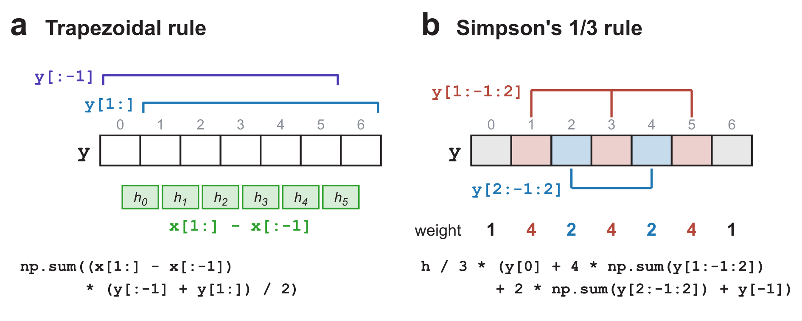
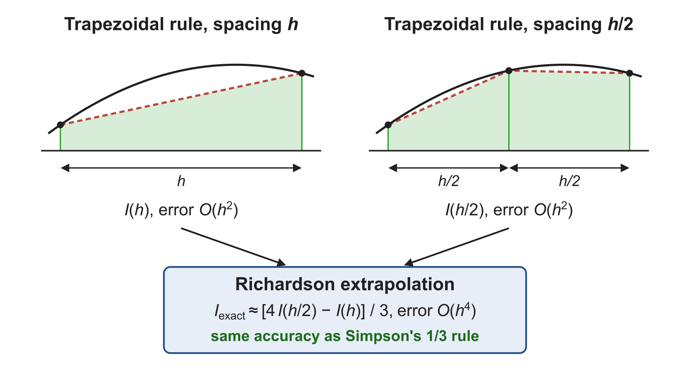

::: {.callout-note}
## Central question

**How do we calculate an integral in Python, and what limits the accuracy of the result?**
:::

## Learning outcomes

By the end of this lecture, you should be able to:

1. **Calculate** integrals from callable functions and tabulated data using SciPy and NumPy, including array-slice implementations of the composite rules.
2. **Apply** the composite trapezoidal and Simpson's 1/3 rules to carbon-uptake data by hand and in Python.
3. **Compare** the convergence of the composite rules and explain the round-off limit.
4. **Explain** how random measurement noise affects an integral and the choice of integration rule.

The reading material also shows how to improve two trapezoidal estimates by Richardson extrapolation.

## Numerical integration in Python

In the last lecture, we separated two kinds of problem:

- **A callable function**, for example $f(x)=x+x^3$ on $[0,2]$.
- **A table** of values recorded at fixed points.

The selection chart from L19 summarizes the routines for both (@fig-integration-choice). We will first call the library routines, then write the composite rules with array slices.

{#fig-integration-choice width="90%" fig-alt="Decision chart. A callable function leads to quad. For discrete data with uneven spacing, trapezoid; for evenly spaced data with 2 to the k plus 1 points, romb; otherwise simpson. A separate box offers custom integration with NumPy arrays. An upper-left box shows from numpy import trapezoid and from scipy.integrate import quad, simpson, romb."}

### Type I: integrate a callable function

::: {.callout-note}
## Function call: `scipy.integrate.quad(f, a, b)`

- **Input:** a Python function `f` and the limits `a`, `b`.
- **Output:** the integral estimate and an estimate of its absolute error.
:::

`scipy.integrate.quad` chooses the evaluation points and refines the calculation automatically [@virtanen2020scipy]. We supply the function and the limits, without building a grid or writing integration weights.

::: {.quarto-wasm-local notebook="l20_callable_integral.edit.py" view="edit" title="Integrating a callable function with scipy.integrate.quad" height="360" loading="lazy" fullscreen="true"}
For $f(x)=x+x^3$ on $[0,2]$, `scipy.integrate.quad(f, 0, 2)` returns the integral $6.000000000000001$ and an estimated absolute error of $7\times10^{-14}$. The exact answer is 6.
:::

For an ordinary smooth function, `scipy.integrate.quad` is usually good enough. Two points need care:

- **Defining the function.** When no analytical expression exists, `f` must still be a Python function that returns one value for each `x`, for example by running a calculation or evaluating a fitted model at that point.
- **Number of function evaluations.** `scipy.integrate.quad` decides how many points to use and where to place them, following its [**quadrature**](https://en.wikipedia.org/wiki/Gauss%E2%80%93Kronrod_quadrature_formula) rule. When each evaluation of `f` is an expensive simulation, this number sets the cost.

### Type II: integrate discrete data

::: {.callout-note}
## Function calls: `numpy.trapezoid(y, x)` and `scipy.integrate.simpson(y, x=x)`

- **`numpy.trapezoid(y, x)`** adds trapezoids between successive data points, using their actual spacing [@harris2020numpy].
- **`scipy.integrate.simpson(y, x=x)`** uses Simpson's rule [@virtanen2020scipy]. With equal spacing and an even number of subintervals, it is the composite 1/3 rule from L19.
- Both functions take the values first and the points second.
:::

::: {.quarto-wasm-local notebook="l20_tabulated_integral.edit.py" view="edit" title="Integrating a table with numpy.trapezoid and scipy.integrate.simpson" height="380" loading="lazy" fullscreen="true"}
For the five-point table $x=0,0.5,1,1.5,2$ and $y=0,0.625,2,4.875,10$, `numpy.trapezoid(y, x)` gives 6.25 and `scipy.integrate.simpson(y, x=x)` gives 6.0.
:::

`scipy.integrate.simpson` is more general than the textbook rule of L19. It also accepts unequal spacing and an odd number of subintervals, and uses adjusted formulas for these cases. A measured table has no exact function to compare with, so we cannot be certain which of the two results is more accurate.

### The composite rules with NumPy slices

Each composite rule is also one line of NumPy, using slices as the finite differences did in L18. @fig-array-slices shows which entries of the arrays each slice selects.

{#fig-array-slices width="100%" fig-alt="Panel a: an array y with indices 0 to 6, bracket y[:-1] over indices 0 to 5 and bracket y[1:] over indices 1 to 6, and six widths h0 to h5 between the cells labelled x[1:] minus x[:-1], with the sum formula below. Panel b: the same array with indices 1, 3, 5 in red selected by y[1:-1:2], indices 2 and 4 in blue selected by y[2:-1:2], weights 1 4 2 4 2 4 1, and the Simpson formula below."}

```python
import numpy as np

def trapezoid_method(y, x):
    return np.sum((x[1:] - x[:-1]) * (y[:-1] + y[1:]) / 2)

def simpson_method(y, x):
    h = x[1] - x[0]
    # We also need to check that the spacings are equal and the number of intervals is even:
    # Equal spacing:            np.allclose(np.diff(x), h)
    # Even number of intervals: (len(x) - 1) % 2 == 0
    return h / 3 * (y[0] + 4 * np.sum(y[1:-1:2])
                    + 2 * np.sum(y[2:-1:2]) + y[-1])
```

Before calling `simpson_method`, make sure that the points in `x` are evenly spaced and that the number of subintervals is even. The commented checks inside the function show one way to test this.

::: {.quarto-wasm-local notebook="l20_composite_slices.edit.py" view="edit" title="Composite trapezoidal and Simpson 1/3 rules with NumPy slices" height="620" loading="lazy" fullscreen="true"}
For the five-point table, `trapezoid_method(y, x)` gives 6.25 and `simpson_method(y, x)` gives 6.0, the same values as `numpy.trapezoid(y, x)` and `scipy.integrate.simpson(y, x=x)`.
:::

::: {.callout-caution}
## Checking a hand-written rule against the library routine

- Compare `trapezoid_method(y, x)` with `numpy.trapezoid(y, x)`, and `simpson_method(y, x)` with `scipy.integrate.simpson(y, x=x)`, on the same data.
- `simpson_method` reproduces `scipy.integrate.simpson` only for equally spaced points and an even number of subintervals. It reads the spacing from the first two points and does not check the others.

**Confirm the spacing and the number of subintervals yourself before trusting a hand-written Simpson rule.**
:::

## Worked example: carbon uptake during carburizing

Carburizing hardens a steel surface by allowing carbon from a carbon-rich gas to diffuse into the steel at high temperature. The surface gains more carbon than the interior, producing a carbon profile that decreases with depth (@fig-carburizing).

{#fig-carburizing width="100%" fig-alt="Panel a: carbon-rich gas above a steel block, with arrows pointing into the steel. Panel b: carbon content decreases with depth, with seven measurements and a shaded area above the initial carbon content C0."}

### Question

**How much carbon has entered the steel surface down to a depth of 1.5 mm? Calculate the uptake using both the composite trapezoidal and Simpson's 1/3 rules.**

The excess carbon content $f(x)$ has been measured at the seven depths below, with $x$ in mm and $f$ in wt%. The uptake $M$ in g/m² is

$$
M=78.5\int_0^{1.5} f(x)\,\mathrm dx.
$$

- The factor 78.5 includes the steel density and unit conversions.
- Reference answer from the analytical profile: **34.36 g/m²**.

| $x_i$ (mm) | 0 | 0.25 | 0.50 | 0.75 | 1.00 | 1.25 | 1.50 |
|---|:-:|:-:|:-:|:-:|:-:|:-:|:-:|
| $f_i$ (wt%) | 1.000 | 0.649 | 0.363 | 0.173 | 0.069 | 0.023 | 0.006 |

: Excess carbon content below the steel surface. {#tbl-carbon-data}

### Method 1: calculate by hand

There are seven points and six subintervals, each of width $h=0.25$ mm.

**Composite trapezoidal rule.** Each interior value belongs to two neighbouring trapezoids:

$$
I_T=\frac h2\Big[f_0+2(f_1+f_2+f_3+f_4+f_5)+f_6\Big].
$$

Substituting the table gives

$$
I_T=\frac{0.25}{2}\Big[1.000+2(0.649+0.363+0.173+0.069+0.023)+0.006\Big]=0.4450.
$$

**Composite Simpson's 1/3 rule.** First check its requirements:

- The spacings are all 0.25 mm.
- The number of subintervals is $N=6$, which is even.

The rule therefore applies, with weights 4 on $f_1,f_3,f_5$ and 2 on $f_2,f_4$:

$$
I_S=\frac h3\Big[f_0+4(f_1+f_3+f_5)+2(f_2+f_4)+f_6\Big].
$$

Substituting the table gives

$$
I_S=\frac{0.25}{3}\Big[1.000+4(0.649+0.173+0.023)+2(0.363+0.069)+0.006\Big]=0.4375.
$$

Multiplying each integral by 78.5 gives:

- **Trapezoidal:** $M_T=34.93$ g/m², about 1.7% above the reference.
- **Simpson's 1/3:** $M_S=34.34$ g/m², about 0.05% below the reference.

### Method 2: calculate in Python

Use the same seven measurements with `numpy.trapezoid` and `scipy.integrate.simpson`, then with `trapezoid_method` and `simpson_method` from above. This table has seven points, so it does not meet the requirement of `scipy.integrate.romb` for $2^k+1$ points. It also supplies no callable function for `scipy.integrate.quad`.

::: {.quarto-wasm-local notebook="l20_carburizing.edit.py" view="edit" title="Carbon uptake from seven measurements: library routines and hand-written methods" height="640" loading="lazy" fullscreen="true"}
With the seven tabulated values, `78.5 * numpy.trapezoid(f, x)` gives 34.9325 g/m² and `78.5 * scipy.integrate.simpson(f, x=x)` gives 34.34375 g/m². `trapezoid_method` and `simpson_method` give the same two numbers, and both reproduce the hand calculations.
:::

The remaining questions concern accuracy: how quickly an estimate improves as the spacing shrinks, where round-off stops that improvement, and how measurement noise affects the total.

## Problem 1: how fast do the errors shrink?

We use three integrals whose exact values we know:

- $\displaystyle\int_0^1 e^x\,\mathrm dx=e-1$.
- $\displaystyle\int_0^{\pi/2}\sin x\,\mathrm dx=1$.
- $\displaystyle\int_1^3x^3\,\mathrm dx=20$.

**How do we know the error scaling?** Calculate each integral with $N=6,12,24,\ldots$ subintervals and check how the error decreases. Every $N$ is divisible by both 2 and 3, so all five rules apply. Going from $N$ to $2N$ halves the spacing $h$, and the error changes as follows:

- Error $e\to e/2$: $O(h)$.
- Error $e\to e/4$: $O(h^2)$.
- Error $e\to e/16$: $O(h^4)$.

::: {.quarto-wasm-local notebook="l20_convergence.edit.py" view="app" title="Convergence of five composite rules for exp(x), sin(x), and x³" height="680" loading="lazy" fullscreen="true"}
For $\int_0^1e^x\,\mathrm dx=e-1$, the error curves have slopes of approximately 1 for the left rectangle, 2 for the midpoint and trapezoidal rules, and 4 for both Simpson rules. At $N=6$ ($h=1/6$), the errors are $1.4\times10^{-1}$, $2.0\times10^{-3}$, $4.0\times10^{-3}$, $7.3\times10^{-6}$, and $1.6\times10^{-5}$. The midpoint error is half the trapezoidal error, and the 3/8 error is about 2.25 times the 1/3 error. Simpson's 1/3 error reaches $1.8\times10^{-15}$ at $N=1536$ ($h\approx6.5\times10^{-4}$) and stays at the round-off level up to $N=24576$. For $\sin x$ on $[0,\pi/2]$ the slopes are the same. For $x^3$ on $[1,3]$, both Simpson rules are exact to round-off for every $N$.
:::

::: {.callout-note}
## Why does round-off matter less in integration?

In L18, the error of a finite difference fell as $h$ shrank and then rose again, because round-off took over. In the convergence test above, the Simpson errors reach the floating-point round-off level and then fluctuate near it. Integration is much less affected by round-off error:

- **Differentiation** subtracts two nearly equal function values and divides the small difference by a small $h$. The rounding errors of the values are divided by $h$ as well, so they grow as $h$ shrinks.
- **Integration** multiplies each function value by a weight proportional to $h$ and adds the products. For these smooth, positive integrands, round-off stays near the scale $\epsilon\,|I|$, where $\epsilon\approx2.2\times10^{-16}$. Summation and cancellation can still introduce rounding error.

**Once round-off dominates, a smaller $h$ costs more without reliably improving the answer.**
:::

### Error orders of the composite rules

The slopes reflect the leading truncation errors obtained by integrating the Taylor expansions on each panel [@burden2016numerical, §4.3–4.4]. For a sufficiently smooth function on the fixed interval $[a,b]$, @tbl-error-orders lists the error of each rule, exact value minus estimate.

| **Method** | Error term | Error order |
|---|:-:|:-:|
| Left rectangle | $\dfrac{b-a}{2}\,h\,f'$ | $O(h)$ |
| Midpoint | $\dfrac{b-a}{24}\,h^2\,f''$ | $O(h^2)$ |
| Trapezoidal | $-\dfrac{b-a}{12}\,h^2\,f''$ | $O(h^2)$ |
| Simpson's 1/3 | $-\dfrac{b-a}{180}\,h^4\,f^{(4)}$ | $O(h^4)$ |
| Simpson's 3/8 | $-\dfrac{b-a}{80}\,h^4\,f^{(4)}$ | $O(h^4)$ |

: Leading truncation errors of the composite rules on $[a,b]$. {#tbl-error-orders .fd-table}

**Why do both Simpson rules integrate $x^3$ without error?** Their error terms contain the fourth derivative, and for $f(x)=x^3$ the fourth derivative is exactly 0.

## Problem 2: integrating noisy data

L18 showed that differentiating noisy data amplifies the noise. Integration does the opposite. Write each measured value as the exact value plus a random error, $\tilde y_i=f(x_i)+\xi_i$. Any integration rule is a weighted sum, so the estimate splits into two parts:

$$
w_0\tilde y_0+w_1\tilde y_1+\cdots+w_N\tilde y_N
=\underbrace{w_0f(x_0)+\cdots+w_Nf(x_N)}_{\text{rule applied to }f}
+\underbrace{w_0\xi_0+\cdots+w_N\xi_N}_{\text{noise in the integral}} .
$$

The noise term adds many independent errors, each multiplied by a weight of about $h$, and positive and negative errors partly cancel. For independent errors with standard deviation $\sigma$, the typical size of such a sum is $\sigma\sqrt{w_0^2+w_1^2+\cdots+w_N^2}$ [@taylor1997error, ch. 3]. For the trapezoidal rule, almost all weights equal $h$, so

$$
\sigma_I\approx\sigma\sqrt{N}\,h=\frac{\sigma\,(b-a)}{\sqrt N}.
$$

Compared with the central-difference derivative of L18:

- **Derivative:** $\sigma_{f'}=\dfrac{\sigma}{\sqrt2\,h}\propto\dfrac1h$. More closely spaced points give **more** noise in the result.
- **Integral:** $\sigma_I\approx\dfrac{\sigma\,(b-a)}{\sqrt N}\propto\dfrac1{\sqrt N}$. More points give **less** noise in the result.

### Noisy samples of $x^3$ again

Take the same noisy data as in L18, $y_i=x_i^3+\xi_i$ at evenly spaced points from 1 to 3 with $\sigma=0.1$, whose exact integral is $\int_1^3x^3\,\mathrm dx=20$.

**Question:** how large are the percentage errors of the trapezoidal and Simpson integrals, and how do they change as the number of points increases?

::: {.quarto-wasm-local notebook="l20_noisy_integral.edit.py" view="app" title="Noisy x³ data: errors of the derivative and of trapezoidal, Simpson, and cubic-fit integrals" height="780" loading="lazy" fullscreen="true"}
As the number of points rises from 6 to 161, the typical derivative error grows from 2.8% to 41%, while the trapezoidal integral error falls from 1.6% (mostly truncation) to 0.08%. At $\sigma=1.0$ with 21 points, the derivative error is 69% and the integral errors are about 2.3%.
:::

As the number of points increases, the integral errors fall, because the independent errors partly cancel in the sum. The derivative error grows, because it divides a small difference by a small $h$. How should we treat such data?

::: {.callout-important}
## Three practical conclusions for noisy data

- **Integration averages out noise.** For independent, zero-mean measurement errors, more points reduce the typical noise in an integral.
- **No fitting or interpolation is needed first.** A Newton–Cotes rule already integrates an interpolating polynomial, and the fitted cubic gives a similar accuracy to the trapezoidal sum in this example. In L18, fitting helped suppress noise before differentiating.
- **A higher-order rule does not reduce noise.** Simpson's weights of 4 and 2 make its noise slightly larger than the trapezoid's. Once the noise is larger than the truncation error, the trapezoidal rule is enough.
:::

Integration is forgiving of noise, but a very coarse data set still has a truncation error. With only 6 points, the trapezoidal error of 1.6% for these data comes almost entirely from truncation. The number of points should be large enough for the truncation error to fall below the noise, after which further independent measurements reduce the typical noise. A systematic measurement offset does not cancel when the values are added.

## Problem 3 (reading material): Richardson extrapolation

Richardson's extrapolation is a method for obtaining a more accurate estimate of the value of an integral from two less accurate estimates [@richardson1911approximate].

### Motivation

The composite trapezoidal rule has an $O(h^2)$ error (@tbl-error-orders). If we halve the spacing to $h/2$, we evaluate the function at about twice as many points, yet the error only falls to about $(h/2)^2=h^2/4$, a quarter of its previous value. Can we do better with the two estimates we already have?

{#fig-richardson width="90%" fig-alt="Left: a concave curve with one trapezoid of width h under its chord, labelled I(h), error O(h squared). Right: the same curve with two trapezoids of width h over 2, labelled I(h/2), error O(h squared). Arrows from both lead to a box: Richardson extrapolation, I exact approximately equals 4 I(h/2) minus I(h), all over 3, error O(h to the fourth), the same accuracy as Simpson's 1/3 rule."}

### Idea: combine $I(h)$ and $I(h/2)$

Write $I(h)$ for the trapezoidal estimate with spacing $h$ and $I(h/2)$ for the estimate with spacing $h/2$. Each estimate differs from the exact integral by its truncation error:

$$
I_{\text{exact}}=I(h)+Ch^2+O(h^4),
$$

where $C$ is a coefficient that depends on $f$ and the interval but not on $h$. The next term is $O(h^4)$ because the error of the trapezoidal rule contains only even powers of $h$ [@burden2016numerical, §4.5]. Replacing $h$ with $h/2$ gives

$$
I_{\text{exact}}=I(h/2)+\frac{Ch^2}{4}+O(h^4).
$$

Both equations contain the same unknown term $Ch^2$, in different amounts. Multiplying the second equation by 4 and subtracting the first removes it:

$$
4I_{\text{exact}}-I_{\text{exact}}=4I(h/2)-I(h)+Ch^2-Ch^2+O(h^4),
$$

so that $3I_{\text{exact}}=4I(h/2)-I(h)+O(h^4)$.

### Summary: Richardson extrapolation of the trapezoidal rule

$$
\boxed{I_{\text{exact}}=\frac{4\,I(h/2)-I(h)}{3}+O(h^4)}
$$

### The result is Simpson's 1/3 rule

Take one panel from $a$ to $b$ with $h=b-a$ and midpoint $m=(a+b)/2$. The two trapezoidal estimates are

- **Spacing $h$:** $I(h)=\dfrac h2\big[f(a)+f(b)\big]$.
- **Spacing $h/2$:** $I(h/2)=\dfrac h4\big[f(a)+2f(m)+f(b)\big]$.

Substituting them into the Richardson formula gives

$$
\frac{4I(h/2)-I(h)}{3}
=\frac13\Big[h\,f(a)+2h\,f(m)+h\,f(b)-\frac h2 f(a)-\frac h2 f(b)\Big]
=\frac{h/2}{3}\Big[f(a)+4f(m)+f(b)\Big].
$$

This is Simpson's 1/3 rule with spacing $h/2$. Applying the same step on every panel of a composite trapezoidal sum gives the composite Simpson's 1/3 rule, which explains why its error is $O(h^4)$ (@tbl-error-orders).

Repeating this step on finer and finer halvings is **Romberg integration**. In SciPy, if you can afford evenly spaced data with $2^k+1$ points, that is, the interval split into 4, 8, 16, 32, 64, 128, 256, 512, … subintervals, `scipy.integrate.romb(y, dx=h)` applies these extrapolations. For smooth, low-noise data, it can improve the trapezoidal estimate substantially.

## Next

The integrals here used functions or data that were already available. In a molecular dynamics engine, the force changes as the atoms move, so the positions and velocities must be updated together. L21 uses differentiation and integration to build a toy MD engine, leading into the ODE methods of Unit 5.
