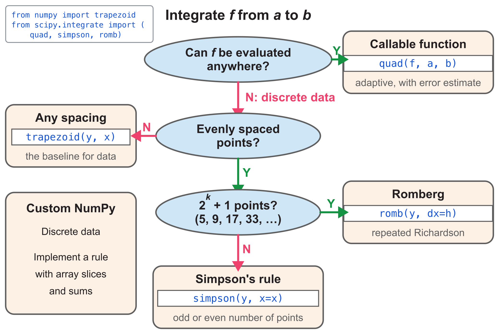
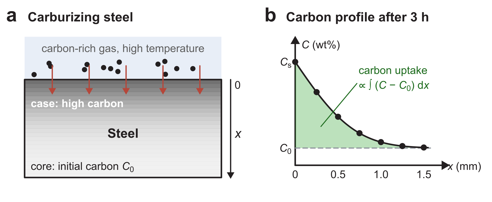

::: {.callout-note}
## Central question

**How do we calculate an integral in Python, and what limits the accuracy of the result?**
:::

## Learning outcomes

By the end of this lecture, you should be able to:

1. **Calculate** integrals from callable functions and tabulated data using SciPy and NumPy, including array-slice implementations of the composite rules.
2. **Apply** the composite trapezoidal and Simpson's 1/3 rules to carbon-uptake data by hand and in Python.
3. **Compare** the convergence of the composite rules and explain the round-off limit.
4. **Explain** how random measurement noise affects an integral and the choice of integration rule.

The reading material also shows how to improve two trapezoidal estimates by Richardson extrapolation.

## Numerical integration in Python

L19 separated two types of problem: a callable function, $f(x)=x+x^3$ on $[0,2]$ (Type I), and a table of five values of the same function (Type II). We now integrate both in Python. The selection chart from L19 summarizes the routes. We will first call the library routines, then write the composite rules with array slices.

{#fig-integration-choice width="90%" fig-alt="A callable function leads to quad. For discrete data, the choices include trapezoid for any spacing, Romberg for evenly spaced data with 2 to the k plus 1 points, Simpson, and custom NumPy integration."}

### Type I: integrate a callable function

::: {.callout-note}
## Function call: `integrate.quad(f, a, b)`

- **Input:** a Python function `f` and the limits `a`, `b`.
- **Output:** the integral estimate and an estimate of its absolute error.
:::

SciPy's `quad` chooses the evaluation points and refines the calculation automatically [@virtanen2020scipy]. For an ordinary smooth function on a finite interval, this is the standard starting point. We supply the function and limits without constructing a grid or writing integration weights.

::: {.quarto-wasm-local notebook="l20_callable_integral.edit.py" view="edit" title="Integrating a callable function with scipy.integrate.quad" height="480" loading="lazy" fullscreen="true"}
For $f(x)=x+x^3$ on $[0,2]$, `integrate.quad(f, 0, 2)` returns $6.0000000$ and an estimated absolute error of $7\times10^{-14}$. The exact answer is 6.
:::

### Type II: integrate discrete data

Store the positions in `x` and the measured values in `y`. The functions below receive the values first and the positions second.

::: {.callout-note}
## Function calls: `np.trapezoid(y, x)` and `integrate.simpson(y, x=x)`

- **`np.trapezoid(y, x)`** adds trapezoids between successive data points, using their actual spacing [@harris2020numpy].
- **`integrate.simpson(y, x=x)`** uses Simpson's rule [@virtanen2020scipy]. With equal spacing and an even number of subintervals, it is the composite 1/3 rule from L19.
:::

The library routines accept the positions directly, so we can use them before writing our own spacing checks. SciPy also handles unequal spacing and an odd number of subintervals with adjusted formulas. The simple 1, 4, 2, …, 4, 1 weights from L19 require equal spacing and an even number of subintervals.

::: {.quarto-wasm-local notebook="l20_tabulated_integral.edit.py" view="edit" title="Integrating a table with NumPy trapezoid and SciPy Simpson" height="480" loading="lazy" fullscreen="true"}
For the five-point table, `np.trapezoid(y, x)` gives 6.25 and `integrate.simpson(y, x=x)` gives 6. The values lie on the cubic $x+x^3$, so Simpson's rule gives its exact integral.
:::

### The composite rules with NumPy slices

Before opening the implementation, try writing the trapezoidal sum yourself. Each trapezoid has a width and an average height:

- `x[1:] - x[:-1]` gives every width $h_i$.
- `(y[:-1] + y[1:]) / 2` gives every average height.
- Multiply these arrays and sum their entries.

For Simpson's 1/3 rule, the first and last values have weight 1. The interior values alternate between weights 4 and 2:

- `y[1:-1:2]` selects $y_1,y_3,\ldots,y_{N-1}$, with weight 4.
- `y[2:-1:2]` selects $y_2,y_4,\ldots,y_{N-2}$, with weight 2.
- `np.diff(x)` gives the spacings. `np.allclose` checks whether they all equal the first spacing, allowing for floating-point rounding.
- `N = len(x) - 1` counts the subintervals. `N % 2 == 0` checks that this count is even.

::: {.quarto-wasm-local notebook="l20_composite_slices.edit.py" view="edit" title="Composite trapezoidal and Simpson one-third rules using NumPy slices" height="680" loading="lazy" fullscreen="true"}
The trapezoidal slices give $0.5(0.3125+1.3125+3.4375+7.4375)=6.25$. For Simpson's rule, the four spacings all equal 0.5 and $N=4$ is even. Its slices give $(0.5/3)[0+10+4(0.625+4.875)+2(2)]=6$. Both agree with their library routines.
:::

## Worked example: carbon uptake during carburizing

Carburizing hardens a steel surface by allowing carbon from a carbon-rich gas to diffuse into the steel at high temperature. The surface gains more carbon than the interior, producing a carbon profile that decreases with depth (@fig-carburizing).

{#fig-carburizing width="100%" fig-alt="Panel a: carbon-rich gas above a steel block, with arrows pointing into the steel. Panel b: carbon content decreases with depth, with seven measurements and a shaded area above the initial carbon content C0."}

### Question

**How much carbon has entered each square metre of the steel surface down to a depth of 1.5 mm? Calculate the uptake using both the composite trapezoidal and Simpson's 1/3 rules.**

The excess carbon content $f(x)$ has been measured at the seven depths below. With $x$ in mm and $f$ in wt%, the uptake $M$ in g/m² is

$$
M=78.5\int_0^{1.5} f(x)\,\mathrm dx.
$$

| $x_i$ (mm) | 0 | 0.25 | 0.50 | 0.75 | 1.00 | 1.25 | 1.50 |
|---|:-:|:-:|:-:|:-:|:-:|:-:|:-:|
| $f_i$ (wt%) | 1.000 | 0.649 | 0.363 | 0.173 | 0.069 | 0.023 | 0.006 |

: Excess carbon content below the steel surface. {#tbl-carbon-data}

The factor 78.5 includes the steel density and unit conversions. **Reference answer from the analytical profile: 34.36 g/m².**

### Method 1: calculate by hand

There are seven points and six subintervals, each of width $h=0.25$ mm.

**Composite trapezoidal rule.** Each interior value belongs to two neighbouring trapezoids:

$$
I_T=\frac h2\Big[f_0+2(f_1+f_2+f_3+f_4+f_5)+f_6\Big].
$$

Substituting the table gives

$$
I_T=\frac{0.25}{2}\Big[1.000+2(0.649+0.363+0.173+0.069+0.023)+0.006\Big]=0.4450.
$$

**Composite Simpson's 1/3 rule.** First check its requirements:

- The spacings are all 0.25 mm.
- The number of subintervals is $N=6$, which is even.

The rule therefore applies, with weights 4 on $f_1,f_3,f_5$ and 2 on $f_2,f_4$:

$$
I_S=\frac h3\Big[f_0+4(f_1+f_3+f_5)+2(f_2+f_4)+f_6\Big].
$$

Substituting the table gives

$$
I_S=\frac{0.25}{3}\Big[1.000+4(0.649+0.173+0.023)+2(0.363+0.069)+0.006\Big]=0.4375.
$$

Multiplying each integral by 78.5 gives:

- **Trapezoidal:** $M_T=34.93$ g/m², about 1.7% above the reference.
- **Simpson's 1/3:** $M_S=34.34$ g/m², about 0.05% below the reference.

### Method 2: calculate in Python

Use the same seven measurements with `np.trapezoid` and `integrate.simpson`. This table has seven points, so it does not meet `romb`'s requirement of $2^k+1$ points. It also supplies no callable function for `quad`.

::: {.quarto-wasm-local notebook="l20_carburizing.edit.py" view="edit" title="Carbon uptake from seven measurements using trapezoid and Simpson" height="560" loading="lazy" fullscreen="true"}
Using the seven tabulated values, `78.5 * np.trapezoid(f, x)` gives 34.9325 g/m² and `78.5 * integrate.simpson(f, x=x)` gives 34.34375 g/m². Both reproduce the hand calculations.
:::

Simpson's rule gives a close estimate from this small table, and `quad` handles a callable function directly. The remaining questions concern accuracy: how quickly an estimate improves as the spacing shrinks, where round-off stops that improvement, and how measurement noise affects the total. We will survey these practical considerations next.

## Problem 1: how fast do the errors shrink?

We use three integrals whose exact values we know:

- $\displaystyle\int_0^1 e^x\,\mathrm dx=e-1$.
- $\displaystyle\int_0^{\pi/2}\sin x\,\mathrm dx=1$.
- $\displaystyle\int_1^3x^3\,\mathrm dx=20$.

Calculate each integral with $N=6,12,24,\ldots$ subintervals. Doubling $N$ halves the spacing $h$, and every $N$ is divisible by both 2 and 3, so all five rules apply. How much does the error fall after each halving? The log–log plot compares these changes, with the method names placed beside their curves.

::: {.quarto-wasm-local notebook="l20_convergence.edit.py" view="app" title="Convergence of five composite rules for exp(x), sin(x), and x³" height="680" loading="lazy" fullscreen="true"}
For $\int_0^1e^x\,\mathrm dx=e-1$, the error curves have slopes of approximately 1 for the left rectangle, 2 for the midpoint and trapezoidal rules, and 4 for both Simpson rules. At $N=6$ ($h=1/6$), the errors are $1.4\times10^{-1}$, $2.0\times10^{-3}$, $4.0\times10^{-3}$, $7.3\times10^{-6}$, and $1.6\times10^{-5}$. The midpoint error is half the trapezoidal error, and the 3/8 error is about 2.25 times the 1/3 error. Simpson's 1/3 error reaches $1.8\times10^{-15}$ at $N=1536$ ($h\approx6.5\times10^{-4}$) and stays at the round-off level up to $N=24576$. For $\sin x$ on $[0,\pi/2]$ the slopes are the same. For $x^3$ on $[1,3]$, both Simpson rules are exact to round-off for every $N$.
:::

::: {.callout-note}
## Why does round-off matter less in integration?

In L18, the error of a finite difference fell as $h$ shrank and then rose again, because round-off took over. In the convergence test above, the Simpson errors reach the floating-point round-off level and then fluctuate near it. Integration is much less affected by round-off error:

- **Differentiation** subtracts two nearly equal function values and divides the small difference by a small $h$. The rounding errors of the values are divided by $h$ as well, so they grow as $h$ shrinks.
- **Integration** multiplies each function value by a weight proportional to $h$ and adds the products. For these smooth, positive integrands, round-off stays near the scale $\epsilon\,|I|$, where $\epsilon\approx2.2\times10^{-16}$. Summation and cancellation can still introduce rounding error.

**Once round-off dominates, a smaller $h$ costs more without reliably improving the answer.**
:::

### Error orders of the composite rules

The slopes reflect the leading truncation errors obtained by integrating the Taylor expansions on each panel [@burden2016numerical, §4.3–4.4]. For a sufficiently smooth function, the errors over the fixed interval $[a,b]$ are

$$
\boxed{
\begin{aligned}
I-L &= \frac{b-a}{2}\,h\,f'(\xi_L) &&=O(h),\\
I-M &= \frac{b-a}{24}\,h^2\,f''(\xi_M) &&=O(h^2),\\
I-T &= -\frac{b-a}{12}\,h^2\,f''(\xi_T) &&=O(h^2),\\
I-S_{1/3} &= -\frac{b-a}{180}\,h^4\,f^{(4)}(\xi_{1/3}) &&=O(h^4),\\
I-S_{3/8} &= -\frac{b-a}{80}\,h^4\,f^{(4)}(\xi_{3/8}) &&=O(h^4).
\end{aligned}}
$$

Here $L,M,T,S_{1/3},S_{3/8}$ denote the five estimates. Each $\xi$ is some point inside $[a,b]$ and may differ between rules. These formulas explain the patterns in the plot:

- **Left rectangle:** halving $h$ approximately halves the error.
- **Midpoint and trapezoidal:** halving $h$ reduces the error by about 4.
- **Both Simpson rules:** halving $h$ reduces the error by about 16.
- **For $x^3$:** the fourth derivative is zero, so both Simpson rules are exact apart from round-off.

## Problem 2: integrating noisy data

L18 showed that differentiating noisy data amplifies the noise. Integration does the opposite. Write each measured value as the exact value plus a random error, $\tilde y_i=f(x_i)+\xi_i$. Any integration rule is a weighted sum, so the estimate splits into two parts:

$$
w_0\tilde y_0+w_1\tilde y_1+\cdots+w_N\tilde y_N
=\underbrace{w_0f(x_0)+\cdots+w_Nf(x_N)}_{\text{rule applied to }f}
+\underbrace{w_0\xi_0+\cdots+w_N\xi_N}_{\text{noise in the integral}} .
$$

The noise term adds many independent errors, each multiplied by a weight of about $h$, and positive and negative errors partly cancel. For independent errors with standard deviation $\sigma$, the typical size of such a sum is $\sigma\sqrt{w_0^2+w_1^2+\cdots+w_N^2}$ [@taylor1997error, ch. 3]. For the trapezoidal rule, almost all weights equal $h$, so

$$
\sigma_I\approx\sigma\sqrt{N}\,h=\frac{\sigma\,(b-a)}{\sqrt N}.
$$

Compare this with the central-difference derivative of L18, $\sigma_{f'}=\sigma/(\sqrt2\,h)$:

- **Derivative:** more closely spaced points, with a smaller $h$, give **more** noise in the result.
- **Integral:** more points, with a larger $N$, give **less** noise in the result.

### Noisy samples of $x^3$ again

- **Data:** the noisy data set of L18, $y_i=x_i^3+\xi_i$ at 21 evenly spaced points from 1 to 3, with $\sigma=0.1$.
- **Exact integral:** $\int_1^3x^3\,\mathrm dx=20$.
- **Question:** how large are the percentage errors of the trapezoidal and Simpson integrals, compared with the 9.4% error of the central-difference derivative in L18?

For this data set, the data error is 0.93% and the derivative error is 9.4%, as in L18, while the trapezoidal integral is off by only 0.03% and the Simpson integral by 0.005%. One data set can be lucky, so the notebook repeats the experiment with 300 independent noise draws and reports the typical, root-mean-square, errors:

- data: 0.8%,
- central-difference derivative: 6.9%,
- trapezoidal integral: 0.25%,
- Simpson's integral: 0.24%,
- integral of a fitted cubic: 0.23%.

The formula above predicts a noise of $0.1\times2/\sqrt{20}=0.045$, or 0.22% of the exact value. Combining that noise with the trapezoidal truncation error of 0.1% gives a root-mean-square error of $\sqrt{0.22^2+0.10^2}\%\approx0.24\%$, close to the observed 0.25%. With 81 points, the typical derivative error rises to 22%, while the integral error falls to 0.12%.

::: {.quarto-wasm-local notebook="l20_noisy_integral.edit.py" view="app" title="Noisy x³ data: errors of the derivative and of trapezoidal, Simpson, and cubic-fit integrals" height="780" loading="lazy" fullscreen="true"}
For the L18 data set (21 points, $\sigma=0.1$), the data error is 0.93%, the central-difference derivative error 9.4%, and the trapezoidal and Simpson integral errors 0.028% and 0.005%. Over 300 noise draws, the typical errors are 0.77% for the data, 6.9% for the derivative, 0.25% for the trapezoidal integral, 0.24% for the Simpson integral, and 0.23% for the integral of a fitted cubic. As the number of points rises from 6 to 161, the typical derivative error grows from 2.8% to 41%, while the trapezoidal integral error falls from 1.6% (mostly truncation) to 0.08%. At $\sigma=1.0$ with 21 points, the derivative error is 69% and the integral errors are about 2.3%.
:::

::: {.callout-important}
## Three practical conclusions for noisy data

- **Integration averages out noise.** For independent, zero-mean measurement errors, more points reduce the typical noise in an integral.
- **No fitting or interpolation is needed first.** A Newton–Cotes rule already integrates an interpolating polynomial, and the fitted cubic gives a similar accuracy to the trapezoidal sum in this example. In L18, fitting helped suppress noise before differentiating.
- **A higher-order rule does not reduce noise.** Simpson's weights of 4 and 2 make its noise slightly larger than the trapezoid's. Once the noise is larger than the truncation error, the trapezoidal rule is enough.
:::

Integration is forgiving of noise, but a very coarse data set still has a truncation error. With only 6 points, the trapezoidal error of 1.6% for these data comes almost entirely from truncation. The number of points should be large enough for the truncation error to fall below the noise, after which further independent measurements reduce the typical noise. A systematic measurement offset does not cancel when the values are added.

## Problem 3 (reading material): Richardson extrapolation, an accurate result from two inaccurate ones

If we know how the error depends on $h$, two calculations at different spacings can cancel it. Richardson extrapolation needs one calculation more than the estimate we already have, a second estimate at half the spacing. The trapezoidal estimate with the spacing $h$ has the form

$$
T(h)=I+Ch^2+O(h^4),
$$

where $C$ is the leading error coefficient and does not depend on $h$. Halving the spacing gives

$$
T(h/2)=I+\frac{C h^2}{4}+O(h^4).
$$

Multiplying the second equation by 4 and subtracting the first removes the $Ch^2$ term and leaves $3I$ plus an $O(h^4)$ error.

### Summary: Richardson extrapolation of the trapezoidal rule

$$
\boxed{I=\frac{4\,T(h/2)-T(h)}{3}+O(h^4)}
$$

Repeating this step on finer and finer halvings is **Romberg integration**. In SciPy, if you can afford evenly spaced data with $2^k+1$ points, that is, the interval split into 4, 8, 16, 32, 64, 128, 256, 512, … subintervals, `scipy.integrate.romb(y, dx=h)` applies these extrapolations. For smooth, low-noise data, it can improve the trapezoidal estimate substantially.

## Next

The integrals here used functions or data that were already available. In a molecular dynamics engine, the force changes as the atoms move, so the positions and velocities must be updated together. L21 uses differentiation and integration to build a toy MD engine, leading into the ODE methods of Unit 5.
