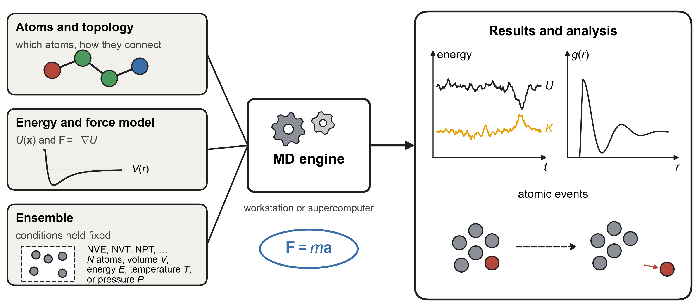
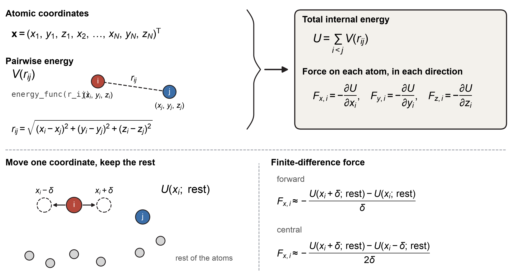
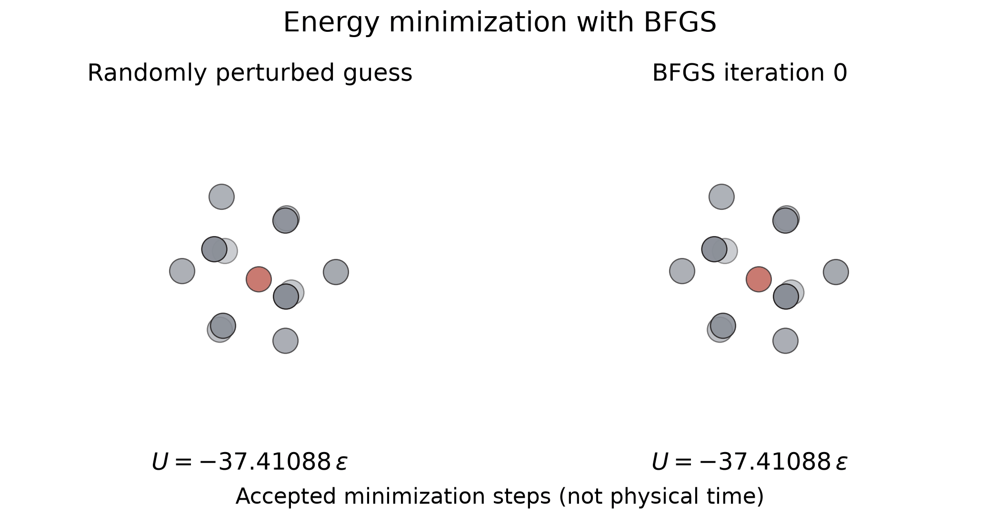
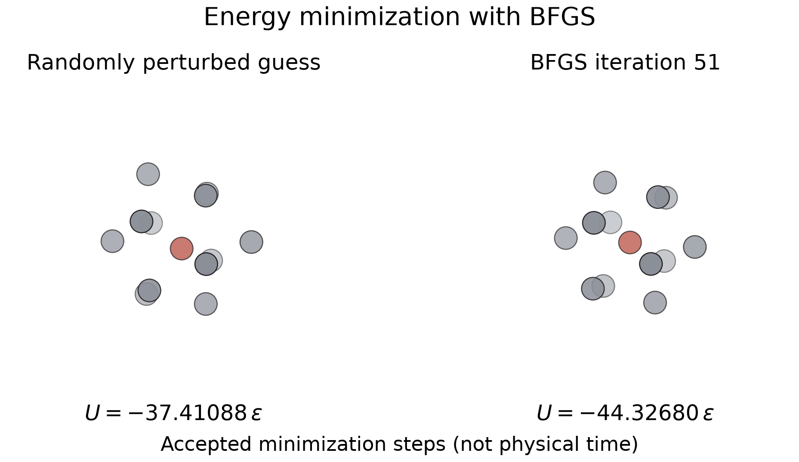
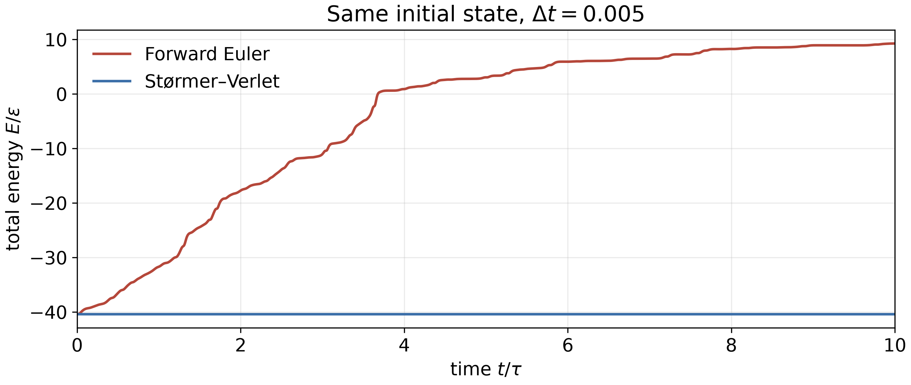
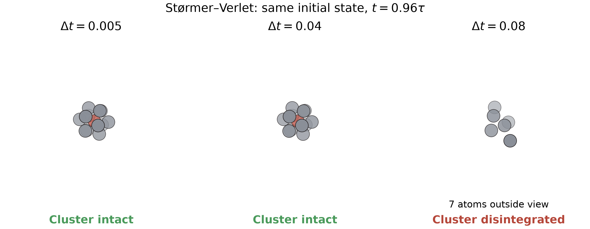

::: {.callout-note}
## Central question

**Can we put the numerical methods we have learned together to build an engine that follows the motion of atoms, and where does that engine break down?**
:::

::: {.callout-tip}
This lecture is mainly a code-building demonstration. Writing the engine yourself is **not required for the final exam**.
:::

## Learning outcomes

By the end of this lecture, you should be able to:

1. **Assemble** a small molecular dynamics engine from a pair energy, finite-difference forces, and a time-stepping function.
2. **Verify** numerical forces by relaxing a cluster to its known energy minimum.
3. **Derive** the forward Euler and Størmer–Verlet updates from the finite differences of Unit 4.
4. **Diagnose** numerical energy drift by comparing the internal, kinetic, and total energies of an isolated cluster.
5. **Distinguish** a numerical instability from a possible physical rearrangement by changing the method and refining the time step.

## From a relaxed cluster to moving atoms

In Unit 3, we found atomic structures by minimizing their energy. A relaxed cluster sits near a local minimum: small forces balance, and the positions change little if we continue the minimization. Real atoms can move around those positions. If we disturb the cluster, its forces accelerate the atoms, which change the distances between neighbouring atoms and therefore change the forces again.

Following this motion numerically is **molecular dynamics**, or **MD**. We already have most of its ingredients:

- **Many-coordinate problems:** store the positions of $N$ atoms as $3N$ coordinates.
- **Differentiation:** calculate forces from the energy with finite differences.
- **Energy minimization:** test those forces and prepare a relaxed starting structure.
- **Integration:** use accelerations to update velocities and positions.

{#fig-md-workflow width="100%" fig-alt="Atoms, an energy and force model, and an ensemble feed an MD engine. Outputs include energies, structural measures, and atomic events."}

Our example is a cluster represented by a Lennard–Jones model of argon. Imagine putting energy into the cluster. Will the atoms only vibrate more strongly, rearrange into another structure, or separate? Before interpreting any of those changes, we need to know whether the numerical engine is adding energy of its own.

### Newton's second law

For atom $i$,

$$
\boxed{
-\nabla_i U(\mathbf x_1,\ldots,\mathbf x_N)
=\mathbf F_i
=m_i\mathbf a_i,
\qquad
\mathbf a_i=\frac{\mathrm d\mathbf v_i}{\mathrm dt},
\qquad
\mathbf v_i=\frac{\mathrm d\mathbf x_i}{\mathrm dt}
}
$$

- **Left-hand side:** the negative gradient of the internal energy $U$ gives the force on atom $i$. The subscript on $\nabla_i$ means differentiation with respect to that atom's three coordinates.
- **Right-hand side:** dividing the force by the mass gives its acceleration.
- **Time integration:** acceleration changes velocity, and velocity changes position.

The force changes as the atoms move. We therefore calculate the trajectory one time step at a time, using the forces at the current positions.

## What can we already compute?

Our engine will model an isolated cluster:

- **Identical atoms (a cluster)**, with no surrounding gas, container, or external force.
- **Pair interactions:** every pair has an interaction energy, for example a Lennard–Jones energy.
- **No heating or cooling during the run:** energy is supplied only when preparing the initial state.

### Internal energy from pairwise energies

Using the Lennard–Jones potential as an example (in reduced units), the **pairwise energy** of two atoms a distance $r$ apart is

$$
V(r)=4\left(r^{-12}-r^{-6}\right).
$$

We can write this as a Python function `energy_func(r)`, as you did in Assignment 1:

```python
def energy_func(r):
    return 4 * (r**-12 - r**-6)
```

The **internal energy** $U$ adds the interaction energies of all pairs in the cluster. For three atoms, $U=V(r_{12})+V(r_{13})+V(r_{23})$. For $N$ atoms,

$$
U=\sum_{i<j}V(r_{ij}),
\qquad
r_{ij}=\lVert\mathbf x_i-\mathbf x_j\rVert
=\sqrt{(x_i-x_j)^2+(y_i-y_j)^2+(z_i-z_j)^2}.
$$

The condition $i<j$ counts each pair once. $U$ is the potential energy stored in the interactions, and it depends only on the positions.

In Python, we store the coordinates in an $N\times3$ NumPy array, `pos`:

- Row `i` holds the $x$, $y$, and $z$ coordinates of atom $i$.
- `pos[i] - pos[j]` is the vector from atom $j$ to atom $i$.
- `np.linalg.norm(pos[i] - pos[j])` gives their distance $r_{ij}$.

{#fig-md-positions-array width="100%" fig-alt="An array of atom coordinates leads to pair distances and a sum of pair interaction energies."}

The function `U(pos)` takes all atom coordinates and returns the total internal energy:

```python
import numpy as np

def U(pos):
    energy = 0.0
    for i in range(len(pos)):
        for j in range(i + 1, len(pos)):
            r = np.linalg.norm(pos[i] - pos[j])
            energy += energy_func(r)
    return energy
```

The notebook uses NumPy to evaluate the same pair sum together: `np.triu_indices(len(pos), k=1)` lists the pairs with $i<j$, and `pos[i] - pos[j]` gives their separation vectors.

### Forces: finite differences of internal energy

The following figure shows how atom coordinates give forces. To calculate the force in the $x$ direction, move only the $x$ coordinate of one atom and keep all other coordinates fixed.

{#fig-md-forces-from-energy width="100%" fig-alt="Atom i is displaced to x_i minus delta and x_i plus delta while the other atom coordinates remain fixed. The two energies give its force component."}

Writing $U(x_i;\,\text{rest})$ for the internal energy as a function of $x_i$ alone, the **central difference** gives an estimate of the force:

$$
\boxed{
F_{x,i}=-\frac{U(x_i+\delta;\,\text{rest})-U(x_i-\delta;\,\text{rest})}{2\delta}+O(\delta^2)
}
$$

Here $\delta$ is a small distance used for the derivative.

### `forces(pos)` by finite differences

The force array has one entry for each atom and direction: `F[i, k]`, with `k` = 0, 1, 2 for $x$, $y$, $z$.

![Shifting entry `[1, 1]` by $\pm\delta$ gives two displaced structures. The central difference of their energies fills the corresponding force entry.](../../../assets/L21-numerical-forces.png){#fig-md-numerical-forces width="100%" fig-alt="Two copies of the positions have opposite small displacements of one coordinate. Their energies give one component of the force array."}

For each atom `i` and direction `k`, copy the positions, displace that coordinate in opposite directions, and calculate the force:

```python
def forces(pos, delta=1e-5):
    F = np.zeros_like(pos)
    for i in range(len(pos)):
        for k in range(3):
            pos_r = pos.copy()
            pos_l = pos.copy()
            pos_r[i, k] += delta
            pos_l[i, k] -= delta
            F[i, k] = -(U(pos_r) - U(pos_l)) / (2 * delta)
    return F
```

This function needs only `U`, so the same procedure works for other energy models. It evaluates the energy twice for each of the $3N$ coordinates. For a small cluster this is manageable. Large MD simulations usually use analytical derivatives to reduce the cost of repeatedly calculating forces.

## Step 0: energy minimization

Before starting the dynamics, we relax the atom positions towards a local energy minimum. We can use the energy and force functions we have just written: `U` is the objective, and `-forces` is its gradient. This also checks whether the forces drive a displaced cluster towards a stable structure.

```python
from scipy import optimize

relaxation = [pos_guess.copy()]
result = optimize.minimize(
    lambda x: U(x.reshape(-1, 3)),
    pos_guess.ravel(),
    jac=lambda x: -forces(x.reshape(-1, 3)).ravel(),
    callback=lambda x: relaxation.append(x.reshape(-1, 3).copy()),
    method="BFGS",
    options={"gtol": 1e-6, "maxiter": 300},
)
if not result.success:
    print(result.message)
pos_min = result.x.reshape(-1, 3)
```

- `pos_guess` contains the initial atom coordinates, with random displacements.
- `ravel()` turns the coordinate array into the vector required by the minimizer. `reshape(-1, 3)` restores the atom rows.
- `callback` records the positions after each minimization iteration, so we can animate the relaxation.

::: {.content-visible when-format="html"}
{#fig-md-relaxation width="80%" fig-alt="A randomly perturbed cluster relaxes to a compact structure as its internal energy decreases."}
:::

::: {.content-visible unless-format="html"}
{width="100%"}
:::

The atoms settle into a compact structure with small forces. A minimization iteration has no physical time attached to it. To follow motion in time, we must instead integrate Newton's equation.

## Step 1: take the next step in molecular dynamics

With forces available, we can advance the atoms using Newton's equation. Let each time step be a small interval $\Delta t$. Write $t_n=n\Delta t$, and let $\mathbf x_n$, $\mathbf v_n$, and $\mathbf a_n$ denote position, velocity, and acceleration at that time. The same formulas apply to every atom and every coordinate.

### Method A: forward differences (forward Euler)

The forward differences approximate velocity and acceleration as

$$
\mathbf v_n\approx\frac{\mathbf x_{n+1}-\mathbf x_n}{\Delta t},
\qquad
\mathbf a_n\approx\frac{\mathbf v_{n+1}-\mathbf v_n}{\Delta t}.
$$

Multiplying by $\Delta t$ and solving for the next values gives the **forward Euler method**:

$$
\boxed{
\begin{aligned}
\mathbf x_{n+1}&=\mathbf x_n+\Delta t\,\mathbf v_n,\\
\mathbf v_{n+1}&=\mathbf v_n+\Delta t\,\mathbf a_n.
\end{aligned}}
$$

Both updates use the current state, with $\mathbf a_n=\mathbf F(\mathbf x_n)/m$.

### Method B: central differences (Størmer–Verlet)

The central second difference gives the acceleration directly from three positions:

$$
\mathbf a_n=
\frac{\mathbf x_{n+1}-2\mathbf x_n+\mathbf x_{n-1}}{\Delta t^2}
+O(\Delta t^2).
$$

Solving for the next position gives the **Størmer–Verlet method**, also called position Verlet [@verlet1967computer]:

$$
\boxed{
\mathbf x_{n+1}
=2\mathbf x_n-\mathbf x_{n-1}
+\Delta t^2\,\mathbf a_n
+O(\Delta t^4)
}
$$

The velocity is calculated afterwards from the saved positions using a central difference:

$$
\boxed{
\mathbf v_n=
\frac{\mathbf x_{n+1}-\mathbf x_{n-1}}{2\Delta t}
+O(\Delta t^2)
}
$$

How different will the two methods be when we use them to move the same cluster?

## Step 2: building a step function

An MD engine needs a step function that it can repeat many times. We can give both methods the same inputs and outputs, so changing the method requires changing only the function used for the step.

- `pos`, `vel`: current positions and velocities.
- `pos_prev`: positions from the previous time step. Forward Euler does not use them.
- `F`, `dt`, `m`: current forces, time step, and atom mass.
- Return values: `pos_next, vel_next`. Størmer–Verlet returns `None` for velocity because its position update does not need it.

```python
def step_euler(pos, vel, pos_prev, F, dt, m=1):
    pos_next = pos + dt * vel
    vel_next = vel + dt * F / m
    return pos_next, vel_next


def step_verlet(pos, vel, pos_prev, F, dt, m=1):
    pos_next = 2 * pos - pos_prev + dt**2 * F / m
    vel_next = None
    return pos_next, vel_next
```

Each array operation updates all atom coordinates together. The functions above implement the numerical updates without the unknown truncation-error terms.

## Assembling the engine

We start near the relaxed structure, displace the atoms slightly, and set their initial velocities to zero. To compare methods, we keep this initial state unchanged. Størmer–Verlet also needs a previous position for its first step. A Taylor expansion supplies it from the initial state:

$$
\boxed{
\mathbf x_{-1}
=\mathbf x_0-\Delta t\,\mathbf v_0
+\frac12\Delta t^2\,\mathbf a_0
+O(\Delta t^3)
}
$$

The engine loop calculates the forces, takes a step, and stores the positions:

```python
def run(pos, vel, dt, n_steps, step, m=1):
    pos = pos.copy()
    vel = vel.copy()
    pos_prev = pos - dt * vel + 0.5 * dt**2 * forces(pos) / m
    trajectory = [pos.copy()]
    for _ in range(n_steps):
        F = forces(pos)
        pos_next, vel_next = step(pos, vel, pos_prev, F, dt, m)
        pos_prev, pos, vel = pos, pos_next, vel_next
        trajectory.append(pos.copy())
    return np.asarray(trajectory)
```

For example, release a slightly displaced cluster and follow it for 2,000 steps:

```python
dt, m = 0.005, 1.0
rng = np.random.default_rng(374)
displacement = 0.02 * rng.normal(size=pos_min.shape)
displacement -= displacement.mean(axis=0)
pos0 = pos_min + displacement
vel0 = np.zeros_like(pos0)
trajectory = run(pos0, vel0, dt, 2000, step_verlet, m)
```

Forward Euler uses its updated velocity internally to advance the next position. For the comparison plots, we calculate velocities afterwards from the saved positions for **both** methods:

```python
velocity = (trajectory[2:] - trajectory[:-2]) / (2 * dt)
positions = trajectory[1:-1]
time = np.arange(1, len(trajectory) - 1) * dt
internal = np.array([U(pos) for pos in positions])
kinetic = 0.5 * m * np.sum(velocity**2, axis=(1, 2))
total = internal + kinetic
```

Each velocity belongs to the middle position of its three-position difference. Using `trajectory[1:-1]` keeps the internal and kinetic energies at matching times.

### The completed MD engine

The completed engine below shows what we will build in class. It includes the visualization and analysis code, so we can concentrate on the energy, forces, and step functions.

1. Choose the atom count, total steps, method, time step, and added energy, then click **Simulate**. Changing a control alone does not run the calculation.
2. Inspect the relaxation animation, then watch the atoms move in the dynamics playback.
3. Compare forward Euler and Størmer–Verlet with the same initial state and time step.
4. Follow the energy curve as the simulation proceeds.

::: {.quarto-wasm-local notebook="l21_md_engine_completed.edit.py" view="edit" title="Build and inspect a molecular dynamics engine" height="900" loading="lazy" fullscreen="true"}
The notebook first relaxes a distorted cluster, then follows its motion with forward Euler or Størmer–Verlet. At a sufficiently small time step, Størmer–Verlet keeps the cluster vibrating with nearly constant total energy. Forward Euler introduces energy drift. Saved positions provide the velocities and energies for the comparison.
:::

## How can we tell whether the trajectory is credible?

For this many-atom trajectory, we have no analytical position at every time against which to compare the result. We do have a physical constraint: an isolated system with time-independent interactions conserves its total energy.

- **Internal energy:** the sum of the pairwise energies,
  $U=V(r_{12})+V(r_{13})+\cdots=\sum_{i<j}V(r_{ij})$.
- **Kinetic energy:** the energy of atomic motion,
  $K=\tfrac12m_1|\mathbf v_1|^2+\tfrac12m_2|\mathbf v_2|^2+\cdots=\sum_i\tfrac12m_i|\mathbf v_i|^2$.
- **Total energy:** $E=U+K$. Internal and kinetic energy can exchange, while their sum should remain constant.

In our comparison, all the added energy starts as internal energy because the initial velocities are zero. Forces then accelerate the atoms, converting some of it into kinetic energy.

## Caveat 1: the integration method can supply artificial energy

{#fig-md-energy width="100%" fig-alt="Total energy versus time for forward Euler and Stormer-Verlet. Euler's total energy rises while Verlet remains nearly constant."}

The energy plot explains the difference between the two trajectories:

- **Forward Euler:** the total energy grows, and atoms separate—the cluster **explodes!**
- **Størmer–Verlet:** the total energy stays nearly constant, and the atoms continue to vibrate in a compact cluster.
- **Physical interpretation:** the calculations started with the same energy. The extra energy in the Euler run came from the numerical update.

::: {.content-visible when-format="html"}
{#fig-md-movie width="100%" fig-alt="Side-by-side animated cluster trajectories. Stormer-Verlet stays compact and vibrates. Euler gradually expands and loses atoms from the fixed viewing volume."}
:::

::: {.content-visible unless-format="html"}
{width="100%"}
:::

A small energy error is an important check, but it does not prove that every position is accurate. Two trajectories can eventually separate while conserving nearly the same energy. We should also compare a shorter run at a smaller time step and check that the quantities we intend to interpret agree.

## Caveat 2: a stable simulation needs a small enough time step

A close approach between two atoms produces a rapidly changing repulsive force. If the time step is too large, the update can carry atoms through much of that encounter before recalculating the force. The next update then reacts to an unrepresentative, sometimes enormous, force.

{#fig-md-step width="100%" fig-alt="Three cluster snapshots compare time steps 0.005, 0.04, and 0.08. Red text identifies the disintegrated cluster at 0.08."}

Keep the initial state fixed and compare runs over the same time interval. A breakup that disappears when we reduce the time step, together with a large numerical energy jump, is evidence of instability in the calculation.

::: {.callout-caution}
## Check the time step before interpreting breakup

An apparently dramatic atomic event may coincide with a numerical energy jump.

**Repeat the calculation with a smaller time step before assigning the event a physical explanation.**
:::

## Caveat 3: different configurations, different ensembles

We started with a system isolated from its surroundings. We supplied its initial energy and then let it evolve without further heating or cooling. Other experimental conditions require different simulation setups, called **ensembles**:

- **NVE:** fixed particle number $N$, volume $V$, and total energy $E$. Our isolated cluster follows the energy-conserving idea of NVE, although it has no enclosing fixed-volume container.
- **NVT:** fixed particle number, volume, and temperature $T$. A thermostat exchanges energy with the system to maintain the target temperature.
- **NPT:** fixed particle number, pressure $P$, and temperature. A thermostat and a barostat control temperature and pressure, allowing the volume to change.

An isolated cluster, a sample held at a specified temperature, and a sample heated under atmospheric pressure therefore need different conditions. We will return to these choices in later classes.

## Next: the ODE behind the engine

The two coupled relations

$$
\frac{\mathrm d\mathbf x_i}{\mathrm dt}=\mathbf v_i,
\qquad
\frac{\mathrm d\mathbf v_i}{\mathrm dt}=\frac{\mathbf F_i(\mathbf x_1,\ldots,\mathbf x_N)}{m_i}
$$

form an initial-value problem for ordinary differential equations. We have already built two numerical methods for it and seen that their behaviour differs. [Unit 5](../../05/index.qmd) develops the formal tools to explain that behaviour: stability, accuracy, appropriate time steps, and the interpretation of molecular dynamics. [L22](../../05/L22/index.qmd) begins with the ODE formulation.
