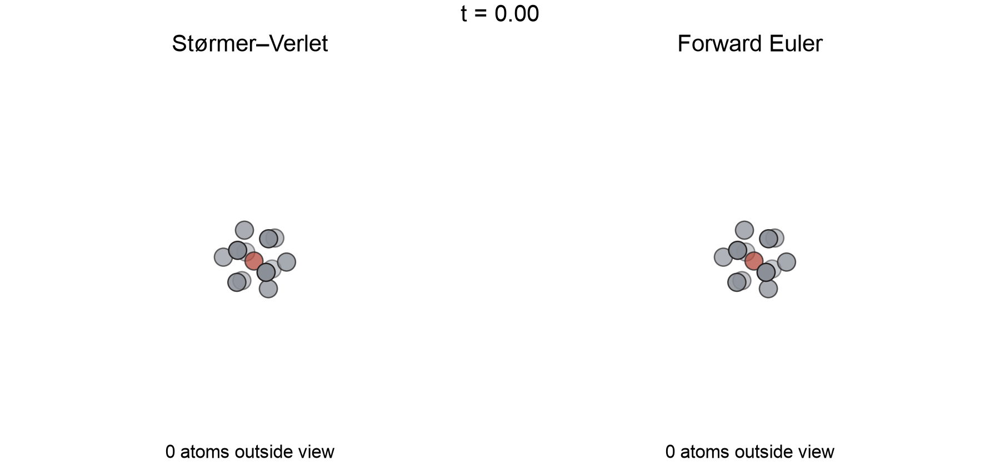
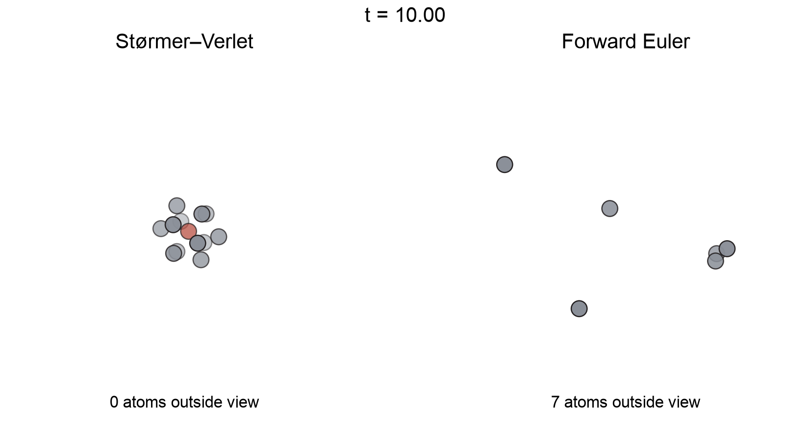

::: {.callout-note}
## Central question

**Can we put the numerical methods we have learned together to build an engine that follows the motion of atoms, and where does that engine break down?**
:::

## Learning outcomes

By the end of this lecture, you should be able to:

1. **Assemble** a small molecular dynamics engine from a pair energy, finite-difference forces, and a time-stepping function.
2. **Verify** numerical forces by relaxing a cluster to its known energy minimum.
3. **Derive** the forward Euler and Størmer–Verlet updates from the finite differences of Unit 4.
4. **Diagnose** numerical energy drift by comparing the internal, kinetic, and total energies of an isolated cluster.
5. **Distinguish** a numerical instability from a possible physical rearrangement by changing the method and refining the time step.

## From a relaxed cluster to moving atoms

In Unit 3, we found atomic structures by minimizing their energy. A relaxed cluster sits near a local minimum: small forces balance, and the positions change little if we continue the minimization. Real atoms can move around those positions. If we disturb the cluster, its forces accelerate the atoms, which change the distances between neighbouring atoms and therefore change the forces again.

Following this motion numerically is **molecular dynamics**, or **MD**. We already have most of its ingredients:

- **Many-coordinate problems:** store the positions of $N$ atoms as $3N$ coordinates.
- **Differentiation:** calculate forces from the energy with finite differences.
- **Energy minimization:** test those forces and prepare a relaxed starting structure.
- **Integration:** use accelerations to update velocities and positions.

{#fig-md-workflow width="100%" fig-alt="Flow diagram. Three input boxes, atoms and topology, energy and force model, and ensemble with NVE, NVT, and NPT, feed an MD engine with gears and the equation F equals m a. An arrow leads to a results panel with internal and kinetic energy against time, a peaked g of r curve, and a cluster from which one red atom escapes."}

@fig-md-workflow places this lecture within a full MD study. Our engine models the simplest ensemble, NVE: a fixed number of atoms $N$, no container that changes volume $V$, and no heat bath, so the total energy $E$ should stay constant.

Our example is a cluster of 13 atoms represented by a Lennard–Jones model of argon. Imagine putting energy into the cluster. Will the atoms only vibrate more strongly, rearrange into another structure, or separate? Before interpreting any of those changes, we need to know whether the numerical engine is adding energy of its own.

### Newton's second law connects the pieces

For atom $i$,

$$
\boxed{
-\nabla_i U(\mathbf x_1,\ldots,\mathbf x_N)
=\mathbf F_i
=m_i\mathbf a_i,
\qquad
\mathbf a_i=\frac{\mathrm d\mathbf v_i}{\mathrm dt},
\qquad
\mathbf v_i=\frac{\mathrm d\mathbf x_i}{\mathrm dt}
}
$$

- **Left-hand side:** the negative gradient of the internal energy $U$ gives the force on atom $i$. The subscript on $\nabla_i$ means differentiation with respect to that atom's three coordinates.
- **Right-hand side:** dividing the force by the mass gives its acceleration.
- **Time integration:** acceleration changes velocity, and velocity changes position.

The force has to be recalculated as the atoms move. A table of accelerations for the entire future trajectory is therefore unavailable at the start. We must calculate the trajectory one time step at a time, and every step needs the forces at the current positions. We therefore begin with the energy and forces.

## What can we already compute?

Our engine will model an isolated cluster:

- **13 identical atoms**, with no surrounding gas, container, or external force.
- **Pair interactions:** every pair contributes a Lennard–Jones energy.
- **No heating or cooling during the run:** energy is supplied only when preparing the initial state.
- **Reduced units:** length is measured in $\sigma$, energy in $\varepsilon$, and time in $\tau=\sigma\sqrt{m/\varepsilon}$. In these units, the numerical values of $\sigma$, $\varepsilon$, and each mass are 1.

Reduced units keep the implementation short. The time-step value 0.005 means $0.005\tau$, not 0.005 seconds. The energy setting 0.3 means an added energy of $0.3\varepsilon$ per atom.

### Internal energy from pairwise energies

For two atoms a distance $r$ apart, the reduced Lennard–Jones **pairwise energy** is

$$
V(r)=4\left(r^{-12}-r^{-6}\right).
$$

In Python, this is the function `energy_func(r)`. The **internal energy** $U$ of the cluster adds the pairwise energies of all pairs. For three atoms, $U=V(r_{12})+V(r_{13})+V(r_{23})$. For $N$ atoms, the same rule is

$$
U=\sum_{i<j}V(r_{ij}),
\qquad
r_{ij}=\lVert\mathbf x_i-\mathbf x_j\rVert=\sqrt{(x_i-x_j)^2+(y_i-y_j)^2+(z_i-z_j)^2}.
$$

The condition $i<j$ counts each pair once. $U$ is the potential energy stored in the interactions, and it depends only on the positions.

### Forces as finite differences of the internal energy

The force on atom $i$ in the $x$ direction is $F_{x,i}=-\partial U/\partial x_i$, and similarly for $y$ and $z$. We can approximate it without deriving any formula. Move only $x_i$ by a small distance $\delta$, keep every other atom fixed, and difference the two internal energies. @fig-md-forces-from-energy collects these steps.

{#fig-md-forces-from-energy width="100%" fig-alt="Top: the coordinate vector x, two atoms i and j joined by distance r_ij with its square-root formula, and a brace leading to the internal energy U as a sum of V of r_ij and the force components as negative partial derivatives. Bottom: atom i shown with dashed copies at x_i minus delta and x_i plus delta among the rest of the atoms, and the forward and central difference formulas for F_x,i."}

Writing $U(x_i;\,\text{rest})$ for the internal energy as a function of $x_i$ alone, the central difference from L17 gives

$$
\boxed{
F_{x,i}=-\frac{U(x_i+\delta;\,\text{rest})-U(x_i-\delta;\,\text{rest})}{2\delta}+O(\delta^2)
}
$$

Here $\delta$ is a small **distance** used for the derivative, while $\Delta t$ will be the **time step** used for motion. The notebook fixes $\delta=10^{-5}$.

### Atoms and internal energy in Python

In code, the positions of $N$ atoms form an $N\times3$ NumPy array, `pos`. Row $i$ holds the $x$, $y$, and $z$ coordinates of atom $i$, so `pos[i] - pos[j]` is the vector from atom $j$ to atom $i$, and `np.linalg.norm` gives its length $r_{ij}$. The internal energy is then a double loop over every pair with $i<j$.

{#fig-md-positions-array width="100%" fig-alt="An N by 3 table named pos with columns x, y, z. Rows for atom i and atom j are highlighted red and blue and lead to the code r_ij equals np.linalg.norm of pos i minus pos j. A small network shows every pair of atoms connected, with one pair highlighted. Below, the sum of V over pairs and a Python function internal_energy with two nested for loops calling energy_func."}

The notebook calculates the same sum without the explicit loops. `np.triu_indices(N, k=1)` returns two index arrays, `i` and `j`, that list every pair with $i<j$ once, so `pos[i] - pos[j]` gives all 78 pair vectors of the 13-atom cluster at the same time.

### `forces(pos)` by finite differences

The force array `F` has the same shape as `pos`: entry `F[i, k]` is the force on atom `i` in direction `k`, with `k` = 0, 1, 2 for $x$, $y$, $z$. @fig-md-numerical-forces follows one entry through the calculation.

![Numerical forces for every coordinate. Entry `[1, 1]` is the $y$ coordinate of atom 1. Shifting it by $\pm\delta$ gives `pos_r` and `pos_l`, and the central difference of their internal energies fills the matching entry of `F`. Repeating this for all $3N$ coordinates completes the force array.](../../../assets/L21-numerical-forces.png){#fig-md-numerical-forces width="100%" fig-alt="Inside a box labelled forces of pos: the pos array with the entry at row 1, column 1 highlighted. Arrows marked plus delta and minus delta lead to two copies, pos_r and pos_l, each passed to internal_energy. Their difference divided by 2 delta, with a minus sign, is stored in the matching green entry of an F array of the same shape."}

For each atom `i` and direction `k`:

1. Copy `pos` into `pos_r` and add $\delta$ to `pos_r[i, k]`.
2. Copy `pos` into `pos_l` and subtract $\delta$ from `pos_l[i, k]`.
3. Store `-(internal_energy(pos_r) - internal_energy(pos_l)) / (2 * delta)` in `F[i, k]`.

The function needs only `internal_energy`, so it works unchanged for any energy model. The price is $2\times3N$ energy evaluations per call: 78 for our 13 atoms. That is acceptable for a small cluster. Production MD codes use analytical derivatives because they recalculate forces for millions of atoms at every step.

## Checking the forces with an energy minimization

A sign error or a misplaced index in `forces` would still produce numbers, and the dynamics would then follow the wrong forces. Before moving any atoms, we test the forces on a problem whose answer we already know. In L16, relaxing the 13-atom Lennard–Jones cluster gave the icosahedron, with $U=-44.326801$.

The minimizers of L15 work with one vector of $3N$ coordinates. We give one the internal energy as the objective and the negative force as its gradient, the `jac` argument:

```python
result = optimize.minimize(
    lambda x: internal_energy(x.reshape(-1, 3)),
    pos_guess.ravel(),
    jac=lambda x: -forces(x.reshape(-1, 3)).ravel(),
    method="BFGS",
)
pos_min = result.x.reshape(-1, 3)
```

- **Starting guess:** `pos_guess` is an icosahedron with the wrong size and random displacements of about $0.05\sigma$, with $U=-37.41$.
- **Flattening:** `ravel` turns the $13\times3$ array into 39 coordinates for the minimizer, and `reshape(-1, 3)` restores rows of atoms for our functions.
- **Gradient:** BFGS moves downhill along $-\nabla U$, which is $+\mathbf F$, so the gradient we supply is `-forces`.

Three results show whether the forces are correct:

- **Relaxed energy:** BFGS converges to $U_{\min}=-44.326801$, matching L16.
- **Forces at the minimum:** the largest component of `forces(pos_min)` is about $5\times10^{-8}$, so the forces vanish where the energy is lowest.
- **Total force:** the sum of all forces is zero to about $10^{-9}$. Internal forces come in equal and opposite pairs, so their sum should vanish even away from a minimum.

If `forces` returns $+\nabla U$ instead, the supplied gradient points uphill. The line search cannot reduce the energy, and BFGS stops at the guess with $U=-37.41$. The relaxed positions `pos_min` also give the engine its starting structure.

## Two ways to take the next step

With forces available, we can advance the atoms. Write $t_n=n\Delta t$, and let $\mathbf x_n$, $\mathbf v_n$, and $\mathbf a_n$ denote the position, velocity, and acceleration of one atom at that time. The same formulas apply to every atom and every coordinate. We will first rearrange the forward difference, then use the central second difference.

### Forward differences give forward Euler

The forward differences from L17 are

$$
\mathbf v_n=\frac{\mathbf x_{n+1}-\mathbf x_n}{\Delta t}+O(\Delta t),
\qquad
\mathbf a_n=\frac{\mathbf v_{n+1}-\mathbf v_n}{\Delta t}+O(\Delta t).
$$

Multiply by $\Delta t$ and solve for the unknown next values. This gives the **forward Euler method**:

$$
\boxed{
\begin{aligned}
\mathbf x_{n+1}&=\mathbf x_n+\Delta t\,\mathbf v_n+O(\Delta t^2),\\
\mathbf v_{n+1}&=\mathbf v_n+\Delta t\,\mathbf a_n+O(\Delta t^2).
\end{aligned}}
$$

The error terms describe one step starting from exact current values. In the program, we use the displayed expressions without those unknown errors.

This is also the left-rectangle idea from L19: hold the velocity constant while integrating position over one step, and hold the acceleration constant while integrating velocity. Both updates use the **old** state. Updating the velocity first and then using that new velocity for the position would produce a different method.

### Central differences give Størmer–Verlet

The central second difference gives the acceleration directly from three positions:

$$
\mathbf a_n=
\frac{\mathbf x_{n+1}-2\mathbf x_n+\mathbf x_{n-1}}{\Delta t^2}
+O(\Delta t^2).
$$

Solving for the next position gives the **Størmer–Verlet method**, also called position Verlet [@verlet1967computer]:

$$
\boxed{
\mathbf x_{n+1}
=2\mathbf x_n-\mathbf x_{n-1}
+\Delta t^2\,\mathbf a_n
+O(\Delta t^4)
}
$$

The next position uses the current force and two stored positions. Over a fixed simulation time, Størmer–Verlet has second-order accuracy. Velocity is not needed to advance this recurrence, but we need it to describe the motion and calculate kinetic energy. Recover the velocity at the **current** time with the central first difference:

$$
\boxed{
\mathbf v_n=
\frac{\mathbf x_{n+1}-\mathbf x_{n-1}}{2\Delta t}
+O(\Delta t^2)
}
$$

The time labels matter: this velocity belongs to $\mathbf x_n$, even though calculating it uses $\mathbf x_{n+1}$. Pairing it with the internal energy at $\mathbf x_{n+1}$ would compare energies from different times.

### Starting the central recurrence

At the beginning, we know $\mathbf x_0$ and $\mathbf v_0$, but there is no saved position $\mathbf x_{-1}$. Taylor expansion supplies it:

$$
\boxed{
\mathbf x_{-1}
=\mathbf x_0-\Delta t\,\mathbf v_0
+\frac12\Delta t^2\,\mathbf a_0
+O(\Delta t^3)
}
$$

Substituting this starting position into the Verlet update gives $\mathbf x_1=\mathbf x_0+\Delta t\,\mathbf v_0+\tfrac12\Delta t^2\mathbf a_0$. Once that first step is available, the same central recurrence can be repeated.

### Step functions

Each method becomes a **step function**: called once per time step, it takes the current state and returns the next one. The two methods need different information about the past:

- `step_euler(pos, vel, F, dt)` uses the current positions and velocities and returns `pos_next, vel_next`.
- `step_verlet(pos, pos_prev, F, dt)` uses the current and previous positions and returns `pos_next`. The run loop recovers the current velocity afterwards.

Both functions also accept a mass `m`, which is 1 in reduced units. Because `pos`, `vel`, and `F` are $N\times3$ arrays, each line of array arithmetic updates every atom at once. The names `pos_prev`, `pos`, and `pos_next` stand for $\mathbf x_{n-1}$, $\mathbf x_n$, and $\mathbf x_{n+1}$, which keeps the time labels visible in the code.

{#fig-md-time-step width="100%" fig-alt="Top: at time t_n, pos gives U through internal_energy and F through forces, beside four atoms with velocity arrows and two N by 3 arrays, pos and vel. Bottom left: the step_euler function returning pos_next and vel_next, with a time line from t_n to t_n+1. Bottom right: the step_verlet function returning pos_next from pos and pos_prev, the recovered velocity formula, and a time line marking t_n-1, t_n, and t_n+1."}

## Assembling the engine

The engine connects these functions in a fixed order (@fig-md-engine-flow). The minimization check supplies `pos_min`. We then prepare the starting state by displacing the atoms from `pos_min` until the internal energy has increased by a specified amount, with all initial velocities zero. The random displacement direction is fixed, so changing the method or time step keeps the initial condition identical.

{#fig-md-engine-flow width="100%" fig-alt="Flowchart. Start: pos_guess and energy_func are minimized with jac equal to minus forces to pos_min, checked against U equals minus 44.3268. The initial state sets pos to pos_min plus a displacement and vel to init_vel. A large box labelled run of n_steps contains pos and vel feeding internal_energy and forces, then step_euler or step_verlet, then a record box, with a dashed arrow looping back. End: records of K, U, E, x, and v over time."}

Each pass through the run loop follows the same sequence:

1. Calculate the internal energy and forces at the current positions.
2. Construct the next positions with the selected step function.
3. Record the current positions and energies. For Verlet, recover the current velocity from the previous and next positions.
4. Replace the stored states and repeat.

| Function | Inputs | Output |
|---|---|---|
| `energy_func(r)` | Pair distances | Pairwise energies $V(r)$ |
| `internal_energy(pos)` | $N\times3$ positions | Internal energy $U$ |
| `forces(pos)` | $N\times3$ positions | $N\times3$ forces by central differences of `internal_energy` |
| `step_euler(pos, vel, F, dt)` | Current positions, velocities, and forces | `pos_next`, `vel_next` |
| `step_verlet(pos, pos_prev, F, dt)` | Current and previous positions, current forces | `pos_next` |
| `run(pos, vel, dt, duration, method)` | Initial state, time step, duration, method | Trajectory and energy records |

: The engine separates the physical model, the force calculation, the time update, and the recording of results. {#tbl-md-engine}

### In-class construction

The starter notebook supplies the energy functions, the minimization, the starting state, and the run loop. Complete three lines in the order of this lecture:

1. **Forces:** the central difference inside `forces`. The minimization check appears once `forces` returns finite values. Compare it with $U_{\min}=-44.326801$ before continuing.
2. **Forward Euler:** `step_euler`. Run it and watch the total energy.
3. **Størmer–Verlet:** `step_verlet`. Select it in the method menu and compare.

Each later cell waits until the function it needs is complete, so an unfinished expression does not produce a misleading trajectory.

::: {.quarto-wasm-local notebook="l21_md_engine_starter.edit.py" view="edit" title="Build the forces and the Euler and Størmer–Verlet step functions of a toy MD engine" height="760" loading="lazy" fullscreen="true"}
The force entry is `F[i, k] = -(internal_energy(pos_r) - internal_energy(pos_l)) / (2 * delta)`. With it, the minimization reaches $U_{\min}=-44.326801$. Forward Euler returns $\mathbf x+\Delta t\,\mathbf v$ and $\mathbf v+\Delta t\,\mathbf F/m$. Størmer–Verlet returns $2\mathbf x-\mathbf x_{\rm prev}+\Delta t^2\mathbf F/m$. The supplied loop then produces a trajectory and energy records.
:::

## How can we tell whether the trajectory is credible?

For this many-atom trajectory, we have no analytical position at every time against which to compare the result. We do have a physical constraint: an isolated system with time-independent interactions conserves its total energy.

- **Internal energy:** the sum of the pairwise energies,
  $U=V(r_{12})+V(r_{13})+\cdots=\sum_{i<j}V(r_{ij})$.
- **Kinetic energy:** the energy of atomic motion,
  $K=\tfrac12m_1|\mathbf v_1|^2+\tfrac12m_2|\mathbf v_2|^2+\cdots=\sum_i\tfrac12m_i|\mathbf v_i|^2$.
- **Total energy:** $E=U+K$. Internal and kinetic energy can exchange, while their sum should remain constant.

All the added energy starts as internal energy because the initial velocities are zero. Forces then accelerate the atoms, converting some of it into kinetic energy.

### Completed engine

The completed notebook contains the same blocks as the starter. Start with forward Euler, $\Delta t=0.005$, and added energy 0.3 per atom. Move the frame slider to inspect the atomic motion, then switch to Størmer–Verlet without changing the other settings.

::: {.quarto-wasm-local notebook="l21_md_engine_completed.edit.py" view="edit" title="Completed isolated-cluster MD engine with energy diagnostics" height="900" loading="lazy" fullscreen="true"}
The relaxed cluster has $U_{\min}=-44.32680$. Adding 0.3 per atom gives $E(0)=-40.42680$, with zero initial kinetic energy. Over reduced time 10 at $\Delta t=0.005$, forward Euler gains about 49.7 energy units and breaks the cluster apart. Størmer–Verlet has a maximum total-energy deviation of about 0.0096.
:::

## Caveat 1: the integration method can supply artificial energy

{#fig-md-energy width="100%" fig-alt="Three energy plots against time. Kinetic and shifted internal energies exchange under Stormer-Verlet. The Verlet total-energy error stays within approximately 0.01, while Euler's total energy rises by approximately 50."}

The energy plot explains the difference between the two trajectories:

- **Forward Euler:** the total energy grows by more than the energy originally binding the cluster, and atoms separate.
- **Størmer–Verlet:** the total-energy error remains small and oscillatory over this run, while the cluster stays compact.
- **Physical interpretation:** the two calculations started with the same energy. The extra energy in the Euler run came from the numerical update.

::: {.content-visible when-format="html"}
{#fig-md-movie width="100%" fig-alt="Side-by-side animated cluster trajectories. Stormer-Verlet remains compact. Euler gradually expands and loses atoms from the fixed viewing volume."}
:::

::: {.content-visible unless-format="html"}
{width="100%"}
:::

A small energy error is an important check, but it does not prove that every position is accurate. Two trajectories can eventually separate while conserving nearly the same energy. We should also compare a shorter run at a smaller time step and check that the quantities we intend to interpret agree.

## Caveat 2: even the central method needs a small enough time step

A close approach between two atoms produces a rapidly changing repulsive force. If the time step is too large, the update can carry atoms through a substantial part of that encounter before recalculating the force. The following update then reacts to an unrepresentative, sometimes enormous, force.

{#fig-md-step width="100%" fig-alt="Three cluster snapshots. Small-step Verlet stays compact. The large-step run has atoms outside the view. A higher-energy, small-step cluster shows larger structural excursions."}

Keep the initial state fixed and compare the runs over the same time interval:

| Time step | Maximum $\lvert E(t)-E(0)\rvert$ through time 10 |
|---:|---:|
| 0.005 | 0.00959 |
| 0.002 | 0.00153 |
| 0.001 | 0.00038 |

: Refining the Størmer–Verlet time step at added energy 0.3 per atom. {#tbl-md-step-refinement}

The errors decrease approximately with $\Delta t^2$. By contrast, $\Delta t=0.08$ produces a large energy jump and atomic ejection, and the positions overflow shortly after time 1. The initial state has not changed, so that breakup cannot be evidence of melting at the prescribed starting energy.

::: {.callout-caution}
## Check the time step before interpreting breakup

An apparently dramatic atomic event may coincide with a numerical energy jump.

**Repeat the calculation with a smaller time step before assigning the event a physical explanation.**
:::

## Caveat 3: motion, rearrangement, and melting are different observations

Now keep the numerical method and a small time step fixed, and increase the added energy towards 1 per atom. The atoms make larger excursions, and their local arrangement can change. In this particular short run, the cluster remains bound. The energy setting 1 means that we supplied $13\varepsilon$ above this cluster's relaxed energy. Establishing a melting-like transition would require a separate study.

Several observations require different evidence:

- **Vibration:** atoms move around approximately the same local arrangement.
- **Structural rearrangement:** atoms change neighbours or the cluster moves between different arrangements.
- **Evaporation:** an atom separates from the remaining cluster and continues away.
- **Melting-like behaviour:** sustained structural mobility over a sufficiently long observation time, assessed with more than a single snapshot.

For a cluster of only 13 atoms, surface effects are large and a sharp bulk melting temperature is not an appropriate assumption. To investigate the physical behaviour, we would compare several starting conditions and longer runs, track neighbour changes or atomic displacements, and first establish that the numerical energy error is small. Energy conservation checks the calculation, while structural measurements tell us what the atoms are doing.

## Next: the ODE behind the engine

The two coupled relations

$$
\frac{\mathrm d\mathbf x_i}{\mathrm dt}=\mathbf v_i,
\qquad
\frac{\mathrm d\mathbf v_i}{\mathrm dt}=\frac{\mathbf F_i(\mathbf x_1,\ldots,\mathbf x_N)}{m_i}
$$

form an initial-value problem for ordinary differential equations. We have already built two numerical methods for it and seen that their behaviour differs. [Unit 5](../../05/index.qmd) develops the formal tools to explain that behaviour: stability, accuracy, appropriate time steps, and the interpretation of molecular dynamics. [L22](../../05/L22/index.qmd) begins with the ODE formulation.
