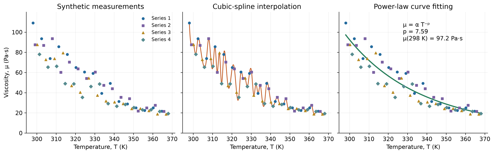
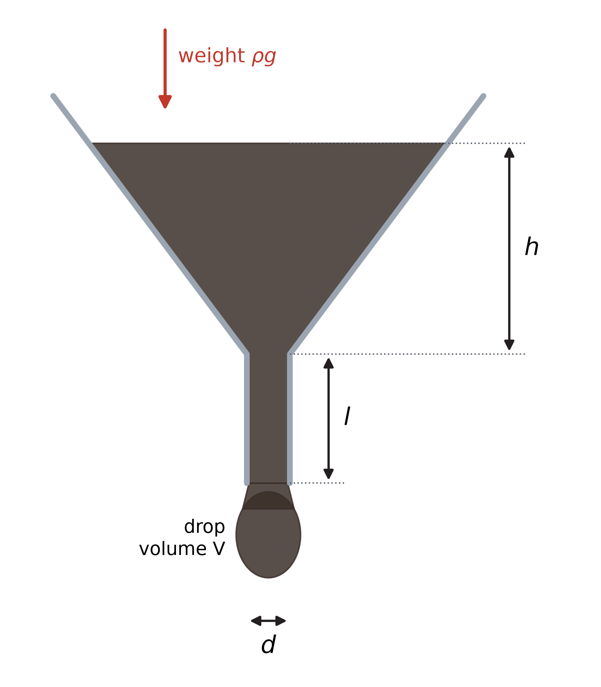
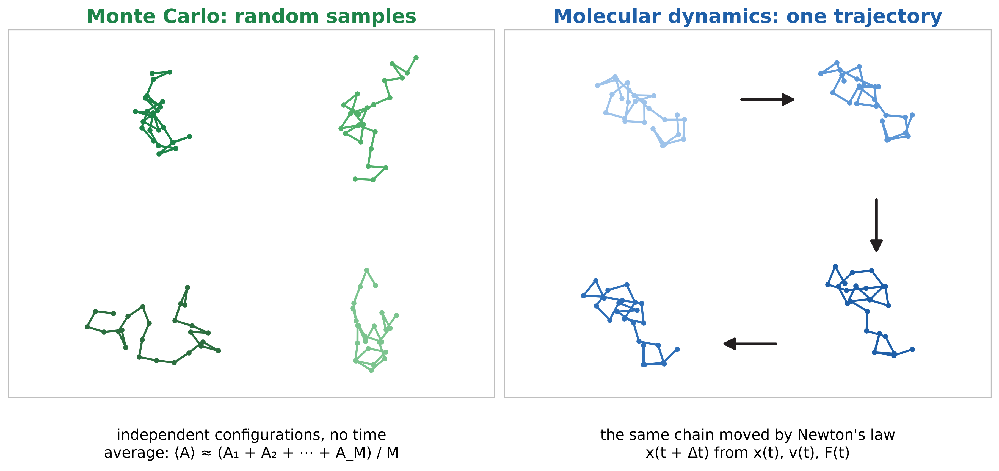
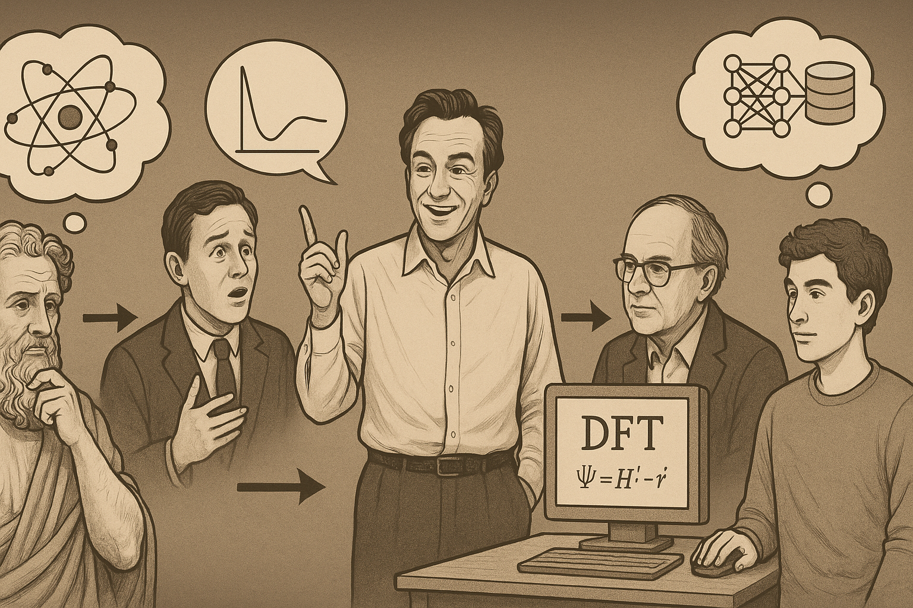
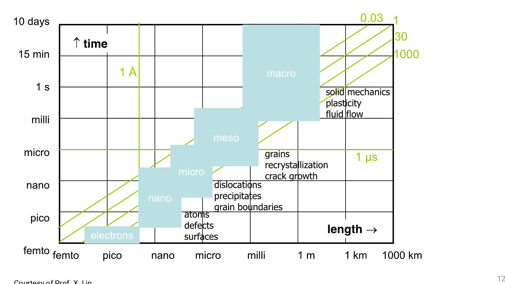
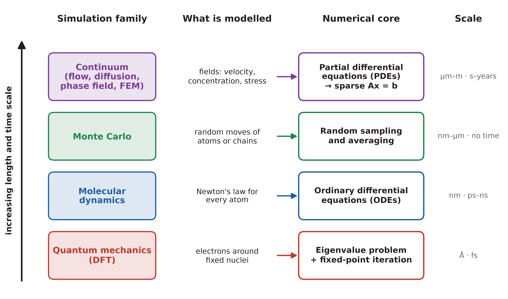

::: {.callout-note}
## Central question

**A drop of pitch takes about a decade to fall from a funnel. What can a model predict about it, why is pitch so viscous, and which simulation can answer each part of that question?**
:::

## Learning outcomes

By the end of this lecture, you should be able to:

1. **Estimate** the viscosity of pitch from the pitch-drop record by finding the root of a continuum flow model.
2. **Describe** a flexible chain molecule as a random walk, and compare Monte Carlo and molecular dynamics as ways to study it.
3. **Explain** where the forces in a molecular dynamics simulation come from: classical potentials, quantum mechanics, and machine learning.
4. **Identify** the length scale, time scale, and quantity of interest of a continuum, a molecular, and a quantum simulation of the same material.
5. **Match** each simulation family to its numerical core: ordinary and partial differential equations, random sampling, and eigenvalue problems.

## The pitch-drop experiment

### *Liquid or solid?*

Pitch, a tar derivative closely related to bitumen, looks like a solid at room temperature. It is hard to the touch, and a hammer shatters it. Thomas Parnell, the first professor of physics at the University of Queensland in Brisbane, wanted to show his students that this material is in fact a liquid. He set up an experiment in which the pitch would flow out of a funnel and form drops, like any other liquid, only very slowly.

In 1927, Parnell heated a sample of pitch and poured it into a glass funnel with a sealed stem. He let the pitch settle for three years, and in 1930 he cut the end of the stem [@edgeworth1984pitch; @uqpitchdrop]. Since then, the pitch has flowed out of the funnel and formed drops.

.](../../../assets/L22-zhang-s11.png){#fig-pitch width="85%" fig-alt="Photographs of broken pitch and of the pitch-drop funnel under a glass bell jar, beside a table of the years in which each drop fell, from 1938 to 2014."}

The experiment is in the Guinness World Records as the longest continuously running laboratory experiment. The record of drops is short:

| Drop | Fell | Years since previous drop |
|:-:|:-:|:-:|
| 1 | December 1938 | 8.1 (after the cut in 1930) |
| 2 | February 1947 | 8.2 |
| 3 | April 1954 | 7.2 |
| 4 | May 1962 | 8.1 |
| 5 | August 1970 | 8.3 |
| 6 | April 1979 | 8.7 |
| 7 | July 1988 | 9.2 |
| 8 | November 2000 | 12.3 |
| 9 | April 2014 | 13.4 |

: The drops of the University of Queensland pitch-drop experiment [@edgeworth1984pitch; @wikipediapitchdrop]. {#tbl-drops}

Nine drops have fallen in more than 90 years, and the tenth is still forming. You can [watch the tenth drop form on the live stream](https://www.youtube.com/@UQPitchDrop/streams). No one has seen a drop fall at the experiment itself. The seventh fell while the custodian, John Mainstone, was out of the room, a camera failure missed the eighth, and the ninth broke away in April 2014 when the beaker was being changed [@uqpitchdrop; @wikipediapitchdrop]. The longer intervals of the eighth and ninth drops have a simple physical cause: air conditioning was installed in the building after 1988, and the pitch became slightly cooler.

The video below compresses three years of the funnel, up to April 2015, into less than a minute [@uqpitchdroptimelapse]. Watch the neck of the tenth drop stretch.



This experiment is the problem for the whole lecture. We follow it from the top, the funnel that we can see, down to the molecules and electrons that make pitch so slow.

## Part 1: the funnel

### Viscosity spans orders of magnitude

In [L09](../../02/L09/index.qmd), we fitted a power law $\mu(T)=\alpha T^{-p}$ to synthetic viscosity data of a bitumen (@fig-l09-fit). The model gave one number, the viscosity $\mu$, at each temperature. That one number is the input of the model in this part.

{#fig-l09-fit width="100%" fig-alt="Three panels of synthetic viscosity data between 300 and 370 K: the data, an oscillating cubic spline through every point, and a smooth decreasing power law."}

Two facts about the viscosity of pitch matter for the experiment [@edgeworth1984pitch; @pochettino1914plastici]:

- **Pitch is about $10^{11}$ times more viscous than water.** Water has $\mu\approx10^{-3}\ \text{Pa·s}$ at room temperature, and pitch has $\mu\sim10^{8}\ \text{Pa·s}$.
- **A small temperature change moves the viscosity by orders of magnitude.** Pitch has $\mu=2.35\times10^{9}\ \text{Pa·s}$ at 9 °C and $\mu=7.30\times10^{5}\ \text{Pa·s}$ at 30 °C, a factor of about 3000 for 21 °C.

### The flow model

Suppose we know $\mu$. How long does one drop take? At the scale of the funnel, pitch is a continuous fluid, so we can use the **Hagen–Poiseuille law** for slow flow through a tube. Edgeworth, Dalton, and Parnell applied it to the stem, of diameter $d$ and length $l$, with a depth $h$ of pitch above it [@edgeworth1984pitch]. The weight of the pitch drives the flow, and viscous friction at the wall resists it. The time $t$ for a volume $V$ to flow out is

:::: {.columns}

::: {.column width="42%"}
{#fig-poiseuille fig-alt="A funnel filled with dark pitch, with dimension arrows for the pitch depth h, the stem length l, and the stem diameter d, a red arrow labelled weight rho g, and a drop hanging from the stem."}
:::

::: {.column width="58%"}
$$
\boxed{\;t=\frac{128\,\mu\,V}{\pi\rho g d^4\,(1+h/l)}\;}
$$

- **$\mu$:** viscosity of the pitch
- **$\rho$:** density of the pitch
- **$V$:** volume of one drop
- **$d$, $l$:** diameter and length of the stem
- **$h$:** depth of pitch above the stem
:::

::::

How to read the formula:

- **$t\propto\mu$:** a viscosity ten times larger makes every drop take ten times longer.
- **$t\propto1/d^4$:** a stem twice as wide makes the drops 16 times faster.
- **$1+h/l$:** the weight of the pitch above the stem adds to the weight in the stem.

### Finding the viscosity is a root-finding problem

The record gives us $t$, and we want $\mu$. Write the question as a residual that is zero at the answer:

$$
f(\mu)=t_\text{model}(\mu)-t_\text{observed}=0 .
$$

This is the root-finding problem of [L05](../../02/L05/index.qmd). The funnel and the drops give the remaining inputs [@edgeworth1984pitch]:

- **Funnel:** $d=0.94\ \text{cm}$, $l=2.9\ \text{cm}$, $h=7.5\ \text{cm}$, $\rho=1.1\times10^{3}\ \text{kg/m}^3$.
- **Drop:** $V=7.8\ \text{mL}$, one sixth of the $47\ \text{mL}$ that flowed out between 1930 and 1979.
- **Observed:** $t_\text{observed}=8.1$ years per drop.
- **Question:** what viscosity $\mu$ makes $f(\mu)=0$?

Here the formula can be solved by hand, and it gives $\mu\approx2.4\times10^{8}\ \text{Pa·s}$. The published value is $(2.3\pm0.5)\times10^{8}\ \text{Pa·s}$ [@edgeworth1984pitch]. The notebook finds the same root with SciPy's `root_scalar` and the bracketed `brentq` method from L05. Because $\mu$ may lie anywhere between $1$ and $10^{14}\ \text{Pa·s}$, the unknown is $\log_{10}\mu$ with the bracket $[0,14]$:

```python
result = root_scalar(residual, bracket=[0.0, 14.0], method="brentq")
mu = 10**result.root
```

The dropdown also sets $t_\text{observed}$ to the longer intervals after the air conditioning was installed.

::: {.quarto-wasm-local notebook="l22_pitch_drop.edit.py" view="edit" title="Viscosity of pitch from the Hagen–Poiseuille drop time with root_scalar" height="720" loading="lazy" fullscreen="true"}
For 8.1 years per drop, `root_scalar` with `brentq` on $\log_{10}\mu\in[0,14]$ gives $\mu\approx2.4\times10^{8}\ \text{Pa·s}$ in 15 function calls. The 12.3- and 13.4-year intervals after 1988 give $3.7\times10^{8}$ and $4.0\times10^{8}\ \text{Pa·s}$.
:::

::: {.level-banner .continuum}
**This is a CONTINUUM MODEL.**

- **Length scale:** centimetres, the funnel and the drop.
- **Time scale:** years, the time between drops.
- **What we want:** the drop time or the viscosity, one number that describes the whole material.
- **What it cannot tell us:** why the viscosity is $10^{8}\ \text{Pa·s}$.
:::

## Part 2: the molecules

### What is bitumen?

Bitumen and pitch are mixtures of thousands of hydrocarbon molecules [@lesueur2009bitumen]:

- **saturates**, long chains of $\text{CH}_2$ groups similar to paraffin wax;
- **aromatics** and **resins**, ring molecules with alkyl side chains; and
- **asphaltenes**, flat stacks of fused aromatic rings with side chains, which cluster together.

Molecular simulations of asphalt use model mixtures of about a dozen representative molecules of these kinds [@li2014asphalt]. To start simply, we keep one feature that most of them share, flexible chains of carbon atoms. A good first model of such a material is a melt of long, flexible chains, the same model used for polymers.

### A chain as a random walk

![A chain of segments $\vec r_i$ with random directions. The dashed vector $\vec R$ joins the two ends [@wikimediaidealchain].](../../../assets/L22-ideal-chain.png){#fig-ideal-chain width="40%" fig-alt="A zigzag chain of black arrows, each pointing in a different direction, with a dashed arrow labelled R from the start of the chain to its end. One segment is labelled r sub i."}

Picture a chain of $N$ segments, each of length $b$ (@fig-ideal-chain). If each segment points in a random direction that does not depend on the others, the chain is a **random walk**. The vector from one end of the chain to the other is the sum of the segment vectors,

$$
\mathbf R=\mathbf r_1+\mathbf r_2+\cdots+\mathbf r_N .
$$

Averaging $\mathbf R\cdot\mathbf R$ over many chains, every cross term $\mathbf r_i\cdot\mathbf r_j$ with $i\neq j$ averages to zero, because the two directions are independent. Only the $N$ terms $\mathbf r_i\cdot\mathbf r_i=b^2$ remain:

$$
\boxed{\;\langle R^2\rangle=Nb^2,\qquad R_\text{rms}=b\sqrt N\;}
$$

A chain of 1000 segments is $1000\,b$ long when it is stretched, but its ends are only about $32\,b$ apart in the random coil. The notebook generates random chains and checks this result by averaging.

::: {.quarto-wasm-local notebook="l22_random_walk.edit.py" view="edit" title="Random-walk chains and the square-root law of the end-to-end distance" height="720" loading="lazy" fullscreen="true"}
For $N=500$ segments and 200 random chains, the root-mean-square end-to-end distance is close to $\sqrt{500}\,b\approx22\,b$, far below the stretched length of $500\,b$. On a log–log plot, the averages for $N=10$ to 5000 follow a line of slope $1/2$.
:::

### From the shape of a chain to its flow

The random walk is a first view of how we simulate materials. It describes only the **shape** of a chain, but once we know the shape, we can already answer some questions about how the material flows. The size of the coil decides how much the chains overlap:

- **Short chains** barely overlap, and the viscosity grows in proportion to $N$.
- **Long chains** overlap many others and entangle. A chain can escape only by sliding along its own length, like a snake through a tube, and the viscosity grows about as $N^{3.4}$ [@rubinstein2003polymer].

**But how can we start from the shape and arrive at a viscosity? And what happens if we change some of the elements, for example replace hydrogen with fluorine or add sulfur to the chain?** The scaling laws above cannot answer this. We need a simulation of many chains made of the actual atoms.

### Monte Carlo or molecular dynamics?

Two methods are used, and they work in different ways (@fig-mc-md).

{#fig-mc-md width="100%" fig-alt="Two panels. Left, in green: four unrelated random chain configurations labelled Monte Carlo random samples. Right, in blue: four snapshots of the same chain connected by arrows, labelled molecular dynamics one trajectory."}

:::: {.columns}

::: {.column width="50%"}
**Monte Carlo (MC): a random method**

- Generate random configurations of the chains, as the notebook did.
- Average a property over them: $\langle A\rangle\approx\frac1M(A_1+A_2+\cdots+A_M)$.
- Gives equilibrium properties: coil size, density, packing.
- Has no physical time.
:::

::: {.column width="50%"}
**Molecular dynamics (MD): a deterministic ODE**

- Integrate Newton's second law for every atom, as in L21.
- The same initial positions and velocities always give the same trajectory.
- Gives dynamic properties: diffusion, stress relaxation, viscosity.
- Needs a time step of about 1 fs.
:::

::::

Bead-spring MD simulations of polymer melts showed the change from short-chain to entangled, snake-like motion as the chains became longer [@kremer1990entangled].

::: {.level-banner .molecular}
**These are MOLECULAR MODELS.**

- **Length scale:** nanometres to micrometres, the size of chains and their coils.
- **Time scale:** picoseconds to microseconds in MD. MC has no time.
- **What we want:** coil size and packing from MC, viscosity and its dependence on chain length from MD.
- **What they need:** the forces between atoms.
:::

## Part 3: the atoms and electrons

### Where does the force come from?

Molecular dynamics is Newton's second law for every atom $i$:

$$
m_i\frac{\mathrm d^2\mathbf x_i}{\mathrm dt^2}=\mathbf F_i=-\frac{\partial E}{\partial\mathbf x_i}.
$$

The equation is simple. **Where do the energy $E$ and the force $\mathbf F_i$ come from?**

Feynman answered the first half of this question in one sentence [@feynman1963lectures, vol. I, §1-2]:

> If, in some cataclysm, all of scientific knowledge were to be destroyed, and only one sentence passed on to the next generation of creatures, what statement would contain the most information in the fewest words? I believe it is the *atomic hypothesis* (or the atomic *fact*, or whatever you wish to call it) that *all things are made of atoms — little particles that move around in perpetual motion, attracting each other when they are a little distance apart, but repelling upon being squeezed into one another.*

Twenty years later, in a lecture on what computers can simulate, he added where the classical picture stops [@feynman1982simulating, p. 486]:

> Nature isn't classical, dammit, and if you want to make a simulation of nature, you'd better make it quantum mechanical, and by golly it's a wonderful problem, because it doesn't look so easy.

{#fig-feynman-ladder width="75%" fig-alt="A sepia cartoon of a line of scientists from an ancient philosopher to a modern student. Thought bubbles show an atom, an interatomic potential curve, and a neural network with a database, and a computer screen reads DFT."}

@fig-feynman-ladder reads from left to right as three answers to the question of where the force comes from:

- **Classical potentials.** A simple formula with a few fitted parameters, such as the Lennard–Jones energy of L14 and L21, $E(r)=4\varepsilon\left[(\sigma/r)^{12}-(\sigma/r)^{6}\right]$. Fast enough for millions of atoms.
- **Quantum mechanics and DFT.** Solve for the electrons around the nuclei, $\hat H\psi=E\psi$, and obtain the energy and forces without fitted parameters. Accurate, but limited to hundreds of atoms.
- **Machine-learning potentials.** Fit a flexible model to many quantum calculations, then run MD with it at close to the cost of a classical potential.

::: {.level-banner .atomistic}
**These are ATOMISTIC MODELS.**

- **Length scale:** ångströms, single bonds and small groups of atoms.
- **Time scale:** femtoseconds, or no time at all for the energy of a fixed structure.
- **What we want:** energies and forces between atoms, from a classical potential, quantum mechanics, or machine learning. They are the inputs of the molecular models.
:::

## Four questions for every simulation

We have now seen the same material at three levels. Before choosing a simulation, ask four questions.

1. **What length scale does the question need?**
2. **What time scale does it need?**
3. **Is there a single simulation whose length and time window covers both?**
4. **What quantity do we want from the simulation?**

For the pitch drop, the answers are:

| Level | Length | Time | What we want | Model or method |
|---|---|---|---|---|
| Funnel | cm | years | drop time, viscosity | Hagen–Poiseuille, continuum flow |
| Chains | nm to µm | ps to µs | coil size, viscosity versus chain length | Monte Carlo, molecular dynamics |
| Atoms and electrons | Å | fs | bond energies, forces | classical potentials, DFT, ML potentials |

: The pitch-drop problem at three levels. {#tbl-levels}

The answer to the third question is no. Consider an MD simulation of one drop:

- **Atoms:** 7.8 mL of pitch contains roughly $10^{24}$ atoms.
- **Time step:** about 1 fs, set by the fastest bond vibration, as we saw in L21.
- **Steps:** one drop in 8 years is $2.5\times10^{8}\ \text{s}$, or about $2.5\times10^{23}$ steps.

A large MD calculation today follows millions to billions of atoms for up to about a billion steps. The drop is out of reach by more than ten orders of magnitude in both atoms and time. Each level therefore answers its own part of the question and passes a number up: quantum mechanics gives the forces, MD gives the viscosity, and the continuum model gives the drop time.

The same picture holds for materials in general. @fig-scales-lin labels the length and time windows by the physical objects in them, and @fig-scales-wiki names the simulation method used in each window [@wikipediamultiscale].

::: {layout-ncol=2}
{#fig-scales-lin fig-alt="A log-log grid of time against length. Diagonal boxes labelled electrons, nano, micro, meso, and macro list atoms, defects, dislocations, grain boundaries, grains, crack growth, solid mechanics, and fluid flow."}

. Slide from Dr. Hao Zhang's MAT E 374 lecture, Fall 2025.](../../../assets/L22-zhang-s13.png){#fig-scales-wiki fig-alt="Length against time on log axes with four overlapping boxes rising diagonally: ab initio MD, empirical MD, kinetic Monte Carlo, and continuum mechanics."}
:::

Research reviews draw the conventional multiscale picture for specific fields. @fig-scales-reviews shows it for carbon-nanotube composites [@pal2016cnt] and for materials in fusion reactors, where each method is matched to an experiment at the same scale [@gilbert2021fusion].

{#fig-scales-reviews width="100%" fig-alt="Two published diagrams of length scale against time scale. The left one rises from physics and ab initio modeling through atomistic, microscale, and continuum modeling to an aircraft. The right one places ab initio, molecular dynamics, kinetic Monte Carlo, dislocation dynamics, continuum mechanics, and finite-element methods beside matching experiments."}

Research groups work across these scales too. @fig-tian-group shows the methods used in the instructor's group, from quantum mechanics at the ångström scale to continuum modeling, CFD and FEM, and experimental prototyping at the millimetre scale, with AI/ML across all of them.

{#fig-tian-group width="100%" fig-alt="Left: boxes labelled QM, mean-field QM, continuum modeling, CFD/FEM, and experimental prototyping rise from angstrom to millimetre length scale, with a tall AI/ML box beside them and publication references next to each box. Right: quotations by Wolfgang Pauli, God made the bulk, the surface was invented by the devil, and Richard Feynman, There's plenty of room at the bottom, with photographs of both."}

## Each method has a numerical core

Inside the program, each simulation family spends most of its time on one kind of numerical problem (@fig-method-core).

{#fig-method-core width="100%" fig-alt="Four rows ordered by an upward arrow of increasing length and time scale: quantum mechanics (DFT) to an eigenvalue problem with fixed-point iteration, molecular dynamics to ordinary differential equations, Monte Carlo to random sampling and averaging, and continuum methods to partial differential equations and sparse linear systems."}

- **Continuum models ↔ partial differential equations.** A field such as velocity, temperature, or concentration depends on position and time. The Hagen–Poiseuille law is the solution of such an equation for one simple geometry. In general, a computer turns the equation into a large sparse linear system $A\mathbf x=\mathbf b$, as in Unit 3.
- **Monte Carlo ↔ random sampling.** Average a property over many random configurations, as for the random chains above and Buffon's needle in L01.
- **Molecular dynamics ↔ ordinary differential equations.** Newton's second law for every atom, with given initial positions and velocities.
- **Quantum mechanics ↔ eigenvalue problems.** The Schrödinger equation $\hat H\psi=E\psi$ becomes a matrix eigenvalue problem (L16), which is solved repeatedly until the electron density stops changing, a fixed-point iteration (L06).

## The plan for the rest of the course

The rest of MAT E 374 follows these numerical cores in the order of their mathematics:

- **Ordinary differential equations and molecular dynamics** (Unit 5): accuracy and stability of time-stepping methods, and why the integrator of an MD code matters.
- **Partial differential equations and continuum models**: diffusion and flow on a grid, and how a PDE becomes a linear system.
- **Random methods**: Monte Carlo sampling of configurations.
- **Back to the atoms**: where interatomic forces come from, from DFT to machine-learning interatomic potentials.

Most of this content is not required for the final exam. We strongly recommend learning it anyway, because these methods are the everyday tools of computational materials research.

## What to keep

- A continuum flow model with one parameter, the viscosity, describes the pitch drop. Finding $\mu\approx2.4\times10^{8}\ \text{Pa·s}$ from the drop record is a root-finding problem.
- A flexible chain is a random walk with $R_\text{rms}=b\sqrt N$. Monte Carlo samples its shape at random, and MD follows its motion deterministically by integrating ODEs.
- The forces in MD come from classical potentials, from quantum mechanics, or from machine-learning models fitted to quantum calculations.
- No single simulation covers both the atoms and the years of a pitch drop. Each level answers its own question and passes a number to the next.
- MD rests on ODEs, continuum models on PDEs, Monte Carlo on random sampling, and quantum mechanics on eigenvalue problems.

## Next: the theory behind molecular dynamics

Molecular dynamics is the level that connects the atoms to the viscosity, and its numerical core is a set of ordinary differential equations. [L23](../L23/index.qmd) begins the theory behind it: Newton's second law as an ODE, initial and boundary conditions, and the first time-stepping methods.
