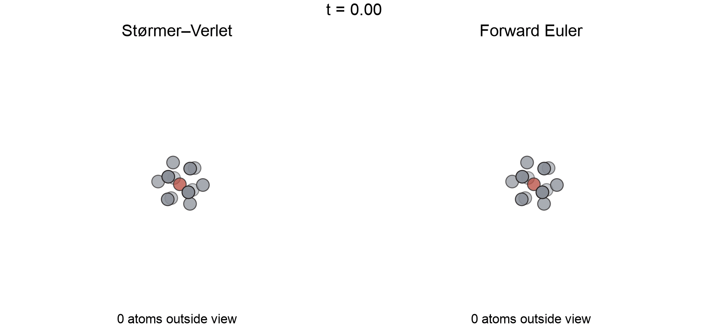
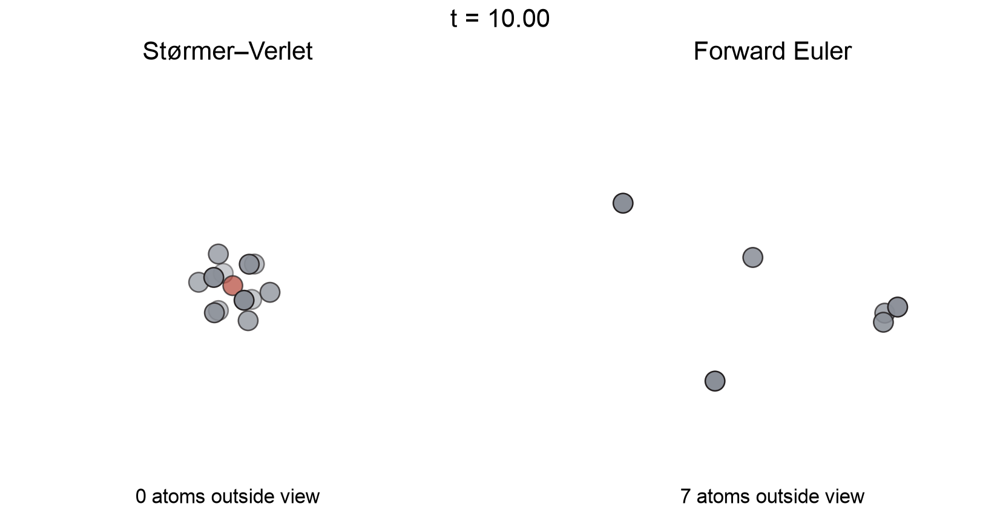
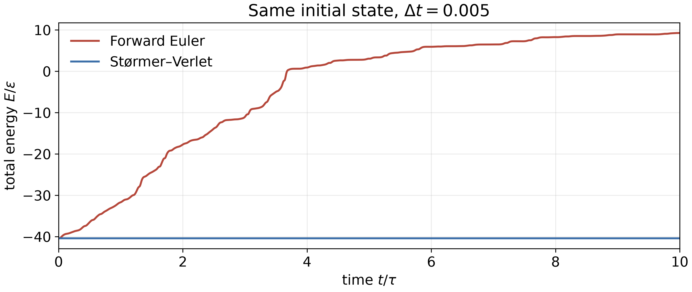
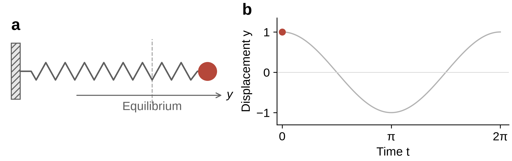
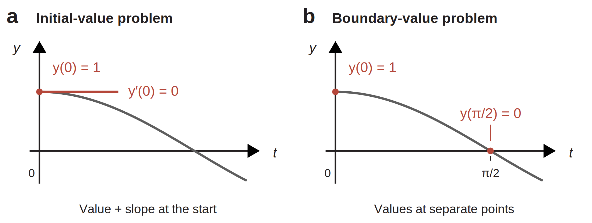
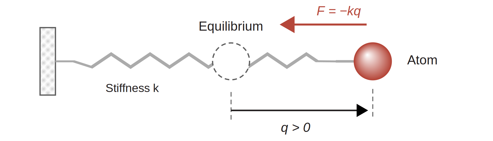
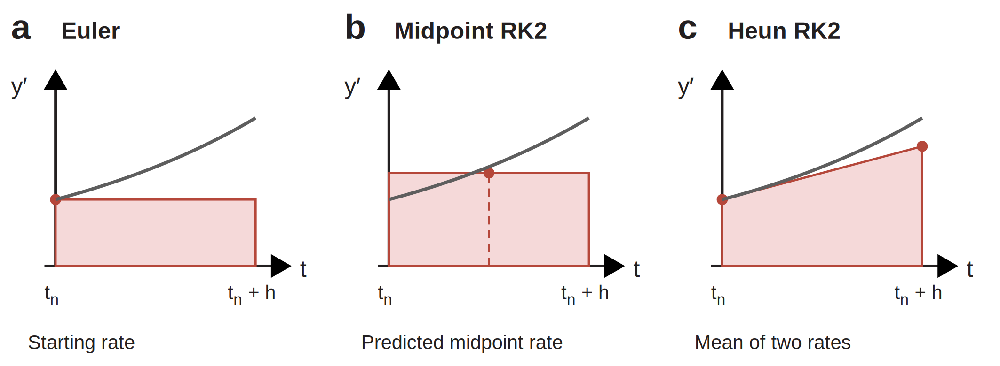

::: {.callout-note}
## Central question

**How can we use our knowledge of numerical differentiation and integration to solve ordinary differential equations?**
:::

## Learning outcomes

By the end of this lecture, you should be able to:

1. **Formulate** an initial-value problem by identifying the unknown function, the differential equation, and the initial conditions.
2. **Solve** the harmonic-oscillator equation analytically and rewrite it as two first-order equations.
3. **Calculate** Euler and second-order Runge–Kutta steps, relating their formulas to numerical integration.
4. **Compare** numerical trajectories with an exact solution and solve the same IVP using SciPy.

## The question left by our molecular dynamics engine

In [L21](../../04/L21/index.qmd), we wanted to solve Newton's equation for the atoms:

\[
m_i\frac{\mathrm d^2\mathbf r_i}{\mathrm dt^2}
=\mathbf F_i(\mathbf r_1,\ldots,\mathbf r_N).
\]

We tried two methods:

- Starting from a **forward difference** \(\longrightarrow\) **forward Euler**.
- Starting from a **central difference** \(\longrightarrow\) **Størmer–Verlet**.

**Yet one cluster continued to vibrate while the other gained energy and flew apart!**

::: {.content-visible when-format="html"}
{#fig-engine width="100%" fig-alt="Side-by-side cluster trajectories: one remains compact while the other expands and loses atoms."}
:::

::: {.content-visible unless-format="html"}
{width="100%"}
:::

{#fig-engine-energy width="100%" fig-alt="Energy versus time: forward Euler gains energy while Stormer-Verlet remains nearly constant."}

This lecture gives a brief introduction to the theory behind these calculations:

- **What kind of numerical problem?** \(\longrightarrow\) An ordinary differential equation (ODE).
- **Why an ODE?** \(\longrightarrow\) Newton's equation relates an unknown trajectory to its time derivatives.
- **What conditions do we supply?** \(\longrightarrow\) Starting positions and velocities, giving an initial-value problem (IVP).

## What is a differential equation?

For a given function \(y=f(x)\), we supply an input \(x\) and evaluate the output \(y\). If \(y=\cos x\), for example, we can calculate \(y\) at any chosen \(x\) directly. The rule for the function is already known.

A differential equation instead supplies a relation involving an **unknown function and its derivatives**. Solving it means finding a function that satisfies that relation. A first-order ordinary differential equation can be written as

\[
y'=f(x,y).
\]

Here \(f\) is the known rule for the slope, evaluated at the current \(x\) and \(y\). We can also write the relation implicitly as \(F(x,y,y')=0\). The solution \(y(x)\) is the unknown function we want to find.

The word **ordinary** means that the unknown function depends on one independent variable. In time-evolution problems, that variable is time: we write \(t\) instead of \(x\), giving \(y'=f(t,y)\).

An equation's **order** is the highest derivative it contains. We usually isolate that derivative on the left when writing the ODE for numerical integration. For an \(n\)th-order equation, this **normal form** is

\[
y^{(n)}=f\bigl(x,y,y',\ldots,y^{(n-1)}\bigr).
\]

The superscript in parentheses counts derivatives: \(y^{(2)}=y''\). For second order this reads \(y''=f(x,y,y')\): the rule for the second derivative may depend on the independent variable, the function value, and the first derivative.

### Case study: the cosine function in three forms

From general physics, we know that an object attached to a spring can oscillate with a cosine displacement. Let \(y\) be its displacement from equilibrium. In normalized units, one such motion is \(y=\cos t\). We can describe it in three ways:

::: {.content-visible when-format="html"}
{#fig-spring-motion width="100%" fig-alt="A spring stretches and compresses as an object moves back and forth, synchronized with a marker tracing a cosine displacement curve."}
:::

::: {.content-visible unless-format="html"}
{width="100%"}
:::

| | Given function | First-order ODE | Second-order ODE |
|---|---|---|---|
| **Given relation** | \(y=\cos t\) | \(y'=-\sin t\) | \(y''=-y\) |
| **Physical information** | Displacement | Velocity | Newton–Hooke law |
| **Solution family** | \(\cos t\) | \(\cos t+C\) | \(A\cos t+B\sin t\) |
| **Auxiliary conditions needed** | **0** | **1:** \(y(0)=1\) | **2:** \(y(0)=1,\;y'(0)=0\) |

: Three descriptions that give the same cosine trajectory with the stated conditions. {#tbl-function-ode}

The middle column prescribes the velocity \(y'=-\sin t\) at every time. Integrating it recovers displacement up to a starting offset. The last column instead supplies the force law: combining Newton's law with Hooke's law gives \(y''=-y\).

::: {.callout-note}
## Auxiliary conditions

An **\(n\)th-order ODE needs \(n\) independent auxiliary conditions** to determine a particular solution.
:::

## Initial values and boundary values

For the second-order oscillator, we can supply the two auxiliary conditions in different ways:

- **Initial-value problem (IVP):** the function and its first \(n-1\) derivatives are specified at the same starting point. For motion, these are the initial position and velocity.
- **Boundary-value problem (BVP):** conditions are specified at different points. For example, we might require a particular displacement at the beginning and another at the end of an interval.

{#fig-conditions width="100%" fig-alt="Left: cosine trajectory with a marked initial displacement and horizontal initial tangent. Right: the same curve with displacement values marked at zero and pi over two."}

For \(y''=-y\), compare

\[
\begin{aligned}
\text{IVP:}\quad &y(0)=1,\qquad y'(0)=0,\\
\text{BVP:}\quad &y(0)=1,\qquad y(\pi/2)=0.
\end{aligned}
\]

This unit, including molecular dynamics, deals with **initial-value problems**. Boundary-value problems arise in situations such as steady-state diffusion through a film, where concentrations are specified at its two surfaces [@kiusalaas2013, §7.1; @burden2016numerical, ch. 11].

## An analytical solution: one vibrating atom

{#fig-vibrating-atom width="100%" fig-alt="A fixed wall connected by a spring to a displaced atom. A dashed outline marks equilibrium, a displacement arrow points right, and the restoring force points left."}

Near a stable equilibrium, an atom's potential energy is approximately quadratic in its displacement \(q\), just as in the harmonic-bond models of L11 and L16:

\[
U(q)=\frac12kq^2,\qquad F(q)=-\frac{\mathrm dU}{\mathrm dq}=-kq.
\]

Newton's law then supplies a **linear, second-order ODE**:

\[
m q''+kq=0.
\]

- **Known:** the mass \(m>0\), stiffness \(k>0\), initial displacement \(q_0\), and initial velocity \(v_0\).
- **Unknown:** the displacement function \(q(t)\).
- **Question:** how does the atom move after release?

### Mathematical solution

This is a homogeneous equation: its right-hand side is zero. With constant coefficients, we can try an exponential \(q=e^{\lambda t}\). Differentiating twice and substituting gives

\[
(m\lambda^2+k)e^{\lambda t}=0.
\]

Since the exponential never vanishes, the **characteristic equation** is \(m\lambda^2+k=0\). Its roots are \(\lambda=\pm i\omega\), where \(\omega=\sqrt{k/m}\). The corresponding real solutions are sine and cosine. Their linear combination gives the general solution,

\[
q(t)=A\cos(\omega t)+B\sin(\omega t).
\]

This family has two unknown constants. The two initial conditions determine them:

\[
\begin{aligned}
q(0)&=A=q_0,\\
q'(0)&=B\omega=v_0.
\end{aligned}
\]

### The particular trajectory

\[
\boxed{
q(t)=q_0\cos(\omega t)+\frac{v_0}{\omega}\sin(\omega t),
\qquad \omega=\sqrt{\frac{k}{m}}
}
\]

This model has a positive restoring stiffness and no damping, so its oscillation amplitude stays constant. If the atom starts at rest, \(v_0=0\), its displacement is \(q_0\cos(\omega t)\). It oscillates between \(q_0\) and \(-q_0\), with period \(2\pi/\omega\). A larger initial velocity changes the amplitude and phase. A stiffer bond or lighter atom oscillates faster.

The analytical trajectory also gives a useful physical check. With \(v=q'\),

\[
E(t)=\frac12mv^2+\frac12kq^2
=\frac12mv_0^2+\frac12kq_0^2.
\]

Potential and kinetic energy change as the atom moves, but their sum is constant. We now have both an exact trajectory and an energy constraint against which to test a numerical method.

## From a second-order equation to a first-order system

A numerical solver usually expects a first-order equation of the form \(y'=f(t,y)\). We can put Newton's equation into that form by introducing velocity as a second unknown function. Write the equations and their initial conditions together:

\[
\boxed{
\begin{aligned}
q'&=v, &q(0)&=q_0,\\
v'&=-\omega^2q, &v(0)&=v_0.
\end{aligned}
}
\]

The two equations are **coupled**: the rate of change of position depends on velocity, and the rate of change of velocity depends on position. We must advance both quantities together.

We collect the current values into a **state vector**:

\[
\mathbf y=
\begin{bmatrix}q\\v\end{bmatrix},
\qquad
\mathbf y'=\mathbf F(t,\mathbf y)=
\begin{bmatrix}v\\-\omega^2q\end{bmatrix},
\qquad
\mathbf y(0)=
\begin{bmatrix}q_0\\v_0\end{bmatrix}.
\]

The bold \(\mathbf F\) here means the vector of rates, whose components are velocity and acceleration. The mechanical force enters its second component through acceleration.

## Explicit Euler: follow the current slope

Divide the time interval into steps of width \(h\), with \(t_n=t_0+nh\). The value \(\mathbf y_n\) is our numerical estimate at \(t_n\). A Taylor expansion of the exact solution gives

\[
\mathbf y(t_n+h)=\mathbf y(t_n)+h\mathbf y'(t_n)
+\frac{h^2}{2}\mathbf y''(t_n)+O(h^3).
\]

Keeping the current value and first derivative gives the **explicit Euler method**:

\[
\mathbf y_{n+1}=\mathbf y_n+h\mathbf F(t_n,\mathbf y_n).
\]

All quantities on the right are known at the start of the step. Geometrically, we follow the current tangent for a time \(h\). For the oscillator, the update in column-vector form is

\[
\begin{bmatrix}
q_{n+1}\\v_{n+1}
\end{bmatrix}
=
\begin{bmatrix}
q_n\\v_n
\end{bmatrix}
+h
\begin{bmatrix}
v_n\\-\omega^2q_n
\end{bmatrix}.
\]

::: {.callout-note collapse="true"}
## Sanity check: one step by hand

Use normalized units with \(\omega=1\).

- **Starting state:** \(q_0=1,\;v_0=0\).
- **Step:** \(h=0.2\).
- **Exact solution:** \(q(t)=\cos t,\;v(t)=-\sin t\).
- **Question:** where does Euler put the atom after one step?

\[
q_1=1+0.2(0)=1,\qquad
v_1=0-0.2(1)=-0.2.
\]

The exact values are \(q(0.2)=0.980067\) and \(v(0.2)=-0.198669\). Euler keeps the initial position for the whole first step because the starting velocity is zero. During the true motion, however, the restoring force immediately accelerates the atom towards equilibrium.

At the next step Euler uses \((q_1,v_1)=(1,-0.2)\), giving \(q_2=0.96,\;v_2=-0.4\). Every later step starts from the preceding numerical state.

:::

### Euler is a rectangle rule for the rate

Analogous to the Newton–Cotes formulas in our earlier lectures, we start by integrating over one step. The differential equation gives the exact identity

\[
y(t_n+h)-y(t_n)=
\int_{t_n}^{t_n+h}f\bigl(t,y(t)\bigr)\,\mathrm dt.
\]

{#fig-rate-rules width="100%" fig-alt="Three rate-versus-time panels show a left rectangle, a midpoint rectangle, and a trapezoid. Red points mark the slopes used by each rule; gray curves indicate the exact rate."}

### Error estimation for forward Euler

Geometrically, the error is the area between the rectangle and the rate curve. Its order follows from the Taylor expansion:

\[
\mathbf y(t+h)=\mathbf y(t)+h\mathbf F(t,\mathbf y(t))+O(h^2).
\]

For one step, the first neglected term is \(O(h^2)\). Over a fixed duration \(\Delta t=nh\), we accumulate errors from \(n\) steps [@kiusalaas2013, §7.2]:

\[
\begin{aligned}
\text{One step:}\qquad &E_{\mathrm{local}}=O(h^2),\\
n\text{ steps:}\qquad &E_{\mathrm{global}}\sim n\,O(h^2)
=O(\Delta t\,h)=\boxed{O(h)}.
\end{aligned}
\]

This is the same global error order as the composite left-rectangle rule.

### Comparing numerical trajectories

The notebook below contains the right-hand-side function and the integration loop. The state is a NumPy array with displacement in entry 0 and velocity in entry 1. Start with **Euler** and compare it with the exact motion:

1. Compare the displacement curves and their amplitudes.
2. Halve \(h\), keeping the final time fixed.
3. Inspect the total energy as well as the trajectory.

The other method choices implement the Runge–Kutta formulas developed below.

::: {.quarto-wasm-local notebook="l23_oscillator.edit.py" view="edit" title="One vibrating atom: Euler, Runge–Kutta, and the exact trajectory" height="900" loading="lazy" fullscreen="true"}
For \(q''=-q,\;q(0)=1,\;v(0)=0\), the exact motion is \(q=\cos t,\;v=-\sin t\), with energy \(E=0.5\) in normalized units. At \(t=10\), Euler with \(h=0.2\) gives \(q=-2.4062,\;v=1.1475\), and \(E/E_0=7.1067\). With \(h=0.1\), the energy ratio falls to \(2.7048\). The smaller step slows the artificial growth, but the exact amplitude remains one.
:::

### Where did the extra energy come from?

Each Euler step adds a small amount of energy to the oscillator:

\[
\boxed{E_{n+1}=E_n+(\omega h)^2E_n}
\]

For any fixed \(h>0\), a nonzero vibration gains energy at every step and eventually grows without bound. A smaller step delays this growth. To keep an isolated system's energy stable, we need an appropriate integrator and time step.

A sample can also exchange energy with its surroundings:

- **NVT:** a thermostat couples the sample to a thermal bath, allowing heat exchange at a specified temperature.
- **NPT:** a thermostat and a **barostat** allow heat exchange and volume changes against an external pressure, including pressure–volume work.

These conditions model the surroundings. They still require a stable integration scheme.

## Runge–Kutta: evaluate more than one slope

Runge–Kutta methods are numerical integration formulas that combine estimates of the derivative, or **slope**, within each step. Midpoint RK2 uses the midpoint-rule geometry, while Heun RK2 uses the trapezoidal-rule geometry.

The slopes are evaluated at predicted intermediate states. These evaluations are called **stages** [@kiusalaas2013, §7.3].

::: {.callout-note}
## What changes from quadrature to ODE integration?

In quadrature, a supplied integrand can be evaluated at each chosen point. For an ODE, the integrand is \(f(t,y(t))\): the state \(y(t)\) at an intermediate point is still unknown. Runge–Kutta supplies estimates of those states before evaluating their rates.
:::

### Midpoint RK2

First use the starting slope to predict the state halfway through the step. Then use the slope at that predicted midpoint for the full update:

\[
\boxed{
\begin{aligned}
\mathbf k_1&=\mathbf F(t_n,\mathbf y_n),\\
\mathbf k_2&=\mathbf F\left(t_n+\frac h2,\mathbf y_n+\frac h2\mathbf k_1\right),\\
\mathbf y_{n+1}&=\mathbf y_n+h\mathbf k_2.
\end{aligned}
}
\]

Here \(\mathbf k_1\) and \(\mathbf k_2\) are **slopes**. Multiplication by \(h\) converts a slope into a state change.

For the same oscillator step, \(\mathbf y_0=(1,0)\) and \(h=0.2\),

\[
\begin{aligned}
\mathbf k_1&=(0,-1),\\
\mathbf y_{\mathrm{mid}}&=(1,0)+0.1(0,-1)=(1,-0.1),\\
\mathbf k_2&=(-0.1,-1),\\
\mathbf y_1&=(1,0)+0.2(-0.1,-1)=(0.98,-0.2).
\end{aligned}
\]

The estimated midpoint velocity lets the atom move during the first step. Its displacement \(0.98\) is much closer to the exact \(0.980067\) than Euler's value of 1.

### Heun RK2: an explicit trapezoidal construction

An alternative is to predict the endpoint with Euler, evaluate the slope there, and average the starting and predicted-end slopes:

\[
\boxed{
\begin{aligned}
\mathbf k_1&=\mathbf F(t_n,\mathbf y_n),\\
\mathbf k_2&=\mathbf F(t_n+h,\mathbf y_n+h\mathbf k_1),\\
\mathbf y_{n+1}&=\mathbf y_n+\frac h2(\mathbf k_1+\mathbf k_2).
\end{aligned}
}
\]

This is **Heun's method**, also called explicit trapezoidal RK2. The endpoint state inside \(\mathbf k_2\) is a prediction, so the method is explicit. Using the unknown final state itself would instead give an implicit trapezoidal equation requiring a solve.

Midpoint and Heun belong to the **second-order Runge–Kutta family**, written **RK2**. Like the composite midpoint and trapezoidal rules, they have second-order global accuracy:

\[
\boxed{\mathbf y_n=\mathbf y_{\mathrm{true}}(t_n)+O(h^2)}
\]

This compares the numerical and exact solutions over a fixed time interval.

### Classical fourth-order Runge–Kutta (RK4)

Simpson's \(1/3\) rule combines three sampled values over two subintervals to estimate an integral. Classical RK4 similarly combines information from across a step, using **four slope estimates**. Its weights are \(1,2,2,1\), compared with \(1,4,1\) for Simpson's \(1/3\) rule:

\[
\boxed{
\begin{aligned}
\mathbf k_1&=\mathbf F(t_n,\mathbf y_n),\\
\mathbf k_2&=\mathbf F\left(t_n+\frac h2,\mathbf y_n+\frac h2\mathbf k_1\right),\\
\mathbf k_3&=\mathbf F\left(t_n+\frac h2,\mathbf y_n+\frac h2\mathbf k_2\right),\\
\mathbf k_4&=\mathbf F(t_n+h,\mathbf y_n+h\mathbf k_3),\\
\mathbf y_{n+1}&=\mathbf y_n+\frac h6
(\mathbf k_1+2\mathbf k_2+2\mathbf k_3+\mathbf k_4).
\end{aligned}
}
\]

- The first stage uses the current state.
- The second and third stages use two successive estimates of the midpoint state.
- The fourth stage uses a predicted endpoint.
- The final update combines all four slopes with weights \(1,2,2,1\).

The weights are chosen to match the Taylor expansion through fourth order. We can use the formula without deriving those coefficient conditions.

### Error orders and the connection to integration

| Method | One-step local error | Global error | Composite integration analogy |
|---|:---:|:---:|---|
| Explicit Euler | \(O(h^2)\) | \(O(h)\) | Left rectangles |
| Midpoint RK2 | \(O(h^3)\) | \(O(h^2)\) | Midpoint rule |
| Heun RK2 | \(O(h^3)\) | \(O(h^2)\) | Trapezoidal rule |
| Classical RK4 | \(O(h^5)\) | \(O(h^4)\) | Simpson's rule: fourth-order accuracy |

: Local error starts from an exact state; global error compares solutions over a fixed interval under the usual smoothness and error-propagation assumptions. {#tbl-rk-errors}

## Solving an IVP in Python

Use SciPy's `solve_ivp` to integrate a first-order system from its initial state. For our oscillator, the state is \(\mathbf y=(q,v)\), so the function must return **two rates in the same order**: \(q'=v\) and \(v'=-q\), using normalized units with \(\omega=1\).

The editable example below supplies:

- `fun`: the function accepting time and the current state, and returning its rates of change.
- `t_span`: the start and end times.
- `y0`: the initial displacement and velocity.
- `method`: the integration method; here we use adaptive `RK45`.
- `t_eval`: the times at which we want output.

The returned solution has times in `t` and state values in `y`. For this two-component system, `y[0]` contains displacement and `y[1]` contains velocity. `rtol` and `atol` set relative and absolute error tolerances. RK45 estimates its local error and adjusts the internal time step. `t_eval` selects output times [@virtanen2020scipy].

::: {.quarto-wasm-local notebook="l23_solve_ivp.edit.py" view="edit" title="Solving the vibrating-atom IVP with SciPy" height="800" loading="lazy" fullscreen="true"}
For \(q'=v,\;v'=-q\), supply the two rates as a vector and the initial state as \([1,0]\). Integrating from \(t=0\) to \(10\) gives \(q(10)\approx-0.839072\) and \(v(10)\approx0.544021\), agreeing with \(\cos(10)\) and \(-\sin(10)\). The returned array has two rows, one for each state component.
:::

## Take-home message

ODEs give us many fun problems to explore, from vibrating atoms to molecular dynamics. **Be careful with the integration scheme: it can change the apparent physics.**

## Check your understanding

1. For \(y''=-4y\), identify the order and the number of auxiliary conditions needed. What initial conditions would select \(y=\cos(2t)\)?
2. Rewrite that equation as a first-order system with its initial conditions. What two numbers must the right-hand-side function return?
3. Starting from \(q=1,\;v=0\) with \(\omega=1\), take one Euler step and one midpoint step with \(h=0.1\). Compare their displacements with \(\cos(0.1)\).
4. Over a fixed time interval, approximately how should the global errors of Euler, RK2, and RK4 change when \(h\) is halved?
5. Why does an ODE method need a predicted midpoint state, while a quadrature rule can directly evaluate a supplied function at the midpoint?

## Next: integration for molecular dynamics

The choice of integration method changed both the trajectory and the energy of our vibrating atom. In molecular dynamics we follow many coupled vibrations over long times, so local accuracy must be considered alongside stability and long-time energy behaviour. Next we return to the engine, examine the Verlet updates, and choose time steps that resolve the atomic motion.
