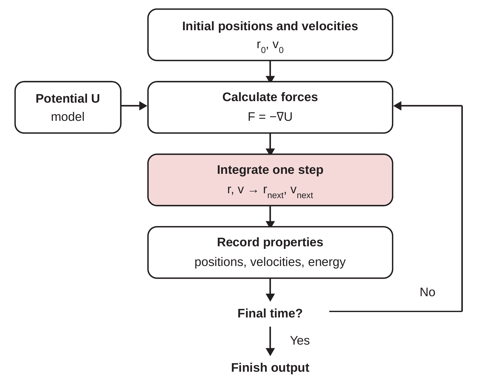
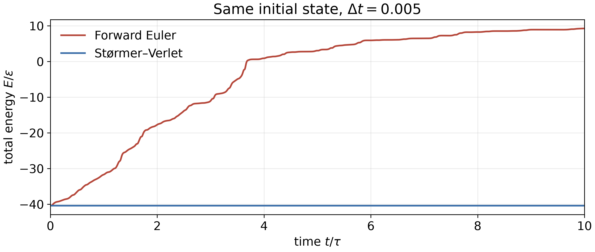
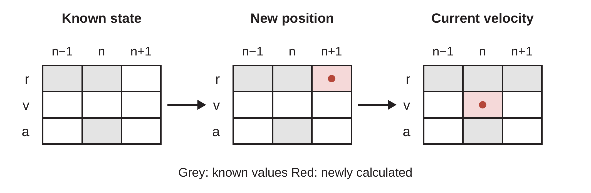
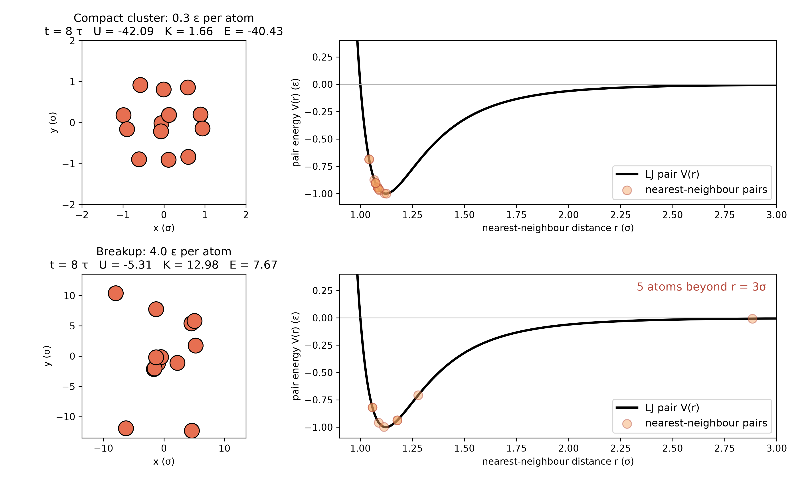
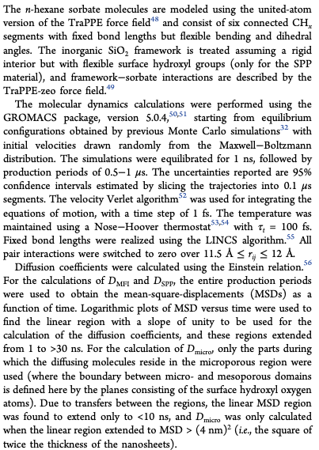

::: {.callout-note}
## Central question

**How do we choose the initial state and time integrator so that our molecular dynamics engine follows atomic motion without adding energy of its own?**
:::

## Learning outcomes

By the end of this lecture, you should be able to:

1. **Formulate** classical MD as an initial-value problem for positions and momenta.
2. **Prepare** a two-atom system with a specified energy by solving for its initial speed or separation.
3. **Derive** Størmer–Verlet and explain the position and velocity updates in velocity Verlet.
4. **Compare** the accuracy and energy behaviour of forward Euler and Verlet integration.

## What is molecular dynamics?

Atoms move continually, attracting one another at some distances and repelling when brought too close. Feynman's atomic picture connects these interactions and motions to the behaviour of matter [@feynman1963lectures, ch. 1]. **Molecular dynamics (MD)** calculates atomic trajectories by numerically solving Newton's equations.

- **Deterministic motion:** the interaction model and initial state determine the subsequent trajectory.
- **A repeated cycle:** calculate forces and use them to advance positions and velocities.
- **A microscopic view:** atomic motion and rearrangements help explain material properties.

We built a toy MD engine in [L21](../../04/L21/index.qmd). We now examine its initial conditions and integration method.

## Newton's law is an IVP

For atom \(i\), position is \(\mathbf r_i\), mass is \(m_i\), and momentum is \(\mathbf p_i=m_i\mathbf v_i\). Newton's law gives

\[
\boxed{
\begin{aligned}
\frac{\mathrm d\mathbf r_i}{\mathrm dt}
&=\frac{\mathbf p_i}{m_i}=\mathbf v_i,\\
\frac{\mathrm d\mathbf p_i}{\mathrm dt}
&=\mathbf F_i=-\nabla_iU.
\end{aligned}
}
\]

**Newton's law is the same coupled first-order ODE system introduced in [L23](../L23/index.qmd).**

All atomistic systems described by Newton's classical mechanics share this ODE format. What determines how a particular material behaves is:

- **The interaction model:** how \(U\) depends on the atomic positions, and therefore what forces the atoms experience.
- **The initial state:** the positions and velocities supplied as initial conditions to the IVP.

Once both are specified, integrating the equations gives the subsequent motion.

::: {.callout-note collapse="true"}
## Hamiltonian formulation and conservation of energy

The Hamiltonian is the total kinetic plus potential energy,

\[
H(\mathbf R,\mathbf P)
=\frac{|\mathbf p_1|^2}{2m_1}
+\frac{|\mathbf p_2|^2}{2m_2}+\cdots+U(\mathbf R).
\]

Here \(\mathbf R\) and \(\mathbf P\) collect all positions and momenta. The same equations become

\[
\begin{aligned}
\frac{\mathrm d\mathbf r_i}{\mathrm dt}
&=\frac{\partial H}{\partial\mathbf p_i},\\
\frac{\mathrm d\mathbf p_i}{\mathrm dt}
&=-\frac{\partial H}{\partial\mathbf r_i}.
\end{aligned}
\]

For a Hamiltonian without explicit time dependence,

\[
\begin{aligned}
\frac{\mathrm dH}{\mathrm dt}
&=\sum_i\left(
\frac{\partial H}{\partial\mathbf r_i}\cdot
\frac{\mathrm d\mathbf r_i}{\mathrm dt}
+\frac{\partial H}{\partial\mathbf p_i}\cdot
\frac{\mathrm d\mathbf p_i}{\mathrm dt}
\right)\\
&=\sum_i\left(-\mathbf F_i\cdot\mathbf v_i
+\mathbf v_i\cdot\mathbf F_i\right)=0.
\end{aligned}
\]

The exact conservative trajectory therefore preserves total energy. This supplies a check on the numerical integration [@lesar2013].
:::

## How MD developed

MD developed through several connected branches:

| Branch | Development |
|:--|:--|
| **Physical theory** | Newton's mechanics → thermodynamics and statistical mechanics → microscopic explanations of bulk properties |
| **Atomic structure** | Chemical bonds and molecular structures → crystal lattices and diffraction → realistic atomic configurations |
| **Integration** | Euler methods → Størmer–Verlet → velocity Verlet |
| **Ensemble control** | Isolated conservative dynamics → temperature controllers and variable-cell pressure control |
| **Potentials** | Harmonic springs → Lennard–Jones and Morse pairs → many-body/reactive models → quantum-derived and machine-learned potentials |
| **Computation and applications** | Small model systems → liquids, silicate melts, polymers, and proteins → parallel CPU/GPU calculations |

Important milestones connect these branches:

- **1687:** Newton's *Principia* establishes the classical mechanics underlying the equations of motion.
- **Nineteenth century:** thermodynamics and statistical mechanics connect microscopic states to bulk properties.
- **1957–1964:** hard-sphere simulations and then liquid-argon MD demonstrate computer calculations of many-particle motion.
- **1967:** Verlet's Lennard–Jones-fluid study develops a widely used integration and neighbour-list approach [@verlet1967computer].
- **1980–1985:** Andersen, Parrinello–Rahman, and Nosé–Hoover methods extend MD to controlled temperature and pressure [@andersen1980molecular; @parrinello1981polymorphic; @hoover1985canonical].
- **1982:** velocity Verlet provides an efficient update of both positions and velocities [@swope1982simulation].
- **Modern MD:** efficient parallel engines and GPUs extend accessible system sizes and times. Machine-learned potentials extend the interaction models available to those engines [@eastman2024openmm].

## The MD loop

{#fig-md-loop width="100%" fig-alt="An initial position and velocity enter a loop of force evaluation, integration, and recording, with a final-time test and output."}

Four parts organize an MD calculation:

1. **Initial conditions:** starting positions and velocities.
2. **Integrator:** the update through each time interval.
3. **Ensemble controller:** heat exchange or volume changes, when required.
4. **Boundaries and cutoff:** the surrounding system and range of interactions.

The potential supplies energy and forces throughout the loop. Today we keep the Lennard–Jones model and develop the first two parts.

Over one time step, the integrator approximates

\[
\begin{aligned}
\mathbf r_{n+1}
&=\mathbf r_n+\int_{t_n}^{t_{n+1}}\mathbf v(t)\,\mathrm dt,\\
\mathbf v_{n+1}
&=\mathbf v_n+\int_{t_n}^{t_{n+1}}\mathbf a(t)\,\mathrm dt.
\end{aligned}
\]

Because the force changes as the atoms move, the unknown trajectory appears inside both integrals.

## Initial conditions: two ways to supply the same energy

Consider two equal-mass atoms on a line, with their centre of mass at zero:

\[
x_1=-\frac r2,\qquad x_2=\frac r2.
\]

Their Lennard–Jones energy, in reduced units \(\epsilon=\sigma=m=1\), is

\[
U(r)=4(r^{-12}-r^{-6}).
\]

Energy minimization gives \(r_{\mathrm{eq}}=2^{1/6}\approx1.12246\), with \(U_{\min}=-1\). If the relaxed atoms have zero velocity, they remain at rest. We want to add \(\Delta E=0.2\), giving total energy \(E_0=-0.8\).

{#fig-initial-states width="100%" fig-alt="Side-by-side two-atom initial states, with positions and velocities, above one potential curve marking the relaxed and displaced starts at total energy minus 0.8."}

### Method 1: solve for the initial speed

Keep the atoms at the minimum and choose \(v_1=-u,\ v_2=u\), so the total momentum is zero. Their kinetic energy is

\[
K_0=\tfrac12mu^2+\tfrac12mu^2=mu^2.
\]

The target energy defines a **root-finding problem for speed**:

\[
f(u)=U(r_{\mathrm{eq}})+mu^2-E_0=0.
\]

In this simple case the positive root is available directly:

\[
\boxed{u=\sqrt{\frac{E_0-U(r_{\mathrm{eq}})}{m}}
=\sqrt{\frac{\Delta E}{m}}.}
\]

For \(\Delta E=0.2\), each speed is \(0.44721\). Initially, \(U=-1\) and \(K=0.2\).

### Method 2: solve for the initial separation

Set \(v_1=v_2=0\) and put all the added energy into the interaction. The **root-finding problem for separation** is

\[
f(r_0)=U(r_0)-E_0=0.
\]

The line \(E_0=-0.8\) intersects the potential on both sides of its minimum:

- **Compressed start:** \(r_0=1.05540\).
- **Stretched start:** \(r_0=1.23902\).

Both have \(U=-0.8\), \(K=0\). They are the turning points of the same bound radial oscillation.

In the figure, the vertical gap from \(U(r)\) to \(E_0\) is kinetic energy. The atoms move fastest at the minimum and stop momentarily at either turning point. The preparations differ in where the oscillation starts, while their total energy is the same.

## Integrating the equations of motion

Let \(t_n=n\Delta t\), with \(\mathbf a_n=\mathbf F(\mathbf r_n)/m\). We need an update that follows many oscillations without gradually heating the isolated system.

### **Forward Euler**

Use the current velocity and acceleration:

\[
\boxed{
\begin{aligned}
\mathbf r_{n+1}&=\mathbf r_n+\Delta t\,\mathbf v_n,\\
\mathbf v_{n+1}&=\mathbf v_n+\Delta t\,\mathbf a_n.
\end{aligned}
}
\]

- **Global accuracy:** \(O(\Delta t)\) over a fixed physical duration.
- **Local one-step error:** \(O(\Delta t^2)\).
- **Energy behaviour:** a persistent upward drift—**the isolated system looks as if it is being heated!**

For the harmonic oscillator, the energy increases at every step:

\[
E_{n+1}=\left[1+(\omega\Delta t)^2\right]E_n.
\]

The multiplier exceeds one for every nonzero step. This artificial energy accumulates, increasing the vibration amplitude and eventually blowing the cluster apart. Reducing \(\Delta t\) slows the growth.

{#fig-euler-energy width="100%" fig-alt="Total energy versus time: forward Euler shows rising energy and Stormer-Verlet remains nearly constant."}

### **Størmer–Verlet: the central-difference method from L21**

Expand the trajectory forward and backward from \(t_n\):

\[
\begin{aligned}
\mathbf r_{n+1}
&=\mathbf r_n+\Delta t\,\mathbf v_n
+\tfrac12\Delta t^2\mathbf a_n
+\tfrac16\Delta t^3\mathbf r_n^{(3)}+O(\Delta t^4),\\
\mathbf r_{n-1}
&=\mathbf r_n-\Delta t\,\mathbf v_n
+\tfrac12\Delta t^2\mathbf a_n
-\tfrac16\Delta t^3\mathbf r_n^{(3)}+O(\Delta t^4).
\end{aligned}
\]

Adding cancels the odd terms, giving the position update. A central first difference supplies velocity [@verlet1967computer]:

\[
\boxed{
\begin{aligned}
\mathbf r_{n+1}
&=2\mathbf r_n-\mathbf r_{n-1}
+\Delta t^2\mathbf a_n+O(\Delta t^4),\\
\mathbf v_n
&=\frac{\mathbf r_{n+1}-\mathbf r_{n-1}}{2\Delta t}
+O(\Delta t^2).
\end{aligned}
}
\]

{#fig-stormer width="100%" fig-alt="Three storage diagrams show known positions and acceleration, the newly calculated position, and the reconstructed current velocity."}

- **Global trajectory accuracy:** \(O(\Delta t^2)\).
- **Position-relation residual:** \(O(\Delta t^4)\), as shown in the Taylor expansion.
- **Velocity reconstruction accuracy:** \(O(\Delta t^2)\), from the central first difference.
- **Velocity availability:** reporting \(\mathbf v_n\) requires the future position \(\mathbf r_{n+1}\).

For kinetic energy and temperature control, it is convenient to obtain position and velocity together at the end of a step.

## Velocity Verlet

Velocity Verlet carries both position and velocity. Starting with \(\mathbf r_n,\mathbf v_n,\mathbf a_n\), **calculate the next position first**:

\[
\mathbf r_{n+1}
=\mathbf r_n+\Delta t\,\mathbf v_n+\tfrac12\Delta t^2\mathbf a_n.
\]

That position supplies the new acceleration. To complete the velocity change, use half of the old acceleration contribution and half of the new one [@swope1982simulation].

### Velocity-Verlet steps

\[
\boxed{
\begin{alignedat}{2}
\text{1.}\quad &\mathbf r_{n+1} \quad &&=\mathbf r_n+\Delta t\,\mathbf v_n+\tfrac12\Delta t^2\mathbf a_n,\\[4pt]
\text{2.}\quad &\mathbf v_{n+1/2} &&=\mathbf v_n+\tfrac12\Delta t\,\mathbf a_n,\\[4pt]
\text{3.}\quad &\mathbf a_{n+1} &&=\mathbf F(\mathbf r_{n+1})/m,\\[4pt]
\text{4.}\quad &\mathbf v_{n+1} &&=\mathbf v_{n+1/2}+\tfrac12\Delta t\,\mathbf a_{n+1}.
\end{alignedat}
}
\]

Velocity Verlet uses a **half-time-step trick**: an intermediate velocity lets us finish the velocity update once the new acceleration is known. We obtain the new velocity at the new time step together with the new position.

![Velocity Verlet calculates the next position, forms an intermediate velocity, evaluates the new acceleration, and completes the velocity update. Shading identifies newly calculated quantities. Diagram adapted from the storage scheme in Allen and Tildesley [@allentildesley1987computer, fig. 3.2].](../../../assets/L24-velocity-stages.png){#fig-velocity-verlet width="100%" fig-alt="Four storage diagrams show the position-first velocity-Verlet sequence and the synchronized final position and velocity."}

Combining the two velocity stages gives the two endpoint updates:

\[
\boxed{
\begin{aligned}
\mathbf r_{n+1}
&=\mathbf r_n+\Delta t\,\mathbf v_n+\tfrac12\Delta t^2\mathbf a_n,\\
\mathbf v_{n+1}
&=\mathbf v_n+\tfrac12\Delta t(\mathbf a_n+\mathbf a_{n+1}).
\end{aligned}
}
\]

- **Global position and velocity errors:** \(O(\Delta t^2)\) over a fixed physical duration.
- **Local one-step position and velocity errors:** \(O(\Delta t^3)\), starting from an exact state.

The velocity uses the mean of the old and new accelerations, like trapezoidal integration. The \(O(\Delta t^4)\) term in the Størmer–Verlet position relation is a two-step residual.

::: {.callout-note collapse="true"}
## One step for our pair

With \(r_0=1.12246\), opposite speeds \(0.44721\), and \(\Delta t=0.005\):

1. **Position:** the initial force is zero, giving \(r_1=1.126934\).
2. **Intermediate velocity:** the zero initial acceleration leaves the speeds unchanged.
3. **New acceleration:** the attractive forces are \(F_1\approx+0.24512,\ F_2\approx-0.24512\).
4. **Final velocity:** each outward speed falls to \(0.446601\).

The total energy after this step is approximately \(-0.7999919\), close to its initial value \(-0.8\).
:::

### Why velocity Verlet is useful for MD

::: {.columns}
::: {.column width="22%"}
{width="100%" fig-alt="Portrait of Loup Verlet."}
:::
::: {.column width="78%"}
- **Time-reversible:** reversing the velocities retraces fixed-step conservative motion in exact arithmetic.
- **Symplectic:** preserves the Hamiltonian geometry, giving favourable long-time energy behaviour.
- **Efficient:** one new force evaluation per step after initialization.
- **Synchronized output in velocity Verlet:** positions and velocities are available together.
:::
:::

For a sufficiently small step and smooth conservative forces, the energy error normally oscillates rather than drifting steadily. A large step can still cause instability.

## Our updated MD engine: a moving cluster

We can now use velocity Verlet in the cluster engine. Supply an added energy per atom and choose how to put it into the initial state:

- **Initial kinetic energy:** start from the relaxed cluster, distribute velocities among the atoms, remove centre-of-mass motion, and scale the kinetic energy to the target.
- **Initial potential energy:** compress the closest pair of atoms along its bond until the cluster energy reaches the same target (a root-finding problem), then release from rest.

The two panels show the same saved trajectory:

- **Left:** the cluster shape, with current total potential energy \(U\), kinetic energy \(K\), and total energy \(E=U+K\) above it.
- **Right:** each atom's nearest-neighbour distance marked on the Lennard–Jones pair curve. Several atoms may share the same nearest pair, so the markers are partly transparent.

The right-hand markers have height \(V(r)\) for an individual pair. The cluster energy \(U\) sums **all** unique pairs.

::: {.quarto-wasm-local notebook="l24_cluster_velocity_verlet.edit.py" view="app" title="Velocity-Verlet cluster: atomic motion and nearest-neighbour pair energies" height="850" loading="lazy" fullscreen="true"}
The relaxed 13-atom cluster has \(U=-44.33\) in reduced units, with \(\Delta t=0.001\) over \(8\tau\). With \(0.3\,\epsilon\) per atom of initial kinetic energy, the cluster stays compact and its total energy changes by less than \(2\times10^{-4}\). With \(4\,\epsilon\) per atom, atoms escape and nearest-neighbour distances grow beyond \(3\sigma\), while the total energy still changes by less than \(0.5\%\).

{width="100%"}
:::

Increase the starting energy and play the animation. Stronger vibrations can lead to atoms escaping or to breakup. Unlike Euler's numerical heating, this energy was supplied in the **initial condition**. Inspect \(E(t)\) to distinguish the two.

## Reading an MD methods section

Below is the methods section of an MD paper on *n*-hexane diffusion in zeolite nanosheets [@bai2016zeolites]. Can you find the correct match between each method in the text and the tiles?

- Click a label, then click a box in the text that it describes.
- A correct match draws a line in the label's colour, linking every box that belongs to that tile.

:::: {.content-visible when-format="html"}
```{=html}
<style>
.mdm{--gap:14px;position:relative;display:grid;grid-template-columns:minmax(150px,1fr) minmax(260px,430px) minmax(150px,1fr);gap:var(--gap);align-items:stretch;margin:1rem 0 .4rem;user-select:none}
.mdm-col{display:flex;flex-direction:column;justify-content:space-around;gap:10px}
.mdm-label{border:2px solid #b3b3b3;border-radius:8px;padding:6px 9px;background:#fff;cursor:pointer;font-size:.9rem;line-height:1.25;transition:border-color .15s,background .15s;position:relative;z-index:2}
.mdm-label b{display:block;font-size:.95rem}
.mdm-label span{color:#5e5e5e;font-size:.82rem}
.mdm-label:hover{border-color:#5e5e5e}
.mdm-label.sel{border-color:#231f20;box-shadow:0 0 0 3px rgba(35,31,32,.15)}
.mdm-label.done{border-color:var(--c);background:color-mix(in srgb,var(--c) 10%,white)}
.mdm-label.done b{color:var(--c)}
.mdm-label.wrong,.mdm-box.wrong{animation:mdm-shake .35s}
@keyframes mdm-shake{25%{transform:translateX(-4px)}75%{transform:translateX(4px)}}
.mdm-paper{position:relative;align-self:center;z-index:1}
.mdm-paper img{display:block;width:100%;height:auto;margin:0}
.mdm-box{position:absolute;border:2px solid var(--c);background:color-mix(in srgb,var(--c) 9%,transparent);border-radius:3px;cursor:pointer;transition:background .15s}
.mdm-box:hover{background:color-mix(in srgb,var(--c) 22%,transparent)}
.mdm-box.done{background:color-mix(in srgb,var(--c) 18%,transparent);border-width:2.5px}
.mdm-box.sel{box-shadow:0 0 0 3px rgba(35,31,32,.25)}
.mdm-lines{position:absolute;inset:0;width:100%;height:100%;pointer-events:none;z-index:3;overflow:visible}
.mdm-bar{display:flex;gap:.6rem;align-items:center;flex-wrap:wrap;font-size:.9rem;margin-bottom:1rem}
.mdm-bar button{border:1px solid #8a8f98;background:#fff;border-radius:6px;padding:3px 10px;cursor:pointer}
.mdm-bar button:hover{background:#f2f2f2}
@media (max-width:760px){.mdm{grid-template-columns:1fr}.mdm-col{flex-direction:row;flex-wrap:wrap;justify-content:center}.mdm-label{flex:1 1 140px}.mdm-paper{order:0}}
</style>
<div class="mdm" id="mdm">
  <div class="mdm-col" id="mdm-left"></div>
  <div class="mdm-paper" id="mdm-paper">
    
  </div>
  <div class="mdm-col" id="mdm-right"></div>
  <svg class="mdm-lines" id="mdm-lines"></svg>
</div>
<div class="mdm-bar"><button id="mdm-show" type="button">Show all links</button><button id="mdm-reset" type="button">Reset</button><span id="mdm-status"></span></div>
<script>
(() => {
  const W = 403, H = 569;
  const cats = [
    {k:"engine", side:"L", c:"#2ca02c", t:"MD engine", d:"software that runs the MD loop"},
    {k:"init", side:"L", c:"#e377c2", t:"Initial conditions", d:"starting positions r(0) and velocities v(0)"},
    {k:"control", side:"L", c:"#6b8e23", t:"Temperature and interaction control (L25)", d:"thermostat, constraints, cutoff"},
    {k:"analysis", side:"L", c:"#7f7f7f", t:"Trajectory analysis (L25)", d:"property computed from the saved run"},
    {k:"potential", side:"R", c:"#9467bd", t:"Interaction potential (L26)", d:"force field that gives U(r)"},
    {k:"structure", side:"R", c:"#d62728", t:"Atomic structure", d:"which atoms and molecules are simulated"},
    {k:"integrator", side:"R", c:"#17becf", t:"Integrator", d:"algorithm that advances r and v"},
    {k:"tend", side:"R", c:"#1f77b4", t:"Simulated time t_end", d:"equilibration and production lengths"},
    {k:"dt", side:"R", c:"#8c564b", t:"Time step Δt", d:"length of one integration step"},
  ];
  // Box coordinates in pixels of the 403 × 569 excerpt image.
  const boxes = [
    {k:"structure", x:2, y:3, w:398, h:103},
    {k:"potential", x:92, y:20, w:110, h:17},
    {k:"potential", x:3, y:106, w:135, h:18},
    {k:"engine", x:3, y:141, w:218, h:17},
    {k:"init", x:2, y:158, w:398, h:50},
    {k:"tend", x:285, y:191, w:37, h:17},
    {k:"tend", x:114, y:208, w:74, h:17},
    {k:"integrator", x:86, y:242, w:149, h:17},
    {k:"dt", x:236, y:259, w:34, h:17},
    {k:"control", x:2, y:277, w:398, h:52},
    {k:"analysis", x:2, y:330, w:398, h:236},
  ];
  const root = document.getElementById("mdm");
  const paper = document.getElementById("mdm-paper");
  const svg = document.getElementById("mdm-lines");
  const status = document.getElementById("mdm-status");
  const catOf = Object.fromEntries(cats.map(c => [c.k, c]));
  let selected = null;
  const labels = {};
  cats.forEach(c => {
    const el = document.createElement("div");
    el.className = "mdm-label"; el.style.setProperty("--c", c.c);
    el.innerHTML = "<b>" + c.t + "</b><span>" + c.d + "</span>";
    el.onclick = () => choose({type:"label", k:c.k, el});
    document.getElementById(c.side === "L" ? "mdm-left" : "mdm-right").appendChild(el);
    labels[c.k] = el;
  });
  const boxEls = boxes.map((b, i) => {
    const el = document.createElement("div");
    el.className = "mdm-box"; el.style.setProperty("--c", catOf[b.k].c);
    Object.assign(el.style, {left: b.x / W * 100 + "%", top: b.y / H * 100 + "%",
      width: b.w / W * 100 + "%", height: b.h / H * 100 + "%", zIndex: b.h > 60 || b.w > 380 ? 1 : 2});
    el.onclick = e => { e.stopPropagation(); choose({type:"box", k:b.k, el, i}); };
    paper.appendChild(el);
    b.el = el; b.done = false;
    return el;
  });
  function flash(el) { el.classList.remove("wrong"); void el.offsetWidth; el.classList.add("wrong"); }
  function choose(item) {
    if (item.type === "box" && boxes[item.i].done) return;
    if (!selected || selected.type === item.type) {
      if (selected) selected.el.classList.remove("sel");
      selected = item; item.el.classList.add("sel"); return;
    }
    const label = selected.type === "label" ? selected : item;
    const box = selected.type === "box" ? selected : item;
    selected.el.classList.remove("sel"); selected = null;
    // One correct box completes the whole tile: link every box of that method.
    if (label.k === box.k) { boxes.forEach(b => { if (b.k === box.k) b.done = true; }); update(); }
    else { flash(label.el); flash(box.el); }
  }
  function update() {
    boxes.forEach(b => b.el.classList.toggle("done", b.done));
    cats.forEach(c => labels[c.k].classList.toggle("done",
      boxes.filter(b => b.k === c.k).every(b => b.done)));
    const n = cats.filter(c => boxes.some(b => b.k === c.k && b.done)).length;
    status.textContent = n + " / " + cats.length + " tiles matched";
    draw();
  }
  function draw() {
    const R = root.getBoundingClientRect();
    svg.setAttribute("viewBox", "0 0 " + R.width + " " + R.height);
    svg.innerHTML = "";
    boxes.filter(b => b.done).forEach(b => {
      const l = labels[b.k].getBoundingClientRect(), r = b.el.getBoundingClientRect();
      let x1, y1, x2, y2, horizontal = true;
      if (l.right <= r.left) { x1 = l.right; y1 = l.top + l.height / 2; x2 = r.left; y2 = r.top + r.height / 2; }
      else if (l.left >= r.right) { x1 = l.left; y1 = l.top + l.height / 2; x2 = r.right; y2 = r.top + r.height / 2; }
      else { horizontal = false; x1 = l.left + l.width / 2; x2 = r.left + Math.min(r.width / 2, 40);
             if (l.bottom <= r.top) { y1 = l.bottom; y2 = r.top; } else { y1 = l.top; y2 = r.bottom; } }
      [x1, x2] = [x1 - R.left, x2 - R.left]; [y1, y2] = [y1 - R.top, y2 - R.top];
      const d = horizontal
        ? "M" + x1 + "," + y1 + " C" + (x1 + x2) / 2 + "," + y1 + " " + (x1 + x2) / 2 + "," + y2 + " " + x2 + "," + y2
        : "M" + x1 + "," + y1 + " C" + x1 + "," + (y1 + y2) / 2 + " " + x2 + "," + (y1 + y2) / 2 + " " + x2 + "," + y2;
      const c = catOf[b.k].c;
      svg.insertAdjacentHTML("beforeend",
        '<path d="' + d + '" fill="none" stroke="' + c + '" stroke-width="2.2" stroke-linecap="round" opacity=".9"/>' +
        '<circle cx="' + x1 + '" cy="' + y1 + '" r="3.5" fill="' + c + '"/><circle cx="' + x2 + '" cy="' + y2 + '" r="3.5" fill="' + c + '"/>');
    });
  }
  document.getElementById("mdm-show").onclick = () => { boxes.forEach(b => b.done = true); update(); };
  document.getElementById("mdm-reset").onclick = () => { boxes.forEach(b => b.done = false); update(); };
  new ResizeObserver(draw).observe(root);
  paper.querySelector("img").addEventListener("load", draw);
  update();
})();
</script>
```
::::

:::: {.content-visible when-format="pdf"}
![Methods excerpt with the modelling choices marked: atomic structure and force fields, MD package, initial conditions, equilibration and production times, integrator, time step, thermostat and interaction treatment, and diffusion analysis [@bai2016zeolites].](../../../assets/L24-bai-methods-map.png){width="100%"}
::::

The excerpt contains two different time quantities:

- **Time step:** \(\Delta t=1\) fs, the length of one velocity-Verlet update.
- **Simulated time:** 1 ns of equilibration and 0.5–1 μs of production, the \(t_\text{end}\) of each run.

The production run therefore takes \(5\times10^{8}\) to \(10^{9}\) velocity-Verlet steps.

## Check your understanding

1. A relaxed two-atom pair has \(U=-1\). Using Method 1, what equal-and-opposite speeds give \(E_0=-0.6\) when \(m=1\)?
2. For the same \(E_0\), what equation do you solve in Method 2? Why does it have two roots?
3. Write the forward Euler updates for position and velocity. Why does an isolated oscillator gain energy at every step?
4. Størmer–Verlet gives \(\mathbf r_{n+1}\) from \(\mathbf r_n\) and \(\mathbf r_{n-1}\). Which position do you need to report \(\mathbf v_n\)?
5. List the four velocity-Verlet steps in order. Which quantity requires a new force evaluation?

## Next

The cluster in our engine is isolated: no surroundings, no temperature control, and every atom interacts with every other. A bulk material needs more. In [L25](../L25/index.qmd), we choose the time step from atomic vibrations, add periodic boundaries and a cutoff, introduce thermostats and barostats, and analyse the saved trajectories.
