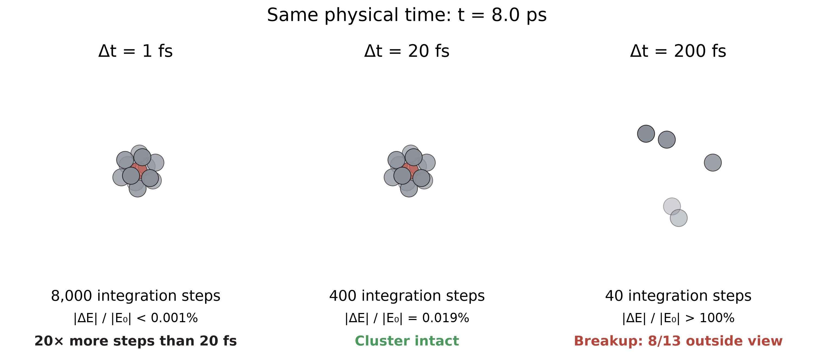
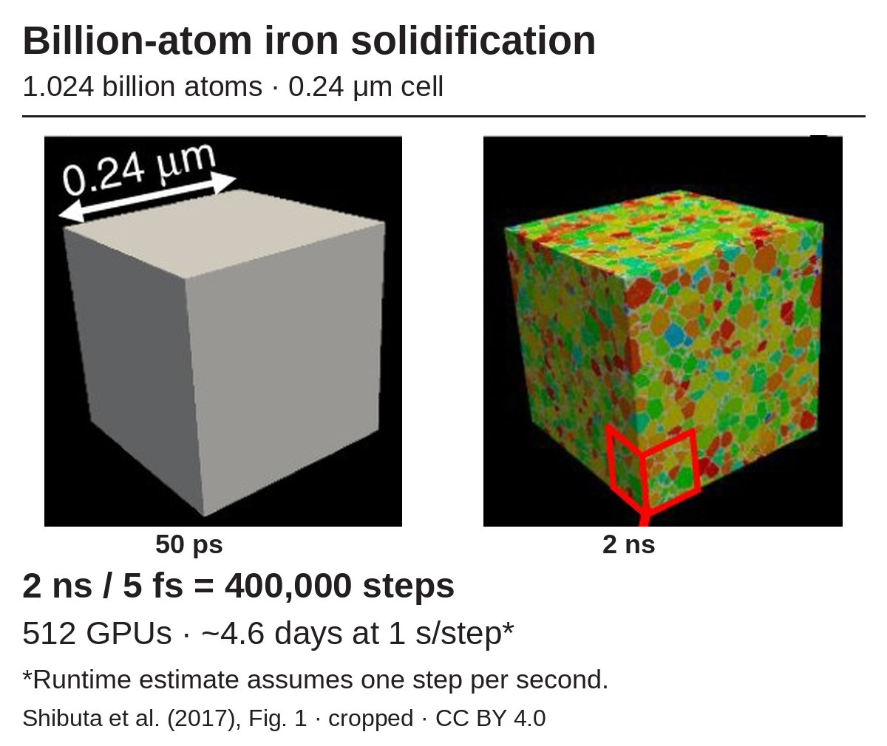
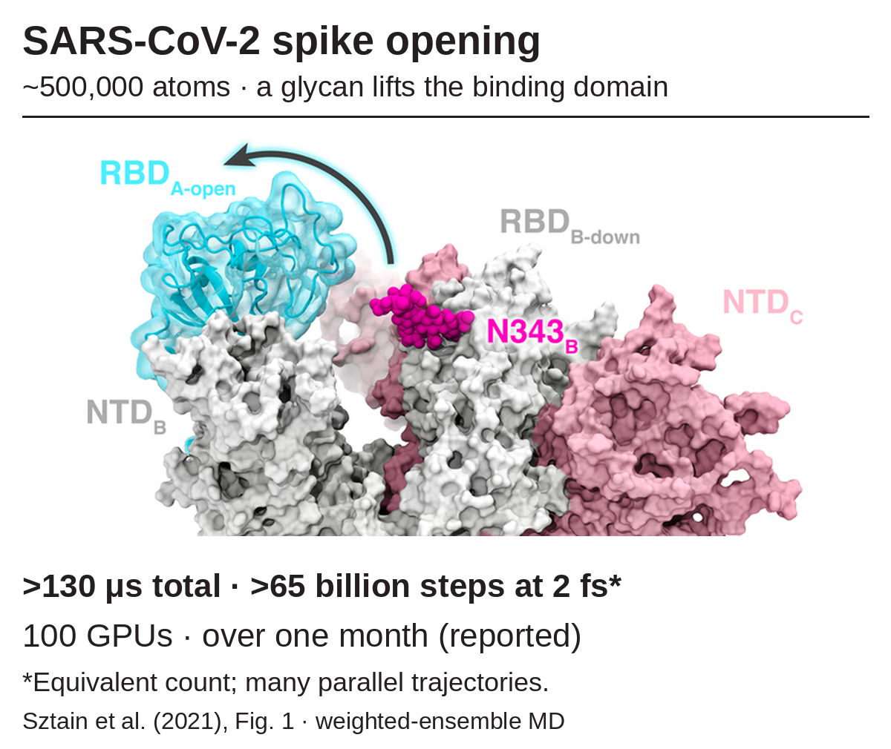
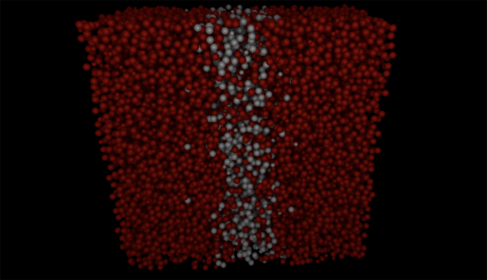
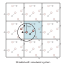
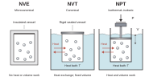
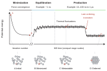
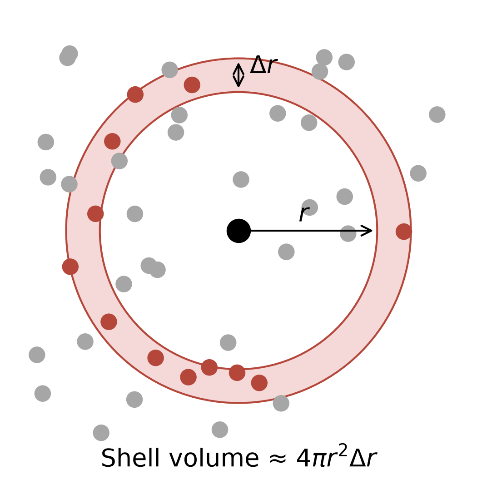
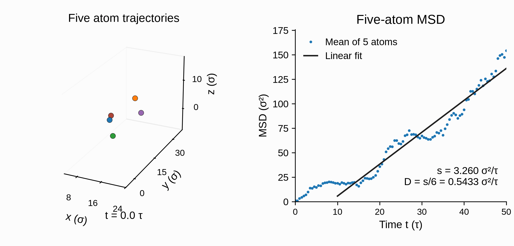
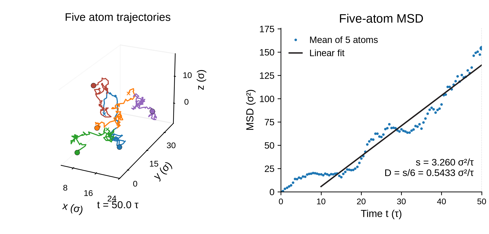

::: {.callout-note}
## Central question

How do we control temperature and pressure in molecular dynamics, and how do we analyse the resulting trajectories?
:::

## Learning outcomes

By the end of this lecture, you should be able to:

1. **Choose and test** a time step using vibration periods, integration error, and computational cost.
2. **Explain** periodic boundaries, interaction cutoffs, and the exchanges allowed in NVE, NVT, and NPT.
3. **Interpret** temperature and pressure control as additional dynamical equations.
4. **Calculate** neighbour-shell coordination from a radial distribution function.
5. **Estimate** diffusivity from the slope of a mean-squared-displacement curve.

## From an isolated pair to a material

In [L24](../L24/index.qmd), we used velocity Verlet to follow atomic vibrations and rearrangements through Newton's equations. To represent a laboratory sample, we must also specify its surroundings and the properties to measure.

- **Time resolution:** how large can a step be while resolving atomic motion?
- **Surroundings:** how can a small set of atoms represent bulk material at a prescribed temperature and pressure?
- **Measurements:** how do atomic positions reveal structure and transport?

## How much time does a trajectory cover?

For smooth forces and an exact starting state, velocity Verlet has one-step position and velocity errors of \(O(\Delta t^3)\). Over a fixed duration, their global errors are \(O(\Delta t^2)\). A smaller step improves accuracy but requires more force evaluations [@swope1982simulation].

A run of \(N_{\mathrm{steps}}\) steps covers

\[
\boxed{t_{\mathrm{run}}=N_{\mathrm{steps}}\Delta t.}
\]

Here \(1\ \mathrm{fs}=10^{-15}\ \mathrm{s}\), \(1\ \mathrm{ps}=10^{-12}\ \mathrm{s}\), and \(1\ \mathrm{ns}=10^{-9}\ \mathrm{s}\). The duration of a million steps depends on \(\Delta t\):

| Time step | Duration of \(10^6\) steps | Interpretation |
|:--|:--|:--|
| \(0.01\ \mathrm{fs}\) | \(10\ \mathrm{ps}\) | Very short time coverage |
| \(1\ \mathrm{fs}\) | \(1\ \mathrm{ns}\) | Plausible starting scale for many models |
| \(10\ \mathrm{fs}\) | \(10\ \mathrm{ns}\) | Requires model-specific accuracy tests |

Atoms move farther between force evaluations as the step increases. A step that misses a close encounter or fast vibration can make the trajectory unstable.

::: {.content-visible when-format="html"}
{#fig-timestep width="100%" fig-alt="Three cluster trajectories compared at the same physical time, using steps of 1, 20, and 200 fs."}
:::

::: {.content-visible unless-format="html"}
{width="100%"}
:::

The cluster remains bound at \(20\ \mathrm{fs}\) with fewer force evaluations. At \(200\ \mathrm{fs}\), it breaks apart. Why?

### Integration error and a stability bound

Near a minimum-energy configuration, atoms oscillate approximately like beads connected by springs, as in [L14](../../03/L14/index.qmd). For a harmonic mode with angular frequency \(\omega\), **velocity Verlet** has a theoretical upper bound for a stable time step [@hairer2003geometric, Example 3.4]:

\[
\boxed{\Delta t<\frac{2}{\omega}}
\]

For an oscillator released from rest with initial energy \(E_0\), the maximum relative energy error satisfies

\[
\boxed{\max_n\frac{|E_n-E_0|}{E_0}\leq\frac{(\omega\Delta t)^2}{4}}
\]

Halving the step reduces this \(O(\Delta t^2)\) energy-error bound by a factor of four. For coupled vibrations, the fastest mode sets the limit. We can start roughly one order of magnitude below \(2/\omega\), then compare with a smaller-step run over the same duration.

### Bond vibrations set a short time scale

How do we estimate \(\omega\)? Recall the bead-and-spring models in [L14](../../03/L14/index.qmd), [L15](../../03/L15/index.qmd), and [Assignment 3, Problem 4](../../../assignments/A3/index.qmd#problem-4-stretching-vibrations-of-hcequivch-30-marks). For two atoms of masses \(m_1\) and \(m_2\), joined by a bond of stiffness \(k\), the vibration period is

\[
\boxed{t_{\mathrm{vib}}=2\pi\sqrt{\frac{m_1m_2}{k(m_1+m_2)}}}
\]

Using representative bond stiffnesses:

| Quantity | C–H stretching | Cu–Cu relative motion |
|:--|:--|:--|
| **Model** | Representative C–H harmonic bond | Course Cu-fitted Lennard–Jones pair |
| **Bond stiffness \(k\)** | \(500\ \mathrm{N/m}\) | \(74\ \mathrm{N/m}\) |
| **Atomic masses \(m_1,m_2\)** | \(12.011,\ 1.008\ \mathrm{u}\) | \(63.546,\ 63.546\ \mathrm{u}\) |
| **Vibration period \(t_{\mathrm{vib}}\)** | \(11\ \mathrm{fs}\) | \(168\ \mathrm{fs}\) |
| **Starting step, about \(t_{\mathrm{vib}}/(10\pi)\)** | \(0.35\ \mathrm{fs}\) | \(5.3\ \mathrm{fs}\) |

**Rule of thumb:** lighter elements, such as hydrogen in organic materials, typically require shorter integration steps.

### What processes can MD resolve?

| Process | Illustrative duration | Steps at \(1\ \mathrm{fs}\) | How easy is MD? |
|:--|:--|:--|:--|
| **Atomic vibration** | \(10\)–\(100\ \mathrm{fs}\) per oscillation | \(10\)–\(100\) | [Easy]{style="color: #17633b; font-weight: 700;"} |
| **Crack propagation** | \(10\ \mathrm{ps}\)–\(1\ \mathrm{ns}\) across a nanoscale sample | \(10^4\)–\(10^6\) | [Accessible]{style="color: #17633b; font-weight: 700;"} |
| **Condensed-state diffusion** | \(0.1\ \mathrm{ns}\)–\(1\ \mu\mathrm{s}\) for nanometre-scale motion in liquids or fast-diffusing solids | \(10^5\)–\(10^9\) | [Varies: easy to expensive]{style="color: #805600; font-weight: 700;"} |
| **Protein folding** | Milliseconds to seconds for many proteins | \(10^{12}\)–\(10^{15}\) | [Very difficult]{style="color: #a52f25; font-weight: 700;"} |

### Large-scale and long-time MD

:::: {.columns}
::: {.column width="50%"}
{width="100%" fig-alt="Billion-atom iron solidification: 2 ns at 5 fs per step gives 400,000 steps. The study used 512 GPUs. At an assumed one second per step, the main run would take about 4.6 days."}

**Solidification:** heterogeneity emerges during homogeneous nucleation in an iron melt. Images cropped from Fig. 1, CC BY 4.0 [@shibuta2017heterogeneity].
:::
::: {.column width="50%"}
{width="100%" fig-alt="SARS-CoV-2 spike opening: over 130 microseconds of aggregate weighted-ensemble trajectories, equivalent to over 65 billion steps at 2 fs. Reported runtime: over one month on 100 GPUs."}

**Spike opening:** a sugar group helps lift the receptor-binding domain, exposing it for binding to human ACE2. Image from Fig. 1 [@sztain2021glycan].
:::
::::

## Production MD engines

Common MD engines include:

{width="100%"}

- **[LAMMPS](https://www.lammps.org/):** a popular choice for materials science, including metals, liquids, and polymers [@thompson2022lammps].
- **[GROMACS](https://www.gromacs.org/):** widely used for biomolecules and molecular systems. [AMBER](https://ambermd.org/) is another established biomolecular package.
- **[OpenMM](https://openmm.org/):** an open-source simulation engine with a Python interface and GPU support. Custom interactions allow solid and liquid models. We use it in the group project [@eastman2024openmm].

The group project uses GPUs for parallel force calculations. As in [L04](../../01/L04/index.qmd), speedup depends on workload and hardware.

[Atomify](https://andeplane.github.io/atomify/) runs MD examples in a browser.

[]{#lammps-diffusion-example}Selected commands from a [**LAMMPS diffusion input**](https://github.com/andeplane/atomify/blob/main/public/examples/diffusion/diffusion/simple_diffusion.in) appear on the left, with the simulation domain on the right.

:::: {.columns}
::: {.column width="53%"}
```text
units lj
velocity all create 3.00 1337 loop geom
pair_style lj/cut 2.5
pair_coeff * * 1.0 1.0 2.5
compute msd_light light msd com yes
fix 1 all nve
run 10000
```
:::
::: {.column width="47%"}
{width="100%" fig-alt="A rectangular three-dimensional simulation cell filled with red atoms and a central slab of smaller grey atoms."}
:::
::::

**Input commands:**

- **Units:** reduced Lennard–Jones length, energy, mass, and time.
- **Velocity creation:** initial temperature 3.00 and random seed 1337.
- **Pair style and coefficients:** Lennard–Jones interactions with \(\epsilon=1\), \(\sigma=1\), and cutoff \(2.5\sigma\) for all type pairs.
- **Diffusion analysis using mean-squared displacement (MSD):** track the light atoms' squared displacements, removing their centre-of-mass motion.
- **NVE fix:** Newtonian integration for all atoms, without a thermostat.
- **Run:** 10,000 steps.
- **Defaults:** periodic boundaries and reduced time step 0.005.

The initial temperature prepares the velocities. NVE then advances the motion without maintaining that temperature.

## Periodic boundary conditions

A small isolated cluster has a large surface-to-volume ratio. **Periodic boundary conditions (PBC)** represent bulk material by surrounding the cell with exact copies of itself. The cell can contain a crystal, liquid, or disordered solid.

- **Repeated cells:** every copy contains the same relative atomic positions. An atom passing through the left boundary re-enters from the right with its velocity unchanged. Atoms on opposite displayed edges can therefore be neighbours.
- **Interaction range:** a cutoff \(r_c\) limits short-range force calculations to nearby atoms, including neighbours across a periodic boundary.

{#fig-pbc width="75%" fig-alt="Nine repeated cells with a blue central simulation cell. Velocity arrows and atoms outside a large cutoff circle are faded. A plain line marks the cutoff radius."}

The cell size limits wavelengths, defects, and fluctuations. Comparing cell sizes tests these finite-size effects.

### Interaction cutoff

The Lennard–Jones potential approaches zero at large separation. A cutoff neglects its distant tail and reduces the number of interacting pairs.

{width="100%" fig-alt="The full Lennard–Jones potential on the left has a dashed zoom region linked to the enlarged cutoff detail on the right. The omitted tail is dashed, while the truncated interaction jumps to zero."}

For \(N\) atoms in three dimensions, compare the work:

- **All pairs:** \(N(N-1)/2\) interactions, giving \(O(N^2)\) work.
- **Cutoff radius \(r_c\):** each atom has roughly \(\rho(4\pi r_c^3/3)\) neighbours, where \(\rho\) is the atomic number density. With a spatial neighbour search, pair evaluation costs \(O(\rho r_c^3N)\).

At fixed density and cutoff, the work grows linearly with \(N\)—potentially orders of magnitude less than evaluating all pairs.

::: {.callout-caution}
## Charged systems need long-range electrostatics

**Coulomb forces** decay more slowly than the Lennard–Jones tail. Ionic crystals and charged biomolecules usually need [Ewald summation or particle-mesh Ewald](https://manual.gromacs.org/current/reference-manual/functions/long-range-electrostatics.html).

**Use the electrostatic treatment specified by the force field.**
:::

## Ensembles: energy, temperature, and pressure conditions

A sample can exchange heat or do work on its surroundings. In statistical physics, an **ensemble** describes its possible states under specified conditions. The common ensembles specify three quantities chosen from:

- **N:** number of particles.
- **V:** volume.
- **E:** total energy.
- **T:** temperature.
- **P:** pressure.

| Ensemble | Specified conditions | Exchange with surroundings |
|:--|:--|:--|
| **NVE** | Number of particles, volume, total energy | No heat or volume work |
| **NVT** | Number of particles, volume, temperature | Heat exchange |
| **NPT** | Number of particles, pressure, temperature | Heat and volume work |

{width="100%" fig-alt="Three cross-sectional apparatus diagrams with eight sample atoms each: a rigid insulated vessel for NVE, a rigid vessel immersed in a heat bath for NVT, and a cylinder with a weighted movable piston immersed in a heat bath for NPT. Red arrows indicate heat exchange, and a separate piston-motion indicator shows variable volume."}

The isolated pair in L24 has no heat bath. Bulk NVE also specifies a volume, often through a periodic cell. Temperature and pressure estimates fluctuate in a finite system.

### NVE: the conservative reference

For a time-independent potential, exact Newtonian dynamics conserves total energy. With smooth forces and a suitable step, velocity Verlet gives a small, oscillating energy error. A short NVE run therefore tests the integration: strong drift suggests a problem with the step size, forces, cutoff, or neighbour list. A thermostat could conceal this drift by removing the added energy.

### NVT: how do we control temperature?

A sample in a thermal bath exchanges heat with its surroundings. An MD thermostat represents that exchange through changes in atomic motion. For \(N\) unconstrained atoms in three dimensions, equilibrium equipartition gives

\[
\boxed{
\begin{aligned}
\frac{\overline K}{N}&=\frac32 k_{\mathrm B}T\\[0.5em]
T_{\mathrm{inst}}&=\frac{2K}{3Nk_{\mathrm B}}
\end{aligned}
}
\]

Here \(K\) is total kinetic energy and \(\overline K\) its equilibrium average. The factor \(3/2\) counts three translational velocity components per atom. An implementation uses the actual number of independent thermal degrees of freedom in place of \(3N\), for example \(3N-3\) after removing centre-of-mass translation.

Instantaneous temperature fluctuates as kinetic and potential energy exchange. A thermostat controls the thermal distribution and mean temperature while permitting these fluctuations.

### Nosé–Hoover thermostat: a dynamical feedback variable

::::: {.scientist-method-inline}
::: {.scientist-method-text}
The Nosé–Hoover thermostat, named for Shuichi Nosé and William Graham Hoover, introduces a dynamical variable \(\zeta\) that controls a friction-like term. Without a thermostat, \(\dot{\mathbf r}_i=\mathbf p_i/m_i\) and \(\dot{\mathbf p}_i=\mathbf F_i\). Adding feedback gives

\[
\begin{aligned}
\dot{\mathbf r}_i&=\frac{\mathbf p_i}{m_i},\\
\dot{\mathbf p}_i&=\mathbf F_i-\zeta\mathbf p_i,\\
\dot\zeta&=\frac{2K-fk_{\mathrm B}T_{\mathrm{bath}}}{Q}.
\end{aligned}
\]

Here \(f\) counts thermal degrees of freedom, and the thermostat inertia \(Q\) sets the response time. Excess kinetic energy increases \(\zeta\). Positive \(\zeta\) damps the momenta, while negative \(\zeta\) supplies energy. The feedback permits temperature fluctuations and can produce oscillations during adjustment [@hoover1985canonical].
:::
:::: {.scientist-portraits}
::: {.scientist-portrait}
{width="78" fig-alt="Portrait of Shuichi Nosé"}

**Shuichi Nosé**

Photo: Hiroyuki Hyuga · [Physics Today](https://physicstoday.aip.org/obituaries/shuichi-nose)
:::
::::
:::::


The kinetic-energy error accumulates in \(\zeta\), like integral control, and is integrated with atomic motion. Check temperature and kinetic-energy fluctuations at different time steps and coupling times. Strong coupling can distort motion, and small harmonic systems can sample the ensemble poorly.

### NPT: a pressure controller changes the cell

At prescribed pressure, heating a material may expand it. A barostat allows the simulation cell to change size, and sometimes shape, in response to the difference between internal and applied stress. Temperature control usually operates alongside it.

An isotropic change multiplies every cell length and atomic position by a factor \(\lambda\):

\[
\begin{aligned}
L_{\mathrm{new}}&=\lambda L_{\mathrm{old}},\\
\mathbf r_i^{\,\mathrm{new}}&=\lambda\mathbf r_i^{\,\mathrm{old}},\\
V_{\mathrm{new}}&=\lambda^3V_{\mathrm{old}}.
\end{aligned}
\]

The barostat equations determine \(\lambda\) from the pressure difference. The integration scheme sets when these cell and position updates occur.

::::: {.scientist-method-inline}
::: {.scientist-method-text}
**Parrinello–Rahman dynamics**, named for Michele Parrinello and Aneesur Rahman, allows cell vectors to change direction, so a crystal can change volume and shape [@parrinello1981polymorphic]. A thermostat controls temperature alongside it. **Langevin dynamics** controls temperature through friction and random forces, and needs a separate barostat for NPT.
:::
:::: {.scientist-portraits}
::: {.scientist-portrait}
{width="78" fig-alt="Portrait of Michele Parrinello"}

**Michele Parrinello**

[ETH Library](https://commons.wikimedia.org/wiki/File:ETH-BIB-Parrinello,_Michele_(1945-)-Portr_17881.jpg) · [CC BY-SA 4.0](https://creativecommons.org/licenses/by-sa/4.0/)
:::
::: {.scientist-portrait}
{width="78" fig-alt="Portrait of Aneesur Rahman"}

**Aneesur Rahman**

[MarzMehter](https://commons.wikimedia.org/wiki/File:Aneesur_Rahman_edited.jpg) · [CC BY-SA 4.0](https://creativecommons.org/licenses/by-sa/4.0/)
:::
::::
:::::


Pressure fluctuates strongly in small cells. We compare its average with the target and monitor volume and temperature. For a nanoparticle in vacuum, a barostat acts on the mostly empty box and does not directly control the particle's pressure.

## Practical checklist for an MD simulation

- **Units:** eV, Å, and fs, atomic units, or a kJ/mol or kcal/mol convention?
- **Initial structure:** has minimization removed overlaps and excessive forces?
- **Periodic boundaries:** are the directions correct and the cell compatible with the cutoff?
- **Time step:** do smaller steps give consistent results over the same duration? Test \(0.5\)–\(1\ \mathrm{fs}\) as a starting range for many unconstrained models.
- **Ensemble and controllers:** NVE, NVT, or NPT? Are the controllers appropriate and properly coupled?
- **Performance:** how many nanoseconds per day on the available hardware?
- **Monitoring:** do energy, temperature, pressure, volume, and trajectory behave as expected?

### Minimization, equilibration, and production

{#fig-md-stages width="100%" fig-alt="Potential energy falls during minimization, rises and fluctuates as the system thermalizes, then fluctuates around a plateau during production before a late drop associated with ordering. Four schematic configurations show the same number of atoms before relaxation, after minimization, in a metastable disordered state, and in an ordered state."}

**Minimization** moves atoms downhill in potential energy to remove severe overlaps. Its iteration count is controlled by force or energy convergence and has no physical duration.

**Equilibration** lets atoms adjust to the target conditions before measurements. Check structure as well as mean temperature.

**Production** records the trajectories and measurements. Equilibrium averages are collected after the relevant properties settle. Rare-event studies may follow a prepared metastable state until a transition occurs. Depending on the process and required statistics, a run might cover \(10\)–\(100\ \mathrm{ns}\), or \(1\ \mu\mathrm{s}\), of simulated time.

Processes such as solidification can be *kinetically controlled*: slow atomic rearrangements make the transformation take much longer than an atomic vibration. Long MD runs may capture these changes, but other methods, such as Monte Carlo sampling or phase-field modelling, may be more suitable. We discuss these methods in the next unit.

## Structure from a radial distribution function

How many neighbours lie in a shell at radius \(r\)? Count atoms between \(r\) and \(r+\Delta r\), then average over reference atoms and saved frames. Call this mean count \(\langle n_{\mathrm{shell}}(r)\rangle\).

{width="100%" fig-alt="A reference atom is surrounded by blue and red neighbour shells. The RDF plot beside it has matching blue and red peaks at the same shell radii."}

The **radial distribution function (RDF)**, \(g(r)\), measures the average neighbour density in that shell relative to the mean density \(\rho=N/V\):

\[
\boxed{
g(r)\approx
\frac{\langle n_{\mathrm{shell}}(r)\rangle}
{\rho\,\tfrac{4\pi}{3}\left[(r+\Delta r)^3-r^3\right]}.
}
\]

Peaks in \(g(r)\) mark preferred neighbour distances. The **cumulative RDF** counts neighbours within a radius, as derived below. J. D. Bernal helped develop this geometric picture of liquids [@bernal1959geometrical; @finney2013bernal].

- **Crystal:** neighbours occupy distinct shells, giving sharp peaks at characteristic distances. Thermal motion broadens them.
- **Liquid:** a strong first-neighbour peak remains, followed by broader, damped oscillations.
- **Amorphous solid:** local peaks can resemble those of a liquid. Motion over time helps distinguish an arrested structure from a flowing one.

Heating broadens crystalline peaks, and loss of distant peaks indicates disorder. Liquids and amorphous solids both have broad peaks, so we also examine energy and mobility to identify melting.

### Relation to diffraction

Diffraction measures correlations in reciprocal space. For an isotropic, one-component material, the structural contribution can be expressed through

\[
S(q)=1+4\pi\rho
\int_0^\infty r^2[g(r)-1]\frac{\sin(qr)}{qr}\,\mathrm dr.
\]

Here \(q\) is the scattering-vector magnitude, in inverse length. The integral relates \(g(r)\) to the structure factor \(S(q)\). X-ray and neutron intensities also include scattering weights [@lesar2013].

## Coordination number: integrating the neighbour shells

The shell count follows directly from the RDF definition:

\[
\mathrm dN(r)=4\pi\rho r^2g(r)\,\mathrm dr.
\]

Integrating to a selected neighbour-shell boundary \(r_{\min}\), commonly the first minimum after the first peak, gives the mean coordination number:

\[
\boxed{
N_{\mathrm c}=4\pi\rho\int_0^{r_{\min}}r^2g(r)\,\mathrm dr.
}
\]

::: {.callout-tip}
## From RDF to coordination: numerical integration

Apply the **trapezoidal rule** or **Simpson's rule** from [L19](../../04/L19/index.qmd) and [L20](../../04/L20/index.qmd) to \(4\pi\rho r^2g(r)\).
:::

For ideal cubic crystals with lattice parameter \(a\):

| Structure | Nearest-neighbour distance | First-shell coordination |
|:--|:--|:--|
| Simple cubic (SC) | \(a\) | 6 |
| Body-centred cubic (BCC) | \(\sqrt{3}a/2\) | 8 |
| Face-centred cubic (FCC) | \(a/\sqrt{2}\) | 12 |

{width="65%"}

Each row counts atoms at the nearest distance. In BCC, the next shell of six atoms is relatively close, so the chosen integration boundary matters when thermal broadening merges the peaks.

### Project data: neighbour shells during heating

{width="100%"}

The first-shell count stays close to 12 as heating broadens the RDF peaks and smooths the cumulative curve.

## Fitting diffusivity (reading material)

Diffusion through a lattice is important in welding. Using our [browser example](#lammps-diffusion-example), how do we obtain the **diffusivity \(D\)** used in mass-transfer and phase-transformation courses?

Measure each atom's squared displacement from its starting position, using unwrapped coordinates across periodic boundaries. Averaging over atoms gives the **mean-squared displacement (MSD)**, \(\langle R^2(t)\rangle\). For three-dimensional diffusion, fit the Einstein relation:

\[
\boxed{
\begin{aligned}
\langle R^2(t)\rangle&\simeq6Dt+b\\[0.5em]
D&=\frac{\text{fitted slope}}{6}
\end{aligned}
}
\]

How do we estimate this derivative from noisy MD data? Adjacent finite differences amplify the noise. Instead, we fit a line over the **linear diffusion regime** using least squares.

::: {.content-visible when-format="html"}
{width="100%" loading="lazy"}
:::

::: {.content-visible unless-format="html"}
{width="100%"}
:::

## What to keep

- The fastest motion limits the time step, while the event of interest sets the trajectory duration.
- Periodic boundaries represent repeating material. Cutoffs approximate short-range interactions.
- Thermostats and barostats control exchanges with the surroundings through additional dynamics.
- RDF peaks identify neighbour shells. Integrating their density-weighted area gives coordination.
- A long-time MSD slope measures diffusivity. Fitting estimates this derivative from noisy data.

## Check your understanding

1. How many steps cover \(100\ \mathrm{ns}\) with a \(0.5\ \mathrm{fs}\) step?
2. Why can a time step satisfy the harmonic stability bound but still give an inaccurate trajectory?
3. What happens to an atom's velocity and neighbour interactions when it crosses a periodic boundary?
4. Why can particle energy change in NVT even when integration is accurate?
5. Why must the RDF be weighted by \(4\pi\rho r^2\) before integration for coordination?
6. What would you check before interpreting a straight MSD segment as equilibrium diffusion?

## Next

The forces depend on the chosen interaction potential. [L26](../L26/index.qmd) examines how that choice affects material behaviour.
