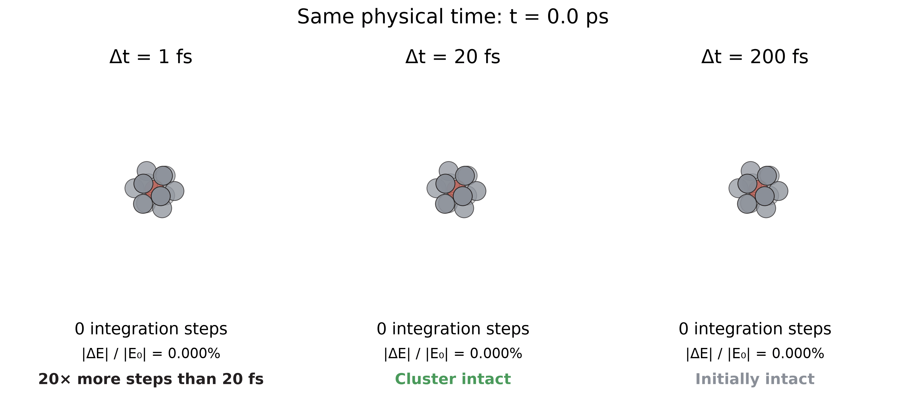
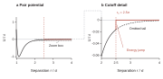
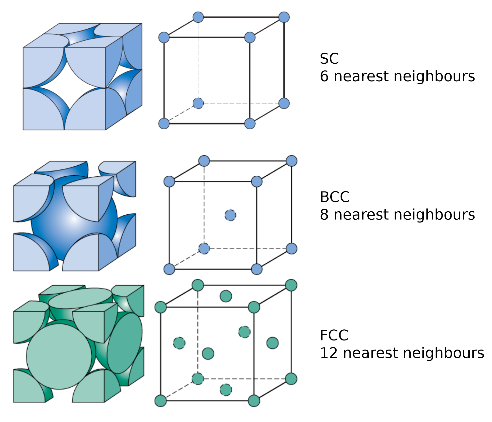
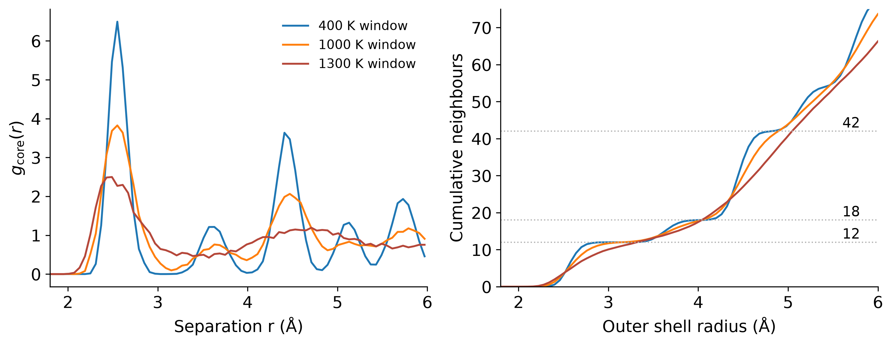

::: {.callout-note}
## Central question

How do we control temperature and pressure in molecular dynamics, and how do we analyse the resulting trajectories?
:::

## Learning outcomes

By the end of this lecture, you should be able to:

1. **Choose and test** a time step using vibration periods, integration error, and computational cost.
2. **Explain** periodic boundaries, interaction cutoffs, and the exchanges allowed in NVE, NVT, and NPT.
3. **Interpret** temperature and pressure control as additional dynamical equations.
4. **Calculate** neighbour-shell coordination from a radial distribution function.
5. **Estimate** diffusivity from the slope of a mean-squared-displacement curve.

## From an isolated pair to a material

In [L24](../L24/index.qmd), positions and velocities evolved through Newton's equations using velocity Verlet. With a suitable interaction model, this procedure can reproduce vibrations, structural rearrangements, and other material behaviour. To connect the trajectory to a laboratory sample, we must also specify its surroundings and decide which quantities to measure.

- **Time resolution:** how large can a step be while resolving atomic motion?
- **Surroundings:** how can a small set of atoms represent bulk material at a prescribed temperature and pressure?
- **Measurements:** how do atomic positions reveal structure and transport?

## How much time does a trajectory cover?

Velocity Verlet gives one-step position and velocity errors of \(O(\Delta t^3)\) when the starting state is exact and the forces are smooth. Over a fixed physical duration, the accumulated position and velocity errors are \(O(\Delta t^2)\). Choosing a smaller step improves accuracy, but increases the number of force evaluations needed to reach that duration [@swope1982simulation].

A run of \(N_{\mathrm{steps}}\) steps covers

\[
\boxed{t_{\mathrm{run}}=N_{\mathrm{steps}}\Delta t.}
\]

Here \(1\ \mathrm{fs}=10^{-15}\ \mathrm{s}\), \(1\ \mathrm{ps}=10^{-12}\ \mathrm{s}\), and \(1\ \mathrm{ns}=10^{-9}\ \mathrm{s}\). One million steps sounds large. Its physical duration depends on \(\Delta t\):

| Time step | Duration of \(10^6\) steps | Interpretation |
|:--|:--|:--|
| \(0.01\ \mathrm{fs}\) | \(10\ \mathrm{ps}\) | Very short time coverage |
| \(1\ \mathrm{fs}\) | \(1\ \mathrm{ns}\) | Plausible starting scale for many models |
| \(10\ \mathrm{fs}\) | \(10\ \mathrm{ns}\) | Requires model-specific accuracy tests |

A very small step spends most of the available computing time resolving a short interval. A large step moves atoms farther before their forces are evaluated again. If that step misses a close encounter or a fast vibration, the trajectory can become unstable.

::: {.content-visible when-format="html"}
{#fig-timestep width="100%"}
:::

::: {.content-visible unless-format="html"}
{width="100%"}
:::

Every frame compares the three trajectories at exactly the same physical time. The same camera angle, atom sizes, and fixed viewing volume are used throughout. The shared clock measures simulated time, while the counters show the number of integration steps:

- **1 fs:** reaching \(8\ \mathrm{ps}\) takes 8,000 steps, twenty times as many as the 20 fs run. The atoms move on the same physical time scale as in the converged trajectory.
- **20 fs:** reaching \(8\ \mathrm{ps}\) takes 400 steps. The cluster remains intact, and the maximum energy error over the run is about \(0.030\%\) of the magnitude of its initial total energy.
- **200 fs:** reaching \(8\ \mathrm{ps}\) takes only 40 steps, but the numerical trajectory breaks the cluster apart and produces a very large energy error. At the final time, eight atoms have left the fixed viewing volume.

This comparison uses L24's argon Lennard–Jones parameters and added energy of \(0.30\epsilon\) per atom. For this initial state and duration, the 1 fs step spends substantially more work resolving motion that 20 fs already reproduces with small energy error. The 200 fs step sacrifices accuracy and stability. The appropriate step must be tested again when the potential, temperature, or initial configuration changes.

### Integration error and a stability bound

For a harmonic oscillator of angular frequency \(\omega\), velocity Verlet has the following stability bound and relative energy-error bound. The energy bound applies to an oscillator released from rest, with initial energy \(E_0\):

\[
\boxed{\omega\Delta t<2,\qquad
\frac{\max_n|E_n-E_0|}{E_0}\leq\frac{(\omega\Delta t)^2}{4}}
\]

For a \(10\ \mathrm{fs}\) period, stability requires \(\Delta t<10/\pi\approx3.2\ \mathrm{fs}\). A \(1\ \mathrm{fs}\) step gives an energy-error envelope of about \(10\%\) in this oscillator example. Halving the step reduces it to about \(2.5\%\). Requiring at most \(1\%\) gives \(\Delta t\lesssim0.32\ \mathrm{fs}\). These harmonic-model estimates show why a stable step can still be inaccurate. Close encounters and the fastest collective modes also matter in a many-atom system.

### Bond vibrations set a short time scale

The local curvature of the potential supplies a stiffness \(k\). For two atoms, the relative coordinate behaves near equilibrium like an oscillator with reduced mass

\[
\mu=\frac{m_1m_2}{m_1+m_2},
\qquad
\omega=\sqrt{\frac{k}{\mu}},
\qquad
t_{\mathrm{vib}}=\frac{2\pi}{\omega}.
\]

- **Stiffer interaction:** larger \(k\) → faster vibration.
- **Lighter relative motion:** smaller \(\mu\) → faster vibration.
- **Time integration:** resolve the shortest important period with many steps.

For the two examples below, use representative harmonic stiffnesses and resolve one vibration with roughly 10–20 steps:

| Quantity | C–H stretching | Cu–Cu relative motion |
|:--|:--|:--|
| **Model** | Representative C–H harmonic bond | Course Cu-fitted Lennard–Jones pair |
| **Bond stiffness \(k\)** | \(500\ \mathrm{N/m}\) | \(74\ \mathrm{N/m}\) |
| **Atomic masses \(m_1,m_2\)** | \(12.011,\ 1.008\ \mathrm{u}\) | \(63.546,\ 63.546\ \mathrm{u}\) |
| **Reduced mass \(\mu\)** | \(0.930\ \mathrm{u}\) | \(31.773\ \mathrm{u}\) |
| **Vibration period \(t_{\mathrm{vib}}\)** | \(11\ \mathrm{fs}\) | \(168\ \mathrm{fs}\) |
| **Initial step range to test** | About \(0.5\)–\(1\ \mathrm{fs}\) | About \(8\)–\(17\ \mathrm{fs}\) |

The stiffer C–H bond and lighter reduced mass give a much shorter vibration period. These estimates resolve individual harmonic modes. In a many-atom simulation, collective modes and close encounters can require a smaller step.

::: {.callout-tip}
## Time step: accuracy versus time coverage

A smaller step reduces integration error but requires more force evaluations per nanosecond. A larger step covers more time but can distort vibrations or make the trajectory unstable. **Compare runs over the same physical duration, including a smaller-step energy and observable check.**
:::

### What processes can MD resolve?

A typical comparison, from atomic motion to slower material changes:

| Process | Illustrative duration | Steps at \(1\ \mathrm{fs}\) |
|:--|:--|:--|
| **Atomic vibration** | \(10\)–\(100\ \mathrm{fs}\) per oscillation | \(10\)–\(100\) |
| **Crack propagation** | \(10\ \mathrm{ps}\)–\(1\ \mathrm{ns}\) across a nanoscale sample | \(10^4\)–\(10^6\) |
| **Condensed-state diffusion** | \(0.1\ \mathrm{ns}\)–\(1\ \mu\mathrm{s}\) for nanometre-scale motion in liquids or fast-diffusing solids | \(10^5\)–\(10^9\) |
| **Protein folding** | Milliseconds to seconds for many proteins | \(10^{12}\)–\(10^{15}\) |

MD readily resolves vibrations and can follow crack propagation and atomic diffusion over accessible distances and times. Slow solid-state diffusion and many protein-folding events require much longer trajectories. These ranges depend on the material, temperature, distance, and system size.

## Production MD engines

Production engines implement force evaluation, integration, and trajectory output efficiently for large systems.

{width="100%"}

- **[LAMMPS](https://www.lammps.org/):** a popular choice for materials science, including metals, liquids, and polymers [@thompson2022lammps].
- **[GROMACS](https://www.gromacs.org/):** widely used for biomolecules and molecular systems. [AMBER](https://ambermd.org/) is another established biomolecular package.
- **[OpenMM](https://openmm.org/):** an open-source simulation engine with a Python interface and GPU support. Custom interactions allow solid and liquid models. We use it in the group project [@eastman2024openmm].

MD has a heavy workload, with many force calculations that can run in parallel on hardware accelerators such as GPUs. As discussed in [L04](../../01/L04/index.qmd), the speedup depends on the workload and hardware. The group project takes advantage of this parallelism.

### Reading an MD input file

Some [online tools](https://andeplane.github.io/atomify/) let you run small MD examples in a browser. Production packages such as LAMMPS, GROMACS, and AMBER each have their own input formats. The commands specify the same physical and numerical choices we have studied.

The [example's input file](https://github.com/andeplane/atomify/blob/main/public/examples/diffusion/diffusion/simple_diffusion.in) contains these lines:

:::: {.columns}
::: {.column width="53%"}
```text
units lj
velocity all create 3.00 1337 loop geom
pair_style lj/cut 2.5
pair_coeff * * 1.0 1.0 2.5
compute msd_light light msd com yes
fix 1 all nve
run 10000
```
:::
::: {.column width="47%"}
{width="100%" fig-alt="A rectangular three-dimensional simulation cell filled with red atoms and a central slab of smaller grey atoms."}
:::
::::

- **Units**; reduced Lennard–Jones length, energy, mass, and time.
- **Velocity creation**; initial temperature 3.00 and random seed 1337.
- **Pair style and coefficients**; Lennard–Jones interactions with \(\epsilon=1\), \(\sigma=1\), and cutoff \(2.5\sigma\) for all type pairs.
- **MSD compute**; light-group mean-squared displacement with its centre-of-mass motion removed.
- **NVE fix**; Newtonian integration for all atoms, without a thermostat.
- **Run**; 10,000 steps.
- **Defaults**; periodic boundaries and reduced time step 0.005, since this file does not override them.

The initial temperature prepares the velocities. NVE then advances the motion without maintaining that temperature.

## Periodic boundary conditions

A small isolated cluster has a large surface-to-volume ratio. To represent a bulk material, we can surround the simulated cell by exact copies of itself. **Periodic boundary conditions (PBC)** describe this repeating system. The contents of a cell may be a crystal, a liquid, or a disordered solid.

Two features need attention:

- **Repeated cells:** every copy contains the same relative atomic positions. An atom passing through the left boundary re-enters from the right with its velocity unchanged. Atoms on opposite displayed edges can therefore be neighbours.
- **Interaction range:** a cutoff \(r_c\) limits short-range force calculations to nearby atoms, including neighbours across a periodic boundary.

{#fig-pbc width="75%" fig-alt="Nine repeated cells with a blue central simulation cell. Velocity arrows and atoms outside a large cutoff circle are faded. A plain line marks the cutoff radius."}

PBC represents an indefinitely repeated material using a finite cell. The chosen cell still limits wavelengths, defects, and fluctuations. Comparing cell sizes tests this finite-size effect.

### Interaction cutoff

The Lennard–Jones potential approaches zero at large separation. A cutoff neglects its distant tail and reduces the number of interacting pairs.

{width="100%" fig-alt="Full Lennard–Jones potential with a dashed zoom box linked to a magnified tail plot. The cutoff at 2.5 sigma introduces a discontinuity between the negative potential and zero."}

Simply setting the potential to zero at \(r_c\) introduces an energy jump if \(U(r_c)\ne0\). Subtracting \(U(r_c)\) inside the cutoff makes the energy continuous, but its derivative can still jump. An engine may instead shift the force or smoothly switch the interaction off. Specify the cutoff and smoothing rule together.

For a cubic cell using the nearest periodic image, choose \(r_c<L/2\). This keeps multiple images of the same neighbour from entering the cutoff. For an orthorhombic cell, use half the shortest side.

::: {.callout-caution}
## Charged systems need long-range electrostatics

Coulomb interactions decay much more slowly than the Lennard–Jones attractive tail. Ionic crystals and charged biomolecules usually need a long-range method such as Ewald summation or particle-mesh Ewald. The [GROMACS explanation](https://manual.gromacs.org/current/reference-manual/functions/long-range-electrostatics.html) describes the real-space and reciprocal-space contributions.

**Use the force field's prescribed electrostatic treatment rather than applying a short-range cutoff to charges without justification.**
:::

## Ensembles: what does the sample exchange?

An **ensemble** specifies the macroscopic conditions under which we sample states. Three common choices connect directly to experimental situations:

| Ensemble | Specified conditions | Exchange with surroundings |
|:--|:--|:--|
| **NVE** | Number of particles, volume, total energy | No heat or volume work |
| **NVT** | Number of particles, volume, temperature | Heat exchange |
| **NPT** | Number of particles, pressure, temperature | Heat and volume work |

{width="100%" fig-alt="Three cross-sectional apparatus diagrams with eight sample atoms each: a rigid insulated vessel for NVE, a rigid vessel immersed in a heat bath for NVT, and a cylinder with a weighted movable piston immersed in a heat bath for NPT. Red arrows indicate heat exchange, and a separate piston-motion indicator shows variable volume."}

The isolated pair of L24 illustrates conservative motion without a heat bath. A literal NVE bulk calculation also specifies a volume, often a periodic cell. For NVT and NPT, temperature and pressure are target thermodynamic conditions. Their instantaneous estimates fluctuate in a finite system.

### NVE: the conservative reference

For a time-independent potential, exact Newtonian dynamics conserves total energy. The numerical trajectory should keep the error small at a suitably chosen step. A stable symplectic integrator provides good long-time behaviour, but does not guarantee exactly constant numerical energy.

This makes a short NVE run a useful integration check. If the energy drifts strongly, inspect the step size, force implementation, cutoff treatment, and neighbour-list settings before adding a thermostat.

### NVT: how do we control temperature?

A sample in a thermal bath exchanges heat with its surroundings. An MD thermostat represents that exchange through changes in atomic motion. For \(N\) unconstrained atoms in three dimensions, equilibrium equipartition gives

\[
\boxed{\frac{\overline K}{N}=\frac32 k_{\mathrm B}T,\qquad
T_{\mathrm{inst}}=\frac{2K}{3Nk_{\mathrm B}}}
\]

Here \(K\) is total kinetic energy and \(\overline K\) its equilibrium average. The factor \(3/2\) counts three translational velocity components per atom. An implementation uses the actual number of independent thermal degrees of freedom in place of \(3N\), for example \(3N-3\) after removing centre-of-mass translation.

Instantaneous temperature fluctuates as kinetic and potential energy exchange. A thermostat controls the thermal distribution and mean temperature while permitting these fluctuations.

### Nosé–Hoover thermostat: a dynamical feedback variable

::::: {.scientist-method-inline}
::: {.scientist-method-text}
The Nosé–Hoover thermostat, named for Shuichi Nosé and William Graham Hoover, introduces a dynamical variable \(\zeta\) that controls a friction-like term. Without a thermostat, \(\dot{\mathbf r}_i=\mathbf p_i/m_i\) and \(\dot{\mathbf p}_i=\mathbf F_i\). Adding feedback gives

\[
\begin{aligned}
\dot{\mathbf r}_i&=\frac{\mathbf p_i}{m_i},\\
\dot{\mathbf p}_i&=\mathbf F_i-\zeta\mathbf p_i,\\
\dot\zeta&=\frac{2K-fk_{\mathrm B}T_{\mathrm{bath}}}{Q}.
\end{aligned}
\]

The parameter \(Q\) controls the response time. When kinetic energy exceeds its target on average, \(\zeta\) tends to increase and remove energy. When it is too low, the feedback can add energy. The controller has its own dynamics, so the temperature can fluctuate and may oscillate during adjustment [@hoover1985canonical].
:::
:::: {.scientist-portraits}
::: {.scientist-portrait}
{width="78" fig-alt="Portrait of Shuichi Nosé"}

**Shuichi Nosé**

Photo: Hiroyuki Hyuga · [Physics Today](https://physicstoday.aip.org/obituaries/shuichi-nose)
:::
::::
:::::


The temperature error accumulates in \(\zeta\), much like integral action in a process controller. Positive \(\zeta\) damps velocities, while negative \(\zeta\) supplies energy. Here \(f\) counts thermal degrees of freedom and \(Q\) is a thermostat inertia. The controller equations must be integrated along with atomic motion.

A tested Nosé–Hoover or Nosé–Hoover-chain implementation is a useful starting point for many-atom NVT. Check average temperature and kinetic-energy fluctuations, together with sensitivity to time step and coupling time. Correct sampling requires sufficient exploration of accessible states. Small harmonic systems can fail this condition, and overly strong coupling can distort motion.

### NPT: a pressure controller changes the cell

At prescribed pressure, heating a material may expand it. A barostat allows the simulation cell to change size, and sometimes shape, in response to the difference between internal and applied stress. Temperature control usually operates alongside it.

An isotropic change multiplies every cell length and atomic position by a factor \(\lambda\):

\[
L_{\mathrm{new}}=\lambda L_{\mathrm{old}},\qquad
\mathbf r_i^{\,\mathrm{new}}=\lambda\mathbf r_i^{\,\mathrm{old}},\qquad
V_{\mathrm{new}}=\lambda^3V_{\mathrm{old}}.
\]

This is the geometric part of pressure control. The barostat determines the change from the pressure difference and its own dynamical equations. The integration scheme specifies how often these updates occur.

::::: {.scientist-method-inline}
::: {.scientist-method-text}
**Parrinello–Rahman dynamics**, named for Michele Parrinello and Aneesur Rahman, also allows cell vectors to change direction, so a crystal can respond through volume and shape [@parrinello1981polymorphic]. A thermostat controls temperature alongside this barostat. Langevin dynamics is another temperature-control method, which requires a separate pressure-control mechanism for NPT.
:::
:::: {.scientist-portraits}
::: {.scientist-portrait}
{width="78" fig-alt="Portrait of Michele Parrinello"}

**Michele Parrinello**

[ETH Library](https://commons.wikimedia.org/wiki/File:ETH-BIB-Parrinello,_Michele_(1945-)-Portr_17881.jpg) · [CC BY-SA 4.0](https://creativecommons.org/licenses/by-sa/4.0/)
:::
::: {.scientist-portrait}
{width="78" fig-alt="Portrait of Aneesur Rahman"}

**Aneesur Rahman**

[MarzMehter](https://commons.wikimedia.org/wiki/File:Aneesur_Rahman_edited.jpg) · [CC BY-SA 4.0](https://creativecommons.org/licenses/by-sa/4.0/)
:::
::::
:::::


Instantaneous pressure fluctuates, often strongly in a small cell. We compare its average with the target and inspect volume and temperature as well. A free nanoparticle surrounded by vacuum needs a different setup from a periodic bulk solid: applying a bulk pressure controller to the surrounding empty box does not directly impose pressure on the particle.

## Practical checklist for an MD simulation

- **Units:** are energy, length, and time expressed in eV, Å, and fs, in atomic units, or in a convention using kJ/mol or kcal/mol?
- **Initial structure:** has the structure been minimized, with no unphysical overlaps or excessive forces?
- **Periodic boundaries:** are the intended directions periodic, and is the cell compatible with the cutoff?
- **Time step:** does a smaller-step run over the same physical duration give stable, consistent results? For many unconstrained atomistic models, \(0.5\)–\(1\ \mathrm{fs}\) is a starting range to test.
- **Ensemble and controllers:** does the physical question require NVE, NVT, or NPT? Are the thermostat and, where needed, barostat appropriate and properly coupled?
- **Performance:** how many nanoseconds per day can the actual system and hardware deliver?
- **Monitoring:** do the trajectory and plots of energy, temperature, pressure, and volume show the expected behaviour?

### Minimization, equilibration, and production

{#fig-md-stages width="100%" fig-alt="Potential energy falls during minimization, rises and fluctuates as the system thermalizes, then fluctuates around a plateau during production before a late drop associated with ordering. Four schematic configurations show the same number of atoms before relaxation, after minimization, in a metastable disordered state, and in an ordered state."}

**Minimization** moves atoms downhill in potential energy to remove severe overlaps. Its iteration count is controlled by force or energy convergence and has no physical duration.

**Equilibration** lets atoms adjust to the target conditions before measurements are used. A simple system might require about a nanosecond, while a slowly relaxing structure can require much longer. Stable mean temperature alone does not establish structural equilibration.

**Production** records the motion and measurements used to answer the physical question. For equilibrium averages, collection begins after the relevant properties have settled. For a rare-event study, production may instead follow a prepared metastable state until a transition occurs. Runs of \(10\)–\(100\ \mathrm{ns}\), or \(1\ \mu\mathrm{s}\), are illustrative durations, chosen according to the process and required statistics. These durations refer to simulated time.

In @fig-md-stages, the atoms fluctuate around a disordered, metastable structure for a long interval before ordering into a lower-potential-energy state. Thermal fluctuations continue on both sides of the transition. The thermostat exchanges energy with the sample while maintaining the target temperature. A steady-looking energy plateau therefore establishes neither global equilibrium nor the absence of a later structural change. Inspect the atomic configurations and analyse the pre-transition and post-transition intervals separately when measuring properties of each state.

For NVE, look for small bounded energy errors. In NVT, energy can change through heat exchange. In NPT, volume work also changes it. Interpret an energy change using the exchanges allowed by the ensemble.

## Structure from a radial distribution function

Once the group-project run is complete, we can ask whether its structure supports our interpretation of its energy and temperature curves. A snapshot shows where the atoms are at one instant. To measure local structure, choose an atom and count neighbours between distances \(r\) and \(r+\Delta r\). Repeat for other reference atoms and for saved frames. Let \(\langle n_{\mathrm{shell}}(r)\rangle\) be that mean count per reference atom.

{width="75%"}

Even a uniform fluid has more atoms in a large-radius shell because the shell has more volume. We divide out this geometric effect and the mean number density \(\rho=N/V\):

\[
\boxed{
g(r)\approx
\frac{\langle n_{\mathrm{shell}}(r)\rangle}
{\rho\,\tfrac{4\pi}{3}\left[(r+\Delta r)^3-r^3\right]}.
}
\]

This normalization assumes that the complete spherical shell is sampled. In a cubic periodic cell, keep the shell's outer radius below \(L/2\). Beyond that distance, the full spherical-shell volume does not match the available minimum-image region.

The **radial distribution function**, or RDF, is dimensionless. For a homogeneous, sufficiently large fluid, \(g(r)\) approaches one at distances beyond its structural correlations. At very small separation, strong repulsion suppresses pairs.

- **Crystal:** neighbours occupy distinct shells, giving sharp peaks at characteristic distances. Thermal motion broadens them.
- **Liquid:** a strong first-neighbour peak remains, followed by broader, damped oscillations.
- **Amorphous solid:** local peaks can resemble those of a liquid. Motion over time helps distinguish an arrested structure from a flowing one.

When heating a crystal, broadening begins before melting. Loss of distant crystalline peaks is evidence of structural disorder, but a phase interpretation should combine this with energy and mobility. A single broad peak cannot establish a melting temperature.

### Relation to diffraction

Diffraction measures correlations in reciprocal space. For an isotropic, one-component material, the structural contribution can be expressed through

\[
S(q)=1+4\pi\rho
\int_0^\infty r^2[g(r)-1]\frac{\sin(qr)}{qr}\,\mathrm dr.
\]

Here \(q\) is the magnitude of the scattering vector, with units of inverse length. Thus \(g(r)\) and the structure factor \(S(q)\) are related by an integral transform. X-ray and neutron intensities also depend on the corresponding scattering weights. Sharp real-space neighbour shells and crystalline diffraction peaks are related signatures of order, but their horizontal axes and peak positions represent different quantities [@lesar2013].

## Coordination number: integrating the neighbour shells

The shell count follows directly from the RDF definition:

\[
\mathrm dN(r)=4\pi\rho r^2g(r)\,\mathrm dr.
\]

Integrating to a selected neighbour-shell boundary \(r_{\min}\), commonly the first minimum after the first peak, gives the mean coordination number:

\[
\boxed{
N_{\mathrm c}=4\pi\rho\int_0^{r_{\min}}r^2g(r)\,\mathrm dr.
}
\]

The weighting by \(4\pi\rho r^2\) is essential. Integrating \(g(r)\) alone gives a length, not a number of neighbours. This is a direct application of the tabulated-data integration methods from L19 and L20.

For ideal cubic crystals with lattice parameter \(a\):

| Structure | Nearest-neighbour distance | First-shell coordination |
|:--|:--|:--|
| Simple cubic (SC) | \(a\) | 6 |
| Body-centred cubic (BCC) | \(\sqrt{3}a/2\) | 8 |
| Face-centred cubic (FCC) | \(a/\sqrt{2}\) | 12 |

{width="65%"}

Each row counts atoms at the nearest distance. In BCC, the next shell of six atoms is relatively close, so the chosen integration boundary matters when thermal broadening merges the peaks.

### Project data: from single frames to averaged shells

Single-frame distributions are noisy because they contain a finite number of pair separations. Combining frames reduces this sampling noise and lets us compare the persistence of neighbour shells during heating.

The example uses the project's 2,899-atom, nominally 4 nm Cu particle with the Mishin potential, heated at \(1\ \mathrm{K/ps}\). Compare windows near 400, 1,000, and 1,300 K: 400–450 K (two saved frames), 950–1050 K (three), and 1250–1350 K (three). These are averages over saved frames along a heating ramp, rather than equilibrium averages at three fixed temperatures.

::: {.quarto-wasm-local notebook="l25_structure_analysis.edit.py" view="app" title="Temperature, neighbour shells, and cumulative coordination" height="760" loading="lazy" fullscreen="true"}
Sharp crystalline shells at low temperature broaden as the particle heats. The 1,000 K window retains crystalline peaks, while the 1,300 K window has broader liquid-like correlations. Cumulative coordination rises through the first, second, and third neighbour shells. For ideal FCC, their successive totals are 12, 18, and 42.

{width="100%"}
:::

The calculation selects reference atoms in the particle core and uses a nominal density based on the original particle radius. Thus \(g_{\mathrm{core}}(r)\) describes local correlation shapes with an approximate normalization. Cumulative coordination comes from actual shell counts. A free particle's surface and thermal expansion make a vacuum-box bulk density inappropriate.

## Further reading: diffusion from a trajectory

Diffusion measures how far atoms move over a time interval. For a lag time \(\tau\), form each displacement from a starting time \(t_0\), square its magnitude, and average over atoms and suitable time origins:

\[
\mathrm{MSD}(\tau)=
\frac{\displaystyle\int_0^{t_{\mathrm{obs}}-\tau}
\left[|\mathbf r_1(t+\tau)-\mathbf r_1(t)|^2+\cdots+
|\mathbf r_N(t+\tau)-\mathbf r_N(t)|^2\right]\,\mathrm dt}
{\displaystyle N\int_0^{t_{\mathrm{obs}}-\tau}\mathrm dt}.
\]

Here \(t_{\mathrm{obs}}\) is the stationary observation duration and \(0<\tau<t_{\mathrm{obs}}\). Numerical sums replace the integrals for saved frames. This is the **mean-squared displacement**. The average makes a collective trend visible even though individual atoms change direction repeatedly.

Periodic coordinates must be **unwrapped** before taking long-time displacements. An atom that crosses a boundary has travelled continuously through the repeated material. Subtracting its wrapped coordinates would instead register a jump close to the box length.

The shape of the MSD identifies different regimes:

- **Very short times:** approximately constant velocity gives \(\mathrm{MSD}\propto\tau^2\), called ballistic motion.
- **Bound or caged motion:** vibrations can produce a plateau over the observed interval.
- **Long-time normal diffusion:** the MSD grows linearly with lag time.

For isotropic diffusion in three dimensions,

\[
\boxed{\mathrm{MSD}(\tau)\simeq6D\tau+b,\qquad
D=\frac{1}{6}\frac{\mathrm d\,\mathrm{MSD}}{\mathrm d\tau}.}
\]

The intercept \(b\) allows the fitted long-time line to start beyond the early transient. In one dimension the prefactor is two, and in two dimensions it is four.

### Fitting a diffusion coefficient

Finite differences amplify noise in the MSD data. A fitted line estimates its derivative over a wider interval, using least-squares fitting from Unit 2:

1. Choose a region in which the MSD is approximately linear.
2. Fit \(\mathrm{MSD}=s\tau+b\).
3. Calculate \(D=s/6\) for three-dimensional diffusion.
4. Change the fit window and compare independent trajectory blocks or runs.

The Atomify example displays an estimate based on \(\mathrm{MSD}/(6t)\). That ratio approaches the same coefficient when the long-time diffusive term dominates. Fitting a slope over an identified linear window makes the selected time range explicit and allows a nonzero transient intercept.

For example, a slope of \(0.12\ \text{Å}^2/\mathrm{ps}\) gives

\[
D=0.020\ \text{Å}^2/\mathrm{ps}
=2.0\times10^{-10}\ \mathrm{m}^2/\mathrm{s}.
\]

The saved Atomify example contains 6,750 atoms with two masses, integrated for 10,000 NVE steps. Select a group and fit interval to see how the inferred slope changes.

::: {.quarto-wasm-local notebook="l25_diffusion_analysis.edit.py" view="app" title="Fit the slope of noisy MSD data" height="720" loading="lazy" fullscreen="true"}
Fitting reduced times 10–50 gives diffusion estimates of about 0.385 for the light group and 0.297 for the heavy group, in reduced length squared per time. Conversion to SI requires specified LJ length and time scales.
:::

This example has no separate equilibration stage, so its fitted values illustrate a mixing run. Equilibrium diffusivity needs a stationary production interval, unwrapped positions, and comparisons across independent blocks or runs. Repeating at different fixed temperatures measures the temperature dependence.

## Connecting the measurements to melting

The group project uses several views of the same heating and cooling process:

- **Energy and temperature:** locate changes in behaviour and verify the imposed thermal history.
- **Structure:** inspect snapshots, RDF peaks, and coordination or local-order measures.
- **Mobility:** examine whether atoms remain near their neighbours or move through the material.

For diffusion fitting, use a hold at approximately constant temperature and a stationary state. A single fit spanning a temperature ramp mixes conditions with different mobilities. For a free particle, also separate whole-particle translation or rotation from internal atomic rearrangement.

A finite nanoparticle heated at a finite rate can show size dependence, delayed melting, and different heating and cooling paths. Report the observed transition together with particle size, potential, heating rate, and analysis criterion. These measurements connect the numerical trajectory to the physical question while keeping its simulation conditions visible.


## What to keep

- The fastest motion limits the time step, while the event of interest sets the trajectory duration.
- Periodic boundaries represent repeating material. Cutoffs approximate short-range interactions.
- Thermostats and barostats control exchanges with the surroundings through additional dynamics.
- RDF peaks identify neighbour shells. Integrating their density-weighted area gives coordination.
- A long-time MSD slope measures diffusivity. Fitting estimates this derivative from noisy data.

## Check your understanding

1. How many steps cover \(100\ \mathrm{ns}\) with a \(0.5\ \mathrm{fs}\) step?
2. Why can a time step satisfy the harmonic stability bound but still give an inaccurate trajectory?
3. What happens to an atom's velocity and neighbour interactions when it crosses a periodic boundary?
4. Why can particle energy change in NVT even when integration is accurate?
5. Why must the RDF be weighted by \(4\pi\rho r^2\) before integration for coordination?
6. What would you check before interpreting a straight MSD segment as equilibrium diffusion?

## Next

A well-controlled trajectory still depends on the interaction model that supplies its forces. [L26](../L26/index.qmd) examines the choice of potential and its consequences for material behaviour.
