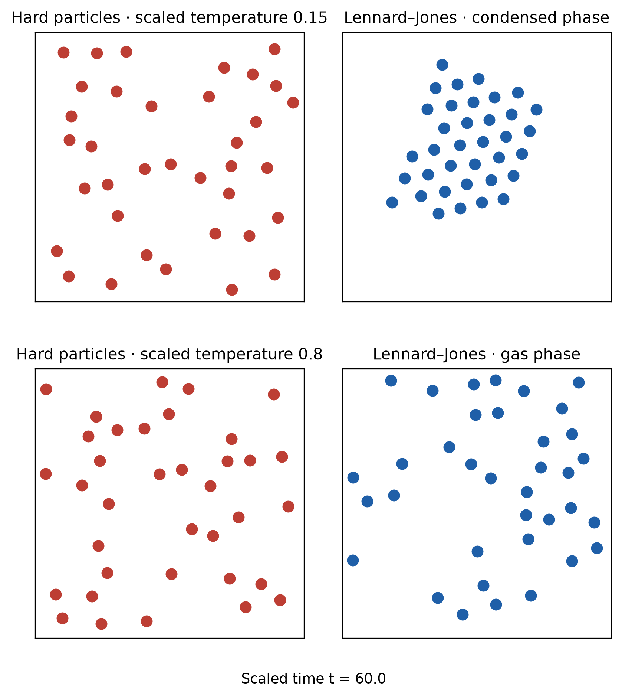
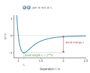
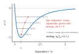
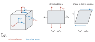
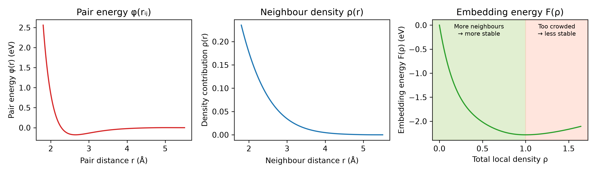
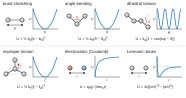
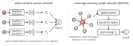
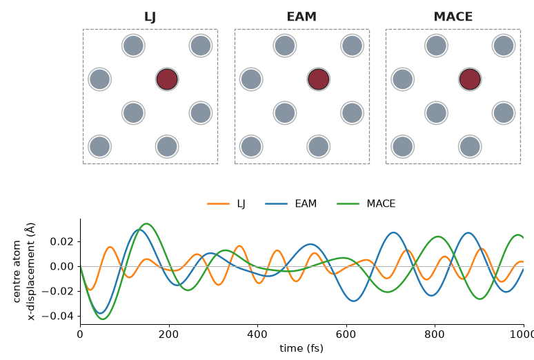
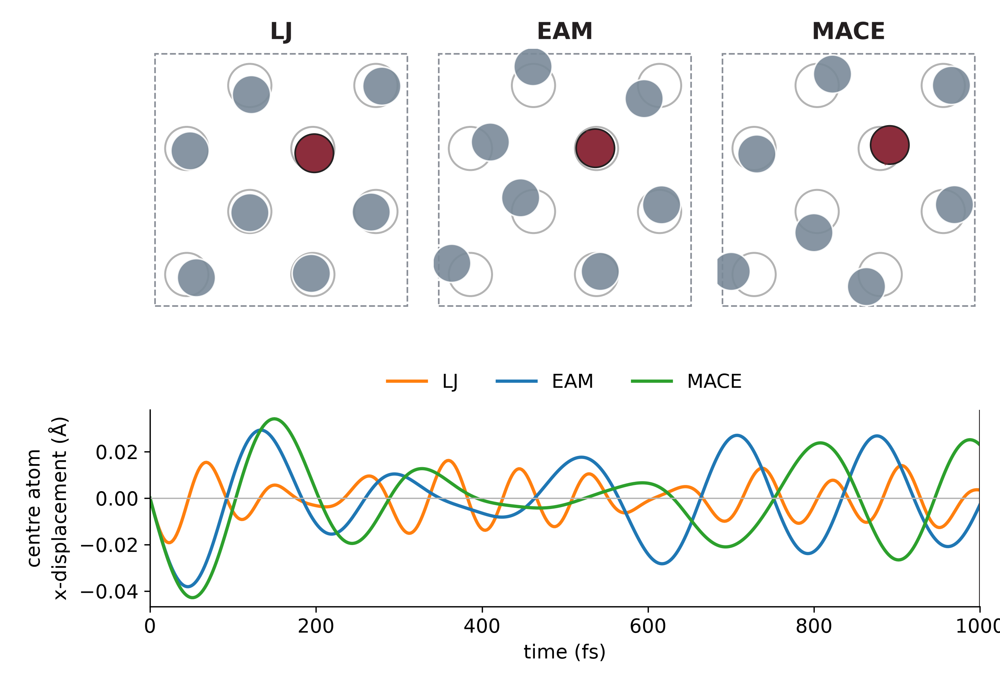

::: {.callout-note}
## Central question

How does the choice of potential affect MD results? Can one potential accurately describe many different materials?
:::

## Sources of error in MD

- **Truncation error:** velocity Verlet has global error \(O(\Delta t^2)\). Stability depends on the forces and time step.
- **Roundoff error:** finite precision limits accuracy. Float64 reduces roundoff. Mixed-precision GPU runs trade precision for speed.
- **Modelling error:** the potential may give incorrect material properties even with accurate integration.

### The potential defines the simulated material

The force in Newton's equation comes from a potential energy:

\[
m_i\frac{\mathrm d^2\mathbf x_i}{\mathrm dt^2}
=-\nabla_i E(\mathbf x_1,\ldots,\mathbf x_N).
\]

Electronic-structure calculations estimate this energy from electrons and nuclei. Repeating them at every time step is expensive, so we use an interatomic potential as a faster approximation.

## Stage 1 · Packing atoms as hard spheres

Bernal studied liquid packing with ball-and-spoke and ball-bearing models. Each ball represents the space occupied by an atom, without electrons or attraction [@bernal1959geometrical; @finney2013bernal].

![J. D. Bernal with one of his ball-and-spoke models of a liquid [@finney2013bernal].](../../../assets/L26-bernal-model.gif){#fig-bernal width="42%" fig-align="center" fig-alt="Black-and-white photograph of J. D. Bernal adjusting a large ball-and-spoke model of a disordered liquid."}

In this [demonstration](https://www.youtube.com/watch?v=vf5jtsgtYC4), shaking and airflow make table-tennis balls vibrate, exchange neighbours, and move freely.

::: {.content-visible when-format="html"}

:::

The **hard-sphere potential** forbids overlap between spheres of diameter \(d\):

\[
\boxed{
U_{\mathrm{HS}}(r)=
\begin{cases}
\infty,&r<d,\\
0,&r\geq d.
\end{cases}
}
\]

The related **Sutherland potential** adds an attractive tail outside the hard wall [@sutherland1893viscosity].

Alder and Wainwright introduced hard-sphere MD in 1957–1959. Particles travel in straight lines between elastic collisions, which conserve momentum and kinetic energy [@alder1957phase; @alder1959molecular].

{#fig-hard-sphere width="85%" fig-align="center" fig-alt="Energy against separation. A black hard-sphere wall at r equals sigma, a blue Sutherland curve with the same wall plus an attractive tail, grey dashed curves for repulsive powers 24 and 48, and the red Lennard-Jones curve with power 12."}

- **Hard spheres:** the interaction is an exclusion rule. Event-driven MD advances from collision to collision.
- **Lennard–Jones particles:** a continuous potential supplies forces as the particles move. A time-stepping method integrates their motion.

::: {.content-visible when-format="html"}
{#fig-lattice-movie width="100%"}
:::

::: {.content-visible unless-format="html"}
{width="100%"}
:::

In the low-temperature panels, Lennard–Jones attraction holds particles together. Hard particles interact only through collisions.

## Stage 2 · Pairwise potentials from physical intuition

A **pair potential** assigns an energy to the separation of two atoms. Most pair potentials contain two parts:

- **Repulsion** at short range keeps atoms from collapsing onto one another.
- **Attraction** at longer range allows a bound state.

The Lennard–Jones 12-6 potential combines these terms [@davies1924molecular]:

\[
\boxed{
\begin{aligned}
U(r)&=4\varepsilon\left[\left(\frac{\sigma}{r}\right)^{12}
-\left(\frac{\sigma}{r}\right)^6\right],\\
F_r(r)&=-U'(r)=\frac{24\varepsilon}{r}
\left[2\left(\frac{\sigma}{r}\right)^{12}
-\left(\frac{\sigma}{r}\right)^6\right].
\end{aligned}
}
\]

- \(\varepsilon\) sets the well depth.
- \(\sigma\) is the separation where \(U=0\).
- Positive \(F_r\) pushes the atoms apart. Negative \(F_r\) pulls them together.

For three atoms the pair energy is \(E=\phi(r_{12})+\phi(r_{13})+\phi(r_{23})\). For many atoms, we write the same operation as

\[
E=\sum_{i<j}\phi(r_{ij}).
\]

The restriction \(i<j\) counts each pair once.

::::: {.scientist-method-inline}
::: {.scientist-method-text}
Pair potentials describe many properties of simple, nearly spherical atoms, as in Aneesur Rahman's simulation of liquid argon [@rahman1964correlations].
:::
:::: {.scientist-portraits}
::: {.scientist-portrait}
{width="78" fig-alt="Portrait of Aneesur Rahman"}

**Aneesur Rahman**

[MarzMehter](https://commons.wikimedia.org/wiki/File:Aneesur_Rahman_edited.jpg) · [CC BY-SA 4.0](https://creativecommons.org/licenses/by-sa/4.0/)
:::
::::
:::::

The **Morse potential** uses exponential terms to describe bond stretching, with a steep repulsive side and a broader attractive well [@morse1929diatomic].

### Reading the pair curve

#### 1 · The potential: bond energy and bond length {.curve-reading}

- **Bond energy \(\varepsilon\):** the depth of the well below the separated-atom energy, \(U(r_0)=-\varepsilon\).
- **Bond length \(r_0\):** the position of the minimum, \(r_0=2^{1/6}\sigma\approx1.12\sigma\).

{#fig-read-potential width="70%" fig-align="center" fig-alt="Lennard-Jones curve with a red arrow for the well depth epsilon and a green marker at the minimum r0, above a sketch of two atoms at rest at r0."}

#### 2 · The first derivative: maximum restoring force {.curve-reading}

- **Equilibrium:** \(U'(r_0)=0\), so the pair feels no net force at \(r_0\).
- **Maximum restoring force:** the peak of \(U'\), at the inflection point \(r_{\mathrm{infl}}=(26/7)^{1/6}\sigma\approx1.24\sigma\), where \(F_{\max}\approx2.40\,\varepsilon/\sigma\).
- **Applied pull:** beyond the inflection point, the restoring force weakens. A sustained pull above \(F_{\max}\) separates the atoms.

{#fig-read-force width="70%" fig-align="center" fig-alt="First derivative of the Lennard-Jones potential with its zero at r0 near 1.12 sigma and its maximum of 2.40 epsilon per sigma at the inflection point near 1.24 sigma."}

We use velocity Verlet to follow the [L24 two-atom pair](../../../wasm-local/l24_two_atom_md.html) under a slowly increasing pull. The pair stretches while the forces nearly balance, then separates when the pull exceeds the maximum of \(U'(r)\).

::: {.content-visible when-format="html"}
{#fig-pull-pair width="70%" fig-align="center"}
:::

::: {.content-visible unless-format="html"}
{width="70%" fig-align="center"}
:::

Without an external pull, the pair can stretch beyond \(r_{\mathrm{infl}}\) and turn back. Escape requires enough initial energy to reach \(U=0\) from the minimum \(U=-\varepsilon\). A cluster shares added energy among many bonds and vibrations. In the L24 notebook, how much energy per atom is needed to break apart \(N=2\) and \(N=13\)?

::: {.content-visible when-format="html"}
:::: {.quarto-wasm-local notebook="l24_cluster_velocity_verlet.edit.py" view="app" title="Velocity-Verlet cluster from L24: energy needed to break N = 2 and N = 13" height="850" loading="lazy" fullscreen="true"}
::::
:::

::: {.content-visible unless-format="html"}
In the L24 cluster notebook, two atoms with 0.7 ε of added energy per atom end far apart with \(U\approx0\) and \(E=+0.4\,\varepsilon\). Thirteen atoms with the same setting stay together as a hot cluster.
:::

::: {.callout-note collapse="true"}
## Why the 13-atom cluster needs more energy per atom than the pair

The pair escapes above 0.5 ε per atom, when its total energy becomes positive. At 0.2 ε per atom, it passes \(r_{\mathrm{infl}}\approx1.24\sigma\) and turns back. The 13-atom icosahedron stays intact at 0.7 ε per atom and loses atoms between 1.0 and 1.5 ε per atom.

- **More bonds:** the cluster has 42 nearest-neighbour bonds and a binding energy of \(44.3\,\varepsilon\), or \(3.4\,\varepsilon\) per atom. The dimer has \(0.5\,\varepsilon\) per atom. Removing a surface atom breaks several bonds and costs about \(6.4\,\varepsilon\).
- **Shared energy:** energy spreads over \(3N-6=33\) vibrational modes. Roughly half becomes potential energy, so an individual pair seldom receives enough to separate.
- **Temperature:** near the minimum, each atom stores about \(3k_BT\): kinetic \(\tfrac32k_BT\) and a similar potential share. At 0.7 ε per atom, the cluster has \(k_BT\approx0.25\,\varepsilon\), below the bulk melting estimate \(k_BT_m\approx0.7\,\varepsilon\) in @fig-read-thermal.
:::

#### 3 · The second derivative: bond stiffness {.curve-reading}

- **Bond stiffness:** \(k=U''(r_0)\approx57\,\varepsilon/\sigma^2\).
- **Curvature:** near \(r_0\) the well looks like a spring, \(U\approx-\varepsilon+\tfrac12k(r-r_0)^2\). A sharper well means a stiffer bond.
- **Inflection:** \(U''=0\) at \(r_{\mathrm{infl}}\), the same point as the force maximum.

{#fig-read-stiffness width="70%" fig-align="center" fig-alt="Second derivative of the Lennard-Jones potential with the value at r0 marked as the stiffness, and an inset showing the potential near its minimum overlaid with a dashed parabola."}

#### 4 · Thermal expansion and melting {.curve-reading}

- **Thermal expansion \(\alpha\):** the compressed side of the well is steeper. As vibration energy rises, the energy-level midpoints shift outward, indicating an increasing mean bond length.
- **Melting point:** the well depth sets a thermal-energy scale. For bulk Lennard–Jones near the triple point, \(k_BT_m\approx0.7\,\varepsilon\) [@agrawal1995melting].

{#fig-read-thermal width="70%" fig-align="center" fig-alt="Lennard-Jones well with four horizontal energy levels; red dots at the midpoint of each level drift to larger separation as energy increases."}

The pair curve sets the energy scale. Collective motion, crystal structure, and pressure also affect expansion and melting.

### Worked case · Stiffness in Assignment 4

Central differences of the Cu–Cu energy data in [Assignment 4, Problem 2](../../../assignments/A4/index.qmd) give force and stiffness. At \(r=2.5\) Å, \(k\approx4.80\ \mathrm{eV/\mathring A^2}\), compared with the exact \(4.765\ \mathrm{eV/\mathring A^2}\).

{#fig-a4-stiffness width="70%" fig-align="center" fig-alt="Three stacked panels for a Cu-Cu bond: energy, force, and stiffness versus separation, with finite-difference points lying on the exact derivative values."}

### Pair-model predictions for metals

A pair potential assigns the same pair energy at a given separation in every environment. In metals, changing the neighbours redistributes the shared electrons.

#### Cohesive energy and vacancy formation energy

**Cohesive energy** \(E_{\mathrm{coh}}\) is the energy per atom needed to separate a bulk crystal into isolated atoms. A **vacancy** is an unoccupied lattice site. Its formation energy is the cost of removing the atom to a bulk reservoir of the same material:

\[
E_{\mathrm{vac}}=E_{N-1}^{\mathrm{defect}}
-\frac{N-1}{N}E_N^{\mathrm{perfect}}.
\]

- **Pair potential, unrelaxed monatomic crystal:** removing an atom breaks its pair interactions. For a fixed, environment-independent pair potential, keeping the other atoms and cell fixed gives \(E_{\mathrm{vac}}/E_{\mathrm{coh}}=1\) under the bulk reservoir convention.
- **Real metals:** vacancy formation costs roughly one-third of the cohesive energy, \(E_{\mathrm{vac}}\approx\tfrac13E_{\mathrm{coh}}\), with the ratio varying between metals.

::: {.table-responsive}

| Metal | \(E_{\mathrm{coh}}\) (eV/atom) | \(E_{\mathrm{vac}}\) (eV) | \(E_{\mathrm{vac}}/E_{\mathrm{coh}}\) |
|:--|--:|--:|--:|
| Cu | 3.54 | 1.3 | 0.37 |
| Ag | 2.85 | 1.1 | 0.39 |
| Au | 3.93 | 0.9 | 0.23 |
| Ni | 4.45 | 1.6 | 0.36 |
| Pt | 5.77 | 1.5 | 0.26 |

: Experimental FCC cohesive and vacancy formation energies, compiled by Foiles, Baskes, and Daw [-@foiles1986embedded, Table II]. {#tbl-vac-coh}

:::

Electron redistribution changes the remaining bonds even at fixed separation, an effect absent from the pair model. Atomic relaxation also changes the pair-model vacancy energy, so the ratio of one applies to the unrelaxed crystal.

#### Elastic constants

Stress is force per unit area. Three force components on each of three face orientations form the **stress tensor**:

\[
\boldsymbol{\sigma}=
\begin{bmatrix}
\sigma_{xx} & \sigma_{xy} & \sigma_{xz}\\
\sigma_{yx} & \sigma_{yy} & \sigma_{yz}\\
\sigma_{zx} & \sigma_{zy} & \sigma_{zz}
\end{bmatrix}.
\]

- **First subscript:** face-normal direction.
- **Second subscript:** force direction.
- **Diagonal entries** (\(\sigma_{xx},\sigma_{yy},\sigma_{zz}\)): normal stresses across a face.
- **Off-diagonal entries:** shear stresses along a face. Angular-momentum balance gives symmetry, \(\sigma_{xy}=\sigma_{yx}\), leaving six independent components.

{#fig-stress-tensor width="90%" fig-align="center" fig-alt="A cube with normal stress arrows in red and shear stress arrows in blue on three faces, a rectangle stretched along x with vertical stress arrows labelled C12, and a sheared parallelogram with shear arrows labelled C44."}

A cubic crystal has three independent **elastic constants** relating small strains to stresses:

\[
\begin{bmatrix}
\sigma_{xx}\\ \sigma_{yy}\\ \sigma_{zz}\\ \sigma_{yz}\\ \sigma_{xz}\\ \sigma_{xy}
\end{bmatrix}
=
\begin{bmatrix}
C_{11} & C_{12} & C_{12} & 0 & 0 & 0\\
C_{12} & C_{11} & C_{12} & 0 & 0 & 0\\
C_{12} & C_{12} & C_{11} & 0 & 0 & 0\\
0 & 0 & 0 & C_{44} & 0 & 0\\
0 & 0 & 0 & 0 & C_{44} & 0\\
0 & 0 & 0 & 0 & 0 & C_{44}
\end{bmatrix}
\begin{bmatrix}
\varepsilon_{xx}\\ \varepsilon_{yy}\\ \varepsilon_{zz}\\ \gamma_{yz}\\ \gamma_{xz}\\ \gamma_{xy}
\end{bmatrix}.
\]

- \(C_{11}\): normal stress along a direction caused by stretching along the same direction.
- \(C_{12}\): normal stress in one direction caused by stretching along another, \(\sigma_{yy}=C_{12}\,\varepsilon_{xx}\).
- \(C_{44}\): shear stress caused by a shear strain, \(\sigma_{xy}=C_{44}\,\gamma_{xy}\).

Pair forces act along the line between atoms. For a cubic crystal at zero pressure, with no internal atomic relaxation, \(C_{12}\) and \(C_{44}\) come from the same spring sum. This gives the **Cauchy relation**, \(C_{12}=C_{44}\) [@daw1984embedded].

Real metals break this rule. Copper has \(C_{12}\approx121\) GPa but \(C_{44}\approx76\) GPa [@mishin2001cu]. The difference comes from the shared electrons:

- **Sideways stretch (\(C_{12}\)):** volume and electron density change, adding an electronic contribution to stress.
- **Shear (\(C_{44}\)):** shape changes at fixed volume, with little density change.

Changing pair parameters preserves this equality for a zero-pressure, unrelaxed crystal.

### Many-body energies in the electron sea

Effective medium theory (**EMT**) and the embedded atom method (**EAM**) describe metallic ion cores in a shared electron distribution. Their energies depend on the surrounding atoms [@norskov1980effective; @daw1984embedded].

::: {.table-responsive}

| Effective medium theory | Embedded atom method |
|:--|:--|
| Jens K. Nørskov and N. David Lang, 1980 | Murray S. Daw and Michael I. Baskes, 1984 |
| Describes an atom in an effective electronic environment | Adds an embedding energy to a pair-energy sum |

:::

The group project uses EAM for copper. We keep the pair-energy sum and add an embedding energy for each atom:

\[
\boxed{
\begin{aligned}
E&=\sum_{i<j}\phi(r_{ij})+\sum_i F_{\mathrm{emb}}(\rho_i),\\
\rho_i&=f(r_{i1})+f(r_{i2})+\cdots
=\sum_{j\ne i}f(r_{ij}).
\end{aligned}
}
\]

Here \(f(r_{ij})\) is the density contribution of neighbour \(j\) at atom \(i\). The function \(F_{\mathrm{emb}}\) converts the total local density into an embedding energy. The subscript distinguishes this energy function from the radial force.

- **Isolated atom:** no neighbours contribute, so \(\rho_i=0\).
- **Perfect crystal:** equivalent sites have the same density.
- **Vacancy or surface:** missing neighbours usually lower the local density.
- **Interstitial or compression:** additional nearby atoms can raise the density.

{#fig-eam-functions width="100%"}

### How different is EAM from LJ?

LJ is fitted to FCC copper's lattice constant, 3.615 Å, and cohesive energy, 3.54 eV/atom, matching the project EAM [@mishin2001cu]. Each panel shows energy versus nearest-neighbour distance for one structure.

{#fig-lj-vs-eam width="100%" fig-alt="Three panels of energy per atom against nearest-neighbour distance for SC, BCC, and FCC copper. LJ and EAM agree at the FCC minimum near minus 3.54 eV, differ slightly for BCC, and differ by about 0.8 eV for SC, each with a sphere model of the unit cell."}

- **FCC (12 neighbours):** the two curves share the same minimum, because both models were fitted there.
- **BCC (8 neighbours):** EAM is lower by about 0.1 eV/atom.
- **SC (6 neighbours):** LJ loses about one-third of its binding (−2.31 eV/atom), while EAM keeps −3.11 eV/atom.

The sharper LJ minimum predicts a stiffer response to uniform expansion. Matching the equilibrium spacing and cohesive energy leaves the curvature as a further test.

## Stage 3 · Bond order and molecular force fields

For a water molecule, we need the H–O–H angle: bent and straight arrangements can have the same two O–H distances.

- **Bond order:** single, double, and triple bonds differ in length and strength. Potentials use a continuous, environment-dependent measure.
- **Bond angles:** three atoms define an angle.
- **Dihedral angles:** four atoms define the relative rotation of two planes.
- **Atom types and charges:** distinguish chemical environments within the same element.

Tersoff and Brenner potentials include bond-order and angular dependence for covalent materials. ReaxFF describes bond formation and breaking [@tersoff1988new; @brenner1990empirical; @vanduin2001reaxff]. Finnis–Sinclair describes metallic cohesion using a tight-binding approximation to the electronic energy [@finnis1984simple].

For biomolecules with fixed bonds, a **force field** combines stretching, bending, twisting, and non-bonded energies. Forces follow by differentiating the total energy [@lesar2013]:

\[
\boxed{
\begin{aligned}
U&=U_{\mathrm{intra}}+U_{\mathrm{inter}},\\
U_{\mathrm{intra}}&=U_{\mathrm{bond}}+U_{\mathrm{angle}}
+U_{\mathrm{dihedral}}+U_{\mathrm{improper}},\\
U_{\mathrm{inter}}&=U_{\mathrm{LJ}}+U_{\mathrm{Coulomb}}.
\end{aligned}
}
\]

{#fig-forcefield-terms width="100%" fig-alt="Six panels, each with an atom sketch and an energy curve: bond stretching and angle bending as parabolas, dihedral torsion as a cosine, improper torsion as a parabola, Coulomb energy as one over r, and the Lennard-Jones well."}

Improper terms maintain planarity or handedness. Non-bonded \(U_{\mathrm{inter}}\) acts within and between molecules, with exclusions or scaling for near neighbours along the bond network.

### How many parameters does a potential need?

- **Lennard–Jones:** **2 parameters**, \(\varepsilon\) and \(\sigma\).
- **EAM:** three tabulated functions, \(\phi(r)\), \(f(r)\), and \(F(\rho)\). The project bonus fits **15 coefficients**.
- **Force field for one protein:** thousands of terms, counted below for lysozyme.

Hen egg-white lysozyme (PDB 1AKI) has 129 amino acids. With hydrogens added and the AMBER ff14SB force field [@maier2015ff14], the counts are:

{#fig-lysozyme width="60%" fig-align="center" fig-alt="Atoms of the lysozyme protein drawn as coloured spheres, with a black line tracing the folded backbone."}

::: {.table-responsive}

| Energy term | Terms in lysozyme | Different parameter sets used |
|:--|--:|--:|
| Atoms (charge, \(\varepsilon\), \(\sigma\)) | 1,960 | 215 charges, 14 LJ pairs |
| Bond stretching | 1,984 | 33 |
| Angle bending | 3,547 | 41 |
| Torsions (dihedral and improper) | 6,669 | 194 |

: Force-field terms for lysozyme with AMBER ff14SB, counted with OpenMM. {#tbl-lysozyme}

:::

The thousands of terms in lysozyme reuse the parameter sets listed in the table.

## Stage 4 · Machine-learned potentials

A **machine-learned interatomic potential** (MLIP) assigns atomic energies from local environments, using coefficients fitted to quantum calculations:

- **Input:** each atom's neighbour positions within a cutoff.
- **Output:** the energy of that atom. The total energy is the sum over all atoms.
- **Forces:** the negative gradient of the total energy with respect to atomic positions.
- **Training data:** DFT energies and forces for many different structures.

Behler and Parrinello introduced neural-network potentials of this form, and MACE also uses the angles between neighbours [@behler2007generalized; @batatia2022mace].

{#fig-mlip-types width="100%" fig-alt="Left: three atoms, each passed through a descriptor box and a small neural network to an atomic energy, summed to the total energy. Right: a central atom receiving arrows from six neighbours, then boxes for updating features, repeating, and computing the atomic energy, summed to the total."}

The MACE-MP-0 medium model used below has **about 4.7 million parameters**, trained on DFT data for many elements [@batatia2025foundation].

Accuracy depends on the training environments. Independent reference calculations are especially important for:

- reactions, where bonds break and form;
- unusual charge states;
- surfaces and defects;
- strong compression.

### How does the potential change atomic vibrations?

Compare LJ, the project EAM, and MACE-MP-0 in the same **32-atom periodic FCC copper crystal**:

- **Initial state:** FCC copper with \(a=3.615\) Å and identical seeded velocities drawn at 100 K, with centre-of-mass motion removed.
- **Dynamics:** 1 ps of NVE motion with a 0.5 fs velocity-Verlet step, without a heating ramp or thermostat.
- **View:** one (001) plane of eight atoms from the periodic cell. Grey rings mark the starting sites. Displacements are drawn twelve times larger than their real size, so a 0.03 Å vibration becomes visible.

::: {.content-visible when-format="html"}
{#fig-atomic-motion width="100%"}
:::

::: {.content-visible unless-format="html"}
{width="100%"}
:::

How to read the animation:

- **LJ (orange curve):** the centre atom oscillates about twice as fast and with about half the amplitude. A stiffer energy minimum gives a stronger restoring force.
- **EAM (blue) and MACE (green):** the traces agree for the first oscillation and retain similar frequencies and amplitudes over 1 ps, consistent with similar restoring forces near this FCC structure.

## What to keep

- Truncation, roundoff, and modelling errors need separate checks.
- Energy, its first derivative, and its second derivative describe binding, force, and stiffness.
- Pair models have specific limitations for vacancy formation energies and elastic constants in metals.
- EAM introduces local-density dependence. Molecular models also need information about bonding and geometry.
- Machine-learned models use many fitted coefficients. Their accuracy depends on the training environments and must be tested against independent benchmarks.

## Check your understanding

1. Why does the unrelaxed pair-model vacancy energy equal the cohesive energy? Which assumptions are needed?
2. Two potentials have the same FCC energy minimum and equilibrium spacing. How can their elastic responses differ?
3. The three motion panels start with identical positions and velocities. Why do the atomic paths separate, and which independent material property would you use to judge the potentials?

## Closing Unit 5

Unit 5 connects initial-value problems to MD through integration, physical conditions, trajectory analysis, and interaction potentials. The group project combines these to predict material properties. The results depend on both the numerical procedure and the potential.
