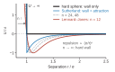
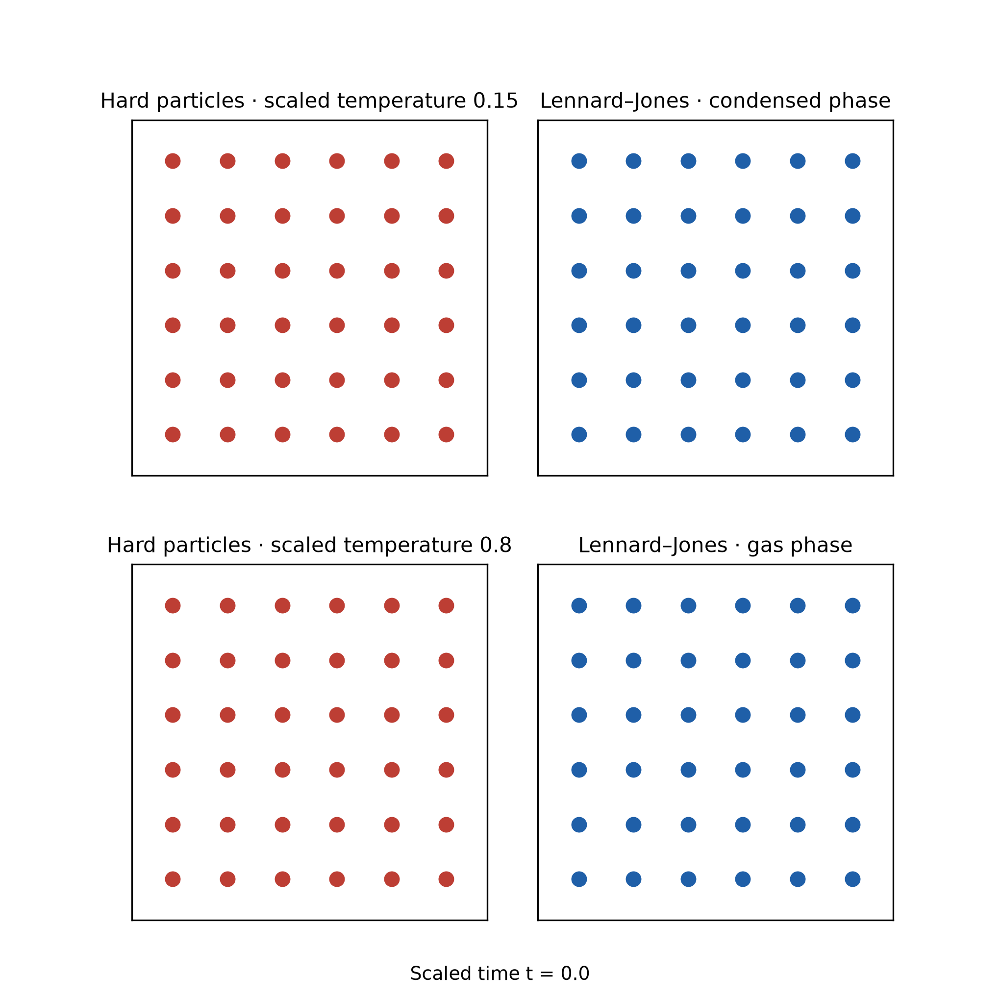
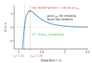
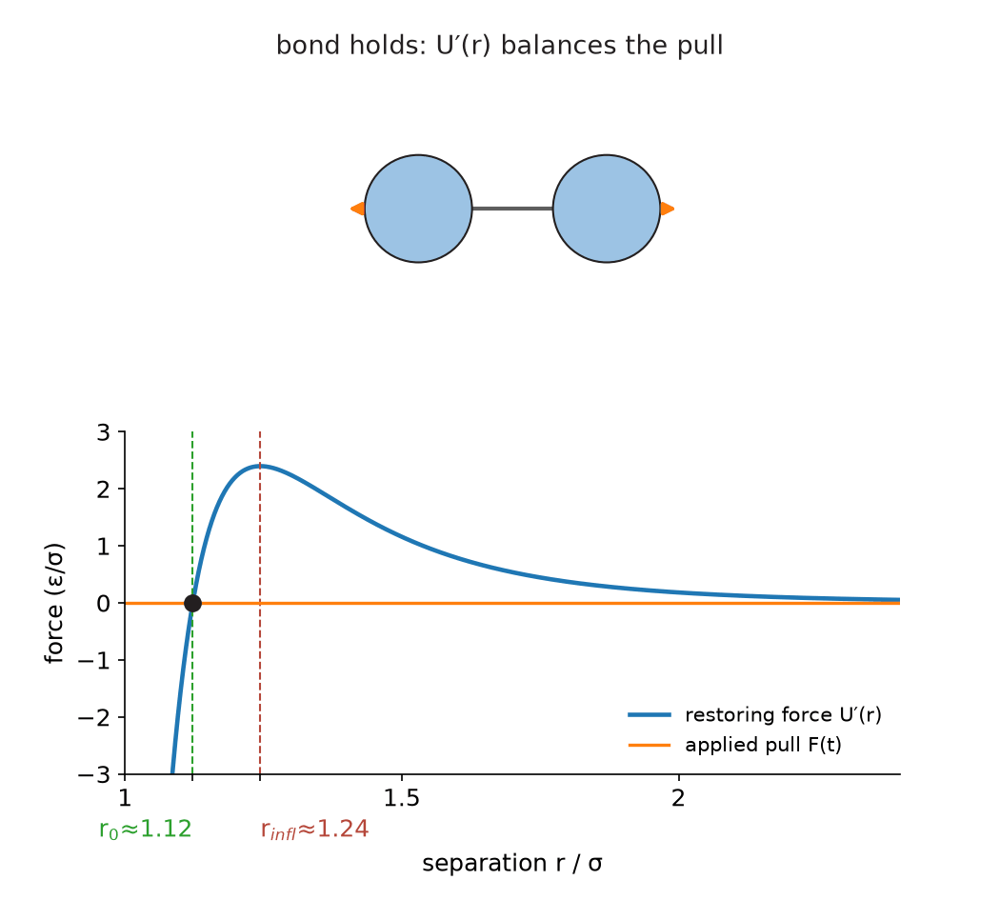
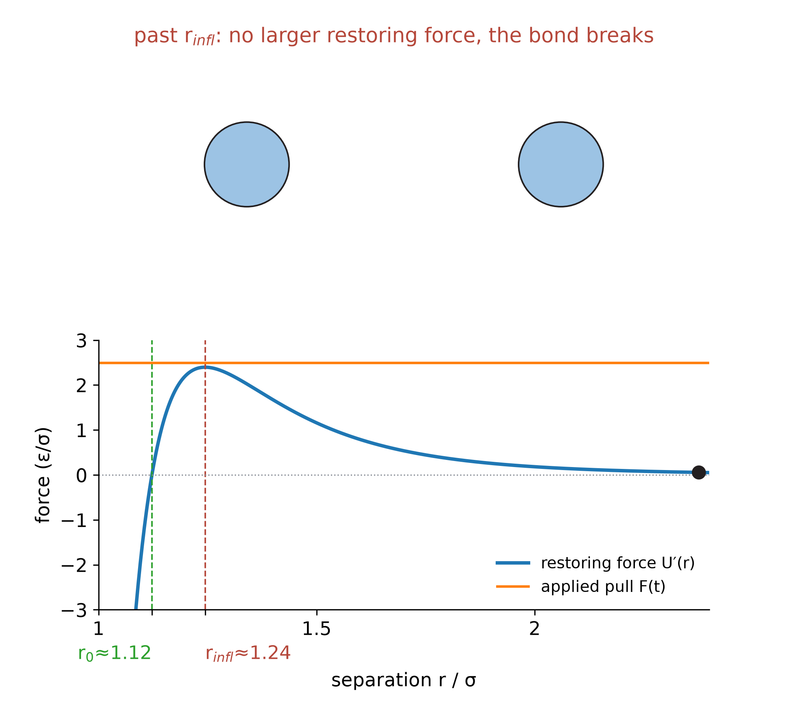
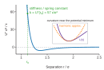
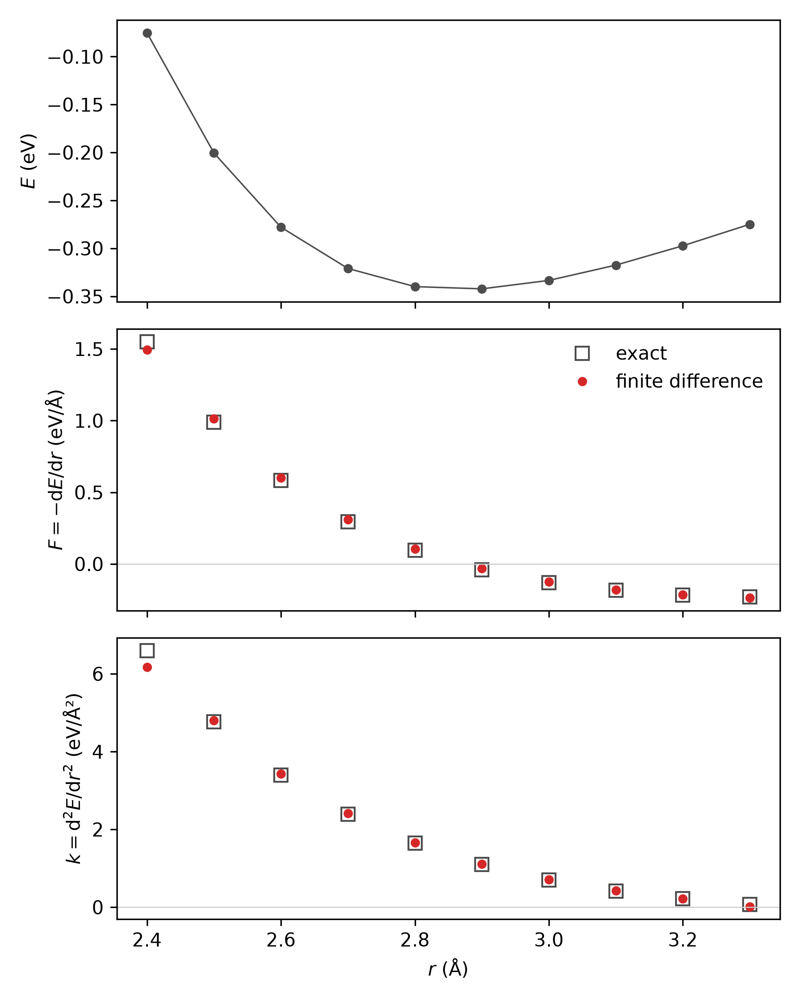
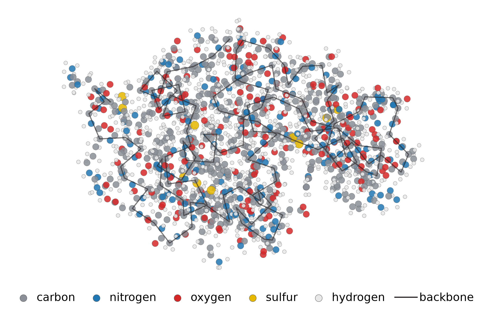

::: {.callout-note}
## Central question

How does the choice of atomistic potential affect the results of molecular dynamics simulations? Can we build a more accurate, more universal potential for a wider range of systems?
:::

## The other half of the error budget

Where do the errors in an MD result come from?

- **Truncation error ← the integrator.** Use **velocity Verlet**: global error \(O(\Delta t^2)\), stable over long runs.
- **Roundoff error ← finite precision.** Use **Float64** when possible. Mixed precision is fine for most GPU runs of large, well-behaved systems.
- **Modeling error ← the choice of potential.** A smaller time step or more digits cannot fix it. This is the subject of this lecture.

### The potential defines the simulated material

The force in Newton's equation comes from a potential energy:

\[
m_i\frac{\mathrm d^2\mathbf x_i}{\mathrm dt^2}
=-\nabla_i E(\mathbf x_1,\ldots,\mathbf x_N).
\]

Electronic-structure calculations can estimate this energy from the electrons and nuclei, but repeating an accurate quantum calculation at every time step is expensive. An interatomic potential replaces that calculation with a faster approximation. The central issue is how much of the relevant physics survives in that approximation.

We will use copper to examine three questions:

- How do we construct an interaction model?
- Which properties can each level of description reproduce?
- Which benchmarks reveal its modeling error?

## Stage 1 · Atoms before computers as hard spheres

Physical models made the structure of a liquid visible before large computer simulations were possible. Bernal built ball-and-spoke and ball-bearing models to study how dense, disordered packing differs from a crystal. Each ball represents the space occupied by an atom, with no electrons and no attraction between atoms [@bernal1959geometrical; @finney2013bernal].

![J. D. Bernal with one of his ball-and-spoke models of a liquid [@finney2013bernal].](../../../assets/L26-bernal-model.gif){#fig-bernal width="42%" fig-align="center" fig-alt="Black-and-white photograph of J. D. Bernal adjusting a large ball-and-spoke model of a disordered liquid."}

A [short physical demonstration](https://www.youtube.com/watch?v=vf5jtsgtYC4) uses table-tennis balls in a cage: gentle shaking produces vibration around fixed positions, stronger shaking lets neighbours exchange places, and an air stream produces freely moving particles.

::: {.content-visible when-format="html"}

:::

The same geometric idea leads to a **hard-sphere potential**, or the related **Sutherland potential**, which adds an attractive tail outside the hard wall [@sutherland1893viscosity]. Two spheres of diameter \(d\) can occupy any non-overlapping configuration, but overlap is forbidden:

\[
\boxed{
U_{\mathrm{HS}}(r)=
\begin{cases}
\infty,&r<d,\\
0,&r\geq d.
\end{cases}
}
\]

Alder and Wainwright used hard spheres in pioneering molecular dynamics calculations in 1957 and described the method in detail in 1959. Between collisions the particles travel in straight lines. At contact, an elastic collision changes their velocities while conserving momentum and kinetic energy [@alder1957phase; @alder1959molecular].

{#fig-hard-sphere width="85%" fig-align="center" fig-alt="Energy against separation. A black hard-sphere wall at r equals sigma, a blue Sutherland curve with the same wall plus an attractive tail, grey dashed curves for repulsive powers 24 and 48, and the red Lennard-Jones curve with power 12."}

- **Hard spheres:** the interaction is an exclusion rule. Event-driven MD advances from collision to collision.
- **Lennard–Jones particles:** a continuous potential supplies forces between collisions. A time-stepping method integrates their motion.

::: {.content-visible when-format="html"}
{#fig-lattice-movie width="100%"}
:::

::: {.content-visible unless-format="html"}
{width="100%"}
:::

As the animation shows, including attraction between the particles can significantly change the phase behaviour!

## Stage 2 · Pairwise potentials from physical intuition

A **pair potential** assigns an energy to the separation of two atoms. Most pair potentials contain two parts:

- **Repulsion** at short range keeps atoms from collapsing onto one another.
- **Attraction** at longer range allows a bound state.

The Lennard–Jones potential, the 12-6 form we have seen several times in this course, combines the two [@davies1924molecular]:

\[
\boxed{
\begin{aligned}
U(r)&=4\varepsilon\left[\left(\frac{\sigma}{r}\right)^{12}
-\left(\frac{\sigma}{r}\right)^6\right],\\
F_r(r)&=-U'(r)=\frac{24\varepsilon}{r}
\left[2\left(\frac{\sigma}{r}\right)^{12}
-\left(\frac{\sigma}{r}\right)^6\right].
\end{aligned}
}
\]

- \(\varepsilon\) sets the well depth.
- \(\sigma\) is the separation where \(U=0\).
- Positive \(F_r\) pushes the atoms apart. Negative \(F_r\) pulls them together.

For three atoms the pair energy is \(E=\phi(r_{12})+\phi(r_{13})+\phi(r_{23})\). For many atoms, we write the same operation as

\[
E=\sum_{i<j}\phi(r_{ij}).
\]

The restriction \(i<j\) counts each pair once.

::::: {.scientist-method-inline}
::: {.scientist-method-text}
This description works well for many questions about simple, nearly spherical atoms, as in Aneesur Rahman's simulation of liquid argon [@rahman1964correlations].
:::
:::: {.scientist-portraits}
::: {.scientist-portrait}
{width="78" fig-alt="Portrait of Aneesur Rahman"}

**Aneesur Rahman**

[MarzMehter](https://commons.wikimedia.org/wiki/File:Aneesur_Rahman_edited.jpg) · [CC BY-SA 4.0](https://creativecommons.org/licenses/by-sa/4.0/)
:::
::::
:::::

Another common pair curve is the **Morse potential**, which uses an exponential dependence to describe bond stretching [@morse1929diatomic].

### What each curve tells us

One pair curve and its two derivatives carry most of what a pair model knows about a bond. The four readings below use the Lennard–Jones curve in reduced units.

#### 1 · The potential: bond energy and bond length {.curve-reading}

- **Bond energy \(\varepsilon\):** the depth of the well below the separated-atom energy, \(U(r_0)=-\varepsilon\).
- **Bond length \(r_0\):** the position of the minimum, \(r_0=2^{1/6}\sigma\approx1.12\sigma\).

{#fig-read-potential width="70%" fig-align="center" fig-alt="Lennard-Jones curve with a red arrow for the well depth epsilon and a green marker at the minimum r0, above a sketch of two atoms at rest at r0."}

#### 2 · The first derivative: maximum restoring force and the point of no return {.curve-reading}

- **Equilibrium:** \(U'(r_0)=0\), so the pair feels no net force at \(r_0\).
- **Maximum restoring force:** the peak of \(U'\), at the inflection point \(r_{\mathrm{infl}}=(26/7)^{1/6}\sigma\approx1.24\sigma\), where \(F_{\max}\approx2.40\,\varepsilon/\sigma\).
- **Point of no return:** past the inflection the restoring force only weakens. A pull larger than \(F_{\max}\) separates the atoms.

{#fig-read-force width="70%" fig-align="center" fig-alt="First derivative of the Lennard-Jones potential with its zero at r0 near 1.12 sigma and its maximum of 2.40 epsilon per sigma at the inflection point near 1.24 sigma."}

The animation pulls the two atoms of the [L24 two-atom demo](../../../wasm-local/l24_two_atom_md.html) apart with a slowly increasing force, using velocity Verlet. The bond follows \(U'(r)\) until the pull reaches the peak at the inflection point. Beyond it, no larger restoring force is available and the pair separates.

::: {.content-visible when-format="html"}
{#fig-pull-pair width="70%" fig-align="center"}
:::

::: {.content-visible unless-format="html"}
{width="70%" fig-align="center"}
:::

In an MD simulation without an external pull, the energy needed to break a bond is usually higher than the energy needed just to pass the inflection point. The atoms vibrate: a stretched pair past \(r_{\mathrm{infl}}\) is still pulled back unless its total energy exceeds the well depth, and in a cluster the added energy is shared among many bonds and vibrations. Play with the cluster notebook from L24: how much energy per atom must you add to break apart \(N=2\) and \(N=13\)?

::: {.content-visible when-format="html"}
:::: {.quarto-wasm-local notebook="l24_cluster_velocity_verlet.edit.py" view="app" title="Velocity-Verlet cluster from L24: energy needed to break N = 2 and N = 13" height="850" loading="lazy" fullscreen="true"}
::::
:::

::: {.content-visible unless-format="html"}
In the L24 cluster notebook, two atoms with 0.7 ε of added energy per atom end far apart with \(U\approx0\) and \(E=+0.4\,\varepsilon\). Thirteen atoms with the same setting stay together as a hot cluster.
:::

::: {.callout-note collapse="true"}
## Why the 13-atom cluster needs more energy per atom than the pair

With two atoms, the pair separates once the added energy exceeds 0.5 ε per atom, because the total energy then exceeds the well depth \(\varepsilon\). With about 0.2 ε per atom, the pair already stretches past \(r_{\mathrm{infl}}\approx1.24\sigma\) and still turns back. At 13 atoms, 0.7 ε per atom leaves the icosahedral cluster intact, and atoms start to leave only between 1.0 and 1.5 ε per atom. Three effects explain the gap:

- **More bonds per atom:** the relaxed 13-atom cluster holds 42 nearest-neighbour bonds, so its binding energy is \(44.3\,\varepsilon\), or \(3.4\,\varepsilon\) per atom. The dimer holds only \(0.5\,\varepsilon\) per atom. Removing a single surface atom from the cluster costs about \(6.4\,\varepsilon\), because it must break several bonds at once.
- **Energy is shared among many vibrations:** the added energy spreads over \(3N-6=33\) vibrational modes. Roughly half of it ends up as potential energy, so one bond rarely receives enough at one time to escape.
- **Added energy per atom is not \(k_BT\):** near the minimum each atom stores about \(3k_BT\) (kinetic \(\tfrac32k_BT\) plus a similar potential share). The 13-atom run with 0.7 ε per atom has \(k_BT\approx0.25\,\varepsilon\), well below the bulk melting estimate \(k_BT_m\approx0.7\,\varepsilon\) in @fig-read-thermal.
:::

#### 3 · The second derivative: bond stiffness {.curve-reading}

- **Bond stiffness:** \(k=U''(r_0)\approx57\,\varepsilon/\sigma^2\).
- **Curvature:** near \(r_0\) the well looks like a spring, \(U\approx-\varepsilon+\tfrac12k(r-r_0)^2\). A sharper well means a stiffer bond.
- **Inflection:** \(U''=0\) at \(r_{\mathrm{infl}}\), the same point as the force maximum.

{#fig-read-stiffness width="70%" fig-align="center" fig-alt="Second derivative of the Lennard-Jones potential with the value at r0 marked as the stiffness, and an inset showing the potential near its minimum overlaid with a dashed parabola."}

#### 4 · Thermal expansion and melting {.curve-reading}

- **Thermal expansion \(\alpha\):** the well is steeper on the compressed side than on the stretched side. As temperature fills the well, the midpoint of each energy level moves outward, so the mean bond length grows.
- **Melting point:** melting begins when thermal energy is a fixed fraction of the bond energy. For Lennard–Jones, \(k_BT_m\approx0.7\,\varepsilon\) [@agrawal1995melting].

{#fig-read-thermal width="70%" fig-align="center" fig-alt="Lennard-Jones well with four horizontal energy levels; red dots at the midpoint of each level drift to larger separation as energy increases."}

Both properties involve many atoms moving together, so the pair curve sets their scale, while the crystal structure and pressure set the exact value.

### Worked case · Stiffness in Assignment 4

In [Assignment 4, Problem 2](../../../assignments/A4/index.qmd), you differentiated a Cu–Cu energy table with central differences to obtain the force and stiffness of the bond. At \(r=2.5\) Å the central second difference gives \(k\approx4.80\ \mathrm{eV/\mathring A^2}\), close to the supplied exact value \(4.765\ \mathrm{eV/\mathring A^2}\).

{#fig-a4-stiffness width="70%" fig-align="center" fig-alt="Three stacked panels for a Cu-Cu bond: energy, force, and stiffness versus separation, with finite-difference points lying on the exact derivative values."}

### What a pairwise potential cannot see

A pair potential gives two atoms at the same separation the same pair energy in every environment. That assumption becomes restrictive for metals, where changing the neighbours also changes the shared electron distribution.

#### Caveat 1 · Cohesive energy versus vacancy formation energy

The **cohesive energy** \(E_{\mathrm{coh}}\) is the energy needed per atom to separate a bulk crystal into isolated atoms. A **vacancy** is a missing atom at a lattice site. Its formation energy measures the cost of removing that atom and returning it to a bulk reservoir of the same material:

\[
E_{\mathrm{vac}}=E_{N-1}^{\mathrm{defect}}
-\frac{N-1}{N}E_N^{\mathrm{perfect}}.
\]

- **Pair potential, unrelaxed monatomic crystal:** removing an atom breaks its pair interactions. With the bulk reservoir convention, \(E_{\mathrm{vac}}/E_{\mathrm{coh}}=1\). This follows for a fixed, environment-independent pair potential when the remaining atoms and cell stay in place.
- **Real metals:** vacancy formation costs roughly one-third of the cohesive energy, \(E_{\mathrm{vac}}\approx\tfrac13E_{\mathrm{coh}}\), with the ratio varying between metals.

::: {.table-responsive}

| Metal | \(E_{\mathrm{coh}}\) (eV/atom) | \(E_{\mathrm{vac}}\) (eV) | \(E_{\mathrm{vac}}/E_{\mathrm{coh}}\) |
|:--|--:|--:|--:|
| Cu | 3.54 | 1.3 | 0.37 |
| Ag | 2.85 | 1.1 | 0.39 |
| Au | 3.93 | 0.9 | 0.23 |
| Ni | 4.45 | 1.6 | 0.36 |
| Pt | 5.77 | 1.5 | 0.26 |

: Experimental cohesive (sublimation) energies and vacancy formation energies of fcc metals, as compiled by Foiles, Baskes, and Daw [-@foiles1986embedded, Table II]. A pair potential gives a ratio of 1. {#tbl-vac-coh}

:::

The pair model can detect the missing bonds. What it cannot describe is the change in the remaining bonds caused by redistribution of the electrons. Atomic relaxation can change the pair-model vacancy energy, so the exact ratio of one applies to the unrelaxed calculation.

#### Caveat 2 · Elastic constants

Stress inside a solid is the force per unit area acting across a small surface. A small cube has three pairs of faces, and the force on each face can point in three directions, so stress needs nine numbers. They form the **stress tensor**:

\[
\boldsymbol{\sigma}=
\begin{bmatrix}
\sigma_{xx} & \sigma_{xy} & \sigma_{xz}\\
\sigma_{yx} & \sigma_{yy} & \sigma_{yz}\\
\sigma_{zx} & \sigma_{zy} & \sigma_{zz}
\end{bmatrix}.
\]

- **First subscript:** the face, labelled by its normal direction.
- **Second subscript:** the direction of the force on that face.
- **Diagonal entries** (\(\sigma_{xx},\sigma_{yy},\sigma_{zz}\)): normal stresses, which push or pull straight across a face.
- **Off-diagonal entries:** shear stresses, which act along a face. The cube must not spin, so \(\sigma_{xy}=\sigma_{yx}\) and only six of the nine numbers are different.

{#fig-stress-tensor width="90%" fig-align="center" fig-alt="A cube with normal stress arrows in red and shear stress arrows in blue on three faces, a rectangle stretched along x with vertical stress arrows labelled C12, and a sheared parallelogram with shear arrows labelled C44."}

**Elastic constants** connect small strains to these stresses. For a cubic crystal, symmetry leaves three independent constants. Writing the six independent stresses and strains as columns gives

\[
\begin{bmatrix}
\sigma_{xx}\\ \sigma_{yy}\\ \sigma_{zz}\\ \sigma_{yz}\\ \sigma_{xz}\\ \sigma_{xy}
\end{bmatrix}
=
\begin{bmatrix}
C_{11} & C_{12} & C_{12} & 0 & 0 & 0\\
C_{12} & C_{11} & C_{12} & 0 & 0 & 0\\
C_{12} & C_{12} & C_{11} & 0 & 0 & 0\\
0 & 0 & 0 & C_{44} & 0 & 0\\
0 & 0 & 0 & 0 & C_{44} & 0\\
0 & 0 & 0 & 0 & 0 & C_{44}
\end{bmatrix}
\begin{bmatrix}
\varepsilon_{xx}\\ \varepsilon_{yy}\\ \varepsilon_{zz}\\ \gamma_{yz}\\ \gamma_{xz}\\ \gamma_{xy}
\end{bmatrix}.
\]

- \(C_{11}\): normal stress along a direction caused by stretching along the same direction.
- \(C_{12}\): normal stress in one direction caused by stretching along another, \(\sigma_{yy}=C_{12}\,\varepsilon_{xx}\).
- \(C_{44}\): shear stress caused by a shear strain, \(\sigma_{xy}=C_{44}\,\gamma_{xy}\).

A pair model treats every bond as a spring that pulls only along the line between two atoms. When we work out \(C_{12}\) and \(C_{44}\) for such a crystal, both come from the same sum over these springs, so the model always gives the same number for both. This is the **Cauchy relation**, \(C_{12}=C_{44}\), and it holds for a cubic crystal at zero pressure when the atoms do not relax inside the cell [@daw1984embedded].

Real metals break this rule. Copper has \(C_{12}\approx121\) GPa but \(C_{44}\approx76\) GPa [@mishin2001cu]. The difference comes from the shared electrons:

- **Sideways stretch (\(C_{12}\)):** the volume changes, so the electron density changes, and the electrons add their own resistance.
- **Shear (\(C_{44}\)):** the shape changes but the volume stays the same, so the electron density barely changes.

A pair model has no electron density, so no choice of its parameters can make \(C_{12}\) larger than \(C_{44}\).

Pair potentials explain binding and local stiffness with a compact model. These two benchmarks show why metallic cohesion needs information about the surrounding atoms.

### Many-body energies in the electron sea

Metallic ion cores interact through a shared electron distribution. Removing a neighbour changes that distribution and therefore changes the energy of the atoms that remain. Effective medium theory (**EMT**) and the embedded atom method (**EAM**) include this environmental contribution [@norskov1980effective; @daw1984embedded].

::: {.table-responsive}

| Effective medium theory | Embedded atom method |
|:--|:--|
| Jens K. Nørskov and N. David Lang, 1980 | Murray S. Daw and Michael I. Baskes, 1984 |
| Describes an atom in an effective electronic environment | Adds an embedding energy to a pair-energy sum |

:::

The group project uses EAM for copper. Its energy has two parts, with the pair contribution first:

\[
\boxed{
\begin{aligned}
E&=\sum_{i<j}\phi(r_{ij})+\sum_i F_{\mathrm{emb}}(\rho_i),\\
\rho_i&=f(r_{i1})+f(r_{i2})+\cdots
=\sum_{j\ne i}f(r_{ij}).
\end{aligned}
}
\]

Here \(f(r_{ij})\) is the density contribution of neighbour \(j\) at atom \(i\). The function \(F_{\mathrm{emb}}\) converts the total local density into an embedding energy. The subscript distinguishes this energy function from the radial force.

- **Isolated atom:** no neighbours contribute, so \(\rho_i=0\).
- **Perfect crystal:** equivalent sites have the same density.
- **Vacancy or surface:** missing neighbours usually lower the local density.
- **Interstitial or compression:** additional nearby atoms can raise the density.

{#fig-eam-functions width="100%"}

### How different is EAM from LJ?

Both models below are fitted to the same FCC copper: the LJ parameters reproduce its lattice constant, 3.615 Å, and cohesive energy, 3.54 eV/atom, and the EAM is the project potential [@mishin2001cu]. Each panel puts the copper atoms on one crystal structure and changes the nearest-neighbour distance.

{#fig-lj-vs-eam width="100%" fig-alt="Three panels of energy per atom against nearest-neighbour distance for SC, BCC, and FCC copper. LJ and EAM agree at the FCC minimum near minus 3.54 eV, differ slightly for BCC, and differ by about 0.8 eV for SC, each with a sphere model of the unit cell."}

- **FCC (12 neighbours):** the two curves share the same minimum, because both models were fitted there.
- **BCC (8 neighbours):** EAM is lower by about 0.1 eV/atom.
- **SC (6 neighbours):** LJ loses about one-third of its binding (−2.31 eV/atom), while EAM keeps −3.11 eV/atom.

LJ reports copper as too stiff because it cannot capture metallic bonding.

## Stage 3 · Beyond metals, bond order and molecular force fields

A scalar local density captures useful information about a metallic environment. Molecular geometry requires more information. A water molecule, for example, has two O–H bonds and a characteristic H–O–H angle. Counting neighbours alone cannot distinguish a bent arrangement from a straight one.

- **Bond order:** chemistry distinguishes single, double, and triple bonds, with different lengths and strengths. Bond-order potentials use a continuous environment-dependent measure of bonding.
- **Bond angles:** three atoms define an angle, which helps distinguish geometries with the same coordination.
- **Dihedral angles:** four atoms define the relative rotation of two planes, important for molecular conformation.
- **Atom types and charges:** chemically different environments can give the same element different interaction parameters.

Tersoff and Brenner potentials incorporate bond-order and angular dependence for covalent materials. ReaxFF extends an environment-dependent description to bond formation and breaking [@tersoff1988new; @brenner1990empirical; @vanduin2001reaxff]. Finnis–Sinclair is another important many-body model, based on a tight-binding description of metallic cohesion, and belongs with the metallic models rather than a water force field [@finnis1984simple].

For many biomolecular simulations, the bonds are specified at the start. A **force field** combines energies for stretching, bending, twisting, and non-bonded interactions. Its forces still come from differentiating the total energy [@lesar2013]:

\[
\boxed{
\begin{aligned}
U&=U_{\mathrm{intra}}+U_{\mathrm{inter}},\\
U_{\mathrm{intra}}&=U_{\mathrm{bond}}+U_{\mathrm{angle}}
+U_{\mathrm{dihedral}}+U_{\mathrm{improper}},\\
U_{\mathrm{inter}}&=U_{\mathrm{LJ}}+U_{\mathrm{Coulomb}}.
\end{aligned}
}
\]

{#fig-forcefield-terms width="100%" fig-alt="Six panels, each with an atom sketch and an energy curve: bond stretching and angle bending as parabolas, dihedral torsion as a cosine, improper torsion as a parabola, Coulomb energy as one over r, and the Lennard-Jones well."}

The improper term can maintain planarity or a specified local handedness. Non-bonded LJ and Coulomb terms act between molecules and also between eligible atoms within a molecule, with exclusions or scaling for near neighbours along the bonded structure. Thus “inter” here labels the non-bonded contribution rather than a strict division by molecule.

### How many parameters does a potential need?

- **Lennard–Jones:** **2 parameters**, \(\varepsilon\) and \(\sigma\).
- **EAM:** three tabulated functions, \(\phi(r)\), \(f(r)\), and \(F(\rho)\). The project bonus fits **15 coefficients**.
- **Force field for one protein:** thousands of terms, counted below for lysozyme.

Hen egg-white lysozyme (PDB 1AKI) has 129 amino acids. With hydrogens added and the AMBER ff14SB force field [@maier2015ff14], the counts are:

{#fig-lysozyme width="60%" fig-align="center" fig-alt="Atoms of the lysozyme protein drawn as coloured spheres, with a black line tracing the folded backbone."}

::: {.table-responsive}

| Energy term | Terms in lysozyme | Different parameter sets used |
|:--|--:|--:|
| Atoms (charge, \(\varepsilon\), \(\sigma\)) | 1,960 | 215 charges, 14 LJ pairs |
| Bond stretching | 1,984 | 33 |
| Angle bending | 3,547 | 41 |
| Torsions (dihedral and improper) | 6,669 | 194 |

: Force-field terms for lysozyme with AMBER ff14SB, counted with OpenMM. {#tbl-lysozyme}

:::

To describe a material more realistically, the intuitive step is to give the potential more parameters: from **2** for LJ, to **15** for the project EAM, to thousands of terms for one protein. Machine-learned potentials take this step much further.

## Stage 4 · Machine-learned potentials

A **machine-learned interatomic potential** (MLIP) is fitted to energies and forces from quantum-chemistry calculations, usually DFT. Like EAM, it gives each atom an energy that depends on its neighbours:

- **Input:** the positions of the neighbours of each atom, within a cutoff.
- **Output:** the energy of that atom. The total energy is the sum over all atoms.
- **Forces:** the derivative of the total energy, as for every potential in this lecture.
- **Training data:** DFT energies and forces for many different structures.

Behler and Parrinello introduced neural-network potentials of this form, and MACE also uses the angles between neighbours [@behler2007generalized; @batatia2022mace].

{#fig-mlip-types width="100%" fig-alt="Left: three atoms, each passed through a descriptor box and a small neural network to an atomic energy, summed to the total energy. Right: a central atom receiving arrows from six neighbours, then boxes for updating features, repeating, and computing the atomic energy, summed to the total."}

The MACE-MP-0 medium model used below has **about 4.7 million parameters**, trained on DFT data for many elements [@batatia2025foundation].

The MD loop stays the same: find the neighbours, evaluate the energy, differentiate it to get the forces, and integrate the positions and velocities. A pretrained model is accurate for environments similar to its training data. Check it against reference data before using it for:

- reactions, where bonds break and form;
- unusual charge states;
- surfaces and defects;
- strong compression.

### How fast do atoms wobble under different potentials?

Start with the same **32-atom periodic FCC copper crystal**, the same lattice spacing, and the same initial velocities. Change only the interaction model: LJ, the project EAM, or MACE-MP-0.

- **Initial state:** FCC copper with \(a=3.615\) Å and identical seeded velocities drawn at 100 K, with centre-of-mass motion removed.
- **Dynamics:** 1 ps of NVE motion with a 0.5 fs velocity-Verlet step. No heating ramp or thermostat.
- **View:** one (001) plane of eight atoms from the periodic cell. Grey rings mark the starting sites. Displacements are drawn twelve times larger than their real size, so a 0.03 Å vibration becomes visible.

::: {.content-visible when-format="html"}
{#fig-atomic-motion width="100%"}
:::

::: {.content-visible unless-format="html"}
{width="100%"}
:::

How to read the animation:

- **Same start:** in each panel the atoms leave the same sites with the same velocities.
- **LJ (orange curve):** the centre atom oscillates about twice as fast and with about half the amplitude. A stiffer energy minimum gives a stronger restoring force.
- **EAM (blue) and MACE (green):** the two traces follow each other for the first oscillation and keep a similar frequency and amplitude over 1 ps. They describe a similar copper lattice, although each was built in a different way.

## What to keep

- Truncation, roundoff, and modeling errors need separate checks.
- Energy, its first derivative, and its second derivative describe binding, force, and stiffness.
- Pair models have specific limitations for vacancy formation energies and elastic constants in metals.
- EAM introduces local-density dependence. Molecular models also need information about bonding and geometry.
- Machine-learned models expand the environments we can describe, while retaining the need for independent physical benchmarks.

## Check your understanding

1. Why does the unrelaxed pair-model vacancy energy equal the cohesive energy? Which assumptions are needed?
2. Two potentials have the same FCC energy minimum and equilibrium spacing. How can their elastic responses differ?
3. The three motion panels start with identical positions and velocities. Why do the atomic paths separate, and which independent material property would you use to judge the potentials?

## Closing Unit 5

Unit 5 connected initial-value problems to molecular dynamics: integrate the equations of motion, choose physical conditions, measure a trajectory, and assess the interaction model. In the group project, these steps come together in a material-property prediction. The reported result depends on both the numerical procedure and the potential that defines the simulated material.
