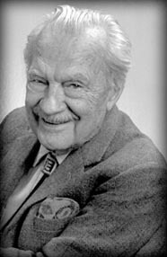
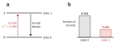

::: {.callout-note}
## Central question

How can we predict the arrangement that an alloy settles into when molecular dynamics cannot follow the atoms for long enough?
:::

## Learning outcomes

By the end of this lecture, you should be able to:

1. **Estimate** how far atomic rearrangement in a solid lies beyond the time reach of MD.
2. **Write** an equilibrium property as a Boltzmann-weighted average over configurations, and explain why it is a high-dimensional integral.
3. **Derive** the Monte Carlo estimate of an integral and its \(1/\sqrt M\) standard error.
4. **Apply** the Metropolis acceptance rule and check it against an exact two-state result.
5. **Distinguish** Monte Carlo attempts from physical time.

## Beyond the reach of molecular dynamics

In [L22](../../05/L22/index.qmd#fig-scales-wiki), we placed simulation methods on a map of length against time. Empirical MD occupies a window from nanometres to about a micrometre and from femtoseconds to about a microsecond. In [L24](../../05/L24/index.qmd)–[L26](../../05/L26/index.qmd), we worked inside that window: atomic vibrations, a heated copper particle, and diffusion in a liquid. Many materials questions lie to the right of it, at longer times, or above it, at larger lengths. This unit develops three ways to answer them:

- **Sample arrangements instead of following motion** (L27 and L28).
- **Replace atoms by a continuous composition field** (L28).
- **Improve the atomic energy that every method relies on** (L29).

Consider a solid A–B alloy annealed at 800 K. Do A and B stay mixed, or do they gather into A-rich and B-rich regions? What fraction of nearest-neighbour bonds join unlike atoms once the alloy has settled? This arrangement controls strength, conductivity, and phase stability. We have three lectures of MD behind us, so why not run MD and watch the atoms rearrange?

### How long does an atom wait before it moves?

In a crystal, an atom changes place with a neighbour mainly when a vacancy arrives beside it, and the exchange requires passing an energy barrier. Tracer measurements of copper self-diffusion between 958 and 1335 K give [@kuper1954selfdiffusion]

\[
D=0.468\ \mathrm{cm^2\,s^{-1}}\,\exp\!\left(-\frac{Q}{RT}\right),\qquad Q=47.1\ \mathrm{kcal\,mol^{-1}}\approx2.04\ \mathrm{eV}.
\]

This is the Arrhenius form from [L09](../../02/L09/index.qmd). Extrapolating about 160 K below the measured range, to 800 K, gives \(D\approx6\times10^{-18}\ \mathrm{m^2/s}\). A random walk of hops of length \(a\) in three dimensions has \(\langle R^2\rangle=6Dt\), the Einstein relation from [L25](../../05/L25/index.qmd#fitting-diffusivity-reading-material). With the nearest-neighbour distance \(a=0.256\ \mathrm{nm}\):

- **Hop rate:** \(\Gamma=6D/a^2\approx570\ \mathrm{s^{-1}}\), so each atom hops about once every 2 ms.
- **Vibrations per hop:** the Cu–Cu vibration period from L25 is 168 fs, about \(6\times10^{12}\) attempts per second. Only one attempt in roughly \(10^{10}\) succeeds.
- **Rearrangement over 5 nm:** \(t=L^2/(6D)\approx0.7\ \mathrm{s}\).

{#fig-time-scales width="100%" fig-alt="A logarithmic time axis from 1 femtosecond to 10 seconds. A blue band marks the reach of a large MD run, ending at 1 microsecond. Markers show one Cu–Cu vibration at 168 fs, one hop at about 2 ms, and rearrangement over 5 nm at about 0.7 s. A red arrow spans the gap of about one million between the MD reach and the rearrangement time."}

With a 1 fs step, 0.7 s requires about \(7\times10^{14}\) steps. The large runs discussed in [L22](../../05/L22/index.qmd) reach about \(10^9\) steps, and the billion-atom iron solidification in L25 covered 2 ns. The rearrangement lies a factor of about a million beyond a very large run. A longer time step does not help, because L25 showed that the fastest vibration limits it. In any MD run we can afford, the alloy keeps the arrangement it started with.

## Which arrangements, and how often?

The settled arrangement does not depend on the path the atoms took, how long they took, or which vacancy carried each atom. If the question concerns only the equilibrium state, we can set the motion aside and ask a question with no time in it: which arrangements does the alloy occupy at temperature \(T\), and how often?

A settled alloy still fluctuates between many arrangements, so a measured property is an average over them, each weighted by how often it occurs. Let \(\mathbf R\) be the list of all atomic positions and \(A(\mathbf R)\) the property, such as the unlike-bond fraction. For a sample in contact with a heat bath, the NVT ensemble of [L25](../../05/L25/index.qmd#ensembles-energy-temperature-and-pressure-conditions), a configuration with energy \(U(\mathbf R)\) occurs with probability proportional to its **Boltzmann weight** \(e^{-U/(k_{\mathrm B}T)}\). The average is

\[
\boxed{
\langle A\rangle
=\frac{\displaystyle\int A(\mathbf R)\,e^{-U(\mathbf R)/(k_{\mathrm B}T)}\,\mathrm d\mathbf R}
{\displaystyle\int e^{-U(\mathbf R)/(k_{\mathrm B}T)}\,\mathrm d\mathbf R}
}
\]

How to read the weights:

- **Low-energy configurations** receive large weights and dominate the average.
- **Raising \(T\)** flattens the weights, so higher-energy configurations contribute more.
- **The denominator** turns the weights into probabilities that sum to one.

How large is this integral? The symbol \(\mathrm d\mathbf R\) contains three coordinates per atom, so ten atoms give a 30-dimensional integral. The trapezoidal rule of [L19](../../04/L19/index.qmd) with ten points per coordinate would need \(10^{30}\) energy evaluations. At a million evaluations per second, that is about \(3\times10^{16}\) years. If the atoms sit on fixed lattice sites, the integral becomes a sum over arrangements, and the count is no kinder. An 8 × 8 lattice holding 32 A and 32 B atoms has

\[
\binom{64}{32}=\frac{64!}{32!\,32!}\approx1.8\times10^{18}
\]

arrangements, about 58,000 years at the same rate. Neither a grid nor a complete count is usable for a sample of 64 atoms, let alone a real alloy.

## Los Alamos, 1946: an impossible count

Physicists met the same obstacle at Los Alamos after the Second World War, and their version closely resembles ours. Designers of fission devices needed to know whether the neutrons in a device multiply or escape. A neutron starts at some position and velocity, travels, collides, scatters, causes fission, or leaves the material. Each neutron therefore has a branching history of random events, and the multiplication rate is an average over all possible histories. There are far too many to enumerate, just as there are far too many alloy arrangements.

::::: {.scientist-method-inline}
::: {.scientist-method-text}
The approach that solved it came from a card player. Stanislaw Ulam relaxed with solitaire and enjoyed poker. In 1946, while recovering from an illness, he asked what chance a game of Canfield solitaire has of coming out. Counting the card arrangements was hopeless, so he asked whether it would be more practical to lay out the cards many times and simply count the successful games [@eckhardt1987stan]. A gambler estimates the odds of a game by playing it many times, and Ulam proposed estimating the neutron average the same way.
:::
:::: {.scientist-portraits}
::: {.scientist-portrait}
{width="78" fig-alt="Wartime Los Alamos badge photograph of Stanislaw Ulam"}

**Stanislaw Ulam**

[Los Alamos badge photo](https://commons.wikimedia.org/wiki/File:Stanislaw_M._Ulam_Los_Alamos_ID.png) · Public domain
:::
::: {.scientist-portrait}
{width="78" fig-alt="Portrait of Nicholas Metropolis in later life"}

**Nicholas Metropolis**

[Los Alamos National Laboratory](https://commons.wikimedia.org/wiki/File:Nicholas_Metropolis.jpeg) · Public domain
:::
::: {.scientist-portrait}
{width="78" fig-alt="Portrait of Edward Teller in 1958"}

**Edward Teller**

[LLNL, 1958](https://commons.wikimedia.org/wiki/File:Edward_Teller_(1958)-LLNL-restored.jpg) · Public domain
:::
::::
:::::

The idea of statistical sampling was old, but it had fallen out of use because the calculations were too long and tedious to do by hand [@metropolis1987beginning]. Random reasoning has a long history:

- **Buffon** posed his needle problem in 1733 and published its solution in 1777 [@weissteinbuffon]. We repeated his experiment in [L01](../../01/L01/index.qmd#first-numerical-experiment-buffons-needle).
- **Boltzmann** explained the second law of thermodynamics through the statistics of enormous numbers of atoms. Mach and Ostwald disputed the atomic view of matter during his lifetime, and Loschmidt and Zermelo raised serious objections to his statistical arguments [@uffink2024boltzmann].
- **Enrico Fermi** used random sampling for neutron problems in Rome in the early 1930s, working with a small mechanical adding machine, and never published the method [@metropolis1987beginning].

What changed in the 1940s was the machine. ENIAC, one of the first electronic computers, could generate and process random choices far faster than any team with desk calculators. Ulam discussed the idea with John von Neumann, who in March 1947 outlined a calculation that followed many individual neutron histories through a fissile core. Nicholas Metropolis suggested the name "Monte Carlo", partly because Ulam had an uncle who would borrow money from relatives because he "just had to go to Monte Carlo" [@metropolis1987beginning]. Metropolis and Ulam described the method in 1949 [@metropolis1949monte]. Random sampling needs very many samples, and only a computer can supply them, so Monte Carlo became a method of the computer age.

## Monte Carlo integration

### Buffon's needle was already an integral

In L01, each needle throw gave a value of 1 for a crossing and 0 otherwise. The crossing fraction was the mean of those values, and it estimated the crossing probability \(2L/(\pi D)\). That probability is an integral over every needle position and angle. Throwing needles at random was therefore Monte Carlo integration: we averaged a property over random samples, and the average estimated the integral. For the alloy, each sample is an arrangement of atoms, and the property is the unlike-bond fraction.

### The estimator

Write the integral of a function \(f\) over a region of volume \(V\). The integral equals the average height of \(f\) times the volume. Drawing \(M\) points \(\mathbf X_1,\mathbf X_2,\ldots,\mathbf X_M\) uniformly in the region, the sample mean estimates that average height:

\[
\boxed{
\begin{aligned}
I&=\int_V f(\mathbf x)\,\mathrm d\mathbf x,\\
\widehat I&=V\,\frac{f(\mathbf X_1)+f(\mathbf X_2)+\cdots+f(\mathbf X_M)}{M}.
\end{aligned}
}
\]

The estimate refers to no grid, so the number of samples need not grow as \(n^d\) with dimension \(d\).

### How accurate is the estimate?

The values \(f_i=f(\mathbf X_i)\) scatter around their mean. Their standard deviation \(\sigma\) measures the spread of individual samples, and more samples do not reduce it. Their average fluctuates much less. For independent samples drawn from the same distribution, the variances of the terms add, and dividing the sum by \(M\) divides its variance by \(M^2\):

\[
\begin{aligned}
\operatorname{Var}\!\left(\frac{f_1+f_2+\cdots+f_M}{M}\right)
&=\frac{M\sigma^2}{M^2}=\frac{\sigma^2}{M},\\
\operatorname{SE}(\widehat I)
&=V\frac{\sigma}{\sqrt M}.
\end{aligned}
\]

The variance is the mean squared deviation from the mean. The **standard error** (SE) is the typical spread of the estimate if we repeated the whole calculation with new random numbers [@taylor1997error, ch. 4]. In practice, the sample standard deviation estimates \(\sigma\):

\[
s^2=\frac{(f_1-\overline f)^2+(f_2-\overline f)^2+\cdots+(f_M-\overline f)^2}{M-1}.
\]

This result explains [L02](../../01/L02/index.qmd). For needles with \(L=D\), the crossing probability is \(p=2/\pi\). Each throw has spread \(\sqrt{p(1-p)}\approx0.48\), and converting the crossing fraction into an estimate of \(\pi\) gives the error scale \(2.37/\sqrt M\) that we observed there. Halving the error needs four times as many throws.

### Does the error grow with dimension?

Take an integral whose exact answer we know:

- **Given:** \(f(\mathbf x)=x_1^2+x_2^2+\cdots+x_d^2\) on the unit cube, so \(V=1\).
- **Exact answer:** each term integrates to \(1/3\), so \(I=d/3\).
- **Spread:** each \(x_k^2\) has variance \(1/5-1/9=4/45\). The terms are independent, so \(\sigma^2=4d/45\).
- **Question:** how does the relative error depend on \(d\)?

\[
\frac{\operatorname{SE}(\widehat I)}{I}
=\frac{\sqrt{4d/45}}{d/3}\,\frac{1}{\sqrt M}
\approx\frac{0.894}{\sqrt{d}\,\sqrt M}.
\]

For this function, the relative error even decreases with \(d\), while the grid cost grows as \(n^d\). The general lesson is narrower: Monte Carlo removes the grid explosion, and its accuracy is set by \(\sigma\). The standard error describes a typical run, so a single run can land closer or farther.

::: {.quarto-wasm-local notebook="l27_monte_carlo_dimension.edit.py" title="Monte Carlo error against dimension and sample count" height="720" loading="lazy" fullscreen="true"}
**Static fallback.** For \(d=10\) and \(M=1000\), the predicted relative standard error is \(0.894/\sqrt{10\,000}\approx0.0089\). Repeated runs give a root-mean-square relative error of about 0.008–0.009, and a grid with ten points per coordinate would need \(10^{10}\) evaluations.
:::

## Why uniform samples fail for an alloy

Apply the estimator to the alloy. Draw arrangements uniformly and weight each by \(e^{-U/(k_{\mathrm B}T)}\), with energy \(\epsilon\) for every unlike bond. On the 8 × 8 lattice, a random arrangement has about 65 unlike bonds out of 128, while two separated strips have 16. At \(k_{\mathrm B}T=\epsilon\), their weights differ by a factor of

\[
e^{-(65-16)}=e^{-49}\approx5\times10^{-22}.
\]

Almost every uniform draw lands on an arrangement with negligible weight, and the rare important arrangements are almost never drawn. The weighted values have an enormous \(\sigma\), so \(\sigma/\sqrt M\) is useless.

The remedy is to choose where the samples land. If we draw points from a probability density \(q(\mathbf x)\) and divide each value by \(q\), the average still estimates the integral:

\[
\begin{aligned}
I&=\int\frac{f(\mathbf x)}{q(\mathbf x)}\,q(\mathbf x)\,\mathrm d\mathbf x,\\
\widehat I&=\frac1M\left[\frac{f(\mathbf X_1)}{q(\mathbf X_1)}+\cdots+\frac{f(\mathbf X_M)}{q(\mathbf X_M)}\right].
\end{aligned}
\]

This is **importance sampling**. For a thermal average, the ideal choice of \(q\) is the Boltzmann distribution itself. The weights then cancel, and \(\langle A\rangle\) becomes a plain mean of the sampled values of \(A\). The obstacle is the denominator of the boxed average: normalizing the Boltzmann distribution requires the very integral we wanted to avoid.

## The Metropolis rule

In 1953, Metropolis, Arianna and Marshall Rosenbluth, and Augusta and Edward Teller removed this obstacle on the Los Alamos MANIAC computer [@metropolis1953equation]. The ratio of two Boltzmann weights needs only their energy difference, so the unknown normalization cancels. They built a chain of configurations. At each step, propose a small change, such as swapping an A atom and a B atom, and accept it with probability

\[
\boxed{
a=\min\!\left(1,\ \exp\!\left[-\frac{\Delta E}{k_{\mathrm B}T}\right]\right),
\qquad \Delta E=E_{\mathrm{new}}-E_{\mathrm{old}}.
}
\]

The procedure for one attempt:

1. **Propose** a change and calculate \(\Delta E\).
2. **Downhill or level** (\(\Delta E\le0\)): accept.
3. **Uphill** (\(\Delta E>0\)): draw a uniform random number \(u\) between 0 and 1, and accept if \(u<e^{-\Delta E/(k_{\mathrm B}T)}\).
4. **Record** the current configuration, whether or not the change was accepted.

Uphill changes become less likely as \(\Delta E\) grows and more likely as \(T\) rises. Step 4 is easy to overlook, and the two-state check below shows why it matters.

### A two-state check

- **Given:** state 0 with energy 0 and state 1 with energy \(\epsilon\), at \(k_{\mathrm B}T=\epsilon\). Each attempt proposes a switch or a stay with equal probability.
- **Exact answer:** the Boltzmann fraction in state 1 is \(e^{-1}/(1+e^{-1})\approx0.269\).
- **Question:** does the Metropolis rule reproduce it?

An uphill switch is accepted with probability \(e^{-1}\approx0.368\), so a uniform draw of 0.20 accepts it, and a draw of 0.70 rejects it. A downhill switch is always accepted. At equilibrium, the probability flowing from 0 to 1 must equal the reverse flow. The equal proposal factors cancel, leaving

\[
p_0\,e^{-\epsilon/(k_{\mathrm B}T)}=p_1\cdot1,
\qquad
\frac{p_1}{p_0}=e^{-\epsilon/(k_{\mathrm B}T)},
\]

which is the Boltzmann ratio. This balance holds because the proposal is symmetric: proposing 0 → 1 is as likely as proposing 1 → 0.

{#fig-two-state width="85%" fig-alt="Panel a shows two horizontal energy levels, 0 and epsilon. A red upward arrow is labelled accept e to the minus 1 equals 0.368, and a black downward arrow is labelled accept always. Panel b shows two bars: state 0 at 0.731 and state 1 at 0.269."}

::: {.quarto-wasm-local notebook="l27_two_state_metropolis.edit.py" title="Two-state Metropolis sampling: which records to count" height="660" loading="lazy" fullscreen="true"}
**Static fallback.** With 20,000 attempts at \(k_{\mathrm B}T=\epsilon\), counting every attempt gives a state-1 fraction of about 0.27, close to the exact 0.269. Counting only accepted switches gives 0.50, because accepted switches alternate between the two states.
:::

Counting only accepted switches gives 0.5 at every temperature, because each accepted switch from 0 to 1 is followed by one from 1 to 0. The repeated records after a rejection carry the information about how long the chain stays in a low-energy state.

## Back to the alloy: what the swap gains and gives up

A Metropolis swap can exchange two distant atoms in one step, a move the real alloy never makes. That freedom is why the method reaches the settled arrangement that MD could not. It also has two costs:

- **Correlated samples.** Each configuration is built from the previous one, and rejections repeat values. The \(M\) records are therefore not independent, and \(s/\sqrt M\) understates the uncertainty. The chain also needs an initial adjustment before its records represent equilibrium.
- **No physical time.** The attempt counter measures sampling work. Equilibrium Metropolis sampling gives averages and fluctuations at fixed \(T\), and it says nothing about how fast the alloy gets there.

Both costs return in L28, where we run the swap on a lattice and measure the unlike-bond fraction.

## What to keep

- Atomic rearrangement in a solid alloy takes a million times longer than a very large MD run, as copper self-diffusion data show.
- An equilibrium property is a Boltzmann-weighted average over configurations, an integral with three coordinates per atom.
- Monte Carlo replaces the grid with random samples. Its standard error is \(\sigma/\sqrt M\), whatever the dimension.
- Uniform samples fail for Boltzmann weights. The Metropolis rule samples in proportion to those weights using only energy differences.
- Every attempt is recorded, including rejections, and attempts are not physical time.

## Check your understanding

1. Using \(D=6\times10^{-18}\ \mathrm{m^2/s}\), how long does a copper atom take to diffuse 1 nm at 800 K? How many 1 fs MD steps is that?
2. Why does the dimension of the integral not appear in the Monte Carlo standard error?
3. A Monte Carlo estimate has a standard error of 0.02 with 1,000 samples. How many samples give 0.005?
4. At \(k_{\mathrm B}T=0.5\epsilon\), what is the acceptance probability of a swap that raises the energy by \(2\epsilon\)?
5. Why must an uphill change sometimes be accepted for a correct average?

## Next

The Metropolis rule gives us a way to sample alloy arrangements, but we have not yet asked why A and B would not simply mix at random. [L28](../L28/index.qmd) runs the swap on a lattice, accelerates it with the strategies of L04, and then replaces the atoms by a composition field.
