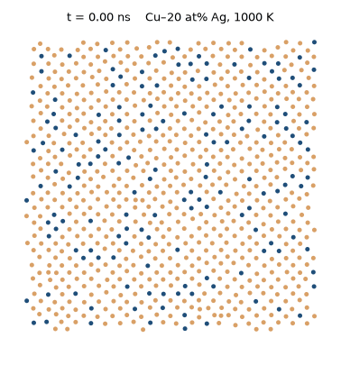
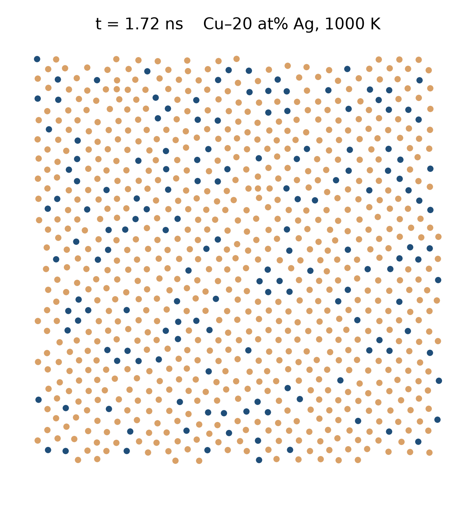
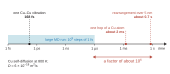
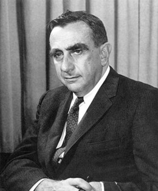
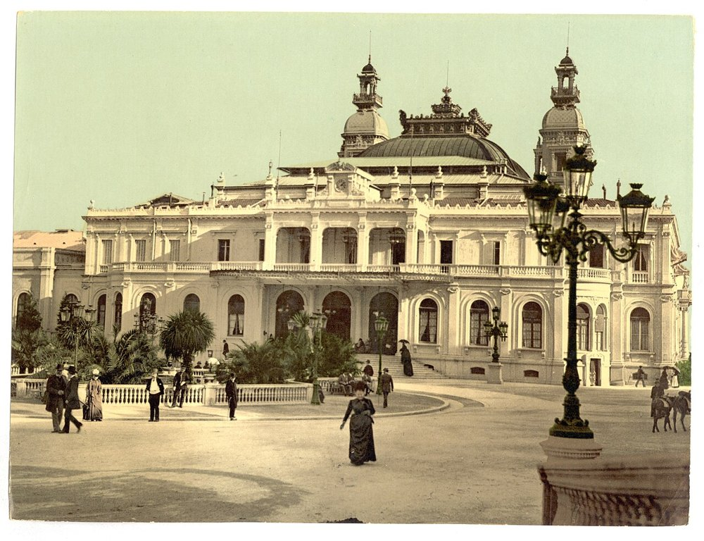
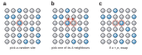

::: {.callout-note}
## Central question

A copper–silver alloy quenched from high temperature separates into Cu-rich and Ag-rich regions. Molecular dynamics already knows the forces between the atoms. Why can it not show us this separation, and what kind of simulation can?
:::

## Learning outcomes

By the end of this lecture, you should be able to:

1. **Estimate** the time an atom waits between hops in a solid, and compare it with the time an MD run covers.
2. **Explain** why simulating a random process is a way of calculating an average.
3. **Generate** random events with a given probability in NumPy, and use a seed to repeat a run.
4. **Write** a lattice Monte Carlo loop that moves atoms one attempt at a time.
5. **Measure** a diffusion coefficient from that loop, and estimate how many attempts a microstructure needs.

## The problem for this unit: a Cu–Ag alloy that will not stay mixed

Copper and silver are both fcc metals, and above about 780 °C they mix in the liquid. On cooling, they separate. The micrographs below show an Ag–Cu alloy close to the eutectic composition after directional solidification. The dark rods and plates are Cu-rich, and the bright matrix is Ag-rich. Faster growth gives a finer pattern [@xu2022cunanowires].

.](../../../assets/L27-cuag-eutectic-sem.jpg){#fig-cuag-sem width="85%" fig-alt="Three scanning electron micrographs at 10,000 times magnification. Panel a shows fine, wavy dark lamellae in a bright matrix. Panels b and c show dark rods that become smaller and more closely spaced as the growth rate increases."}

The phase diagram tells us where this happens. Below the eutectic temperature, almost every composition lies in the two-phase region \(\alpha+\beta\), where \(\alpha\) is Cu with a little Ag dissolved and \(\beta\) is Ag with a little Cu. You constructed the same kind of boundary in [Assignment 4, Problem 4](../../../assignments/A4/index.qmd#problem-4-phase-separation-in-pbsn-solder-35-marks), where a common tangent to two Gibbs-energy curves gave the compositions of the two phases in Pb–Sn solder.

{#fig-agcu-diagram width="55%" fig-alt="Phase diagram from pure Cu on the left to pure Ag on the right. A liquid region sits above two liquidus lines that meet at a eutectic point near 72 mass percent Ag and 780 degrees Celsius. Narrow alpha and beta regions hug the two edges, and alpha plus beta fills the area below the eutectic line."}

A phase diagram describes the end state. It does not say how a uniform alloy turns into two phases, how fast, or what pattern it forms on the way. These are the questions that Unit 6 answers, using the same alloy throughout:

- **L27:** why MD is too slow for this process, and how a Monte Carlo simulation moves atoms by random events.
- **L28:** how Boltzmann probabilities make Ag atoms cluster, how parallel hardware runs millions of events per second, and how the atoms become a continuous composition field.
- **L29:** where the atomic energies in all these simulations come from.

## First attempt: molecular dynamics

We already have a tool that moves atoms. In [L24](../../05/L24/index.qmd)–[L26](../../05/L26/index.qmd), MD followed atoms by integrating Newton's equations, with forces from an interatomic potential. L26 showed that an embedded-atom (EAM) potential describes metals much better than a pair potential, and an EAM potential fitted to the Cu–Ag system already exists [@williams2006embedded]. So we set up the experiment directly:

- **Starting state:** an fcc crystal of 32,000 atoms, with 20% of the sites chosen at random to hold Ag. This is a fully mixed alloy, the state right after a quench.
- **Conditions:** 1000 K and zero pressure (NPT, [L25](../../05/L25/index.qmd#npt-a-pressure-controller-changes-the-cell)). The phase diagram places Cu–20 at% Ag at this temperature well inside \(\alpha+\beta\), so the atoms should separate.
- **Engine:** LAMMPS [@thompson2022lammps] on one office GPU, with a 2 fs time step. The run advances 46 ns of simulated time per day of computing.

The animation shows a single atomic layer of the crystal for 1.7 ns, the length of the run.

::: {.content-visible when-format="html"}
{#fig-cuag-md width="60%" fig-alt="Animated square layer of atoms, light copper and dark silver, randomly mixed. The frames show small thermal jitter but the same random arrangement from the first to the last frame."}
:::

::: {.content-visible unless-format="html"}
{width="60%"}
:::

Nothing happens. The mean-squared displacement of the atoms stays between 0.25 and 0.27 Ų for the whole run. That is the size of a thermal vibration. An atom that hopped to a neighbouring site would have moved 2.6 Å, or 6.6 Ų squared. Every atom vibrates around its own site, and none has moved.

### How long would we need to wait?

Diffusion in a solid needs an atom to jump into a neighbouring vacant site over an energy barrier. Tracer measurements of copper self-diffusion between 958 and 1335 K give [@kuper1954selfdiffusion]

\[
D=0.468\ \mathrm{cm^2\,s^{-1}}\,\exp\!\left(-\frac{Q}{RT}\right),\qquad Q=47.1\ \mathrm{kcal\,mol^{-1}}\approx2.04\ \mathrm{eV}.
\]

This is the Arrhenius form from [L09](../../02/L09/index.qmd). At 1000 K it gives \(D\approx2.3\times10^{-15}\ \mathrm{m^2/s}\). We use it as the estimate for our alloy. A random walk of hops of length \(a=0.256\ \mathrm{nm}\) in three dimensions spreads as \(\langle R^2\rangle=6Dt\), the Einstein relation from [L25](../../05/L25/index.qmd#fitting-diffusivity-reading-material). The numbers follow:

- **Hop rate:** \(\Gamma=6D/a^2\approx2\times10^{5}\ \mathrm{s^{-1}}\), so each atom waits about 5 µs between hops.
- **Vibrations per hop:** a Cu–Cu vibration lasts 168 fs ([L25](../../05/L25/index.qmd#bond-vibrations-set-a-short-time-scale)). An atom vibrates about 28 million times for each successful hop.
- **Separation over 5 nm:** \(t=L^2/(6D)\approx2\ \mathrm{ms}\).

{#fig-time-scales width="100%" fig-alt="Logarithmic time axis from 1 femtosecond to 10 seconds. A blue band ends at 46 nanoseconds for one GPU day, and a grey band ends at 1 microsecond for the largest runs. Markers show one Cu–Cu vibration at 168 fs, one hop at about 5 microseconds, and rearrangement over 5 nm at about 2 milliseconds. A red arrow labelled about 40,000 GPU days spans the gap."}

At 46 ns per day, 2 ms takes about 40,000 days, more than a century of computing for a region 5 nm across. Our run of 1.7 ns covered less than a thousandth of the time between two hops of a single atom. The MD run was correct, and it answered its question: in 1.7 ns, the alloy stays mixed.

How do we reach the hops, then? MD spends almost all its effort on the 28 million vibrations that end where they started. Each vibration either ends in a hop or does not. If we treat the hop as a random event with a known probability, we can skip the vibrations and simulate only the events that change the arrangement. A simulation built from random events is called a **Monte Carlo** simulation.

## Monte Carlo: a casino and a card game

::::: {.scientist-method-inline}
::: {.scientist-method-text}
The name comes from the casino in Monaco. In 1946, the mathematician Stanislaw Ulam was recovering from an illness at home and playing solitaire. He wondered how likely a game was to come out, gave up on counting the card arrangements, and realised that laying out the cards many times and counting the successes would answer the question [@eckhardt1987stan]. At Los Alamos, he and John von Neumann applied the same idea to neutrons travelling through a fissile core, where each neutron's path is a chain of random collisions. ENIAC, one of the first electronic computers, could follow thousands of such random histories. Nicholas Metropolis suggested the name, partly because Ulam had an uncle who borrowed money from relatives because he "just had to go to Monte Carlo" [@metropolis1987beginning]. In 1953, Metropolis, the Rosenbluths, and Augusta and Edward Teller added the rule for sampling atoms at a given temperature, which we use in L28 [@metropolis1953equation].
:::
:::: {.scientist-portraits}
::: {.scientist-portrait}
{width="78" fig-alt="Wartime Los Alamos badge photograph of Stanislaw Ulam"}

**Stanislaw Ulam**

[Los Alamos badge photo](https://commons.wikimedia.org/wiki/File:Stanislaw_M._Ulam_Los_Alamos_ID.png) · Public domain
:::
::: {.scientist-portrait}
{width="78" fig-alt="Portrait of Nicholas Metropolis in later life"}

**Nicholas Metropolis**

[Los Alamos National Laboratory](https://commons.wikimedia.org/wiki/File:Nicholas_Metropolis.jpeg) · Public domain
:::
::: {.scientist-portrait}
{width="78" fig-alt="Portrait of Edward Teller in 1958"}

**Edward Teller**

[LLNL, 1958](https://commons.wikimedia.org/wiki/File:Edward_Teller_(1958)-LLNL-restored.jpg) · Public domain
:::
::::
:::::

:::: {.columns}
::: {.column width="58%"}
{#fig-casino fig-alt="Colour-tinted photograph of the ornate Monte Carlo casino building with gardens and palm trees in front."}
:::
::: {.column width="42%"}
::: {.content-visible when-format="html"}
```{=html}
<video controls playsinline preload="metadata" poster="../../../assets/L27-monte-carlo-intro-poster.jpg" width="100%" style="max-height: 480px; background: black;" aria-label="Short narrated video on the origin of the Monte Carlo method">
  <source src="../../../assets/L27-monte-carlo-intro.mp4" type="video/mp4">
  Your browser does not support embedded video. <a href="../../../assets/L27-monte-carlo-intro.mp4">Open the video directly</a>.
</video>
```
*AI-generated video (Google NotebookLM) from a course script. The people and scenes are drawn illustrations.*
:::
:::
::::

## Simulating a random process is calculating an average

We have used Monte Carlo before. In [L01](../../01/L01/index.qmd#first-numerical-experiment-buffons-needle), we dropped virtual needles on a lined floor and counted crossings. Each throw gave a value of 1 for a crossing and 0 otherwise. The crossing fraction after \(N\) throws was the average of those values,

\[
\widehat P=\frac{x_1+x_2+\cdots+x_N}{N},\qquad x_i\in\{0,1\},
\]

and it estimated the crossing probability \(2L/(\pi D)\). That probability is an integral over every possible position and angle of a needle, so the random throws were calculating an integral by averaging. In [L02](../../01/L02/index.qmd#return-to-buffons-needle), we measured how the error of such an average shrinks: the estimate of \(\pi\) had a typical error of \(2.37/\sqrt N\). In [L04](../../01/L04/index.qmd), we made the throws faster with NumPy, compiled loops, many cores, and a GPU.

The same reasoning holds for any random process we simulate:

- **One run** of the process gives one random outcome, such as a crossing or the time until a hop.
- **Many runs** give a distribution of outcomes.
- **The average** over runs estimates the expected value, and its error decreases as \(1/\sqrt N\). Four times as many runs halve the error.

A random event therefore plays the role that a time step played in MD. MD advanced the atoms by a deterministic rule, and here the next state is chosen by drawing random numbers.

## Random numbers in NumPy

A computer produces random numbers with a **pseudo-random number generator**, a deterministic algorithm whose output passes statistical tests for randomness. In NumPy, we create a generator once and draw from it:

```python
import numpy as np

rng = np.random.default_rng(374)   # 374 is the seed
u = rng.random()                   # a uniform number in [0, 1)
site = rng.integers(400)           # a whole number 0, 1, ..., 399
```

How to use these draws:

- **Seed:** the same seed reproduces the same sequence, so a run can be repeated exactly and an error can be traced. A different seed gives an independent run. In L04, parallel workers needed separate streams from `SeedSequence.spawn` for the same reason.
- **An event with probability \(p\):** draw \(u\) and let the event happen if \(u<p\). Since \(u\) is uniform, the chance that it falls below \(p\) is exactly \(p\).
- **A random choice among \(n\) options:** draw `rng.integers(n)`. Each option has probability \(1/n\).

These three lines are all we need to simulate the atom hops. Return to the vibrating atom. Each vibration ends in a hop with a small probability \(p\), so the atom keeps drawing \(u\) until \(u<p\):

```python
def vibrations_until_hop(p, rng):
    count = 0
    while True:
        count += 1
        if rng.random() < p:
            return count
```

Repeating this for many atoms gives the distribution of waiting times. The probability that the first \(k-1\) vibrations fail and the \(k\)-th succeeds is \((1-p)^{k-1}p\), and its average is \(1/p\) vibrations. For copper at 1000 K, \(p\approx3.6\times10^{-8}\), so the average wait is the 28 million vibrations we estimated from the measured diffusivity. Use the slider to watch the simulated histogram follow the exact curve, and notice how widely individual atoms differ around the average.

::: {.quarto-wasm-local notebook="l27_random_events.edit.py" title="Waiting for a hop: random events in NumPy" height="560" loading="lazy" fullscreen="true"}
**Static fallback.** With \(p=0.1\) and 1,000 atoms, the simulated waiting times form a decaying histogram that follows \((1-p)^{k-1}p\), and their average is close to the exact value of 10 vibrations. Some atoms hop on the first vibration and a few wait more than 40.
:::

## A lattice Monte Carlo, one attempt at a time

Now we build the alloy simulation. Every atom in the fcc crystal sits on a lattice site, and a hop moves it to a neighbouring site. To keep the picture small, we use a two-dimensional square lattice of \(L\times L\) sites with periodic boundaries, as in [L25](../../05/L25/index.qmd#periodic-boundary-conditions). Each site holds a Cu or an Ag atom, and a hop exchanges the atoms on two neighbouring sites. In a real crystal, the exchange happens through a vacancy. Here we let two neighbours swap directly, which keeps the composition fixed and the code short.

{#fig-lattice-attempt width="95%" fig-alt="Three 6 by 6 lattices of grey Cu and blue Ag atoms. In panel a, a red ring marks one Ag atom. In panel b, a second ring marks its Cu neighbour and a double arrow joins them. In panel c, the Ag and Cu atoms have exchanged places."}

The procedure for one attempt:

1. **Pick a site** \(i\) at random from the \(L^2\) sites.
2. **Pick a neighbour** \(j\) at random from its four neighbours.
3. **Draw** \(u\). If \(u<p\), exchange the atoms on \(i\) and \(j\).
4. **Repeat.** A **sweep** is \(L^2\) attempts, so every site is tried once on average.

Written out in pure Python, the loop has no hidden steps. The lists `x` and `y` record each atom's position without wrapping at the boundary, so we can measure how far it travels, as we did with unwrapped coordinates in L25:

```python
for sweep in range(n_sweeps):
    for attempt in range(N):                  # N = L * L attempts per sweep
        i = rng.integers(N)                   # 1. a random site
        dx, dy = steps[rng.integers(4)]       # 2. one of its four neighbours
        j = neighbour(i, dx, dy)
        if rng.random() < p:                  # 3. the hop happens with probability p
            a, b = site[i], site[j]
            site[i], site[j] = b, a           #    the two atoms exchange sites
            x[a] += dx; y[a] += dy
            x[b] -= dx; y[b] -= dy
```

The atoms in this simulation never vibrate. Every step either moves two atoms or leaves them in place, so the arrangement changes from the first sweep onward.

### What the simulation measures well: diffusion

Each accepted swap moves two atoms by one lattice spacing \(a\). An attempt therefore adds \(2a^2\) to the total squared displacement with probability \(p\), and a sweep of \(L^2\) attempts adds \(2pa^2\) per atom. In two dimensions the Einstein relation reads \(\langle R^2\rangle=4Dt\), so

\[
\boxed{
\begin{aligned}
\langle R^2\rangle&=2p\,a^2\times(\text{number of sweeps}),\\
D&=\frac{p\,a^2}{2}\ \text{per sweep}.
\end{aligned}
}
\]

Run the notebook below, fit the slope of \(\langle R^2\rangle\), and compare it with \(2p\).

::: {.quarto-wasm-local notebook="l27_lattice_hops.edit.py" title="Lattice Monte Carlo in pure Python: hops and diffusion" height="720" loading="lazy" fullscreen="true"}
**Static fallback.** On a 20 × 20 lattice with 20% Ag and \(p=0.5\), 200 sweeps give a fitted slope of 0.999 \(a^2\) per sweep against the predicted \(2p=1\), so \(D=0.25\,a^2\) per sweep. Pure Python performs about half a million attempts per second. The final lattice looks as randomly mixed as the starting one.
:::

The unit of time here is the sweep. Matching \(D\) per sweep to the measured diffusivity turns sweeps into seconds. With \(p=0.5\) and the copper values at 1000 K,

\[
t_{\text{sweep}}=\frac{p\,a^2/2}{D}=\frac{0.25\times(0.256\ \mathrm{nm})^2}{2.3\times10^{-15}\ \mathrm{m^2/s}}\approx7\ \mu\mathrm s.
\]

A single sweep already covers more time than an atom waits for a hop, a wait that MD could not reach in a day. About 260 sweeps reach the 2 ms that would take MD a century.

### Where it struggles: the whole microstructure

Look again at the lattice after the run. The Ag atoms wander but stay randomly mixed. The simulation gives no reason for Ag to prefer Ag neighbours, because the hop probability \(p\) is the same for every swap. Real Cu–Ag atoms separate because some arrangements have lower energy than others, so the probability of a swap must depend on how the swap changes the energy. That dependence is the subject of L28.

The second difficulty is size. The micrographs show features a few micrometres across. Suppose we wanted a region 1 µm × 1 µm in a single atomic layer:

- **Sites:** \((1\ \mu\mathrm m/0.256\ \mathrm{nm})^2\approx1.5\times10^{7}\).
- **Time for an atom to diffuse 1 µm:** \(t=L^2/(4D)\approx110\ \mathrm s\), or about \(1.5\times10^{7}\) sweeps.
- **Attempts:** \(1.5\times10^{7}\ \text{sites}\times1.5\times10^{7}\ \text{sweeps}\approx2\times10^{14}\).

At half a million attempts per second, the pure-Python loop needs about 13 years. The Monte Carlo method closed a gap of a factor of a million in time. Watching a whole microstructure form needs another large factor in the number of attempts per second, and the attempts must know about energy.

## What to keep

- MD follows every vibration. In a solid at 1000 K, an atom vibrates about 28 million times per hop, so one GPU day of MD does not reach a single hop.
- Monte Carlo replaces deterministic steps by random events. Averaging over random outcomes estimates an expected value, with an error that decreases as \(1/\sqrt N\).
- In NumPy, create one generator with a seed, `rng = np.random.default_rng(seed)`, and let an event with probability \(p\) happen when `rng.random() < p`.
- A lattice Monte Carlo swaps neighbouring atoms one attempt at a time. Its mean-squared displacement gives \(D=pa^2/2\) per sweep in two dimensions, which converts sweeps into seconds.
- With a constant hop probability, the alloy stays mixed, and a micrometre-scale region needs about \(10^{14}\) attempts.

## Check your understanding

1. At 1000 K, how many 2 fs MD steps does an atom need, on average, before it hops once?
2. Why does the same seed give the same Monte Carlo run? When would you want a different seed?
3. Write one line of NumPy that decides whether an event with probability 0.3 happens.
4. A lattice run with \(p=0.2\) gives a mean-squared displacement of \(40\,a^2\) after 100 sweeps. Is this consistent with \(2pa^2\) per sweep?
5. Our lattice Monte Carlo moves atoms over milliseconds, yet the Ag atoms never cluster. What is missing from the hop rule?

## Next

[L28](../L28/index.qmd) gives each swap a probability that depends on its energy change, through the Boltzmann factor. We count how many swaps a microstructure needs, run them in parallel on a GPU at more than ten million per second, and watch Cu–Ag separate in three different ways. The pattern then becomes a composition field, which carries the simulation to real lengths and times.
