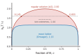
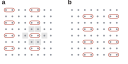
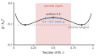

::: {.callout-note}
## Central question

The Metropolis swap reaches the settled arrangement of an alloy, one attempt at a time. How do we make it fast enough for a real microstructure, and when is it better to stop tracking atoms altogether?
:::

## Learning outcomes

By the end of this lecture, you should be able to:

1. **Calculate** the energy change of an A–B swap from its local neighbourhood.
2. **Explain** why independent Buffon throws parallelize directly while lattice swaps need non-touching update sets.
3. **Compare** serial, vectorized, and GPU versions of the same swap model by their results and their speed.
4. **Write** the Cahn–Hilliard equation for a composition field and reduce it to coupled ODEs with the L17 stencil.
5. **Choose** a stable time step, and check conservation and decreasing free energy.

## The alloy on a lattice

[L27](../L27/index.qmd) ended with an A–B alloy annealed at 800 K and a sampling rule that can reach its settled arrangement. To use that rule, we need an energy we can count. Place the atoms on a square lattice with periodic boundaries, as in [L25](../../05/L25/index.qmd#periodic-boundary-conditions):

- **Sites:** \(N_s\) fixed sites in a square grid, each with four nearest neighbours.
- **Composition:** fixed numbers of atoms, \(N_A\) and \(N_B\).
- **Energy:** each unlike nearest-neighbour bond costs \(\epsilon>0\). Like bonds cost nothing.

Counting each bond once, with \(N_{AB}\) unlike bonds,

\[
\begin{aligned}
U&=\epsilon N_{AB},\\
N_b&=\frac{4N_s}{2}=2N_s,\\
f_{AB}&=\frac{N_{AB}}{N_b}.
\end{aligned}
\]

The factor of one half avoids counting each bond from both ends. The **unlike-bond fraction** \(f_{AB}\) is the property we measure.

{#fig-lattice width="90%" fig-alt="Two square lattices of grey A atoms and blue B atoms. In panel a, A fills the left half and B the right half, and red unlike bonds appear only at the two interfaces, 16 in total. In panel b, the atoms are mixed and 64 of the 128 bonds are red."}

The strips have two interfaces of eight bonds each, so \(N_{AB}=16\). The random arrangement has 64. A random mixture has fewer unlike bonds than a checkerboard but many more than the strips, so the energy favours separation while the number of possible arrangements favours mixing. Which side wins depends on temperature, and the swap simulation answers that question for us.

::: {.callout-note collapse="true"}
## Separation temperature from two extremes, the regular solution, and the exact lattice

**Two extremes.** A random 50:50 mixture has energy \(\epsilon\) per site and mixing entropy \(k_{\mathrm B}\ln2\) per site. A fully separated alloy has almost no unlike bonds and no mixing entropy. Mixing wins when \(\epsilon-k_{\mathrm B}T\ln2<0\), that is, above \(k_{\mathrm B}T\approx1.44\epsilon\).

**Regular solution.** With B fraction \(c\) and randomly chosen neighbours, a bond is unlike with probability \(2c(1-c)\). The free energy per site is

\[
g(c)=\Omega c(1-c)+k_{\mathrm B}T\left[c\ln c+(1-c)\ln(1-c)\right],\qquad \Omega=4\epsilon,
\]

and \(g'(c)/(k_{\mathrm B}T)\) is the function \(F(x)\) of [Assignment 2, Problem 2](../../../assignments/A2/index.qmd#problem-2-fixed-point-iteration-for-a-binary-alloy-30-marks), with \(H=\Omega/(k_{\mathrm B}T)\). Two phases exist for \(H>2\), below \(k_{\mathrm B}T=2\epsilon\). At \(H=2.5\), they contain 14.5% and 85.5% B.

**Exact lattice.** Writing B as spin \(+1\) and A as \(-1\) turns the energy into the Ising model with coupling \(J=\epsilon/2\). Onsager's exact solution [@onsager1944crystal] and Yang's spontaneous magnetization [@yang1952spontaneous] place the separation at \(k_{\mathrm B}T=\epsilon/\ln(1+\sqrt2)\approx1.13\epsilon\). Real neighbours are correlated, and local clusters keep the mixed alloy stable to a lower temperature than the regular solution predicts.

{width="70%" fig-alt="Temperature over epsilon against B fraction. A red dome peaks at 2.0, with marked compositions 0.145 and 0.855 on a dashed line at 1.6. A flatter blue region peaks at 1.13. A short dashed grey line at 1.44 is labelled two extremes."}
:::

## One swap from its neighbourhood

Applying the L27 rule, we pick a site and one of its nearest neighbours and propose exchanging their atoms. Swapping two like atoms changes nothing. Swapping an A and a B keeps both atom counts fixed. The energy change depends only on the bonds around the two sites, because every other bond is untouched.

### A worked swap

- **Given:** a horizontal A–B pair. Besides each other, the A atom has three neighbours (A, A, B), and the B atom has three neighbours (B, A, A).
- **Question:** what are \(\Delta U\) and the acceptance probability at \(k_{\mathrm B}T=\epsilon\)?

The bond between the two atoms stays unlike after the exchange, so we leave it out. Before the swap, the A site has one unlike outside bond and the B site has two, a total of three. After the swap, the left site holds B among (A, A, B), giving two unlike bonds, and the right site holds A among (B, A, A), giving one. The total stays at three:

\[
\Delta U=\epsilon\,(3-3)=0,\qquad a=1.
\]

If instead the outside neighbours of the A atom were (A, A, A) and those of the B atom (B, B, B), the swap would create six unlike bonds where there were none, \(\Delta U=6\epsilon\), and at \(k_{\mathrm B}T=\epsilon\) it would be accepted with probability \(e^{-6}\approx0.0025\).

The procedure reads six neighbours and does a handful of comparisons, whatever the lattice size. Recounting all \(2N_s\) bonds after every attempt would give the same \(\Delta U\) at a cost proportional to \(N_s\). For a million sites, the local calculation is about \(10^5\) times cheaper.

## How much work does a microstructure need?

A **sweep** is \(2N_s\) swap attempts, one per bond on average. The arrangement settles only after hundreds to thousands of sweeps, so the work is large:

- **Lattice:** \(1024\times1024\approx10^6\) sites, still only about 260 nm across for copper.
- **Attempts:** \(2\times10^6\) per sweep, times 1,000 sweeps, gives \(2\times10^9\).
- **Python loop:** the serial notebook below makes about \(4\times10^5\) attempts per second, so the run takes about 1.4 hours.

This is the Buffon problem of [L04](../../01/L04/index.qmd) again: a simple calculation repeated billions of times. In L04, we accelerated Buffon's needle in four ways:

- **NumPy arrays** in place of a Python loop.
- **Just-in-time compilation** with Numba.
- **Parallel CPU cores**, each with its own random stream.
- **A GPU**, with thousands of arithmetic units working at once.

There is also a fifth option, which L04 did not need: change the algorithm or the model itself. We use both kinds of acceleration in this lecture, hardware first.

## Why swaps do not parallelize like Buffon throws

Every Buffon throw is independent, so we could hand a million throws to a million workers and add their crossing counts. Swaps are not independent. Two swaps that share a site, or that read a site the other one changes, can both compute \(\Delta U\) from the old arrangement and then write conflicting results. The atom counts may no longer add up, and the sampled distribution is no longer Boltzmann.

The way out is to update only pairs that cannot interfere. A horizontal pair at columns \(j\) and \(j+1\) reads columns \(j-1\) to \(j+2\). If we propose pairs in every fourth column and every second row at once, no pair writes a site that another pair reads. Shifting the pattern by one column at a time gives four passes, the two row offsets give eight, and the same eight for vertical pairs make sixteen passes per sweep, as illustrated in @fig-pair-sets.

{#fig-pair-sets width="85%" fig-alt="Two 8 by 8 grids of grey dots. In panel a, red rounded outlines enclose horizontal pairs in columns 0 to 1 and 4 to 5 of every second row, and six grey squares mark the neighbours of one pair. Panel b shows the same pattern shifted by two columns and one row."}

Within a pass, every selected pair applies the same local rule at the same moment, reading only the old arrangement. That is the defining structure of a **cellular automaton**: a grid of cells, each updated from its neighbourhood by one rule, all at once [@wolfram1983statistical]. Our automaton contains a random draw and the Metropolis test, so it still samples the Boltzmann distribution. The rule maps directly onto array operations in NumPy and onto a GPU, where each pixel of a texture holds one site.

::: {.quarto-wasm-local notebook="l28_serial_vs_parallel.edit.py" title="Serial swaps and parallel pair sets on the same alloy" height="720" loading="lazy" fullscreen="true"}
**Static fallback.** On a 32 × 32 lattice, the serial loop and the pair-set update give the same unlike-bond fraction within their block uncertainties: 0.313 ± 0.003 and 0.312 ± 0.001 at \(k_{\mathrm B}T=1.6\epsilon\), and 0.436 ± 0.001 and 0.437 ± 0.001 at \(4\epsilon\). On a 128 × 128 lattice, the NumPy pair-set sweep is about 16 times faster than the Python loop.
:::

Before trusting a faster code, we check that it reproduces the slower one, as we did for the Buffon versions in L04. Here the check is the same average from both methods, not the same random sequence, because the parallel version visits the pairs in a different order.

### The alloy on a GPU in the browser

The demonstration below runs the pair-set rule in WebGL. Each fragment-shader pass updates one pair set for the whole lattice, and the arrangement stays in GPU memory between frames. It is an alloy version of the liquid–vapour lattice demonstration by Vilas Winstein (UC Berkeley, [original demo](https://vilas.us/simulations/liquidvapor/)), in which sites exchange particles with a reservoir. Our sites exchange atoms with each other, so the composition stays fixed.

::: {.quarto-wasm-local notebook="l28_alloy_gpu.edit.py" view="app" title="A–B alloy swaps on the GPU (WebGL)" height="760" loading="lazy" fullscreen="true"}
**Static fallback.** On a 128 × 128 lattice at \(k_{\mathrm B}T=\epsilon\), a random 50:50 start forms interconnected A-rich and B-rich domains within a few hundred sweeps, and the unlike-bond fraction falls from 0.50 to about 0.13. At \(4\epsilon\), it settles near 0.44. A test browser without a graphics card made 8 to 16 million attempts per second, 20 to 40 times the Python loop, and a graphics card is typically much faster.
:::

How to read the demonstration:

- **High temperature:** fine-grained mixing, with \(f_{AB}\) only slightly below the random value.
- **Below about \(1.1\epsilon\):** domains form and coarsen. Larger domains have fewer interface bonds per atom.
- **Sweeps:** a sweep counts sampling work. As in L27, it is not physical time.

## Changing the model: from sites to a composition field

Hardware buys a factor of 10 to 1,000. A cubic micrometre of copper holds about \(8.5\times10^{10}\) atoms, and coarsening during an anneal continues for minutes or hours. The swap model also gives no physical time. The fifth kind of acceleration is to change what we compute.

Look at the GPU lattice from a distance. The domain pattern is clear while the individual atoms are not. Average the lattice over small blocks, and the result is a smooth **composition field** \(c(\mathbf r,t)\), the fraction of B atoms in a small region around position \(\mathbf r\) at time \(t\). A field needs one value per block in place of one per atom, and its evolution can be written as a differential equation with a physical time.

### What the field equation must contain

The equation describes the same physics as the lattice, so it needs three ingredients:

- **A free energy per site, \(g(c)\),** from the bond energies. We use the regular solution above, the free energy students solved in Assignment 2.
- **An interface cost.** Unlike bonds at a boundary raise the energy, so we add a penalty for composition gradients with coefficient \(\kappa>0\).
- **Conservation.** Swaps never change the number of B atoms, so the field can change only by moving B from one place to another.

The total free energy, with site density \(n_0\), is [@cahn1958free]

\[
F[c]=n_0\int_V\left[g(c)+\frac{\kappa}{2}|\nabla c|^2\right]\mathrm dV.
\]

{#fig-free-energy width="70%" fig-alt="A double-well curve of free energy over kT against B fraction, with minima near 0.145 and 0.855 and a shaded spinodal region between 0.276 and 0.724. A blue chord joins points at 0.4 and 0.6 below the curve's central maximum. A dashed horizontal common tangent touches both minima."}

B atoms move from regions of high **exchange chemical potential** \(\mu\) to low, where \(\mu\) is the free-energy change per exchanged atom. A flux \(\mathbf j=-\mathcal M\nabla\mu\), with mobility \(\mathcal M\ge0\), carries them, and the composition of a region changes by what flows in minus what flows out [@cahn1961spinodal]:

\[
\boxed{
\begin{aligned}
\mu&=g'(c)-\kappa\nabla^2c,\\
\frac{\partial c}{\partial t}&=\nabla\cdot\left(\mathcal M\nabla\mu\right).
\end{aligned}
}
\]

This is the **Cahn–Hilliard equation**, a description chosen to contain the three ingredients above. If the lattice sites could change identity on their own, as in Winstein's liquid–vapour demonstration, the field would not be conserved, and the corresponding description is the simpler **Allen–Cahn equation**, \(\partial_t c=-L\,\mu\), with one Laplacian instead of two [@allen1979microscopic]. For an alloy, swaps conserve composition, so we take Cahn–Hilliard.

At \(H=2.5\), \(g'(0.4)\approx+0.095\,k_{\mathrm B}T\) and \(g'(0.6)\approx-0.095\,k_{\mathrm B}T\). B flows from the B-poor region toward the B-rich one, and small composition differences grow, as the swaps showed on the lattice. The mobility gives the model a physical time once it is calibrated, for example from a measured interdiffusion coefficient.

## Solving the field equation

On a periodic grid with spacing \(h\) and constant \(\mathcal M\), we apply the five-point form of the central second difference from [L17](../../04/L17/index.qmd) twice. In one dimension it reads

\[
\begin{aligned}
\mu_i&=g'(c_i)-\kappa\,\frac{c_{i-1}-2c_i+c_{i+1}}{h^2},\\
\frac{\mathrm dc_i}{\mathrm dt}&=\mathcal M\,\frac{\mu_{i-1}-2\mu_i+\mu_{i+1}}{h^2},
\end{aligned}
\]

and in two dimensions the same differences are added in \(x\) and \(y\). These are coupled ODEs, one per grid cell, the initial-value problem of [L23](../../05/L23/index.qmd). Summing the second line over a periodic grid gives zero, so the mean composition is conserved exactly by the discretization.

### Forward Euler and its time-step limit

Forward Euler, \(c^{n+1}=c^n+\Delta t\,\dot c^n\), is the simplest choice. Each step is cheap, but applying the stencil twice makes the equation stiff. The fastest grid mode decays at a rate of about \(64\mathcal M\kappa/h^4\) in two dimensions, and forward Euler is stable only if \(\Delta t\) times that rate stays below 2:

\[
\Delta t\lesssim\frac{h^4}{32\,\mathcal M\kappa}.
\]

Halving the grid spacing forces a time step 16 times smaller. In the reduced units of the notebook (\(h=\mathcal M=\kappa=k_{\mathrm B}T=1\)), the bound is about 0.03, and the free-energy curvature near the separated compositions lowers it further. A run with \(\Delta t=0.02\) separates cleanly, while \(\Delta t=0.03\) drives compositions to 0 and 1.

### A semi-implicit step in Fourier space

The stiff part of the equation is linear: the two Laplacians acting on \(c\). If we evaluate that part at the new time and keep the logarithmic part of \(g'\) at the old time, each step requires solving a linear system. On a periodic grid, the Fourier transform turns the Laplacian into multiplication by a number for each wave, so the system separates into one simple division per mode. This **semi-implicit Fourier method** [@chen1998applications] removes the \(h^4\) limit, and accuracy alone then sets the time step.

::: {.quarto-wasm-local notebook="l28_phase_field.edit.py" title="Cahn–Hilliard with the regular-solution free energy: explicit and semi-implicit steps" height="720" loading="lazy" fullscreen="true"}
**Static fallback.** On a 128 × 128 grid at \(H=2.5\), starting from \(c=0.5\pm0.01\) and running to \(t=60\):

- **Forward Euler, \(\Delta t=0.02\):** 3,000 steps, compositions from 0.139 to 0.860.
- **Forward Euler, \(\Delta t=0.03\):** unstable, compositions reach 0 and 1.
- **Semi-implicit, \(\Delta t=1\):** 60 steps, compositions from 0.139 to 0.858, about 15 times faster.

The mean stays at 0.50000 in every stable run, and the free energy decreases at every saved step. At \(H=1.5\), the perturbation decays.
:::

Three checks tell us whether a phase-field run can be trusted:

- **Conservation:** the mean composition stays at its initial value.
- **Free energy:** \(F\) never increases, because \(\mathrm dF/\mathrm dt=-n_0\int\mathcal M|\nabla\mu|^2\,\mathrm dV\le0\).
- **Reference values:** away from interfaces, the separated regions approach the A2 compositions 0.145 and 0.855.

The semi-implicit run reproduced the explicit result with fifty times fewer steps on the same computer, a speedup comparable to moving the lattice model onto the GPU.

## Four ways to accelerate the same alloy

| Approach | What changes | Result in this lecture |
|:--|:--|:--|
| **Local \(\Delta U\)** | Read six neighbours in place of recounting all bonds | Cost per attempt independent of lattice size |
| **Parallel pair sets** | Update non-touching pairs at once, as a cellular automaton | Same averages, 16 times faster with NumPy |
| **GPU** | Run the same automaton as a WebGL shader | 8 to 16 million attempts per second in the browser |
| **Continuum model** | Replace sites by \(c(\mathbf r,t)\) and step implicitly | Physical time, large regions, 50 times fewer steps than forward Euler |

: Acceleration of the A–B alloy calculation {#tbl-accelerate .fd-table}

The first three keep the model and make the arithmetic faster. The fourth changes the model, which is often the larger gain, but it introduces parameters, \(g\), \(\kappa\), and \(\mathcal M\), that the lattice did not need.

## What to keep

- A swap's energy change depends only on the bonds around the two sites, so each attempt has a fixed cost.
- Buffon throws are independent and parallelize directly. Swaps share neighbours, so parallel updates must use non-touching pair sets, the structure of a cellular automaton.
- A faster code must reproduce the averages of the slower one before its speed means anything.
- Averaging the lattice gives a composition field. The Cahn–Hilliard equation describes its conserved evolution with a free energy, an interface cost, and a mobility.
- Forward Euler needs \(\Delta t\propto h^4\). A semi-implicit Fourier step removes that limit, while conservation and decreasing free energy check the result.

## Check your understanding

1. Recount the worked swap if the A atom's outside neighbours were (B, B, A). What are \(\Delta U\) and the acceptance probability at \(k_{\mathrm B}T=\epsilon\)?
2. Why would updating every horizontal pair at once, in place of every fourth column, sample the wrong distribution?
3. The parallel and serial codes produce different arrangements from the same seed. What should agree, and how would you test it?
4. Halving \(h\) in a forward-Euler Cahn–Hilliard run multiplies the number of grid cells by four. By what factor does the total work grow?
5. What experimental quantity could calibrate \(\mathcal M\), and why do swap sweeps not provide it?

## Next

Every parameter in this lecture had to come from somewhere: the bond energy \(\epsilon\), the free energy \(g\), the gradient coefficient \(\kappa\), and the mobility \(\mathcal M\). L29 moves inward on the multiscale map, to the electrons that determine atomic energies.
