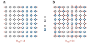
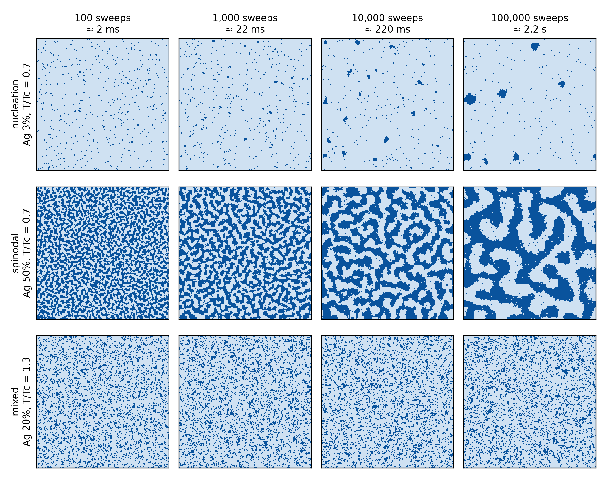
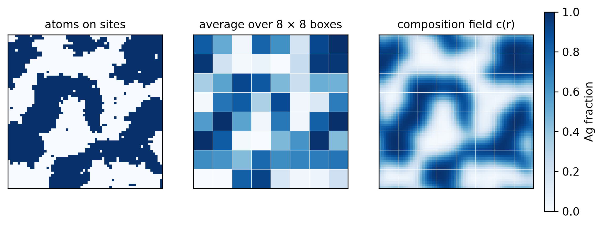

::: {.callout-note}
## Central question

In L27, our lattice Monte Carlo moved Cu and Ag atoms over milliseconds, but the alloy never separated. What rule makes the swaps prefer Ag–Ag and Cu–Cu neighbours, how fast can a computer apply it, and how do we go from atoms to a model that covers micrometres and seconds?
:::

## Learning outcomes

By the end of this lecture, you should be able to:

1. **Calculate** the energy change of a Cu–Ag swap from its neighbours, and its Boltzmann acceptance probability.
2. **Estimate** how many swap attempts a microstructure needs, and explain why parallel swaps must not touch.
3. **Identify** nucleation, spinodal decomposition, and a stable mixture from lattice simulations and the phase diagram.
4. **Construct** a phase boundary from free-energy curves with a common tangent, and explain the role of the gradient penalty.
5. **Describe** how averaging the lattice gives a composition field, and how the Allen–Cahn and Cahn–Hilliard equations evolve it in real units.

## Swaps that know about energy

L27 ended with two open problems. The swap probability \(p\) was the same for every swap, so nothing made Ag atoms gather. And a region a micrometre wide needed about \(10^{14}\) attempts. We start with the first.

### Bond energies on the lattice

Keep the square lattice of L27, with Cu and Ag atoms on its sites. In the quasi-chemical picture of a solid solution, the energy of the alloy is the sum of its nearest-neighbour bond energies, and only the difference between unlike and like bonds matters for mixing [@porter2009phase, §1.3.4]:

- **Bond types:** Cu–Cu, Ag–Ag, and Cu–Ag.
- **Mixing energy per unlike bond:** \(\epsilon=\epsilon_{\mathrm{CuAg}}-\tfrac12(\epsilon_{\mathrm{CuCu}}+\epsilon_{\mathrm{AgAg}})\).
- **Sign:** for Cu–Ag, \(\epsilon>0\), so every unlike bond raises the energy.

With \(N_{\mathrm{CuAg}}\) unlike bonds, the energy that changes during a swap is

\[
U=\epsilon\,N_{\mathrm{CuAg}}.
\]

{#fig-lattice width="90%" fig-alt="Two square lattices of grey Cu atoms and blue Ag atoms. In panel a, Cu fills the left half and Ag the right half, and red unlike bonds appear only at the two interfaces, 16 in total. In panel b, the atoms are mixed and 64 of the 128 bonds are red."}

The strips have 16 unlike bonds and the random arrangement 64, so separation lowers the energy. Mixing, on the other hand, can be done in far more ways. Temperature decides between the two.

### The Boltzmann acceptance rule

In a material at temperature \(T\), a state with energy \(U\) occurs with probability proportional to its **Boltzmann factor** \(e^{-U/(k_{\mathrm B}T)}\). Metropolis and coworkers showed in 1953 how to make a chain of random moves visit states with exactly these probabilities [@metropolis1953equation]. For a proposed swap with energy change \(\Delta E\):

\[
\boxed{
p_{\text{accept}}=\min\!\left(1,\ e^{-\Delta E/(k_{\mathrm B}T)}\right)
}
\]

How to read the rule:

- **Downhill or level** (\(\Delta E\le0\)): always accept.
- **Uphill** (\(\Delta E>0\)): accept with probability \(e^{-\Delta E/(k_{\mathrm B}T)}\), using the test \(u<p\) from L27.
- **High temperature:** uphill swaps are accepted often, and the atoms stay mixed.
- **Low temperature:** uphill swaps are rare, and swaps that create like bonds win.

The only change to the L27 loop is that \(p\) is now computed for each swap.

### A worked swap

- **Given:** a horizontal Cu–Ag pair. Apart from each other, the Cu atom has neighbours (Cu, Cu, Cu) and the Ag atom has neighbours (Ag, Ag, Ag). The temperature is \(k_{\mathrm B}T=0.79\epsilon\).
- **Question:** what are \(\Delta E\) and the acceptance probability?

The bond between the two atoms is unlike before and after the swap, so it drops out. Before the swap, both atoms sit among their own kind, with no unlike outside bonds. After the swap, the Ag atom sits among three Cu atoms and the Cu atom among three Ag atoms, which makes six unlike bonds:

\[
\Delta E=6\epsilon,\qquad p_{\text{accept}}=e^{-6/0.79}\approx5\times10^{-4}.
\]

The reverse swap has \(\Delta E=-6\epsilon\) and is always accepted. Ag atoms that meet therefore tend to stay together. The calculation reads only the six outside neighbours, so its cost does not depend on the size of the lattice.

{#fig-pair-sets width="85%" fig-alt="Two 8 by 8 grids of grey dots. In panel a, red rounded outlines enclose horizontal pairs in columns 0 to 1 and 4 to 5 of every second row, and six grey squares mark the neighbours of one pair. Panel b shows the same pattern shifted by two columns and one row."}

## How many swaps, and how fast?

Each swap is cheap, but a microstructure needs a great many. Take a single atomic layer 1 µm across:

- **Sites:** about \(1.5\times10^{7}\), so one sweep is \(3\times10^{7}\) attempts, one per bond.
- **Sweeps:** the patterns below take \(10^4\) to \(10^5\) sweeps to coarsen.
- **Attempts:** up to \(3\times10^{12}\).

The pure-Python loop of L27 managed about half a million attempts per second, which gives two months for this layer. This is the Buffon problem of [L04](../../01/L04/index.qmd) again: a short calculation repeated trillions of times. In L04, we used NumPy arrays, compiled loops, many cores, and a GPU.

There is one difference. Buffon's needles are independent, so a million workers can each throw their own. Two swaps that share a site, or that read a site the other one changes, are not independent. If both compute \(\Delta E\) from the old arrangement and then write their results, the atom counts may not add up, and the Boltzmann probabilities are lost.

The solution is to update only pairs that cannot interfere, as in @fig-pair-sets. A horizontal pair in columns \(j\) and \(j+1\) reads columns \(j-1\) to \(j+2\). Pairs in every fourth column and every second row are therefore independent, and all of them can be updated at the same moment. Four column offsets, two row offsets, and two directions give 16 such sets, and the 16 passes together make one sweep. Each pass is a single array operation, which suits NumPy and a GPU.

The 16 sets must be chosen in random order. A fixed order works like a conveyor belt: a lone Ag atom can be carried one site further in every pass and cross the lattice in a single sweep. We measured this by following isolated Ag atoms for 1,000 sweeps. With a fixed order, their mean-squared displacement reached about \(10^7\,a^2\). With a random order, it reached about \(2.7\times10^3\,a^2\), close to an ordinary random walk. The Boltzmann averages were correct in both cases, but only the random order gives sensible kinetics.

::: {.quarto-wasm-local notebook="l28_serial_vs_parallel.edit.py" title="Serial swaps and parallel pair sets on the same alloy" height="720" loading="lazy" fullscreen="true"}
**Static fallback.** On a 32 × 32 lattice, the serial loop and the pair-set update give the same unlike-bond fraction within their uncertainties: about 0.31 at \(k_{\mathrm B}T=1.6\epsilon\) and 0.44 at \(4\epsilon\). On a 128 × 128 lattice, the NumPy pair-set sweep is about 16 times faster than the Python loop.
:::

Before trusting a faster code, we compare its averages with those of the slower one, as we did for the Buffon versions in L04. The two codes visit the pairs in different orders, so their arrangements differ, but their averages agree.

### Swaps on the GPU

The notebook below runs the same pair-set rule as a WebGL shader in the browser. Each pixel of a texture holds one site, and the arrangement stays in GPU memory. The controls set the temperature as a fraction of the separation temperature \(T_c\) and the Ag fraction, and a small phase diagram marks where the chosen alloy sits. The idea follows the liquid–vapour lattice demonstration by Vilas Winstein ([original demo](https://vilas.us/simulations/liquidvapor/)), adapted so that atoms exchange with each other and the composition stays fixed.

::: {.quarto-wasm-local notebook="l28_alloy_gpu.edit.py" view="app" title="Cu–Ag swaps on the GPU (WebGL)" height="820" loading="lazy" fullscreen="true"}
**Static fallback.** A test browser without a graphics card performed about 15 million attempts per second on a 256 × 256 lattice, about 30 times the Python loop of L27. A graphics card is typically much faster. At \(T/T_c=0.7\), the Cu-rich matrix approaches the exact equilibrium value of 1.0% Ag, which the runs in @fig-regimes reach by 100,000 sweeps.
:::

### Converting sweeps to seconds

As in L27, we turn sweeps into seconds by matching diffusion. A lone Ag atom in this rule has a mean-squared displacement of about \(3.1\,a^2\) per sweep, so \(D\approx0.78\,a^2\) per sweep in two dimensions. Matching this to the copper self-diffusion coefficient at 1000 K, \(2.3\times10^{-15}\ \mathrm{m^2/s}\), gives

\[
t_{\text{sweep}}=\frac{0.78\,(0.256\ \mathrm{nm})^2}{2.3\times10^{-15}\ \mathrm{m^2/s}}\approx22\ \mu\mathrm s.
\]

This conversion is approximate. Real atoms move through vacancies, and their diffusivity changes with the local composition. It gives the order of magnitude, which is what we need to compare with experiment.

## Three ways the alloy separates

We now run the GPU rule on a 256 × 256 lattice, about 65 nm across, from a random start. The temperature is written as \(T/T_c\), where \(T_c\) is the highest temperature at which the lattice can hold two phases. For this lattice, \(k_{\mathrm B}T_c=\epsilon/\ln(1+\sqrt2)\approx1.13\epsilon\) exactly [@onsager1944crystal].

{#fig-regimes width="100%" fig-alt="A grid of twelve square snapshots. Top row: scattered dark dots that slowly gather into a few compact dark particles by 100,000 sweeps. Middle row: a fine maze of dark and light that coarsens into broad interconnected bands. Bottom row: a fine random speckle that looks the same at every time."}

How to read the three rows:

- **Nucleation (top).** At 3% Ag, the alloy lies just inside the two-phase region. Small Ag clusters form and dissolve again. Only a few grow large enough to survive, and those become compact particles that keep growing by collecting Ag from the matrix. Stable particles appear between 1,000 and 10,000 sweeps, about 20 to 200 ms, and by 100,000 sweeps the matrix has fallen to 1.0% Ag, the equilibrium value.
- **Spinodal decomposition (middle).** At 50% Ag, every small composition fluctuation grows at once. A fine, interconnected pattern appears within 100 sweeps, about 2 ms, and coarsens into broad bands. There is no waiting time and no single particle to point at.
- **Stable mixture (bottom).** Above \(T_c\), the atoms form short-lived clusters, but no pattern grows. The unlike-bond fraction stays at about 0.22 for all 100,000 sweeps.

The same swap rule produces all three behaviours. Which one we see depends on where the alloy sits on the phase diagram.

## Where does the phase diagram come from?

The lattice simulation drew its own phase diagram: at each temperature, we can measure the Ag fraction of the Cu-rich phase and of the Ag-rich phase. In practice, phase diagrams are built differently, from free-energy curves, as in [L07](../../02/L07/index.qmd) for CO₂ and in [Assignment 4, Problem 4](../../../assignments/A4/index.qmd#problem-4-phase-separation-in-pbsn-solder-35-marks) for Pb–Sn. The connection between the two is what lets us leave the atoms behind.

### A free energy for each composition

Imagine a small box of the alloy with Ag fraction \(c\), uniform inside. Its free energy per atom has two parts:

- **Bond energy:** if neighbours were placed at random, a bond would be unlike with probability \(2c(1-c)\). Each atom has four neighbours, so the energy per atom is \(\Omega\,c(1-c)\) with \(\Omega=4\epsilon\).
- **Mixing entropy:** the number of ways to arrange the atoms gives \(-T\Delta S=k_{\mathrm B}T\left[c\ln c+(1-c)\ln(1-c)\right]\).

Together they form the **regular solution** [@porter2009phase, eq. 1.38]:

\[
\boxed{
g(c)=\Omega\,c(1-c)+k_{\mathrm B}T\left[c\ln c+(1-c)\ln(1-c)\right]
}
\]

You have met its derivative before. Setting \(g'(c)=0\) and dividing by \(k_{\mathrm B}T\) gives the function \(F(x)=\ln\frac{x}{1-x}+H(1-2x)\) of [Assignment 2, Problem 2](../../../assignments/A2/index.qmd#problem-2-fixed-point-iteration-for-a-binary-alloy-30-marks), with \(H=\Omega/(k_{\mathrm B}T)\).

### From curves to a phase diagram

{#fig-phase-construction width="100%" fig-alt="Panel a: three free-energy curves. At 1.2 Tc the grey curve has a single minimum. At 0.9 Tc the blue curve has two shallow minima touched by a dashed line. At 0.7 Tc the red curve has two deeper minima near 0.09 and 0.91 touched by a dashed line. Panel b: a black dome of tangent points peaking at Tc and 0.5, with the blue and red tie lines at 0.9 and 0.7 Tc. A flatter blue dashed dome with square Monte Carlo points lies outside the black dome."}

How to read the construction:

- **Above \(T_c\):** the curve has one minimum and bends upward everywhere. Any uniform alloy has a lower free energy than any mixture of two compositions, so the alloy stays mixed.
- **Below \(T_c\):** the curve has two minima. A straight line touching both, the **common tangent**, gives the compositions of the two phases. An alloy between those two points lowers its free energy by splitting into them, exactly as in A4.
- **Phase diagram:** repeating the tangent at each temperature and plotting its two points against \(T\) traces the dome in @fig-phase-construction b.
- **Nucleation or spinodal:** where the curve bends downward (\(g''<0\)), any small fluctuation lowers the free energy, which is the spinodal region in the middle row of @fig-regimes. Between the tangent point and the region of downward bending, small fluctuations raise \(g\), and the alloy must wait for a large enough cluster, which is nucleation in the top row.

The regular solution assumes that neighbours are random, while the lattice simulation lets Ag atoms cluster. The two domes in @fig-phase-construction b therefore differ: the lattice dome is flatter on top, and the regular solution overestimates \(T_c\) by a factor of about 1.8. At low temperature, where isolated atoms really are randomly placed, the two agree.

::: {.callout-note collapse="true"}
## Comparing the regular-solution and exact separation temperatures

**Regular solution.** Two phases exist when \(g\) has two minima, which first happens when \(g''(0.5)=0\): \(\Omega=2k_{\mathrm B}T\). With \(\Omega=4\epsilon\), the separation temperature is \(k_{\mathrm B}T_c=2\epsilon\).

**Exact lattice.** Writing Ag as spin \(+1\) and Cu as \(-1\) turns the bond energy into the two-dimensional Ising model with coupling \(J=\epsilon/2\). Onsager's exact solution [@onsager1944crystal] gives \(k_{\mathrm B}T_c=\epsilon/\ln(1+\sqrt2)\approx1.13\epsilon\), and Yang's spontaneous magnetization [@yang1952spontaneous] gives the phase compositions below it. The Monte Carlo squares in @fig-phase-construction b agree with this exact curve to within about 0.01 in composition.

**Why they differ.** Near \(T_c\), Ag atoms form clusters of all sizes. Clusters lower the bond energy of the mixed alloy below the random-mixing estimate, so the mixed state survives to a lower temperature than the regular solution predicts.
:::

### The interface needs a penalty

The free-energy curve describes a box with a uniform composition. What about a box that sits on the boundary between a Cu-rich and an Ag-rich region? Its composition changes from one side to the other, and the unlike bonds across the boundary cost energy that a uniform box does not have. We add a **gradient penalty** that is zero in a uniform region and grows with the steepness of the composition change [@cahn1958free]:

\[
\boxed{
F[c]=n_0\int_V\left[g(c)+\frac{\kappa}{2}\,|\nabla c|^2\right]\mathrm dV
}
\]

Here \(n_0\) is the number of atoms per volume and \(\kappa>0\) sets the cost of a gradient. It comes from the same bonds as \(\Omega\): expanding the unlike-bond count between neighbouring boxes gives \(\kappa\) proportional to \(\epsilon a^2\).

{#fig-gradient width="80%" fig-alt="Top: an S-shaped curve of Ag fraction rising from 0.09 to 0.91, with one dashed box on the flat Cu-rich part and one on the steep middle. Bottom: two overlapping bell-shaped curves centred on the interface, one blue for the local free energy above the tangent and one dashed red for the gradient penalty."}

The two terms pull in opposite directions. A sharp interface keeps most boxes at the low-energy tangent compositions but has a large gradient. A wide interface has small gradients but many boxes at intermediate compositions, where \(g\) lies above the tangent. The balance sets the interface width, about \(\sqrt{\kappa/\Omega}\), a few atomic spacings here. It also explains coarsening: interfaces cost energy, so the pattern reduces its interface area by growing larger features.

## From atoms to a composition field

We now have everything needed to stop tracking atoms. Look at a lattice snapshot from a distance, or average it over small boxes, and the result is a smooth **composition field** \(c(\mathbf r,t)\), the Ag fraction near position \(\mathbf r\) at time \(t\).

{#fig-coarse-grain width="100%" fig-alt="Three panels of the same region. Left: sharp dark and white pixels for individual Ag and Cu atoms forming winding bands. Middle: an 8 by 8 grid of shaded squares with values between 0 and 1. Right: a smooth image with the same winding dark bands and gradual edges, coloured by Ag fraction."}

The field needs one number per box in place of one per atom, and it changes smoothly, so it can be described by a differential equation. The equation must contain what the lattice taught us:

- **A local free energy** \(g(c)\), with its two minima below \(T_c\).
- **A gradient penalty** \(\tfrac{\kappa}{2}|\nabla c|^2\) for interfaces.
- **A rule for how \(c\) may change**, which differs between two well-known models.

The driving force is the **chemical potential** \(\mu=g'(c)-\kappa\nabla^2c\), the change in free energy when one Cu atom is replaced by Ag at position \(\mathbf r\). Two descriptions use it:

- **Allen–Cahn** [@allen1979microscopic]: \(\partial c/\partial t=-L\,\mu\). Each box lowers its own free energy directly, as if atoms could change identity on the spot. This suits a quantity that is not conserved, such as the degree of order in an ordering alloy, or the liquid–vapour demonstration where sites exchange particles with a reservoir.
- **Cahn–Hilliard** [@cahn1961spinodal]: Ag can only move from one box to another, with a flux \(\mathbf j=-M\nabla\mu\) down the gradient of \(\mu\). The composition of a box changes by what flows in minus what flows out.

Swaps conserve the number of Ag atoms, so our alloy needs Cahn–Hilliard:

\[
\boxed{
\begin{aligned}
\mu&=g'(c)-\kappa\nabla^2c,\\
\frac{\partial c}{\partial t}&=\nabla\cdot\left(M\nabla\mu\right).
\end{aligned}
}
\]

These equations are a description chosen to contain the three ingredients above, in the same way that the regular solution is a chosen form for \(g\). Their value is that they work in real units. The mobility \(M\) is fixed by the measured diffusion coefficient, and the grid spacing can be a nanometre or a micrometre.

### Solving the field equation

On a periodic grid with spacing \(h\), the second difference of [L17](../../04/L17/index.qmd), applied in \(x\) and \(y\), replaces each Laplacian. One equation per grid point remains, a system of coupled ODEs as in [L23](../../05/L23/index.qmd):

\[
\begin{aligned}
\mu_{i,j}&=g'(c_{i,j})-\kappa\,\frac{c_{i+1,j}+c_{i-1,j}+c_{i,j+1}+c_{i,j-1}-4c_{i,j}}{h^2},\\
\frac{\mathrm dc_{i,j}}{\mathrm dt}&=M\,\frac{\mu_{i+1,j}+\mu_{i-1,j}+\mu_{i,j+1}+\mu_{i,j-1}-4\mu_{i,j}}{h^2}.
\end{aligned}
\]

Forward Euler is the simplest choice, but the Laplacian applied twice makes the equations stiff, and it is stable only for \(\Delta t\lesssim h^4/(32M\kappa)\). Halving the grid spacing forces a time step 16 times smaller. A **semi-implicit Fourier step** treats the stiff linear part at the new time, which on a periodic grid reduces to one division per Fourier mode, and removes that limit [@chen1998applications].

::: {.quarto-wasm-local notebook="l28_phase_field.edit.py" title="Cahn–Hilliard for the alloy: explicit and semi-implicit steps in real units" height="780" loading="lazy" fullscreen="true"}
**Static fallback.** On a 128 × 128 grid at \(H=2.5\), starting from \(c=0.5\pm0.01\) and running to 60 reduced time units:

- **Forward Euler, \(\Delta t=0.02\):** 3,000 steps, compositions from 0.139 to 0.860.
- **Forward Euler, \(\Delta t=0.03\):** unstable, compositions reach 0 and 1.
- **Semi-implicit, \(\Delta t=1\):** 60 steps, the same pattern and compositions.

The mean composition stays at 0.50000 and the free energy decreases at every saved step. With \(h=1\) nm and the copper diffusivity at 1000 K, the grid is 128 nm wide and the run covers about 0.1 s.
:::

Three checks tell us whether a field calculation can be trusted:

- **Conservation:** the mean composition stays at its starting value, as the swaps guaranteed on the lattice.
- **Free energy:** \(F\) never increases.
- **Phase compositions:** away from interfaces, the field reaches the common-tangent compositions of @fig-phase-construction.

## From events to fields

| Model | What is simulated | Time | Size reached here |
|:--|:--|:--|:--|
| **MD** (L27) | Every atomic vibration | 2 fs per step | 32,000 atoms, 1.7 ns |
| **Lattice Monte Carlo** | Random swaps with Boltzmann probabilities | about 22 µs per sweep | 65 nm, 2 s |
| **Cahn–Hilliard field** | Composition averaged over boxes | set by \(M\) and the measured \(D\) | 128 nm and beyond, any grid |

: Three models of the same Cu–Ag alloy {#tbl-models .fd-table}

Each step up the table gives up detail to gain length and time. The field model gained the most, but it also needs the most parameters: \(\Omega\), \(\kappa\), and \(M\) have to come from somewhere.

## What to keep

- A swap is accepted with probability \(\min(1,e^{-\Delta E/(k_{\mathrm B}T)})\), and \(\Delta E\) needs only the six neighbouring bonds.
- Parallel swaps must not share neighbours, and the pair sets must be visited in random order to keep the kinetics right.
- Near the phase boundary, the alloy separates by nucleation. Deep inside it, every fluctuation grows by spinodal decomposition. Above \(T_c\), the alloy stays mixed.
- A phase diagram comes from common tangents to free-energy curves. A gradient penalty adds the cost of interfaces.
- Averaging the lattice gives a composition field. Cahn–Hilliard evolves it with conserved composition, in real lengths and times.

## Check your understanding

1. A Cu atom has outside neighbours (Cu, Ag, Cu), and the Ag atom it swaps with has (Ag, Ag, Cu). What is \(\Delta E\), and what is the acceptance probability at \(k_{\mathrm B}T=0.79\epsilon\)?
2. Why would updating every horizontal pair at once, in place of every fourth column, give the wrong probabilities?
3. A 10% Ag alloy at \(0.7\,T_c\): would you expect nucleation or spinodal decomposition? Use @fig-phase-construction.
4. Where on the free-energy curve does a common tangent touch, and why does an alloy between those points split?
5. Why does an alloy need Cahn–Hilliard in place of Allen–Cahn?

## Next

Every model in this unit rests on an atomic energy: the EAM potential of the MD run, the bond energy \(\epsilon\) of the lattice, and the free energy \(g\) of the field. [L29](../L29/index.qmd) asks where those energies come from, and how atomistic calculations supply them.
