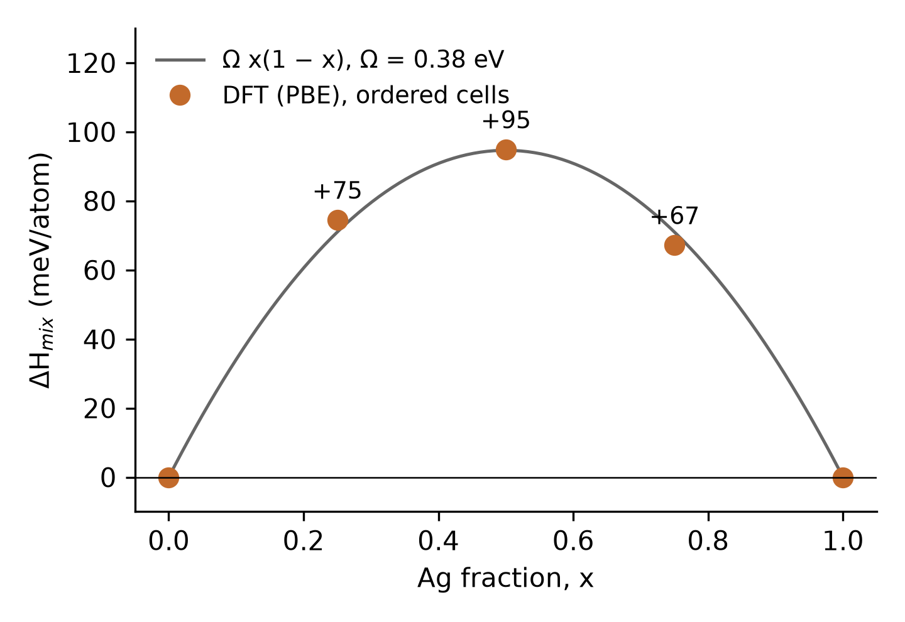

::: {.callout-note}
## Central question

The Monte Carlo swaps of L28 and the free-energy curves of the phase field need a single number for Cu–Ag: the mixing enthalpy, or the bond energy \(\epsilon\) behind it. Why is it positive for Cu and Ag, and how can we calculate it from the atoms alone?
:::

## Learning outcomes

By the end of this lecture, you should be able to:

1. **Describe** the valence orbitals of Cu and Ag, and why they overlap in a metal.
2. **Build** a tight-binding matrix for a periodic ring of atoms and find its energy levels as an eigenvalue problem.
3. **Calculate** a mixing enthalpy from filled energy levels, and explain how on-site energies and hopping decide whether two metals mix.
4. **Explain** how density functional theory replaces fitted tight-binding parameters by a calculation based on the electron density.
5. **Connect** a DFT mixing enthalpy to the bond energy \(\epsilon\) and the regular-solution parameter \(\Omega\) of L28.

## What do electrons do in a metal?

Every model so far took an energy as given. L27's MD used an EAM potential fitted to Cu–Ag data [@williams2006embedded]. L28's lattice used a bond energy \(\epsilon\), and its free-energy curve used \(\Omega=4\epsilon\). These numbers come from the electrons, and in a metal the outer electrons do not belong to one atom.

{#fig-orbitals width="100%" fig-alt="Two panels. For Cu, a tall narrow 3d peak near 0.3 angstrom and a broad 4s peak near 1.2 angstrom that reaches the dotted half-neighbour line. For Ag, a 4d peak near 0.55 angstrom and a broad 5s peak near 1.4 angstrom, again reaching the dotted line. Energies are listed in the legends."}

How to read @fig-orbitals:

- **d orbitals (solid):** compact, held close to the nucleus. In the metal, they overlap only weakly with the neighbours.
- **s orbitals (dashed):** spread out to the midpoint between neighbours and beyond. Neighbouring s orbitals overlap strongly, so the valence electron can move from atom to atom.
- **Cu and Ag differ:** Ag is larger, its 5s orbital reaches further, and its d level lies deeper. The Ag–Ag distance in the metal is about 13% larger than the Cu–Cu distance.

So an electron in the metal has two choices at each atom: stay, with the energy of its orbital, or hop to a neighbour. The balance of the two decides the energy of an arrangement, and with it the mixing enthalpy.

## Tight binding: the electron problem as a matrix

**Tight binding** writes each electron state as a combination of atomic orbitals, one per atom, and keeps only two kinds of numbers [@slater1954simplified]:

- **On-site energy** \(\varepsilon_i\): the energy of an electron sitting on atom \(i\). It depends on the element.
- **Hopping** \(t_{ij}\): how strongly an electron is passed between neighbouring atoms \(i\) and \(j\). It depends on the pair: Cu–Cu, Ag–Ag, or Cu–Ag.

For a ring of \(N\) atoms, each with one s orbital, these numbers fill an \(N\times N\) matrix. Atom \(i\) has neighbours \(i-1\) and \(i+1\), and the ring closes on itself, the periodic boundary of [L25](../../05/L25/index.qmd#periodic-boundary-conditions):

\[
\mathbf H=
\begin{pmatrix}
\varepsilon_1 & -t_{12} & 0 & \cdots & -t_{1N}\\
-t_{12} & \varepsilon_2 & -t_{23} & \cdots & 0\\
0 & -t_{23} & \varepsilon_3 & \cdots & 0\\
\vdots & & & \ddots & \vdots\\
-t_{1N} & 0 & 0 & \cdots & \varepsilon_N
\end{pmatrix}.
\]

The corner entries \(-t_{1N}\) are the periodic boundary. They are the only change needed to turn a chain into a ring, and they would be awkward to build into a wave equation on a grid. The allowed electron energies are the eigenvalues of \(\mathbf H\),

\[
\boxed{\mathbf H\,\mathbf c=E\,\mathbf c}
\]

the same eigenvalue problem as the Hessian of [L16](../../03/L16/index.qmd#the-eigenvalue-problem). Each eigenvector \(\mathbf c\) tells how much of the electron sits on each atom.

### From energy levels to a mixing enthalpy

With one valence electron per atom and two electrons per level, the lowest \(N/2\) levels are filled. The electronic energy of an arrangement is the sum over the filled levels:

\[
\begin{aligned}
E_{\text{band}}&=2\left(E_1+E_2+\cdots+E_{N/2}\right),\\
\Delta H_{\text{mix}}&=\frac{E_{\text{band}}(\text{alloy})}{N}-\left[\tfrac12\frac{E_{\text{band}}(\text{Cu})}{N}+\tfrac12\frac{E_{\text{band}}(\text{Ag})}{N}\right].
\end{aligned}
\]

The procedure in NumPy:

1. **Fill \(\mathbf H\)** with \(\varepsilon\) on the diagonal and \(-t\) for each neighbour pair, including the pair that closes the ring.
2. **Solve** with \(\texttt{np.linalg.eigvalsh(H)}\), which returns the eigenvalues of a symmetric matrix in ascending order.
3. **Fill** the lowest \(N/2\) levels and sum them twice.
4. **Repeat** for pure Cu, pure Ag, and an alloy arrangement, and subtract.

For a pure ring, the eigenvalues are known exactly, \(E_m=\varepsilon-2t\cos(2\pi m/N)\) for \(m=0,1,\ldots,N-1\), which is a useful check on the code.

::: {.quarto-wasm-local notebook="l29_tight_binding.edit.py" title="Tight binding on a periodic ring: energy levels and the mixing enthalpy" height="760" loading="lazy" fullscreen="true"}
**Static fallback.** For a 20-atom ring with \(t_{\mathrm{CuCu}}=1.2\) eV, \(t_{\mathrm{AgAg}}=0.9\) eV, \(t_{\mathrm{CuAg}}=0.8\) eV, and equal on-site energies, the alternating arrangement has \(\Delta H_{\text{mix}}\approx+316\) meV/atom and two separated blocks \(+24\) meV/atom. Raising \(\varepsilon_{\mathrm{Ag}}\) by 0.5 eV lowers both, to \(+261\) and \(+18\) meV/atom.
:::

How the two kinds of parameters act, which you can test with the sliders:

- **Weak unlike hopping** (\(t_{\mathrm{CuAg}}\) below the like hoppings): electrons gain less energy hopping across Cu–Ag bonds, so every unlike bond costs energy, \(\Delta H_{\text{mix}}>0\), and the metals separate. This is the Cu–Ag case.
- **Different on-site energies:** electrons can lower their energy by moving from the higher level to the lower one, which needs unlike neighbours, so the alloy is favoured and \(\Delta H_{\text{mix}}\) drops.
- **Two blocks:** small but positive, because the ring has two Cu–Ag interfaces. This is the interface cost of L28, coming from the electrons.

The bond energy \(\epsilon\) of L28 is exactly this kind of number: the extra energy per unlike bond. Tight binding gives it a mechanism.

## The catch: who supplies \(\varepsilon\) and \(t\)?

Tight binding is fast and transparent, but the on-site energies and hoppings are parameters. They are fitted, to experiments or to more complete calculations, in the same way that L26's potentials and Assignment 2's Lennard–Jones parameters were fitted. Modern tight-binding programs such as xtb carry carefully fitted parameters for most of the periodic table and solve the same kind of matrix problem, with more orbitals per atom and the electrons' repulsion included [@bannwarth2019gfn2]. For a new element pair, a new crystal structure, or an unusual environment, the fitted values may not transfer.

To calculate the mixing enthalpy of *any* pair without fitted parameters, we go one level lower, to quantum mechanics itself.

## Density functional theory: the electron density decides

The full quantum description of \(N_e\) electrons is a wavefunction of all \(3N_e\) electron coordinates at once. For the 152 electrons of a four-atom CuAg cell (two Cu with 29 each and two Ag with 47 each), a grid with only ten points per coordinate would need \(10^{456}\) values, the same explosion of dimension as the configuration integrals of L27.

Density functional theory avoids this by working with a quantity we have used throughout this unit: a **density**. In L28, we replaced atoms by a composition field. Here we replace the many-electron wavefunction by the **electron density** \(n(\mathbf r)\), the number of electrons per volume at position \(\mathbf r\), a function of only three coordinates:

- **The principle:** the ground-state electron density determines the energy of the system. Hohenberg and Kohn proved that, for given nuclear positions, the energy is a functional of \(n(\mathbf r)\), and the true density is the one that minimizes it [@hohenberg1964inhomogeneous].
- **The practical method:** Kohn and Sham rewrote the problem as electrons moving independently in an effective potential that depends on the density itself [@kohn1965selfconsistent]. In atomic units,

\[
\begin{aligned}
\left[-\tfrac12\nabla^2+v_{\text{eff}}[n](\mathbf r)\right]\psi_j(\mathbf r)&=\varepsilon_j\,\psi_j(\mathbf r),\\
n(\mathbf r)&=\sum_j f_j\,|\psi_j(\mathbf r)|^2.
\end{aligned}
\]

The first line is again an eigenvalue problem, the continuous version of \(\mathbf H\mathbf c=E\mathbf c\). The second line fills the levels, with occupations \(f_j\), as we did in the tight-binding ring. The difference is that nothing is fitted. The effective potential contains the attraction of the nuclei, the electrostatic repulsion of the density, and an **exchange–correlation** term for the remaining quantum effects, which must be approximated. A common choice for metals is the PBE approximation [@perdew1996generalized].

Because \(v_{\text{eff}}\) depends on \(n\), the equations are solved by iteration, like the fixed-point problems of [L06](../../02/L06/index.qmd):

1. **Guess** a density \(n(\mathbf r)\).
2. **Build** \(v_{\text{eff}}[n]\) and solve the eigenvalue problem.
3. **Fill** the lowest levels to get a new density.
4. **Mix** the new density with the old and repeat until it stops changing.

{#fig-density width="60%" fig-alt="A square map of electron density with bright rings around four Ag sites and dimmer rings around Cu sites, separated by a dark, nearly uniform background between the atoms."}

In a periodic crystal, the orbitals \(\psi_j\) repeat from cell to cell up to a phase, so the calculation needs only one cell, a set of sample points for that phase (the **k-points**), and a finite set of plane waves to represent the orbitals. The periodic boundary that was a matrix corner in the tight-binding ring becomes the natural setting of the calculation. Codes such as Quantum ESPRESSO [@giannozzi2009quantum], GPAW [@mortensen2024gpaw], and SPARC [@xu2021sparc] solve exactly this problem, with different ways of representing the orbitals.

## The Cu–Ag mixing enthalpy from DFT

We calculated the energy of pure Cu, pure Ag, and three ordered Cu–Ag cells with GPAW, using PBE, plane waves up to 450 eV, and a 10 × 10 × 10 k-point grid. For each cell, the volume was varied and the minimum energy taken. The mixing enthalpy is then the same subtraction as in the tight-binding ring:

\[
\Delta H_{\text{mix}}(x)=\frac{E(\text{cell})}{N}-\left[(1-x)\,E_{\mathrm{Cu}}+x\,E_{\mathrm{Ag}}\right].
\]

{#fig-mixing width="70%" fig-alt="A plot of mixing enthalpy against Ag fraction. Points at 0.25, 0.5 and 0.75 have values of plus 75, plus 95 and plus 67 meV per atom, all positive. A grey parabola peaking near 95 meV passes close to all three points."}

How to read the result:

- **All three values are positive**, so DFT predicts that Cu and Ag prefer to separate, from the electrons alone.
- **The shape is close to \(\Omega x(1-x)\)**, the regular-solution enthalpy of L28, with \(\Omega\approx0.38\) eV per atom, or about 37 kJ/mol.
- **Lattice constants:** 3.64 Å for Cu and 4.15 Å for Ag. The 14% size mismatch strains any mixed arrangement and adds to the positive \(\Delta H\).

These numbers are an upper estimate. The atoms were kept on ideal fcc sites, only the volume was relaxed, and the cells are ordered, while a quenched alloy is random. Relaxing the atoms and averaging over random arrangements would lower \(\Omega\). That calculation follows the same steps with larger cells.

### Back to the lattice of L28

On L28's square lattice, each atom has four neighbours, so \(\Omega=4\epsilon\) and \(\epsilon\approx\Omega/4\approx95\) meV. With the exact lattice result \(k_{\mathrm B}T_c\approx1.13\epsilon\), the model alloy would separate below about 1250 K. The real alloy melts at the eutectic, about 780 °C or 1050 K, before its solid miscibility gap can close, which is consistent with a large \(\Omega\). The chain is complete:

- **DFT** gives \(\Delta H_{\text{mix}}\), and with it \(\Omega\) and \(\epsilon\).
- **Lattice Monte Carlo** uses \(\epsilon\) in the Boltzmann factor of every swap.
- **The phase field** uses \(\Omega\) in \(g(c)\) and the measured diffusivity in the mobility.
- **MD** uses an EAM potential fitted to DFT energies and experimental data.

## What to keep

- In a metal, the outer s electrons spread to the neighbours, so their energy depends on which atoms surround them.
- Tight binding writes this as a matrix of on-site energies and hoppings. Its eigenvalues are the electron levels, and filling them gives the energy of an arrangement.
- A weak unlike hopping makes \(\Delta H_{\text{mix}}\) positive and drives separation. A difference in on-site energies favours mixing.
- DFT removes the fitted parameters by working with the electron density. The Kohn–Sham equations are an eigenvalue problem solved to self-consistency.
- PBE gives \(\Delta H_{\text{mix}}\approx+95\) meV/atom for CuAg, close to \(\Omega x(1-x)\) with \(\Omega\approx0.38\) eV, the number that L27 and L28 needed.

## Check your understanding

1. In the tight-binding matrix of a ring, which entries make the boundary periodic? What would change for an open chain?
2. A 4-atom ring has equal on-site energies and hopping \(t\). Use \(E_m=\varepsilon-2t\cos(2\pi m/4)\) to find its band energy with four electrons.
3. In the notebook, set all three hoppings equal and raise \(\varepsilon_{\mathrm{Ag}}\). What happens to \(\Delta H_{\text{mix}}\), and why?
4. Why does DFT need to iterate, while the tight-binding ring did not?
5. Using \(\Omega=0.38\) eV and \(\Omega=4\epsilon\), what is the acceptance probability at 800 K of a swap that creates two extra unlike bonds?

## Next

This completes Unit 6. A Cu–Ag alloy that separates on cooling needed three models: Monte Carlo swaps to reach the slow hops, a composition field to reach real lengths and times, and an electronic calculation to supply the energy that drives both.
